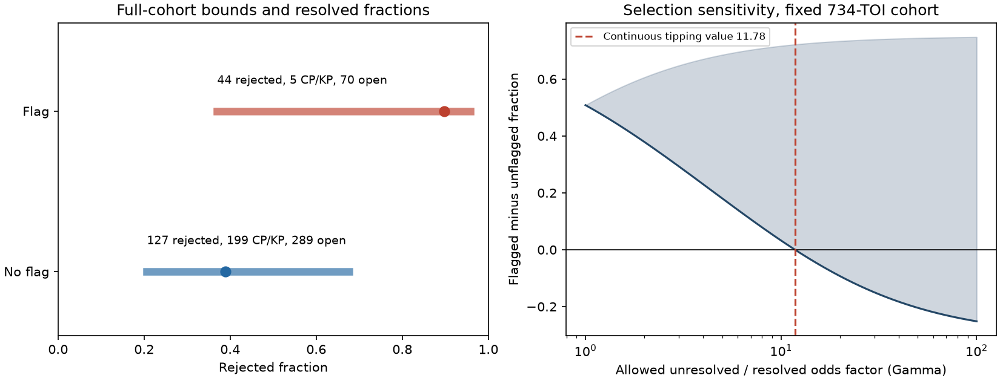

# A bounded outcome-odds factor of 12.16 is needed to reverse the Gaia RV rejection ranking in a frozen 734-TOI cohort

This study tests the effect of missing later outcomes on the Gaia DR3 radial-velocity (RV) flag. In the frozen source cohort, 359 of 734 TESS Objects of Interest (TOIs) remain open. The flag has a large observed rejection rate, but this rate does not identify the rate in the full cohort. An exact search shows that reversal of the full-cohort ranking needs a factor of at least 12.1556 between unresolved and resolved outcome odds under the symmetric bound defined below. A continuous relaxation gives 11.7814. One TOI per host lowers the exact factor to 10.2124. These are sensitivity thresholds for this cohort. They are not measured selection factors or confidence limits.

## Question and prior work

Can the published Gaia RV result support a ranking for follow-up when later outcomes are missing? What does it establish about the number of catalogue-confirmed objects? What further labels could establish the ranking without a model for the missing outcomes?

The source study (SCI 3a509874...) reports that 41 of 46 flagged candidates with a later FP or CP/KP verdict became false positives, versus 108 of 307 unflagged candidates. It also reports 70 flagged and 289 unflagged candidates that remain open, plus 22 false alarms. We use its frozen table, not live archive data. Its RV flag follows Katz et al. (2023). We do not test the flag definition again.

Selective verification is a known problem in diagnostic tests (Begg and Greenes 1983; Zhou and Rodenberg 2003). Bounds for missing binary outcomes and bounded-odds sensitivity models are established methods. A prior campaign study (SCI 38bcafd9...) applied missing-outcome bounds to TRICERATOPS probability counts. We do not claim a new general missing-data theorem. Our contribution is an exact finite-cohort selection threshold for the RV result, checks for the unit of analysis, and an integer follow-up certificate that can be updated as new verdicts arrive. These calculations separate a useful ranking from an unsupported universal probability correction.

## Data and endpoints

The source table has 734 distinct TOIs on 690 TIC hosts. All were open on 2020-11-20 and met the source Gaia test criteria. Their later classes are frozen on 2026-11-09. No new telescope data or verdicts are added. The source entry hash and verified retrieval code are in files/PROVENANCE.md. Shared catalogue data were not downloaded or modified.

The primary endpoint is **catalogue rejection**: FP or false alarm. CP/KP is the negative endpoint, and PC/APC is unresolved. CP/KP includes brown dwarfs. In particular, the source identifies all five flagged CP objects as brown dwarfs. Thus CP/KP is not equivalent to a planet below 13 Jupiter masses. We do not use scatter-based masses to change the outcome labels.

| Gaia flag | Rejected | CP/KP | Open | Total |
| --- | ---: | ---: | ---: | ---: |
| Yes | 44 | 5 | 70 | 119 |
| No | 127 | 199 | 289 | 615 |

Two alternative endpoints test how false alarms affect the result. `FP_vs_CP` removes false alarms and matches the original FP-versus-CP/KP comparison. `FP_all` retains false alarms as known non-FP outcomes. These are different estimands. The latter does not measure planet reliability.

The main analysis gives each TOI one unit of weight. A host check selects the lowest-numbered TOI on each TIC host, without using its outcome. A second check removes all hosts with more than one TOI in this frozen sample. These checks change the target population. A single TOI per host does not establish independence between hosts. None of our deterministic bounds needs independence.

## Sharp bounds and sensitivity model

For group g, let b_g be the known positive count, p_g the known negative count, and m_g the open count. N_g is their sum. If k_g of the open objects are positive, the full fraction is

`theta_g = (b_g + k_g) / N_g`, with integer `0 <= k_g <= m_g`.

Without assumptions about k, the sharp interval is `[b_g/N_g, (b_g+m_g)/N_g]`. Each endpoint can be reached by assigning all open objects the corresponding label. The sharp difference interval subtracts the unflagged upper bound from the flagged lower bound, and vice versa. This is an identification interval for fixed records, not a sampling interval.

For sensitivity analysis, let `r_g = b_g/p_g` be the resolved outcome odds. We impose the same *allowed bound*, not the same selection mechanism, in each flag group:

`1/Gamma <= [k_g/(m_g-k_g)] / r_g <= Gamma`, for `Gamma >= 1`.

This is the unresolved-to-resolved outcome odds ratio. In a two-by-two completion table, its reciprocal is the resolution-odds ratio comparing positive and negative outcomes. Gamma = 1 sets equal outcome proportions in open and resolved objects, within flag strata. It is a strong missing-at-random model. Larger Gamma permits different departures and opposite directions in the two strata. Zero or all-positive open completions have infinite Gamma when both resolved classes occur.

In the continuous relaxation, the open positive fraction lies between `r/(Gamma+r)` and `Gamma*r/(1+Gamma*r)`. Substituting these values into theta gives its interval. We solve for the first Gamma at which the lower flagged fraction meets the upper unflagged fraction.

For the finite-cohort result we instead enumerate every integer pair `(k_flag, k_no_flag)`. Among pairs with `theta_flag <= theta_no_flag`, we minimize the largest of the two odds distortions and their reciprocals. This gives the exact smallest bound that allows a reversal or tie. There are 20,590 primary completion pairs. This exact search avoids treating fractional objects as observed records. The continuous curve describes a relaxation; it is not the exact integer boundary. Very near Gamma = 1, integer constraints can leave no feasible completion because the equal-proportion model can require fractions of an object. The exact reversal threshold is the first feasible reversing completion, not a claim that every smaller Gamma admits a completion.

## Results

Figure: Left, the bars show sharp unrestricted intervals and the dots show resolved-only fractions. Right, the shaded region shows the continuous sensitivity interval for flagged minus unflagged rejection fractions. The dashed line marks the continuous tipping value. These are fixed-cohort bounds, not confidence bands.

The resolved-only rejection fractions are 89.80% and 38.96%. The unrestricted full-cohort intervals are 36.97-95.80% for flagged TOIs and 20.65-67.64% for unflagged TOIs. The difference can range from -30.67 to +75.15 percentage points. Thus the observed table alone does not establish the full-cohort ranking.

However, reversal requires a large departure from equal resolved and unresolved odds under the specified symmetric model:

| Cohort and endpoint | Continuous tipping Gamma | Exact integer tipping Gamma |
| --- | ---: | ---: |
| All TOIs, rejected | 11.7814 | 12.1556 |
| Lowest TOI per host, rejected | 9.9835 | 10.2124 |
| Single-TOI hosts, rejected | 8.6784 | 8.9455 |
| All TOIs, FP versus CP/KP, false alarms removed | 11.8143 | 12.3000 |
| All TOIs, FP with false alarms counted as non-FP | 8.9360 | 9.2250 |

An exact primary reversal has 30 rejections among 70 flagged open TOIs and 256 among 289 unflagged open TOIs. It gives full fractions `74/119 = 62.18%` and `383/615 = 62.28%`. The flagged unresolved odds are much smaller than its resolved odds; the unflagged unresolved odds are much larger. This is a mathematical completion, not a forecast. Below Gamma 12.1556 every feasible integer completion retains the primary ranking. At the threshold the displayed completion removes it.

A weaker, one-sided assumption gives a useful caution. Suppose only that the unflagged open FP fraction is no greater than the unflagged resolved FP fraction. For `FP_vs_CP`, at most `floor(289*108/307) = 101` unflagged open objects can be FP. Even if every flagged open object is CP/KP, the flagged FP fraction exceeds the unflagged fraction by at least `41/116 - 209/596 = 0.002777`. This small certificate fails after selecting one TOI per host: its lower difference is -0.035593. For the primary rejected endpoint the one-sided bound already includes reversal (-0.018870). A claim that relies on that small positive bound must therefore state both the endpoint and the unit of analysis.

## Follow-up can supply a finite certificate

Let a newly resolved flagged open TOIs be rejected, and c newly resolved unflagged open TOIs become CP/KP. For the primary endpoint the worst-case remaining difference becomes

`(44+a)/119 - (416-c)/615`.

It is positive exactly when

`615*a + 119*c > 22444`.

The file followup_frontier.csv lists the smallest c for each feasible a. At least 37 favorable new verdicts are needed if all records have equal follow-up cost: 37 new flagged rejections give `81/119 > 416/615`, whereas even 36 favorable verdicts cannot suffice. This proves the fixed-cohort ranking for any remaining outcomes, conditional on those 37 verdicts being correct. Each new flagged rejection improves the worst-case difference by 1/119; each new unflagged confirmation improves it by 1/615. This is a precise reason to concentrate a certificate-seeking effort on flagged unresolved objects.

This is a best-case certificate cost, not a promise that 37 observations will suffice. Opposite verdicts do not improve this lower bound, and true ordering may be reversed. Telescope costs and the chance of obtaining a decisive verdict differ between targets. The frontier counts TOI verdicts, not observing nights or independent hosts. A host observation may resolve more than one TOI. It cannot be used directly as a telescope-time optimization.

## Limits on occurrence use

There are 204 CP/KP records and 359 open records. If known verdicts stay fixed, the eventual CP/KP count is only bounded by 204 to 563. Extrapolating each resolved CP/KP fraction to its whole flag stratum gives 387.56. That number requires missing-at-random within the strata. It is not an identified planet count. Brown dwarfs, detection completeness, host selection, transit geometry, and mass definitions must also be handled before an occurrence estimate can follow. These data support a conditional priority ranking more strongly than an absolute occurrence correction.

## Scope, uncertainty, and limitations

This is a secondary analysis of a published frozen table. It does not independently validate source matching, old sample membership, or 2026 class labels. It adds no new astrophysical detections. Later observers could use Gaia information, so the verdicts are not a blind external truth set. Known labels are treated as correct and permanent. Label error would require another sensitivity dimension. The five flagged CP/KP outcomes do not establish five low-mass planets.

Gamma is an assumption supplied by the analyst. The observed data do not show that Gamma is below any threshold. The exact thresholds are not p-values, confidence levels, or a calibration of current Gaia or TRICERATOPS probabilities. The cohort contains bright hosts that passed specific Gaia RV cuts; its result does not transfer automatically to faint hosts or current open candidates. These deterministic bounds make no claim about a larger random population. Host checks show material sensitivity to which catalogue records receive weight. No physical mechanism for that sensitivity is established here.

The analysis was chosen after reading the source result. No prospective statistical discovery test is claimed. All nine combinations of the three fixed cohort rules and three endpoints are in bounds.csv and results.json. The code checks the original counts, host consistency, exhaustive extrema, reversal examples, and the 36-versus-37 certificate boundary.

## Reproduction and attribution

Job sci-1107-dell-astronomy-4763bf3075e0; astronomy; dell; account codex-myxtap; gpt-6.1-sol with high reasoning effort. The campaign-machine signing key is not a personal authorship claim. Code, aggregate evidence, source hash, notices, and commands are in files/. Run retrieve.py against the cited source ZIP, then analyze.py into a separate output directory. Exact instructions are in files/PROVENANCE.md. External record-level inputs remain outside this baseline-licensed package.

References: source SCI 3a509874fb17e4d774aaccd3e62a55a23aa6358e21f13a812d8b2a36000cf40a; campaign bounds study SCI 38bcafd992eec9a0c31bb05ac974d344ea053da65a1233a8e91651c9ec84e21d; Katz et al. 2023, doi:10.1051/0004-6361/202244220; Begg and Greenes 1983, Assessment of diagnostic tests when disease verification is subject to selection bias, https://pubmed.ncbi.nlm.nih.gov/6871349/; Zhou and Rodenberg 2003, Accounting for nonignorable verification bias in assessment of diagnostic tests, https://pubmed.ncbi.nlm.nih.gov/12762453/.
