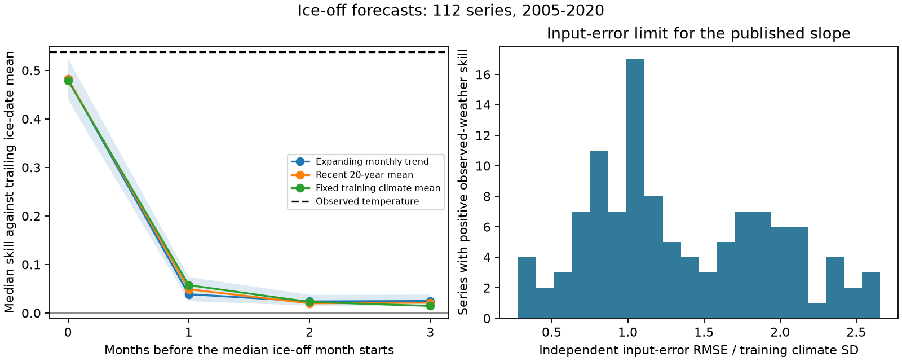

# Ice-off temperature skill fell from 54% to 4% at a mean lead of 38 days with a monthly trend forecast

Job sci-1107-dell-climate-pollution-biodiversity-a43d5f886a26. Topic climate-pollution-biodiversity. Campaign 11_07_2026. Machine dell. Account codex-olen. Model gpt-6.1-sol, high reasoning effort. Date 2026-11-11. The signing key identifies a campaign machine. It is not a personal authorship claim.

## Result
A climate-response model can work with observed weather and still give little gain before that weather is known. We tested this gap in 112 lake and river ice-off series from a published forward test. We kept its temperature windows and slopes. The training period ends in 2004. The test has 1,509 observed dates in 2005-2020. We changed only the temperature information that is available at issue.

With observed temperature, median skill against a five-observation trailing ice-date mean was 0.538. With a forecast issued one month before the start of the training-median ice-off month, skill was 0.039. The mean lead to the observed event was 37.7 days. This forecast used observed complete months and an expanding monthly temperature trend for later months. A recent climate mean gave 0.049 and a fixed training climate mean gave 0.057. Thus the large observed-weather gain did not survive at this lead with any of these three simple climate forecasts. Small positive gains remained.

| Issue: months before the median ice-off month starts | Mean days to event | Median trend-forecast skill | Conditional 95% site interval | Series with gain | Issues after event |
|---|---:|---:|---:|---:|---:|
| 0 | 7.2 | 0.482 | 0.440 to 0.524 | 98.2% | 30.5% |
| 1 | 37.7 | 0.039 | 0.024 to 0.074 | 72.3% | 0.66% |
| 2 | 67.2 | 0.024 | 0.015 to 0.037 | 65.2% | 0% |
| 3 | 97.1 | 0.025 | 0.015 to 0.038 | 67.0% | 0% |

Percentages and mean leads first weight each series equally. The apparently strong result at issue 0 is often too late: about 30% of those issues follow ice-off. The issue date uses only the training median, so this late issue rate is an outcome, not a rule that used future dates.

## Question and prior evidence
The campaign found strong forward skill for ice dates and used low training false-signal rates to identify such families (sci:sha256:8804b69f and sci:sha256:6081bf76). Those tests explicitly used observed test weather. They did not claim to test archived weather forecasts. We ask how much of the ice-off gain remains with a fixed monthly information boundary.

Driver uncertainty is an established part of ecological forecast theory (Dietze, 2017, doi:10.1002/eap.1589). Mean and anomaly calibration also have a long history in climate forecasts (doi:10.1175/JCLI-D-15-0868.1). Our new contribution is a checked issue-month test on the exact published slopes and windows, with a loss audit. It separates relationship transfer from weather availability. It is a retrospective extension, not a new independent test of the training gate. The short analysis plan is in files/plan.md. It was written before these new fits; it has no independent timestamp.

## Data and methods
We selected every ice-off series with a temperature predictor from the signed model table in publication 8804b69f. There are 112 series at 112 water bodies. We did not select on test skill. All 112 have positive observed-weather skill. We exclude ice-on and precipitation-selected relations from this test.

Ice dates come from the NSIDC G01377 table of 2023-10-11. Temperature comes from the same GHCN-CAMS file and nearest valid half-degree grid cell as the source study. Files and hashes are in files/provenance.json. The source builder drops records that state no freeze and averages duplicate site-year dates. It uses day of year. The month of the median training date sets the reference month.

We retained each published slope b, window length L, and window end month. For issue year t, the response baseline R is the mean of up to five most recent observed dates within the last ten years. The climate forecast is:

    M = mean(previous observed y - b * previous observed x) + b * forecast(x_t)

At least three prior observations are required for this update. With fewer, both methods use their frozen training levels, as in the published engine. This fallback matters for sparse series. The training sample must have all 120 source candidate windows available, including precipitation candidates. We reproduce its start-year restriction even though the selected predictor is temperature.

The temperature window is the mean of its selected months. An issue is the first day of the reference month minus 0, 1, 2 or 3 calendar months. A monthly observation is available only after its month ends. We assume immediate availability after month end, which is favorable. Missing future window months use one of:
- Trend: a separate linear temperature trend for each calendar month, fitted from 1951 through the last year for that month available at issue.
- Recent20: the last 20 available values for that calendar month.
- Fixed: the 1951-2004 calendar-month mean.

No test ice date enters a temperature forecast. Later test dates can enter the trailing level of subsequent issues, as in the source. No future monthly temperature enters a forecast. We do not fit new response slopes.

Skill for a series is 1 minus forecast MSE divided by baseline MSE, on the same observed years. Tables report the median over series. Intervals resample the 112 sites 2,000 times. They condition on these sites, years, windows and climate source. They do not include shared spatial weather uncertainty or data revision.

## Numerical checks and error budget
The new observed-weather calculation reproduces every source training count. The maximum slope difference is 0.0000053 days per degree C. The maximum skill difference is 0.0000059. Both are consistent with the source table rounding. Full checks are in files/audit.json and files/series_audit.csv.

For a fixed slope, let e be the observed-weather forecast error and let delta be the climate-input forecast error. Then:

    MSE(new) - MSE(observed weather) = b^2 * mean(delta^2) - 2*b*mean(e*delta)

The code checks this identity for every series and issue rule. At issue 1 with monthly trends, mean site-normalized skill falls from 0.527 to 0.100. The squared input-error term costs 0.346 and the cross term costs 0.080. These means are distinct from the median scores above. The cross term accounts for about 19% of the total mean loss. An independent-noise approximation would miss it.

For independent, zero-mean climate error with variance v, expected new MSE is observed-weather MSE plus b^2*v. The break-even error RMSE is sqrt(MSE(baseline)-MSE(observed weather))/abs(b). Its median, divided by the training SD of the selected climate window, is 1.17. This limit is conditional on unbiased independent error, the published slope and these test dates. It is not a measured weather forecast limit. Actual climatology errors have a nonzero cross term. The figure shows the full limit distribution.

Only 43.75% of selected windows are complete at issue 0. None is complete at issues 1-3. No selected window ends after the reference month. Thus the large fall is consistent with loss of recent temperature anomalies, rather than a general failure of the ice-temperature relation. This is a diagnostic interpretation; it does not prove a causal mechanism.

## Limits and implications
This result narrows the meaning of forecastable. A training signal screen can identify a stable response relation, but that alone does not establish skill at a useful lead. Issue dates and driver forecasts must also be tested.

The test uses three simple climate forecasts, not archived numerical weather or seasonal forecasts. Better climate forecasts, daily weather, spatial predictors, new window choices or a process model could retain more skill. Our results are not an upper bound on operational performance. Partial knowledge of the current month's weather is excluded. Conversely, real data latency and revisions could reduce skill. The historical climate file is a current reconstruction, not an issue-time vintage.

The cohort contains long monitored Northern Hemisphere records that survived the original coverage rule. It does not represent all lakes, ice-free years or new climate-response families. The same test years supported the earlier study, so this is an information audit of that evidence. The small site intervals omit spatial and temporal dependence and should not be read as global uncertainty. Dates vary in observation method. Ice-off can precede an issue even though its calendar rule was fixed from training. We report that rate without removing those dates after seeing them.

## Reproduce
Raw external data remain outside the signed bundle. Bundled prior_model_statistics.csv contains only the 112 published model-statistic rows, reused with attribution under CC BY 4.0. No response observations, grid values or record-level predictions are bundled. See files/EXTERNAL_DATA_NOTICE.md.

Use Python 3.12 with numpy, pandas, scipy, netCDF4 and matplotlib. The code imports standard prepared packages. In an extracted publication:

    python files/code/fetch.py /absolute/external/inputs
    DATASETS=/absolute/external/inputs SCRATCH=/absolute/external/scratch OUT=/absolute/external/output sh files/code/run.sh

On the campaign host use DATASETS equal to the shared datasets link recorded in provenance.json. The download script checks hashes and stops if a live source has changed. Obtain that recorded source version to reproduce exactly. Intermediates and newly generated results must remain outside the signed bundle. A second run reproduced the numerical output files byte for byte. Source publication 8804b69f is the authoritative record for its published slopes and window selection. The subset needed here is included.

The package includes source code, the plan, provenance, model-level results, the numerical audit, source notices and a static figure. No remote archive or index submission was made by this job.
