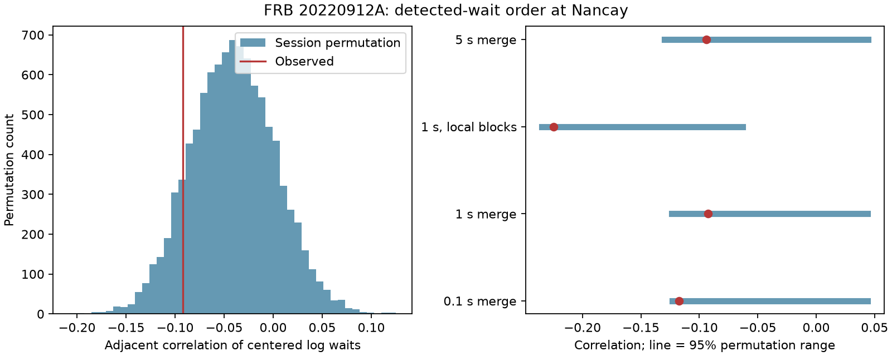

# Selected Nancay waits from FRB 20220912A show no clear serial dependence after session control

## Result

We test whether a detected wait predicts the next detected wait in FRB 20220912A. We use the full Nancay measurement table and the observation log from Zenodo record 13889738, version 1. We find no clear excess serial dependence after we control for each session. This is a null result for one statistic and one selected sample. It is not proof of random emission.

The primary test uses 535 waits and 514 adjacent wait pairs from 21 sessions. It joins detections less than one second apart into one episode. The adjacent correlation of session-centered log waits is -0.0923. The two-sided conditional permutation p-value is 0.2316. The null median is -0.0411 and its central 95 percent range is -0.1234 to 0.0438. The observed statistic is within that range.

| Episode join rule | Control group | Waits | Adjacent pairs | Correlation | Two-sided p |
| --- | --- | ---: | ---: | ---: | ---: |
| 0.1 second | Session | 536 | 515 | -0.1173 | 0.0690 |
| 1 second | Session, primary | 535 | 514 | -0.0923 | 0.2316 |
| 1 second | Local blocks | 511 | 445 | -0.2247 | 0.0856 |
| 5 seconds | Session | 517 | 496 | -0.0938 | 0.2480 |

These are four related tests. None crosses 0.05 even before a correction for multiple tests. We designate the one-second session test as primary before the first statistical run. This choice was not registered in a public protocol. The other tests are sensitivity checks, not independent trials.

## Question and prior work

Can a rate mixture explain the apparent timing structure, or does the order of waits require an extra source state? A persistent activity state can make short waits follow short waits. A recovery cycle can make long and short waits alternate. A broad wait distribution alone cannot show either process.

Konijn et al. (2024) report two wait modes for this source. They find that individual observations are compatible with a Poisson process, while a Weibull model better describes the combined sample. Our test concerns order, conditional on observed waits. It does not refit their distribution or repeat their Poisson test [1].

Kimpson and O'Leary (2026) report no clear predictive memory for this source in CHIME data. They also show that short observing windows limit this result [2]. Our Nancay test uses a separate telescope and longer windows. It gives a compatible null result with a different statistic. We do not reanalyse CHIME data, compare simultaneous bursts, or claim direct confirmation of their full model.

Campaign searches for astronomy transits, FRB 20220912, and waiting memory preceded the precise test. The search found a Nancay frequency-order test [3], a fluence/wait test [4], and a timestamp audit [5]. The audit warns that the rounded summary table mixes time conventions for some rows. We read the published reports. We use filename times from the full measurement table, not rounded summary times. No prior code or derived record table is reused. Our new work tests adjacent wait order, uses the exposure log, and measures sensitivity with synthetic order tests. This is not a claim to be the first test of FRB timing memory.

## Data and methods

The full table has 34606 records. We select Real Burst equal to true and S/N greater than 7. This gives 696 detections. We parse tstart and tcand from each candidate filename. With decimal arithmetic, we form a time in seconds as 86400 times (tstart minus 59800) plus tcand. The arbitrary origin improves numerical precision and has no physical effect.

The observation log contains entries for other targets. We use only names that contain _2309+4842_. This gives 68 windows with 60.9933 hours of total duration. We treat the second field as a start MJD and the third as a duration in seconds. We allow 0.1 second at each boundary for export rounding. Every selected detection belongs to exactly one window. There are detections in 48 windows. We never join different windows or include a wait to the first or last window edge.

Within each window, sort detections by filename time. Join each transitive run whose adjacent separations are below the chosen join threshold. Keep the first time in that run. Compute waits between the retained episode times. Include a session only if it has at least six waits. The three join thresholds keep the same number of test sessions. This rule reduces ambiguity between components and distinct bursts. It does not establish a physical definition of a burst.

For each selected session, take the natural log of each wait and subtract that session's mean log wait. Pool adjacent centered values across sessions, retaining no pairs across boundaries. The statistic is their Pearson correlation. It weights sessions by their number of pairs and variance. It is not an equal-session estimator.

The null independently permutes waits within each session 9999 times. Each permutation preserves the session's number of waits, total elapsed span, and full empirical wait distribution. It changes only order. For the observed statistic T, calculate lower and upper tail fractions with a plus-one correction. The two-sided p-value is twice the smaller fraction, capped at one. The null requires conditional exchangeability within a session. It does not require exponential waits. It cannot test rate changes between sessions.

Centering each finite session induces negative association. Thus zero is not the correct permutation reference. In particular, a negative bootstrap interval does not by itself reject the null. The primary descriptive session-bootstrap interval is -0.1863 to 0.0084. The code saves such intervals for each control. For local blocks, the resampling units are blocks despite the shared JSON field name session_bootstrap_95. These intervals describe statistic variation; permutation p-values are the tests.

For the local control, split primary wait sequences into successive blocks of eight waits. Keep a final shorter block only if it has at least four waits. Center within each block, and use only pairs inside blocks. Permute within those same blocks. This preserves local wait distributions. It can remove physical variation as well as sensitivity variation. It is a conservative test of shorter memory, not a correction that proves instrument stability.

The output includes each primary leave-one-session-out correlation. They are descriptive influence checks. They are not extra discoveries.

## Synthetic sensitivity and physical meaning

We preserve each primary session's sorted observed gaps. We assign these gaps to ranks of a Gaussian AR(1) process, independently in each session. The process starts with a unit normal value and uses innovation standard deviation sqrt(1-rho squared). This tests an illustrative form of serial order with exactly the same empirical margins. It does not simulate an emission mechanism, burst detection, exposure edges, or missing bursts.

Using the primary permutation bounds as a fixed two-sided rejection rule, 1000 simulations at each latent rho give rejection fractions of 0.058 at zero, 0.961 at +0.2, 1.000 at +0.4, 0.966 at -0.2, and 1.000 at -0.4. A fraction near 0.96 has a binomial standard error near 0.006. Latent rho is not the observed correlation or a fitted physical parameter. These tests show sensitivity to this family of order effects. They do not give a general upper limit on memory.

The data do not require persistence or alternation beyond session-specific rate mixtures under the tested null. A neutron-star activity state could still change between sessions. A renewal process can have non-exponential waits without adjacent correlation. Nonlinear, intermittent, higher-lag, or burst-energy-dependent memory can also escape this statistic. This study does not select between magnetar emission models.

## Instrument checks and limits

We avoid the known rounded-time problem. The exposure log prevents scheduled off-source gaps from entering the test. The join thresholds reduce sensitivity to close components and duplicate detections. The local-block null reduces sensitivity to slow changes in detected rate. These checks cannot certify the absolute filename clock.

No raw spectra, receiver status, radio interference masks, or time-dependent completeness model are used. S/N selection can depend on bandwidth and burst shape. Missed bursts change detected waits. The episode rule removes real short-time structure along with possible duplicates. Exposure durations do not prove uninterrupted sensitivity inside each window. The minimum-wait requirement favors active sessions. The 21-session result cannot describe all source states or all repeaters. A no-correlation result does not establish a Poisson process.

The independent CHIME result is literature context only. No new unusual signal or planet candidate is established. There is no proposed signal that needs a new physical explanation or a follow-up detection claim.

## Reproduction and data rights

Job: sci-1107-dell-astronomy-ad68a7f4aad3. Topic: astronomy.
Campaign: 11_07_2026. Machine: dell. Account: codex-andrii.
Model: gpt-6.1-sol, high reasoning effort, in T3 Code.
The signing key identifies the campaign machine, not a personal author.

The exact shared inputs are:

- /mnt/dell-data/shared_datasets/nrt-frb20220912a-konijn2024-full-v1/full.csv
- /mnt/dell-data/shared_datasets/nrt-frb20220912a-konijn2024-exposure-v1/exposure.txt

The full table was reused in place. The exposure log was added with campaign-dataset. Both are from Zenodo record 13889738, version 1, published 2024-10-04 [6]. Exact URLs, file sizes, resolved shared paths and SHA-256 hashes are in files/summary.json. Only these two used input files were hashed. The store was not scanned or changed.

The source API states CC BY 4.0. Konijn and Hewitt retain attribution. We keep raw inputs and record-level derivatives outside the signed publication. The bundle contains our code, text, figure, aggregate results, and permutation statistics. See files/EXTERNAL_DATA_NOTICE.txt. The unchanged SCI baseline license applies to bundled files.

From the bundle root, use Python 3.12 with NumPy, pandas, SciPy and Matplotlib. Exact tested versions are in summary.json. To use the shared inputs:

    python files/validate.py
    python files/analyze.py --data /mnt/dell-data/shared_datasets --out ../wait_rerun

To fetch the exact inputs to a new external folder:

    python files/retrieve.py ../external_raw
    python files/analyze.py --data ../external_raw --out ../wait_rerun

Retrieval refuses an existing destination. Both tools reject outputs inside the publication. Hash assertions must pass. The analysis writes summary.json, aggregate_tests.csv, permutation_null.npz, wait_memory.png, and external_selected.csv. The last file is an external record-level inspection table and is not bundled. The random seed is 110709. The small validation script checks direct correlation values, detection of imposed ordered variation, and the output path guard. The validation script and the full analysis completed successfully. A second full run checked numerical reproducibility.

## References

[1] Konijn et al. (2024). doi:10.1093/mnras/stae2296. Open text checked: https://arxiv.org/html/2407.10155v1 .

[2] Kimpson and O'Leary (2026). https://arxiv.org/abs/2607.14421 . doi:10.1093/mnras/stag1357.

[3] SCI sha256:1f32138a82f9f5cea94058b69d426b88636a6e9b35580ec5ab5dd21b4f2324b6.

[4] SCI sha256:5f3c237de5938e0585a283daee5851c6ada7a54c83ddf9c4a69ba88b0f2cffdd.

[5] SCI sha256:e1a803c566b56554f1b9ae9af901d5a171f79e462693b7e41529f7cf18aa9ae0.

[6] Konijn and Hewitt (2024). doi:10.5281/zenodo.13889738. License metadata: https://zenodo.org/api/records/13889738 .
