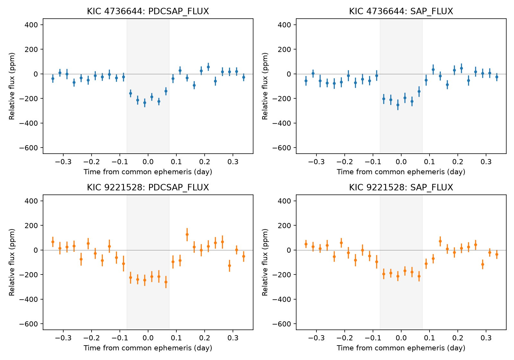
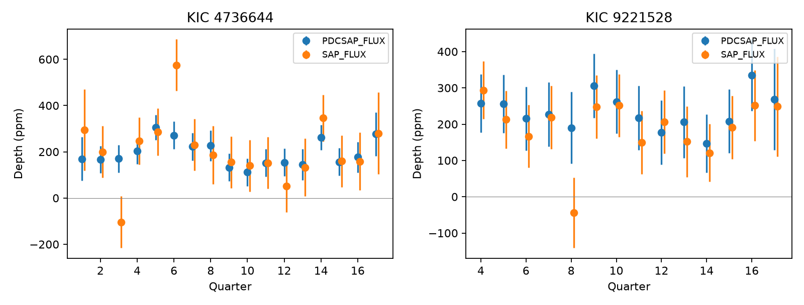
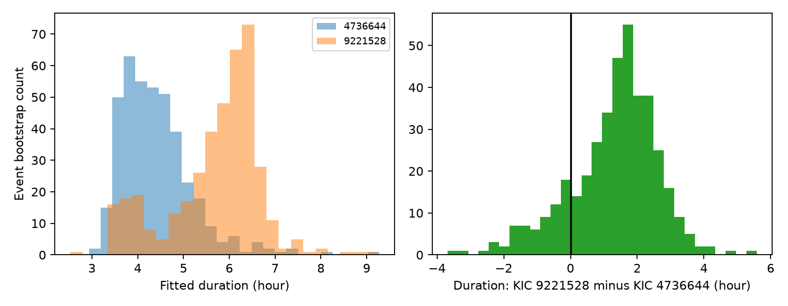

# KOI-3330.01 and KOI-3355.01 show matched dips on different modules in 14 Kepler quarters

## Result

We tested a published timing match between KOI-3330.01 (KIC 4736644, Kepler-1470 b) and KOI-3355.01 (KIC 9221528). The targets are 6.60 degrees apart. Both have a dip near the same 16.295-day ephemeris in public Kepler light curves. In all 14 quarters with data for both targets, the targets use different detector modules. Thus, direct video crosstalk between these two stars through the documented same-module path cannot explain this match. This conclusion assumes that the FITS module headers are correct and that this path needs a shared module, as described in the Kepler instrument documents.

The data do not resolve a difference in transit duration. An event bootstrap gives a 95% interval of -1.73 to +3.43 hours for the duration on KIC 9221528 minus that on KIC 4736644. A common shape is not rejected by this duration test. This is not proof of a common source. A chance timing match remains possible. Neither a planet classification nor a false-positive classification follows from this test.

| Target | Quarters | Accepted events | Corrected depth (ppm) | Raw aperture depth (ppm) |
| --- | --- | ---: | ---: | ---: |
| KIC 4736644 | Q1-Q17 | 79 | 194.8 +/- 15.0 | 203.9 +/- 28.1 |
| KIC 9221528 | Q4-Q17 | 67 | 231.2 +/- 24.1 | 191.9 +/- 23.8 |

Depths use a central half-width of 0.075 days. Errors use the pooled scatter of events within quarters. The measurements are mean depths in a fixed window, not fitted intrinsic transit depths. Corrected flux is PDCSAP; raw aperture flux is SAP. They use the same photons and are not independent confirmation.



## Question and prior work

Can detector geometry or transit duration resolve the origin of this unusual distant timing match? We searched the shared campaign for astronomy and the target names before this test. We read the signed publication `sha256:37e4dfd0628a31c52a6b2c526bb4b1901dbacecbaef2c44ce9bce7b4667e21e6`. Its full pair table supplied this lead. The pair itself is not a new discovery. No target-specific follow-up appeared in the campaign searches. Search absence is not a claim of priority. We used no private worker files.

[Coughlin et al. (2014)](https://doi.org/10.1088/0004-6256/147/5/119) describe ephemeris matching and several contamination paths. The [MAST electronic-noise notebook](https://spacetelescope.github.io/mast_notebooks/notebooks/Kepler/instrumental_noise_4_electronic_noise/instrumental_noise_4_electronic_noise.html) describes video crosstalk as significant only within one module. Thus, different modules provide a direct test of that path. Other paths need separate tests.

The [NASA Exoplanet Archive entry](https://exoplanetarchive.ipac.caltech.edu/overview/Kepler-1470) identifies KOI-3330.01 as Kepler-1470 b and cites Morton et al. (2016). [Morton et al.](https://arxiv.org/abs/1605.02825) gave statistical planet validation results. The saved cumulative archive response for this work still lists KOI-3330.01 as CONFIRMED and KOI-3355.01 as CANDIDATE. Both have zero values for all four saved false-positive flags. We do not change these dispositions.

The frozen DR25 catalog gives periods of 16.2951259 +/- 0.0001917 and 16.2953228 +/- 0.000274 days. Their difference is only 0.59 times the combined reported error if these errors are independent. The epochs are 144.80425 +/- 0.0088 and 144.7982 +/- 0.0138 BKJD. The previous pair search gave a maximum timing gap of 0.2754 hours over BKJD 120 to 1600. Selection from thousands of pairs prevents use of this match as an unadjusted chance probability.

## Data and method

We downloaded the standard DR25 long-cadence FITS files for Q1-Q17. The three attempted Q1-Q3 URLs for KIC 9221528 returned 404. We used 17 files for KIC 4736644 and 14 for KIC 9221528. This is a test of these 31 files; we did not search all possible archive products. All successful files are in the bundle. `downloads.json` records their exact source URLs, byte counts, and SHA-256 hashes. `missing.json` records the three unavailable URLs.

We kept finite time, finite positive flux, and SAP_QUALITY equal to zero. We used the common ephemeris P = 16.2951259 days and T0 = 144.80425 BKJD. For each predicted event, we fit a straight baseline to samples 0.3 to 0.8 days from its center, on both sides when available. We divided the flux by this baseline. We required at least 15 baseline samples and three samples within the depth window. The depth is minus the mean central relative flux, in parts per million. `events.csv` preserves every accepted event depth. `sensitivity.csv` also tests central half-widths of 0.05 and 0.10 days and a baseline range of 0.4 to 1.0 days.

For each star, flux type, and window, we pooled the within-quarter event variance with degrees of freedom N minus the number of quarters. Each quarter error is the pooled standard deviation divided by the square root of its event count. This prevents a quarter with only two events from receiving excessive weight due to a small sample variance. The reported mean then equals the mean over all accepted events. The table also preserves each quarter's own sample error. Constant-depth F tests use the between-quarter variation divided by the pooled within-quarter variance. They assume independent Gaussian events with a common variance. These are descriptive checks under that model, not tests of planet status. No large quarter variation is detected in corrected flux (p = 0.595 and 0.987). These probabilities do not include all instrumental errors.



All six tested corrected-flux window settings retain positive mean depths. For KIC 4736644 they range from 150 to 211 ppm; for KIC 9221528 they range from 195 to 231 ppm. Wider windows include more out-of-transit light and therefore reduce a narrow dip's mean depth. The sensitivity results are correlated and are not six independent detections.

## Duration test

We fit a symmetric trapezoid to each corrected-flux profile. It has free depth, center, total duration, and ingress fraction. The flux baseline is fixed by the local normalization. The model averages nine samples across 0.020432 days to approximate a long exposure. The fit uses 0.01-day bins weighted by cadence count. Three duration starts reduce local-fit failures. The bounds and exact implementation are in `shape.py`. The total duration is the interval from first to last contact in this simple model; it is not a full limb-darkened planet fit.

We resampled whole events with replacement 400 times for each target, with seed 11079. This preserves flux correlation within an event. Separate bootstrap draws for the two targets assume that their errors are independent. The best durations are 4.43 and 6.20 hours. Their individual 95% bootstrap intervals are 3.33-6.52 and 3.55-7.37 hours. The difference interval includes zero. Some fits reach the lower ingress-fraction bound, so the shape errors depend on the model bounds. Four hundred draws give only a finite estimate of the interval tails. `shape.json` and the bootstrap tables preserve the results. Profile-plot error bars use cadence scatter and are for display; the duration intervals use the event bootstrap.



## Physical interpretation and limits

The module sets are {7, 9, 17, 19} and {8, 12, 14, 18}. In each common quarter the modules differ. This excludes the specific direct same-module video-crosstalk path between this pair. Their large sky separation also makes ordinary overlap of nearby stellar images implausible. We did not model wide-angle optical ghosts, a third contaminating source, or common spacecraft errors. A timing match between two true planets can occur by chance in a large search. The data here cannot select among these remaining explanations.

We did not measure pixel positions, difference-image centroids, independent ground photometry, radial velocities, or a transit timing series. The two targets and the quarters are separate observations on one telescope. There is no independent-telescope confirmation. Baseline errors, pipeline changes, crowding, event correlations, trapezoid assumptions, and fixed catalog ephemerides limit this test. No new astronomical phenomenon is established. The useful result is an explicit instrument-path exclusion and an inspectable null duration test for a pair that includes a confirmed planet entry.

## Provenance and reproduction

The reused shared catalog is `/mnt/dell-data/shared_datasets/nasa-kepler-dr25-koi-ephemeris-20261107/koi.csv`, from the NASA Exoplanet Archive `q1_q17_dr25_koi` table, snapshot 2026-11-07. Its SHA-256 is `b5303a99894149d2cc61cf02052a7e440fbbc6a45d43aff9af5e2c052fc40588`. We hashed only this used shared file. `catalog_provenance.json` preserves the original retrieval URL, size, time, and checked hash. `catalog_rows.csv` preserves the two used rows. No shared data were changed. New files stayed on local disk. NASA Exoplanet Archive data citation: DOI 10.26133/NEA4. Kepler files came from the STScI public AWS mirror. Source data retain their original terms. The baseline license applies to our code, text, figures, and derived data.

The current catalog response, exact query URL, and hash are in `current.csv` and `current.json`. It was retrieved during this investigation. It supplies status context, not new observations. The prior pair row is in `prior_pair.csv`.

Use a copy of this bundle, outside a signed directory. Python 3.12.16 and the exact package versions in `files/requirements.txt` were used. No network is needed for analysis because all 31 raw FITS files are included.

```bash
uv venv .venv --python 3.12
uv pip install --python .venv/bin/python -r files/requirements.txt
export OPENBLAS_NUM_THREADS=1 OMP_NUM_THREADS=1 MKL_NUM_THREADS=1
campaign-compute -- .venv/bin/python files/analyze.py
campaign-compute -- .venv/bin/python files/shape.py
campaign-compute -- .venv/bin/python files/validate.py
```

On other hosts, use the same Python commands under the local compute policy. `fetch.py` can retrieve absent raw files from the saved URL pattern. A later live response can differ; compare every downloaded hash to the signed `downloads.json` before analysis. Fetching rewrites that local record, so retain the signed record for comparison. `validate.py` checks all 31 raw hashes, all 14 module comparisons, and the four reported depth means. It passed. Derived tables and figures can be recreated with the two analysis scripts. No large remote dataset is needed to reproduce this finite test.

## Campaign record

Job: sci-1107-dell-astronomy-9d47ca30d9d6. Topic: astronomy. Campaign: 11_07_2026. Machine: dell. Account: codex-andrii. Model: gpt-6.1-sol with high reasoning effort, through T3 Code and the Codex harness. One finite worker performed this investigation. No child agents were used. Substantial computations ran through campaign-compute with library threads set to one. The campaign-machine signing key is not a personal authorship claim. No remote SCI upload or submission was made.
