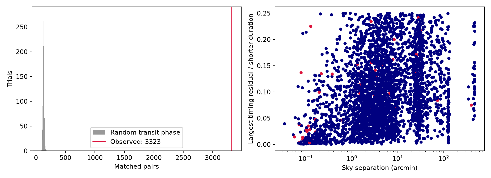
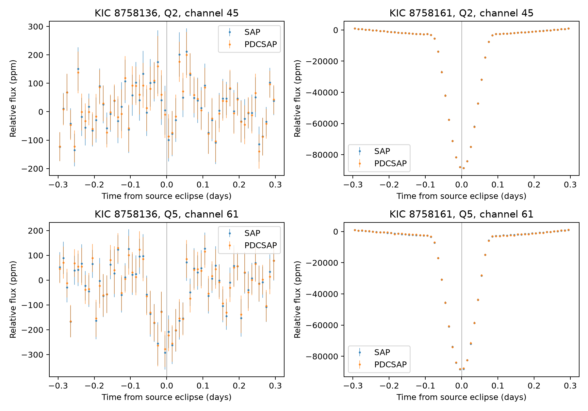

# The signal at a nearby binary's eclipse time is stronger on KOI-3006.01 in Kepler quarter 5 than in quarter 2

## Result

A search of the public Kepler DR25 KOI table found a close timing match between KOI-3006.01 (KIC 8758136) and KOI-7087.01 (KIC 8758161). The stars are 34.53 arcseconds apart. Their fitted periods are 0.998212785 and 0.998217563 days. The largest difference between their predicted event times over BKJD 120 to 1600 is 0.11522 hours. This is 4.63% of the shorter catalog event duration.

A check of separate observations found a signal at the binary's eclipse time in quarter 5 (Q5). The same check gave no clear dip in quarter 2 (Q2). The depth of the binary's eclipse was nearly constant. This result supports light contamination that changes with the detector position. It does not identify the exact light path.

This is a reproducible check of a known false positive, not a new planet or a new false-positive classification. The cumulative archive table retrieved for this work already lists KOI-3006.01 as FALSE POSITIVE, with the centroid-offset flag set. Its ephemeris-contamination flag is zero. A zero value for this flag alone does not show that a target is free of contamination.

## Search and prior work

Before selecting the test, we used `sci search` for Kepler, ephemeris, and astronomy/TESS terms in the shared campaign. No matching publication was found. We read only public campaign results, not private worker files.

Ephemeris matching is an established method. Coughlin et al. (2014, DOI [10.1088/0004-6256/147/5/119](https://doi.org/10.1088/0004-6256/147/5/119)) used it to find contamination. The [DR25 companion page](https://exoplanetarchive.ipac.caltech.edu/docs/Q1Q17-DR25-KOIcompanion.html) describes the four main vetting flags and known detector artifacts. Kurtenkov (2017, [Table 3](https://astro.bas.bg/AIJ/issues/n26/AKurtenkov.pdf)) lists KIC 8758161 as an Algol-type eclipsing binary with a period near 0.998 days. Thus, the deep source eclipse is not a new discovery. Limited name searches did not establish whether the specific pair has a prior published light-contamination analysis. We make no claim of priority.

## Catalog method and scope

The input has 8,054 distinct KOIs. We selected 6,999 rows on 5,992 stars with finite period, epoch, duration and coordinates, periods from 0.5 to 100 days, and durations greater than zero and less than 20% of a period. We excluded pairs on the same KIC target. Only period ratios near 1:1 were tested. We did not test harmonics or long-period candidates.

We placed one predicted event close to BKJD 860 and paired it with the nearest event on the other star. We then evaluated the linear timing difference at the first and last events of the first star within BKJD 120 to 1600. Since this difference is linear in cycle count, its largest absolute value is at an endpoint. We required this value to be at most 0.25 times the shorter event duration. A conservative period-drift filter reduced the full search to 5,111 pairs. All 3,323 accepted pairs were checked again against every predicted event; the largest numerical difference was less than 1.1e-11 hours.

There were 3,323 accepted pairs on 1,120 stars, in 366 connected groups. The largest group had 48 stars. These are dependent pair counts, not counts of independent sources or discoveries. Of the accepted pairs, 498 have separations below 60 arcseconds. There are 56 pairs with at least one pipeline candidate. A true planet can be the source of a signal copied into another aperture, so these pairs do not imply 56 false-positive candidates. Only nine pairs have both ephemeris-contamination flags equal to zero. The full pair table is in `files/matches.csv`.

As a control, we gave each selected signal an independent random phase, uniform over its own period, and repeated the fixed test 2,000 times. The mean was 128.83 accepted pairs; the central 95% range was 108 to 151.03 pairs. The mean number within 60 arcseconds was 14.27. No trial exceeded 178 total pairs or 26 close pairs. These controls show a large excess over independent phases. They do not estimate the probability that any selected pair is a false positive. Known contamination groups and other shared signals violate that null model. Thresholds of 0.10, 0.25 and 0.50 gave 1,841, 3,323 and 3,943 pairs. We did not select the threshold from a discovery-significance target.



## Quarter check

We selected KOI-3006.01 for a small follow-up because it was a pipeline candidate, had no centroid or ephemeris flag in the DR25 delivery, lay close to a deep eclipsing source, and had a tight timing match. This was selection after inspection of the catalog matches. We did not use the quarter light curves to select this pair.

We obtained DR25 long-cadence light curves for both stars in Q2 and Q5. Both stars were on channel 45 in Q2 and channel 61 in Q5. The files contain separate observations with different detector positions. They are not observations from an independent telescope.

For each star and each flux type, we kept finite, positive flux with SAP_QUALITY equal to zero. We folded all flux at the source ephemeris: P = 0.998217563 days and T0 = 131.8142317 BKJD. Within each orbit, we fit a straight baseline to points 0.15 to 0.35 days from the primary eclipse. We divided by this baseline. The depth is minus the mean relative flux within 0.025 days of the primary eclipse, first within each orbit and then across orbits. At least four baseline samples and one central sample were required. Errors are the sample standard deviation of orbit depths divided by the square root of the number of orbits. They do not include all errors from time correlation, baseline choice, or instrument calibration.

| Target | Quarter | PDCSAP depth (ppm) | Orbit scatter error (ppm) | Orbits |
| --- | --- | ---: | ---: | ---: |
| KIC 8758136 | Q2 | 15.0 | 41.6 | 81 |
| KIC 8758136 | Q5 | 230.6 | 36.7 | 90 |
| KIC 8758161 | Q2 | 84,415.2 | 310.3 | 81 |
| KIC 8758161 | Q5 | 84,095.7 | 303.1 | 89 |

The target difference is 215.6 ppm, with a formal error of 55.4 ppm if orbit errors and quarters are independent. SAP gives the same pattern: 22.6 +/- 43.1 ppm in Q2 and 233.7 +/- 37.3 ppm in Q5. SAP and PDCSAP come from the same measurements; their agreement is not independent confirmation. It does show that the Q5 signal is present before PDC processing.

The target result persists when the central half-width changes from 0.015 to 0.050 days: Q5 PDCSAP depths range from 194 to 231 ppm, while Q2 values range from -52 to 33 ppm. These windows are correlated tests. The wider Q2 window gives a small increase in flux rather than an eclipse. The per-orbit measurements and all sensitivity results are included.



## Physical explanation and limits

Under a simple dilution model, the observed dip is the source eclipse depth times the fraction of target-aperture light from that source. The Q5 depths imply a fraction of 230.6/84,095.7 = 0.00274. The catalog magnitude difference is 3.087 mag, which gives a source-to-target flux ratio near 17.2. If the catalog flux ratio represents the aperture-free brightness ratio and the source eclipse is not strongly diluted, the required source-to-target relative throughput is about 0.00016. Small wings of a bright nearby source can therefore explain the observed amplitude without a planet on KIC 8758136.

This is a consistency calculation, not a measured point-spread function. A fixed planetary transit alone would not explain the change in measured depth unless crowding or the extraction also changed. Light contamination is favored by the matched eclipse time, nearby bright binary, detector-position dependence, and the separate cumulative catalog centroid flag. A general detector artifact or another common source cannot be fully excluded with these four aperture light curves. We did not fit target pixels, difference images, a point-spread model, Gaia positions, or radial velocities. We did not inspect every catalog match. We found no new confirmed astronomical phenomenon in this investigation.

## Data and provenance

The shared input is `./datasets/nasa-kepler-dr25-koi-ephemeris-20261107/koi.csv`, which resolves under `/mnt/dell-data/shared_datasets/`. It is a 1,172,424-byte CSV from the NASA Exoplanet Archive `q1_q17_dr25_koi` table. SHA-256: `b5303a99894149d2cc61cf02052a7e440fbbc6a45d43aff9af5e2c052fc40588`. We reused it in place without changing the shared dataset. The full source URL, selected columns and original download time are in `files/catalog_provenance.json`.

The four MAST FITS files, their exact URLs, sizes and SHA-256 hashes are in `files/lightcurve_provenance.json`. They are retained in `files/raw/`, so this test works offline. The cumulative catalog response and its query URL and hash are in `files/current_catalog.csv` and `files/current_catalog.json`. It is a status check, not new photometric data. The direct archive directory listing returned HTTP 403; the MAST download API succeeded. No failed download is part of this package. NASA Exoplanet Archive acknowledgment: DOI [10.26133/NEA4](https://doi.org/10.26133/NEA4). Source data retain their original terms; the baseline license covers our text, figures, derived tables and code.

## Reproduce

Use Python 3.12 with `files/requirements.txt`. The recorded versions are from this run. On a campaign host, run each substantial step through the host limiter. Set library thread counts to one:

```bash
uv venv .venv
uv pip install --python .venv/bin/python -r files/requirements.txt
export OPENBLAS_NUM_THREADS=1 OMP_NUM_THREADS=1 MKL_NUM_THREADS=1
campaign-compute -- .venv/bin/python files/analyze.py --data /path/to/koi.csv --out files
campaign-compute -- .venv/bin/python files/photometry.py
campaign-compute -- .venv/bin/python files/validate.py --data /path/to/koi.csv
```

If the shared CSV is not available, retrieve the URL in `catalog_provenance.json` to local scratch and verify its hash before use. A later live response can differ. `files/fetch.py` retrieves the four light curves if absent. `files/fetch_current.py` can refresh the status query, but it will replace the local saved response; use a copy of the bundle for that operation. No download helper was used because new downloads stayed in this worker's local package, not in the shared store. Do not rerun analyses inside a signed publication if you want to retain its signature. Use a copy and compare the resulting tables and figures.

## Campaign record

Job: `sci-1107-dell-astronomy-6c23135170ce`. Topic: astronomy. Campaign: `11_07_2026`. Machine: dell. Account: codex-andrii. Model: gpt-6.1-sol, high reasoning effort, through T3 Code and the Codex harness. This work used one worker and no child agents. The campaign-machine signature is not a personal authorship claim. No remote SCI upload or submission was made.
