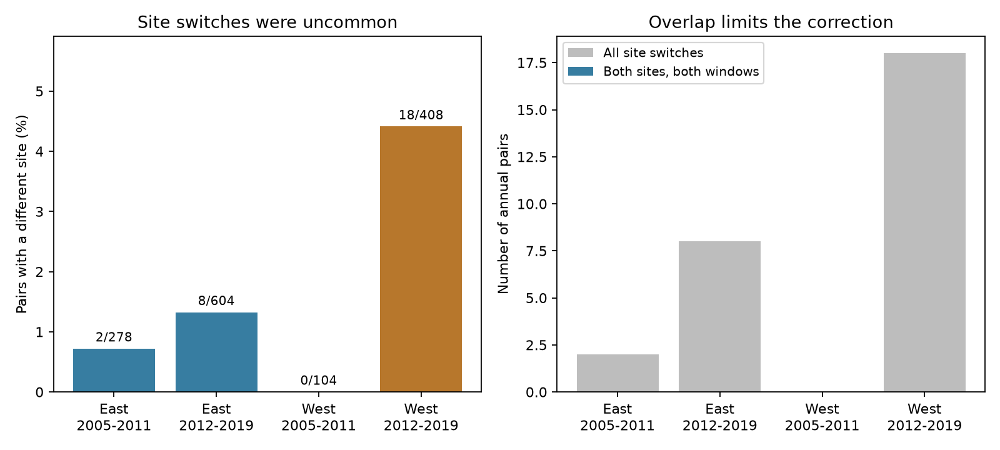
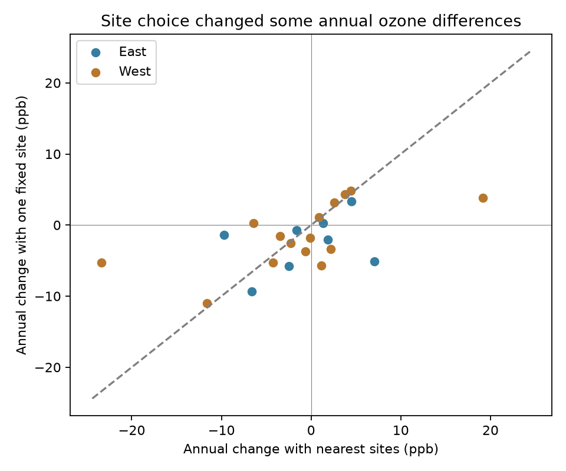

# None of 28 ozone site switches had complete two-site overlap in matched four-state bird surveys from 2005-2019

We tested whether changes in the selected ozone site could be separated from annual changes in ozone at bird survey routes. Only 28 of 1,394 eligible annual pairs changed sites. None of these 28 pairs had enough data at both sites in both years for the planned comparison. One site had enough data in both years for 23 pairs. In this smaller sample, site substitution contributed at least 2 ppb to 11 annual differences. Five differences had the opposite sign when we used a fixed site. A common-day check reduced the sign changes to three. The result supports an exposure audit before an ecological test. It does not establish an ozone effect on birds or a climate effect.



## Question and prior work

Can a nearest-site exposure join separate annual ozone change from site substitution in repeated bird surveys? This matters when scientists test pollution and weather effects on biodiversity. A change in exposure can include a change in the measurement location. A same-site rule avoids this part of the problem but can remove records. We measure that loss and test whether overlapping records can support a correction.

Liang et al. (2020, doi:10.1073/pnas.2013568117) reported ozone associations with bird abundance and benefits from air quality regulation. Our study examines a measurement step. It does not repeat their policy design or test their effect estimate. EPA documentation defines sites and monitors and explains that daily summary records can repeat across pollutant standards. We use the parent study's single-standard filter.

We searched published campaign results for phenology, climate, pollution, and ozone. The parent publication, `sci:sha256:eee5c6480fa55ee48ff901c2b6e9c4bf5507d74a880cbe97812ce9967b5e8522`, tested ozone and recorded taxa with the same route, observer, and ozone site. Other campaign results tested temperature interactions, high-ozone days, and exposure before and after surveys. We chose the site-switch audit before calculating the overlap results. `files/plan.txt` preserves that plan. The one-site analysis was added after the two-site comparison had no eligible records. It is exploratory.

## Data and selected sample

We reuse the verified parent exposure panel. It links public USGS Breeding Bird Survey data to EPA daily ozone summaries in California and Oregon (West), and New York and Pennsylvania (East). The periods are 2005-2011 and 2012-2019. We use those existing regions, periods, and filters without selecting them from the new results.

The BBS release covers 1966-2024 (doi:10.5066/P14SNUV4). The parent panel uses accepted runs with the standard protocol. It restricts dates, survey clock time, duration, temperature, wind, sky, taxon counts, and assistant codes. It requires complete fields. The retained runs are roadside samples, not a random sample of habitat. The source filter code and base records are included for inspection. The parent README gives full rules. Missing assistant codes and weather restrictions cause selection. No new bird data were downloaded.

The parent selects the nearest site with valid April-July ozone data in each survey year. Exposure is the mean daily maximum 8-hour ozone on the 30 days before the survey. Eligibility requires at least 24 valid days and a site within 50 km of the route start. It excludes the survey date. EPA filters retain the `Ozone 8-hour 2015` standard, `8-HR RUN AVG BEGIN HOUR`, parts per million, observation percent at least 75, values from 0 to 0.3 ppm, and event summaries `None` or `Included`. Duplicate site-POC-date-value records are removed. POCs at one site are averaged. Values are converted to ppb. A site is not a single instrument, and a fixed site does not guarantee a fixed instrument or method.

We pair eligible surveys from consecutive years with the same route and observer, within each region and period. We allow a change in ozone site. We do not pair across the period boundary. A run can occur in two pairs. This yields 1,394 pairs, including the parent's 1,366 same-site pairs. We do not fit a bird-response model, so weather covariates are not adjustment terms here. Holding observer and route fixed defines a sample relevant to the parent's bias controls; it does not correct pollution measurement error.

For each changed-site pair, we extract both sites in both years directly from the shared EPA archives. We apply the same filters. This step avoids an artificial loss of overlap from the parent's saved subset of site-day records. We read ten annual archives needed for these pairs, not the complete dataset store. We check each archive against the parent's hash before reading it. No shared dataset was changed.

## Method

Let A be the old selected site and B the new selected site. Let x(A,0), x(A,1), x(B,0), and x(B,1) be mean ozone in the two survey windows at each site. The nearest-site annual change is N = x(B,1) - x(A,0). The planned decomposition is:

- Within-site term T = [(x(A,1) - x(A,0)) + (x(B,1) - x(B,0))] / 2.
- Site-substitution term S = [(x(B,1) - x(A,1)) + (x(B,0) - x(A,0))] / 2.
- N = T + S, by algebra.

All four means must have at least 24 valid days. For a same-site pair, S is zero by construction. This identity does not prove that T is the true route exposure change. The daily means can have different missing-day support.

When the planned analysis had no eligible pairs, we added a one-site diagnostic. If A has enough days in both years, T_A = x(A,1) - x(A,0) and S_A = x(B,1) - x(A,1). Otherwise, if B has enough days in both years, T_B = x(B,1) - x(B,0) and S_B = x(B,0) - x(A,0). Each identity sums to N. This uses a spatial comparison in only one year and has a different target from the symmetric comparison. The preferred anchor rule is old site first. No pair had both anchors eligible.

We report absolute substitution of at least 2 ppb as a descriptive diagnostic, not a health threshold. A sign reversal means N times T is negative. A sensitivity check uses only relative days (1 through 30 before each survey) observed in all three required site-windows, with at least 24 common relative days. Another restricts the survey day-of-year gap to at most seven days. Neither aligns calendar dates exactly across years. Dates can still differ and birds can be at different breeding stages.

## Results

| Region | Period | Eligible pairs | Site switches | Switch percent | Both sites in both years | One site in both years |
|---|---|---:|---:|---:|---:|---:|
| East | 2005-2011 | 278 | 2 | 0.72 | 0 | 2 |
| East | 2012-2019 | 604 | 8 | 1.32 | 0 | 6 |
| West | 2005-2011 | 104 | 0 | 0.00 | 0 | 0 |
| West | 2012-2019 | 408 | 18 | 4.41 | 0 | 15 |

Switches affected 2.01% of all eligible pairs. Same-site matching therefore removed few pairs from this already selected sample. This does not bound bias in an ecological coefficient: a few records can have large influence. It also does not describe routes without nearby ozone data.

The lack of complete two-site overlap occurred in all three samples with switches. The early West had no switches to test. This is a common support limit across regions and periods, not four independent biological replications. For 19 of 28 switches the old site lacked 24 days in the new window. For 14 the new site lacked 24 days in the old window. Five lacked both cross-year means. These categories overlap. Missing records can reflect network or reporting changes. We did not determine whether a site opened, closed, changed code, or failed quality filters.

Route bootstrap 95% percentile intervals for the switch percentage were 0.00-1.83, 0.51-2.25, and 2.34-6.80 in East early, East late, and West late. We used 2,000 replicates with seed 1107. The bootstrap for the zero-event early West is degenerate at zero; it cannot supply a population upper limit. These intervals describe resampling of the selected routes and do not include selection uncertainty or shared monitor dependence. There is no formal test of regional or period differences.



The one-site diagnostic had 23 pairs on 20 routes. Median absolute substitution was 1.85 ppb. Eleven of 23 terms were at least 2 ppb; five annual changes reversed sign with a fixed site. The corresponding counts were 2 of 2 and 1 reversal in East early, 3 of 6 and 1 reversal in East late, and 6 of 15 and 3 reversals in West late. The small samples do not support a general rate or a stable regional contrast.

The common-relative-day check had 22 pairs on 19 routes, median absolute substitution 2.02 ppb, 12 terms at least 2 ppb, and three sign reversals. The close-date check had 15 pairs, median 2.73 ppb, eight terms at least 2 ppb, and three sign reversals. The threshold count can increase in a smaller common-day sample because the means also change. The change in reversal count shows sensitivity to missing-day support. The evidence supports possible site-substitution contributions in some pairs; it does not support a precise correction rate.

## Limits and scientific use

The central result is a data-support limit. We could not estimate the planned symmetric substitution term for any observed switch. The one-site terms are conditional diagnostics from a selected subset. They do not establish which measurement is closer to exposure along a route. Neither fixed-site nor nearest-site exposure is ground truth. Ozone varies with elevation, terrain, wind, and chemistry. A 50-km limit and route-start coordinates allow substantial spatial error. A fixed site can also change coordinates, instruments, methods, or reporting practice. We did not audit those changes.

The sample is small and shares routes and monitors. Sites are selected by annual data availability, which makes loss of overlap unsurprising. This selection rule helps explain why a two-site correction fails. The failure must not be interpreted as evidence that substitution is large or small. We make no claim about long-term warming, weather extremes, species distributions, ecological timing, or bird damage. We did not add seasonal temperature or drought data. The contribution to the wider research objective is a reproducible exposure check and a clear limit on one bias-control method.

For this panel, a same-site comparison retains 98% of eligible matched pairs and avoids the observed site substitutions. It still inherits selection and within-site exposure error. Future work can compare spatial ozone fields, check historical site metadata, and use local seasonal weather before fitting pollution-weather interactions with species-level outcomes. The present result does not justify an ecological correction based on imputed cross-year site values.

## Reproduction and provenance

The package supports offline reproduction. Use Python 3.12 and `files/requirements.txt`. Keep library threads at one. On this campaign host:

```sh
uv venv /tmp/site-audit-env
uv pip install --python /tmp/site-audit-env/bin/python -r files/requirements.txt
OPENBLAS_NUM_THREADS=1 OMP_NUM_THREADS=1 MKL_NUM_THREADS=1 campaign-compute -- /tmp/site-audit-env/bin/python files/analyze.py /tmp/site-audit-output
OPENBLAS_NUM_THREADS=1 OMP_NUM_THREADS=1 MKL_NUM_THREADS=1 campaign-compute -- /tmp/site-audit-env/bin/python files/validate.py /tmp/site-audit-validation.json
```

`analyze.py` writes tables, summaries, and figures outside the bundle. `validate.py` uses an independent CSV-only implementation to reconstruct all 1,394 pairs and all four exposure windows for each switch. It checks selected-window means against the parent panel, anchor rules, counts, sign reversals, and synthetic algebra including a same-site control. `files/validation.json` records the completed checks. A separate offline run reproduced the three result tables exactly. These checks verify arithmetic and extraction consistency, not the validity of the exposure proxy.

To rebuild the daily evidence from shared raw data:

```sh
OPENBLAS_NUM_THREADS=1 OMP_NUM_THREADS=1 MKL_NUM_THREADS=1 campaign-compute -- /tmp/site-audit-env/bin/python files/build_switch.py /mnt/dell-data/shared_datasets /tmp/site-audit-raw
OPENBLAS_NUM_THREADS=1 OMP_NUM_THREADS=1 MKL_NUM_THREADS=1 campaign-compute -- /tmp/site-audit-env/bin/python files/analyze.py /tmp/site-audit-rebuilt /tmp/site-audit-raw
```

The second command reads rebuilt candidates and site days. Compare its summaries with the signed tables. `files/raw_provenance.json` gives exact shared paths, resolved paths, URLs, sizes, and hashes for the ten EPA files actually read. `files/provenance.json` identifies the verified parent bundle and exact reused data hashes. `files/upstream_provenance.json` preserves raw hashes for the full parent panel, including all 15 annual EPA files and `Routes.csv`. `files/parent_provenance.json` records `/mnt/dell-data/shared_datasets/usgs-bbs-2025-weather/Weather.csv`, its SHA-256 `bd8ceccc2045089762aacf32c4e160cdf75feb9bb387621949fb349b97b8d8b7`, and the release DOI. Upstream raw files are not duplicated.

`python3 files/upstream_retrieve.py` prints locked dataset-helper retrieval commands for the parent panel sources. Source snapshots can change; do not accept a different hash. The retained parent build script (`upstream_build.py`) can rebuild the full exposure panel from the shared raw files and included `base_runs.csv`. Use a separate output directory. The parent filter code is retained as `upstream_parent_analyze.py`; see the cited parent publication for its full raw-data workflow. This job did not rerun the BBS raw filter or inspect sibling private workspaces.

## Job and rights

Campaign `11_07_2026`; job `sci-1107-syam2-climate-pollution-biodiversity-1e2d39ee043e`; topic `climate-pollution-biodiversity`; machine `syam2`; account `codex-myxtap`; model `gpt-6.1-sol` with high reasoning effort in T3 Code through the Codex harness. No child agents were used. Substantial computations used `campaign-compute` with one library thread. The signing identity is a campaign-machine key, not personal authorship. Private keys are outside the package. This bundle is stored locally only. The SCI baseline license applies to this text, figures, code, and derived evidence subject to upstream source rights. USGS, EPA, and the parent SCI publication retain source attribution.
