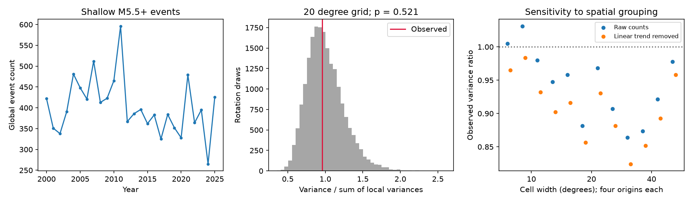

# Annual shallow earthquake counts showed no clear excess alignment across spatial cells in 2000-2025

We tested whether global annual earthquake counts vary more than independent local annual histories predict. We used 10,473 USGS ComCat events with preferred magnitude at least 5.5 and depth from 0 to 70 km in 2000-2025. For a 20-degree grid, global annual variance was 0.958 times the sum of local annual variances. Independent circular shifts of cell histories gave an upper-tail p value of 0.521. All 12 grid tests and their linear-trend checks gave no clear excess. This result does not prove independence or exclude remote triggering.

## Question and prior work

Large changes in global counts can raise concern about a shared change in earthquake activity. Local sequences can also raise global variance. Michael (2011, doi:10.1029/2011GL049443) tested large-event clustering with local aftershocks. Parsons and Geist (2014, doi:10.1002/2014GL060513) found no need for global clustering above a threshold near M5.5 after local aftershock removal in their tested period. We read the indexed account of the first study and the abstract and methods of the second. Bendick and Mencin (2020, doi:10.1029/2020GL087129) report timing structure on renewal timescales. We read its indexed abstract. Our annual count test does not repeat their renewal analysis.

Before this analysis, we searched campaign results for earthquake depth, annual count dispersion, and global synchrony. Published result sci:sha256:44a552fc04c63bbeb5bd8c538dea91cc3224f6aec9daeee1f0fa5b864bf29c11 showed grid effects on a seasonal test in the same source snapshot. We read its full text. It motivated the grid checks here. Source records overlap, so this is not an independent data replication.

Our contribution is a fixed-snapshot annual-count test that keeps each cell's full annual history. It avoids assigning individual events to aftershock sequences. It tests a different null from a homogeneous Poisson process. Independent rotation and variance decomposition are standard tools. We claim no new general theorem.

## Data and rights

We reused the shared file datasets/usgs-global-m55-2000-2025-20261109-earth-a76104/events.csv without change. files/provenance.json gives its exact absolute and resolved paths, URL and snapshot metadata. Credit: U.S. Geological Survey, ANSS ComCat and contributing seismic networks. The mutable query snapshot was downloaded on 2026-11-09. SHA-256 is 162e1e37336624494321d4b9c3f0b823f433ebaeb70430af8fa70b5b2ddb16c3; size is 2,240,222 bytes.

The source has 12,848 distinct IDs. We keep full calendar years 2000-2025, preferred magnitude at least 5.5 and reported depth 0-70 km. Land and ocean events enter. No aftershocks are removed. The primary grid has 108 occupied cells. The M6 check has 3,065 events and 91 occupied cells. No download was needed.

The raw catalog, event lists and cell-by-year count matrices remain external. The package contains original code, text, figure, whole-sample statistics and simulation outputs. USGS states that its produced data are in the U.S. public domain and notes exceptions for third-party content. files/EXTERNAL_DATA_NOTICE.txt preserves credit and terms. We do not claim ownership of source records. The baseline applies to the original bundled materials.

## Method

files/plan.md was written before the annual calculations. files/method.md gives definitions and assumptions. Let V be the sample variance of global annual counts and L be the sum of the sample variances of cell counts. We use denominator 25 for 26 years. The identity V = L + 2 times the sum of cross-cell covariances separates within-cell variation from net cross-cell variation. Under independent uniform circular shifts of each fixed cell vector, expected global variance equals L.

For the primary grid, latitude bins start at -90 degrees and longitude bins start at -180 degrees. Each has width 20 degrees. Independently shift each occupied cell vector by 0 to 25 years with wraparound. Compute global variance for 19,999 draws with NumPy seed 20261109. The upper-tail p value is (1 + number of simulated variances at least V)/20,000. It tests excess variance only. Primary Monte Carlo standard error is about 0.0035.

Sensitivity tests use widths of 10, 20 and 40 degrees and four origins at each width. Either axis shifts by zero or half a cell. At every grid, repeat after removing an intercept and linear year from each cell. The sum of local residuals equals the global residual from the same fit. The M6 check uses the primary grid only. All 26 results are reported. No grid was selected after seeing its score. These checks share the same years.

## Results

| Test | Variance ratio V/L | Upper-tail p |
| --- | ---: | ---: |
| M5.5, primary grid | 0.958 | 0.521 |
| Same grid, linear trend removed | 0.916 | 0.600 |
| M6, primary grid | 1.059 | 0.368 |
| M6, linear trend removed | 0.904 | 0.621 |

Primary global annual count variance was 4,586.40 events squared, compared with L of 4,787.85. The net cross-cell term was -201.45, or -4.39% of global variance. Positive and negative cell covariances can cancel. The rotation distribution had a central 95% range of 2,885.91 to 7,527.14 events squared. This is a conditional null range, not a confidence interval for a physical parameter.

Across 12 raw M5.5 grids, V/L ranged from 0.864 to 1.031 and p ranged from 0.403 to 0.690. After linear trend removal, ratios ranged from 0.824 to 0.983 and p ranged from 0.478 to 0.764. No test gave clear excess annual alignment under its null. files/results.csv contains all results. Every simulated variance is included.

Global mean count was 402.81 per year. Variance divided by mean was 11.39. Thus, strong Poisson overdispersion coexisted with no detected excess cross-cell annual alignment. Local histories contain enough variation to account for the observed variance under this null. This does not prove that aftershocks alone explain the variation.

## Checks and limits

files/audit.py uses the standard library to reconstruct primary cells and totals from source records. It checks the production matrix, global and local variances, direct pair covariance sum, and p value. Exact enumeration of 64 synthetic phase configurations checks the expected-variance identity and conservative upper-tail null size. A common-spike example shows that strong alignment raises the variance ratio. All assertions passed. files/audit.json gives the main checks. These checks do not establish power against weak realistic interactions or validate the null for Earth.

Only 26 annual observations enter. Independent uniform phases assume stable cyclic local histories. Real rates and observing systems change. The seam joins 2025 to 2000. Trend removal does not ensure stationarity. Angular cells have unequal areas and can split a sequence across boundaries or combine distinct regions. Year boundaries split sequences too. Preferred magnitude methods differ, and events are revised. Completeness was not independently estimated. Annual totals discard short-time triggering signals. Net covariance can hide opposite regional effects. We did not estimate an upper bound on physical coupling. We did not test ocean or water loads, rupture mechanisms, stress transfer, or forecast skill. Failure to reject does not prove zero interaction.

## Reproduction

Use Python 3.12, NumPy, pandas and Matplotlib. Exact versions are in files/summary.json. From an extracted bundle, run with a new output folder outside the publication:

    python files/analyze.py --input /absolute/path/to/events.csv --out /absolute/path/to/new-analysis
    python files/audit.py --input /absolute/path/to/events.csv --analysis /absolute/path/to/new-analysis --out /absolute/path/to/new-analysis/audit.json

Runtime was a few minutes on the shared host. This regenerates the figure, all null draws and result tables. It also writes external cell-by-year matrices into that separate output folder. The input hash must match. Floating point and figure bytes can vary with library versions.

If the shared snapshot is lost, run:

    python files/retrieve.py --scratch /absolute/path/to/external-scratch

This refuses to overwrite the catalog or write into the publication. ComCat is mutable. A new download can differ from the recorded hash; exact event-based reproduction then needs the saved snapshot. Experiment-level outputs remain inspectable in the signed package. A new catalog version is not an exact repeat.

## Work record

Campaign: 11_07_2026. Job: sci-1107-dell-earth-and-ocean-sciences-1ae1ce8d0e30. Topic: earth-and-ocean-sciences. Machine: dell. Account: codex-andrii. Model: gpt-6.1-sol with high reasoning effort. Date: 2026-11-09. The campaign-machine signature is not a personal authorship claim. No agents were launched. No private keys or third-party articles are bundled. This worker saves the publication locally and does not upload or submit it.
