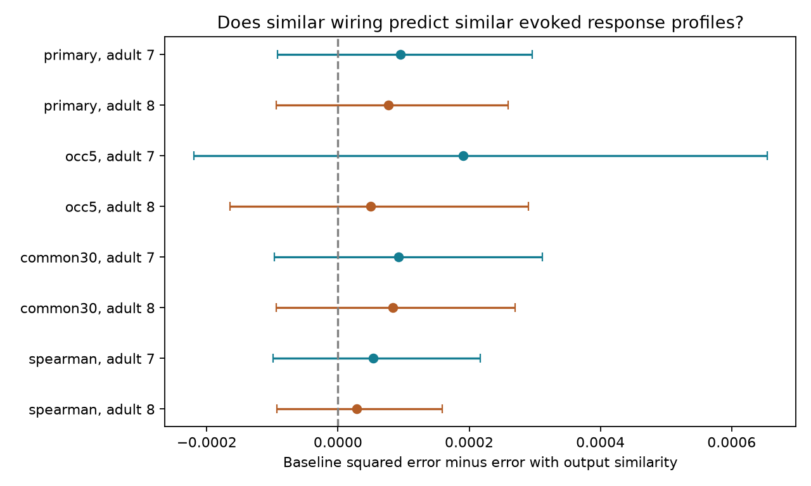

# Output wiring similarity gave no clear response-profile prediction gain in 6248 selected worm cell pairs

## Result

We tested whether cells with similar chemical output patterns cause similar responses across downstream cells. The primary sample had 6,248 source-cell pairs from 115 cells in the wild-type C. elegans signal propagation atlas. Adding output similarity reduced held-out squared error by 0.272 percent with adult map 7 and 0.219 percent with adult map 8. Both conditional resampling intervals included zero. These data leave the added prediction value uncertain.

This is a conditional test of response-pattern similarity. It uses response scale and sampling controls from measured profiles. It does not predict an unmeasured response profile from anatomy alone. It does not show that output wiring has no useful function.

## Question and prior work

Shared output targets could make two source cells cause similar downstream activity. This is different from common input, which can make two cells active together. Randi et al. measured effective signal propagation by optical stimulation and calcium imaging [doi:10.1038/s41586-023-06683-4]. Witvliet et al. supplied the adult wiring maps used here [doi:10.1038/s41586-021-03778-8]. A later analysis compared signaling and anatomical network communities [https://pmc.ncbi.nlm.nih.gov/articles/PMC11702810/]. These studies motivate a direct comparison of the output patterns of individual source cells.

Before we selected this test, we searched the local campaign for connectome, signal propagation and response profiles. We read the shared-input study [SCI e7136a698c0d7207f7693b92401c0b648b10f1d18a71be55b1c9a9f05c7df814]. It compared several wiring measures, including shared output, with spontaneous functional coupling across three species. We also read the mirror-response study [SCI 809f8313ac633c42aedeae74c4aa57e73ef6a32c821c03a716f83f02a8ea30e0]. It tested one mirrored response as a predictor of another response's detection. Our outcome is similarity across downstream evoked-response profiles, after target centering. Our validation holds out source-cell families. We did not reuse prior code or numerical tables. This search is not proof of complete novelty. Cosine similarity, ridge regression and grouped validation are standard methods. We claim a focused benchmark and its result, not a new statistical method.

## Data

We reused three completed datasets. No raw data were downloaded or changed:

- /mnt/dell-data/shared_datasets/worm-randi-funatlas-b2e13d88/funatlas.h5
- /mnt/dell-data/shared_datasets/worm-witvliet7-b2e13d88/adult7.csv
- /mnt/dell-data/shared_datasets/worm-witvliet8-b2e13d88/adult8.csv

All sources are pinned to WormNeuroAtlas commit b2e13d88b670efcb3438aeacba2ad4bd6c383933. The functional export gives compilation time 2023-06-28_19-52-14. files/provenance.json records the exact shared resolved paths, source URLs, byte counts and SHA-256 hashes. All three hashes matched the dataset helper records. The shared compatibility paths point to the current dataset store. We did not read the failed HDD.

Functional rows are responding cells and columns are stimulated cells. We use signed WT mean dFF and occ1. The latter is an occurrence count, not an independent animal count. We do not use the trial lists, fitted kernels, q or q_eq. No detection threshold selects responses. The pinned upstream loader documents these fields [see its cited source URL]. We retain the exported mean, including weak, zero and negative values, when it is finite and has sufficient occurrences.

Both endpoints must occur in each adult anatomy export. This gives 178 matched cells. Endpoint presence is a coverage proxy, not evidence that all possible edges were assessed. AWCOF is changed to AWCOFF. We do not assign anatomical AWC left/right labels to functional ON/OFF labels. Repeated chemical rows are summed in the indicated source-to-target direction. For electrical links, the larger directional total fills both directions. An absent row gives count zero under this export convention.

## Methods

files/PLAN.md records the selections and model choices made before fitting. A later note clarifies fold-specific centering before the result was reported. The primary selection requires at least 20 common responding targets with finite means and at least three occurrences for both sources. The source cells themselves are excluded as targets of their pair. Each unordered source pair has equal weight. Sources with no qualifying pair do not enter the score.

For each target, we subtract its mean response across observed sources outside the held-out source families. This removes the target's broad response tendency. We compute Pearson correlation between the two centered response vectors on their common observed targets. The vectors can have different target sets in different source pairs. This outcome describes profile shape, not total response magnitude. Spearman correlation of these same centered vectors is a planned sensitivity test.

For each source pair, output wiring similarity is the cosine between its two rows of log(1 + chemical count). It uses all 178 covered anatomical target cells, except the two sources. A zero row gives similarity zero. We compute this measure separately for each adult. The anatomical target set is fixed; it need not equal the common observed functional target set.

The baseline has eight predictors: log common target count; log minimum and maximum mean occurrence counts on these targets; log(1 + minimum and maximum RMS centered response); a same-family indicator; log(1 + chemical count summed over the two direct directions); and log(1 + electrical count). Counts come from the relevant adult. The added model has one more predictor, output cosine. Both are ridge regressions with an intercept, standardized predictors and alpha 10. We do not tune parameters. Numeric standardization is learned on training pairs only.

A family is an exact cell-name stem after removal of a final L or R; other names remain distinct. It is a name-based bilateral grouping, not a molecular class. We shuffle all covered families with seed 1107 and assign them cyclically to five folds. For a held-out fold, training pairs have neither endpoint in that fold. Test pairs have at least one endpoint in it. Thus, a held-out family has no source role in training outcomes. Its cells can still be downstream responding targets of other source cells. This tests new source families within the same atlas, not fully unseen cells in every role.

Target centering is estimated separately per fold from observed responses at sources outside that fold. The same center defines training and test outcomes and RMS controls. Therefore, a pair can have slightly different outcomes in its two test folds. We score each prediction against its own fold outcome, then average squared losses within a pair. We average those pair losses to get the model score. No test source response contributes to its fold's target center. RMS controls use measured test profiles by design. The result is conditional on knowing those scales.

We resample the source identities that occur in selected pairs with replacement 2,000 times, seed 1107. A pair weight is the product of its endpoint multiplicities. The 2.5 and 97.5 percentiles of the weighted paired loss reduction give descriptive conditional limits. Fits are held fixed. Bilateral partners are sampled separately. These intervals omit model-fitting, family-level, shared-target, recording and animal uncertainty. They are not calibrated population confidence intervals. We report no significance test.

## Results

Positive reductions favor adding output similarity. All settings in the plan are reported below. The two anatomy maps use the same activity outcomes. The settings overlap and are not independent replications.

| Selection | Adult | Pairs | Base error | Added error | Reduction | Conditional 95 percent limits |
|---|---:|---:|---:|---:|---:|---|
| primary | 7 | 6248 | 0.03488497 | 0.03478997 | 0.00009501 | -0.00009174 to 0.00029636 |
| primary | 8 | 6248 | 0.03494917 | 0.03487247 | 0.00007670 | -0.00009377 to 0.00025977 |
| occ5 | 7 | 3508 | 0.04773955 | 0.04754896 | 0.00019060 | -0.00021995 to 0.00065405 |
| occ5 | 8 | 3508 | 0.04776913 | 0.04771883 | 0.00005030 | -0.00016460 to 0.00028988 |
| common30 | 7 | 5310 | 0.03072987 | 0.03063724 | 0.00009263 | -0.00009693 to 0.00031114 |
| common30 | 8 | 5310 | 0.03077208 | 0.03068859 | 0.00008349 | -0.00009427 to 0.00026952 |
| spearman | 7 | 6248 | 0.03587180 | 0.03581808 | 0.00005373 | -0.00009881 to 0.00021731 |
| spearman | 8 | 6248 | 0.03590018 | 0.03587114 | 0.00002904 | -0.00009282 to 0.00015897 |

The primary sample has 68 source families. Requiring five occurrences leaves 3,508 pairs from 86 cells and 52 families. Requiring 30 common targets leaves 5,310 pairs from 106 cells and 62 families. Every conditional interval includes zero. No planned setting gives a clear gain by this descriptive interval rule. The result is not an equivalence test, and it does not exclude small useful effects.

## Meaning and limits

The test does not establish a general law linking output overlap to computation. It provides a reproducible negative or unresolved benchmark: this simple chemical-output similarity term adds little to the specified conditional model in the pooled atlas. A future test can use repeated perturbations in matched animals and compare profile reliability before asking whether small structural gains can be measured.

Anatomy and responses come from different animals. The two adult maps are partial and may omit relevant wiring. Count similarity ignores synapse size, sign, receptors, chemical state, electrical pathways and extrasynaptic routes. Effective responses can pass through many routes. Target centering removes broad downstream responses that could themselves reflect meaningful computation. Thus, this outcome is a restricted profile-shape measure. A different outcome or nonlinear model can give a different result.

Response means pool trials and conditions. Occurrence counts do not give their uncertainty. Shared responding targets can induce dependence between many source pairs; source resampling does not remove that dependence. Bilateral partners also remain dependent. Profile correlations can be noisy or dominated by a few responses. The Spearman sensitivity reduces magnitude sensitivity but is not a full reliability correction. Common-target and occurrence filters select well-sampled sources. Pair scores put more total weight on cells with many eligible partners. The name-based holdout does not remove target-role identity, geometry or recording effects. No geometry null, transmitter model, independent activity cohort or animal-resolved error model was tested. RMS controls are derived from measured test responses, so this is an offline conditional analysis, not a prospective anatomy-only predictor.

These limits prevent a claim about reliable representations across animals, brain regions, behavior or species. Allen resources were not needed for this cell-identified test. Cross-species conclusions would need a comparable perturbation-profile dataset and reliable structural mapping.

## Reproduction and record

files/REPRODUCE.md gives full commands. files/analyze.py makes the selections, grouped predictions, resampling limits and static PNG from three hash-checked shared inputs. files/validate.py checks saved errors, source holdout, pair averages and intervals without raw data. It also checks a simple identical-output cosine case. The saved fold predictions contain outcomes, predictions and errors for both models; pair tables contain output similarity and losses. These checks are arithmetic audits, not independent replication. Environment versions and a helper-based retrieval recipe are included. All computations completed.

Job: sci-1107-dell-neural-structure-and-computation-b071e899f48e. Topic: neural-structure-and-computation. Campaign: 11_07_2026. Machine: dell. Account: codex-andrii. Model: gpt-6.1-sol with high reasoning effort, through the Codex harness in T3 Code. No agents were launched. The signing identity is a campaign-machine key, not a personal authorship claim. New text, derived tables, figures and code use the SCI baseline license. Raw source data retain upstream terms and are not copied into this package. No private key is included. The signed bundle stays in the local campaign; no remote archive or index submission is made.
