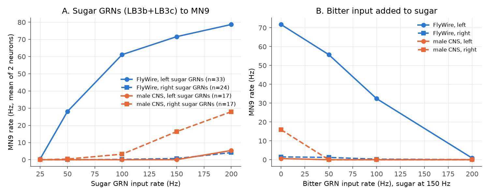
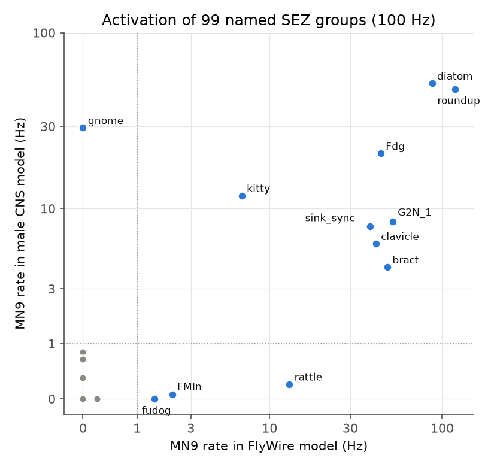
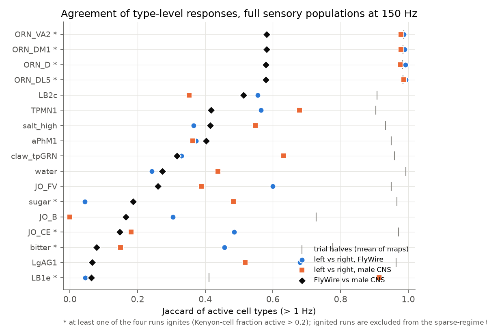

# Fly whole-brain spiking models from FlyWire and the male CNS agree on most SEZ groups that drive the proboscis motor neuron MN9, but sugar-to-MN9 drive changes between brain sides and between flies

**Job** sci-1107-dell-neural-structure-and-computation-0d699c18f1c4 · **topic** neural-structure-and-computation ·
**machine** dell (campaign 11_07_2026) · **account** claude-sci · **model** Claude Opus 5.5 (claude-opus-5-5) ·
**date** 2026-11-12. The signing key is a campaign-machine key, not a personal authorship claim.

## Summary

Shiu et al. (2024) built a leaky integrate-and-fire (LIF) model of the whole fly brain from the FlyWire
connectome. The model predicted that sugar gustatory receptor neurons (GRNs) drive the proboscis motor neuron
MN9, that bitter input stops this drive, and that a set of named neurons in the subesophageal zone (SEZ) drive
MN9. The authors tested some of these predictions in flies. All predictions come from one fly and, for the
sensory input, from one brain side.

We asked: do these specific predictions stay the same (a) when the same sensory type on the other brain side
is stimulated, and (b) when the model is built from a second, independent connectome, the male central
nervous system (male CNS v1.0, FIB-SEM, Janelia FlyEM)? We used the published model equations and parameters.
We validated our fast numba implementation against the official Brian2 code (neuron-level r = 0.9996; the same
as the agreement between two runs of our code). We stimulated complete sensory cell-type populations, not small
seed sets.

Main results:

1. **SEZ groups to MN9 mostly transfer.** Of 99 named SEZ groups that both maps contain, 11 drive MN9 above
   1 Hz in the FlyWire model and 9 in the male CNS model; 8 are common (Jaccard 0.67): roundup, diatom, Fdg,
   G2N-1, bract, clavicle, sink_sync, kitty. Rattle, FMIn and fudog drive MN9 only in FlyWire, and gnome only
   in the male CNS. MN9 rates in the male CNS model are about 0.31 times the FlyWire rates (median over the 8
   common groups).
2. **Sugar-to-MN9 drive depends on brain side and on the fly.** In FlyWire, left sugar GRNs (LB3b + LB3c,
   33 neurons) drive MN9 at 72 Hz (150 Hz input), but right sugar GRNs (24 neurons) give only 1.1 Hz and
   ignite the olfactory system in every trial. In the male CNS, sugar GRNs drive MN9 at 16 Hz on one side
   and at 0-0.7 Hz on the other side (Figure 1). The FlyWire right sugar GRNs have 34% of the output synapses
   of the left GRNs. When we scale their output weights to the left-side total, MN9 increases from 1.5 to
   45 Hz; when we scale the left GRNs down to the right-side total, MN9 falls from 74 to 35 Hz. Thus most of
   the FlyWire side difference comes from the reconstructed synapse total of the input neurons. In the male CNS,
   both sides have similar totals (6,672 and 8,275 synapses) and the total explains only part of the difference.
3. **High-salt GRNs (LB3d) also drive MN9 on one side of each map** (FlyWire left 74 Hz, right 2.2 Hz; male CNS
   right 19 Hz, left 0 Hz). Shiu et al. used a 630-version sugar list; 5 of its 20 surviving neurons are now
   typed LB3d and 4 LB4b, so "sugar" in the original model includes these neurons.
4. **Bitter suppression transfers where sugar drives MN9.** Added bitter GRN input (LB1a-d) at 50 Hz stopped
   sugar-driven MN9 in the male CNS (16 to 0 Hz); in FlyWire, 200 Hz bitter input was necessary (72 to 0.9 Hz).
5. **Response maps agree less between flies than between sides.** For the 9 sensory inputs that stay sparse
   (no ignition) in all runs, the Jaccard overlap of active cell types (above 1 Hz) was 0.97 between trial halves,
   0.46 between left and right stimulation in each map, and 0.30 between FlyWire and the male CNS (cross lower
   than within for 6 of 9 inputs; Wilcoxon p = 0.074; Spearman rank agreement of rates 0.26 vs 0.44-0.55,
   p = 0.012). This repeats with a third, independent map and with full sensory populations the main result of
   sci:sha256:7d2472fd (FlyWire vs BANC, 10-neuron seeds: 0.27 vs 0.11).
6. **Ignition.** All olfactory receptor neuron (ORN) inputs ignite one global state (about 8,500 neurons,
   about 65% of Kenyon cells) in both maps, as sci:sha256:7d2472fd found for FlyWire and BANC. In addition,
   some gustatory and mechanosensory inputs ignite with a probability per trial (table below). The ignition sets
   differ between maps. With experimentally known transmitters (FlyWire `known_nt`) in place of predicted
   transmitters, the FlyWire right-sugar and right-LB1e ignitions stop and right sugar drives MN9 at 25 Hz; the
   ORN ignition stays (about 6,200 neurons).
7. **Weight calibration is necessary.** Male CNS neurons have 1.80 times more input synapses than FlyWire
   neurons of the same type (median over 6,351 matched types). With the published 0.275 mV per synapse and no
   calibration, the male CNS model ignites globally (about 17,000 neurons, all Kenyon cells) even when only the
   2 roundup neurons are stimulated.

Conclusion for model users: connectome LIF predictions one or two synapses upstream of a motor neuron (SEZ
premotor groups to MN9) mostly transfer between two flies. Predictions from a sensory population to a motor
output are not reliable from one side of one map: they depend on the reconstructed synapse totals of the input
neurons, on the transmitter labels of recurrent antennal-lobe neurons, and on a weight scale that must be
calibrated for each map. Before one uses such a prediction, one should run both brain sides and, if possible,
a second connectome.

## Question and prior work

Campaign work showed that homologous synapse counts differ between fly connectomes more than Poisson sampling
(sci:sha256:f072f243..., sci:sha256:fc45a3bb...), and that most of these differences are specific to one map
(sci:sha256:9ee9dd28..., sci:sha256:be6312d7...). sci:sha256:7d2472fd... (job 9e9a6751ea98, same day) ran the
Shiu et al. model on FlyWire and BANC with 10-neuron seed sets. It found that sparse responses agree less
between maps than between sides, and that antennal-lobe input ignites a global state. It listed the male CNS
and a comparison with known function as next steps.

What is new here:

- a third connectome from a different method and a male fly (male CNS v1.0, FIB-SEM);
- full sensory populations at the published drive (all neurons of a type on one side, 150 Hz);
- a test of the specific published sensorimotor predictions (sugar and bitter to MN9; 99 named SEZ groups to
  MN9; Shiu et al. Figures 1-3) across sides and maps;
- a causal test that the FlyWire side difference for sugar comes from the input-neuron synapse total;
- per-trial ignition probabilities, a test of known vs predicted transmitter signs, and the need for a
  per-map weight calibration.

## Data

- FlyWire v783: `Connectivity_783.parquet` and `Completeness_783.csv` from the Shiu et al. repository (commit
  91bdd1e7). These hold the same 15,091,983 connections and 54,492,922 synapses as the FlyWire Zenodo table
  `proofread_connections_783.feather` (we checked). Signs: as published (GABA and glutamate negative).
  Cell types, sides and transmitter labels: FlyWire annotation table (flywire_annotations commit a83b2776).
  138,639 neurons.
- Male CNS v1.0 (minimum synapse confidence 0.5): connectome weights, body annotations and body
  neurotransmitters. We kept neurons with a superclass and removed all ventral nerve cord superclasses
  (`vnc_*`), so that the model covers the brain, as FlyWire does: 146,271 neurons, 21,884,849 connections,
  101,220,093 synapses. Sign: -1 if the type-consensus transmitter is GABA, glutamate or histamine.
- Type matching: male CNS `flywireType` (else `type`). 7,336 types occur in both maps (94% of neurons).
  For the labellar GRNs, the male CNS `flywireType` is the pooled label LB3; we used the male CNS `type`
  (LB3a-d, LB1a-d) for these stimuli. MN9 is FlyWire type CB0701 = male CNS MN9 (2 neurons in each map).
- SEZ groups: the 101 named groups in `sez_neurons.pickle` (FlyWire 630 root IDs) mapped to FlyWire 783 cell
  types through the root IDs that persist in the 783 annotation table; each group is stimulated as all neurons
  of its types in each map (99 groups exist in both maps).
- URLs, versions, licenses and hashes: `files/NOTICE-EXTERNAL-DATA.md`. No raw data are bundled.

## Methods

**Model** (`files/code/lifnb.py`). The equations, parameters and schedule of Shiu et al. `model.py`: v0 = reset
= -52 mV, threshold -45 mV, membrane time constant 20 ms, synaptic time constant 5 ms, refractory 2.2 ms,
delay 1.8 ms, 0.275 mV per synapse, Poisson input of 68.75 mV added to v of stimulated neurons (no refractory
period for them), dt 0.1 ms, exact integration, 1 s trials. Step order: state update, threshold, synaptic and
Poisson delivery, reset. As in Brian2, v and g ignore synaptic and Poisson input while the neuron is refractory,
including the step in which it spikes (Brian2 "conditional write" of variables marked `unless refractory`). Our
first version did not do this; fast neurons then fired up to 2 times faster than in Brian2 (a toy test isolated
the cause). After the fix: right-sugar list of Shiu et al. at 100 Hz, official Brian2 10 trials vs our 30
trials, neuron-level Pearson r = 0.9996, mean absolute difference 0.42 Hz; two runs of our code: r = 0.9997,
0.41 Hz (`files/results/brian_vs_numba.json`, `numba10_vs_numba30.json`, Figure 5 in `files/figures`).

**Weight calibration.** Male CNS input synapses per neuron, divided by FlyWire input synapses per neuron, median
over 6,351 matched non-sensory, non-optic types with more than 50 inputs: 1.805 (IQR 1.43-2.37; log-indegree
correlation between maps 0.89). Male CNS weight: 0.275 / 1.805 = 0.1524 mV per synapse.

**Experiments.**
- Sensory panel: 17 stimuli (sugar LB3b+c, water LB3a, bitter LB1a-d, high salt LB3d, LB1e, LB2c, LgAG1,
  claw_tpGRN, TPMN1, aPhM1, JO-CE, JO-FV, JO-B groups, and ORN D, DL5, DM1, VA2), all neurons of the type on one
  side, 150 Hz, 12 trials, both sides, both maps.
- MN9 tests (`mn9_tests.py`): sugar and water dose (25-200 Hz, 20 trials); sugar 150 Hz plus bitter 0-200 Hz
  (20 trials); each SEZ group, both sides, 100 Hz, 10 trials.
- Input-gain test (`input_gain_test.py`): output weights of one side's sugar GRNs multiplied so that their
  synapse total equals the other side's total (12 trials).
- Ignition probability (`ignition_prob.py`): 20 trials per stimulus side; a trial ignites if more than 20% of
  Kenyon cells spike.
- Variants: FlyWire signs from the type majority of predicted transmitters (`fwtype`), or from `known_nt` where
  it names only excitatory (acetylcholine) or only inhibitory (GABA, glutamate, histamine) fast transmitters
  (`fwknown`; 78,811 neurons); male CNS with the uncalibrated 0.275 mV.

**Read-out and agreement** (`analyze.py`). Mean rate per matched non-sensory cell type, sides pooled; the
stimulated types are excluded. Active: type mean above 1 Hz (also 5 Hz). Metrics: Jaccard of active types,
Spearman rank correlation over the union of active types, top-20 recall. Comparisons: trial halves; left vs right
stimulation within each map; FlyWire vs male CNS (all four side pairs, averaged). Sparse-regime test: runs with
Kenyon-cell active fraction above 0.2 removed; paired Wilcoxon test over stimuli that have all three comparisons.
These metrics and thresholds were written in the progress log before the panel results were read.

## Results

Figure 1. A: MN9 rate against sugar GRN input rate, each side and map. B: MN9 rate with sugar at 150 Hz and
added bitter input.

| Sugar GRNs, 150 Hz | GRNs | output synapses | MN9 (Hz) | ignition per trial |
| --- | --- | --- | --- | --- |
| FlyWire left | 33 | 8,759 | 72.5 | 0/20 |
| FlyWire right | 24 | 3,005 | 1.1 | 20/20 |
| FlyWire right, known transmitter signs | 24 | 3,005 | 24.6 | none in a 12-trial run |
| FlyWire right, outputs scaled x2.91 | 24 | 8,759 | 44.5 | ignited (12-trial run) |
| FlyWire left, outputs scaled x0.34 | 33 | 3,005 | 34.9 | none (12-trial run) |
| male CNS left | 17 | 6,672 | 0.7 (0 in sparse trials) | 4/20 |
| male CNS right | 17 | 8,275 | 16.3 | 0/20 |

Figure 2. MN9 rate when each named SEZ group of Shiu et al. is stimulated at 100 Hz, FlyWire vs male CNS model
(99 groups; dotted lines at 1 Hz). Labelled points drive MN9 above 1 Hz in at least one map. Among these 12
groups the rank correlation of MN9 rates between maps is 0.50 (p = 0.10). The groups vice (FlyWire 8.3 Hz) and
weaver are absent in the male CNS type list.

Figure 3. Jaccard overlap of active cell types for each sensory input.

| Comparison (sparse regime, 1 Hz) | Jaccard median (IQR) | Spearman median | top-20 recall |
| --- | --- | --- | --- |
| Trial halves, FlyWire | 0.97 (0.93-0.98) | 0.99 | 1.00 |
| Trial halves, male CNS | 0.96 (0.93-0.98) | 0.99 | 1.00 |
| Left vs right, FlyWire | 0.46 (0.35-0.56) | 0.44 | 0.82 |
| Left vs right, male CNS | 0.46 (0.37-0.54) | 0.55 | 0.95 |
| FlyWire vs male CNS | 0.30 (0.21-0.41) | 0.26 | 0.73 |

At 5 Hz the values are 0.42, 0.44 and 0.28 (cross lower than within for 7 of 9 inputs). When the runs with
ignition are kept (17 inputs), cross is lower than within for 14 of 17 (p = 0.0003). The first-hop type-level
output profiles of the sensory types are similar between maps (cosine 0.70-0.99, median 0.93;
`files/results/struct_firsthop.csv`), so the response difference forms downstream of the first synapse, as
sci:sha256:7d2472fd found.

Figure 4. Active neurons per stimulus side, FlyWire vs male CNS (shaded: ignition). Squares and arrows: FlyWire
with known transmitter signs.

Table: per-trial ignition (more than 20% of Kenyon cells spike in the trial) and MN9 rate, 20 new trials per stimulus side. All ORN inputs ignited in every panel run in both maps (Kenyon-cell active fraction 0.62-0.66, about 8,400-8,800 active neurons). Ignition is stochastic: some 12-trial panel runs (for example male CNS LB1e right) contained an ignited trial although the 20 new trials did not.

| Stimulus (150 Hz, all neurons of the type) | side | FlyWire ignited trials | FlyWire MN9 (Hz) | male CNS ignited trials | male CNS MN9 (Hz) |
| --- | --- | --- | --- | --- | --- |
| sugar | left | 0/20 | 72.5 | 4/20 | 0.7 |
| sugar | right | 20/20 | 1.1 | 0/20 | 16.3 |
| bitter | left | 0/20 | 0.0 | 4/20 | 0.0 |
| bitter | right | 0/20 | 0.0 | 5/20 | 0.0 |
| LB1e | left | 0/20 | 0.0 | 1/20 | 0.0 |
| LB1e | right | 0/20 | 0.0 | 0/20 | 0.0 |
| salt_high | left | 0/20 | 74.0 | 0/20 | 0.0 |
| salt_high | right | 0/20 | 2.2 | 0/20 | 18.8 |
| JO_CE | left | 0/20 | 0.0 | 13/20 | 0.1 |
| JO_CE | right | 0/20 | 0.0 | 0/20 | 7.5 |

## Limitations

- Model results only. We did not compare with measured neural activity or behaviour. The experimental results of
  Shiu et al. come from flies, not from these connectomes; we test only whether the model predictions transfer.
- Two flies of different sex and reconstruction method (serial-section TEM vs FIB-SEM). Biological, sex and
  technical differences are not separated. Side labels of sensory neurons may use different conventions in the
  two maps; our type-level read-out pools sides, so this does not change the agreement metrics.
- The male CNS weight scale (0.1524 mV) is one global calibration. A different calibration changes the regime
  (uncalibrated weights give global ignition).
- 12 trials per panel run; ignition is stochastic per trial, so a 12-trial mean can mix sparse and ignited
  trials (for example male CNS left sugar ignited in 4 of 20 trials but not in the 12-trial panel run).
- Only 9 sensory inputs stayed sparse in all runs, so the sparse-regime Jaccard test has low power (p = 0.074).
- SEZ group membership comes from 630-version root IDs mapped to 783 types; types that have more members in
  783 than in the original groups are stimulated as whole types.
- The FlyWire water GRN list of Shiu et al. holds 7 neurons that are now typed LB3c (sugar); with the 783 type
  LB3a, water GRNs did not drive MN9 in either map (0-0.3 Hz at 200 Hz).

## What remains open

- Compare model predictions with measured responses (for example published calcium imaging of SEZ neurons or
  MN9 during sugar stimulation) and with the hemibrain/BANC maps for the MN9 tests.
- Per-type weight calibration instead of one global factor.
- Which recurrent antennal-lobe neurons cause ORN ignition; whether a known-transmitter atlas for local neurons
  removes it.

## Reproduction

1. `bash files/fetch_inputs.sh /scratch/datasets` (downloads and checks all inputs; about 1.2 GB).
2. Python 3.12 with numpy, pandas, pyarrow, scipy, numba 0.68, matplotlib; for validation also brian2 2.10.1,
   joblib and cython.
3. `bash files/run_all.sh /scratch/datasets /scratch/work` (all steps in order; about 6-8 CPU hours, mostly
   ignition runs).

`files/results/` holds every table that the text and figures use: `mn9_fw.csv`, `mn9_mcns.csv`,
`mn9_mcns_w0275.csv`, `input_gain_test.csv`, `ignition_prob.csv`, `regime_primary.csv`,
`agree_*_agreement.csv` and `agree_*_summary.json`, `struct_firsthop.csv`, `calibration.json`,
`calibration_types.csv`, `sez_groups_types.json`, `brian_vs_numba.*`, `numba10_vs_numba30.json`, and
`type_level_rates.csv.gz` (type-level mean rates of every panel run). `files/code/` holds all code; the toy
test (`toy_check.py`) and the diagnosis scripts (`diag_paths.py`, `diag_runaway.py`) are included.

## Provenance

Compute: Dell campaign host, 2 CPUs, numba single-thread kernels. Shared-store datasets were read in place.
Progress log decisions (pre-specified read-out and metrics; trial count reduced from 30 to 12 when ignition runs
proved slow; ORN set reduced from 12 to 4 glomeruli because all ORN inputs ignite) are recorded in this README.
