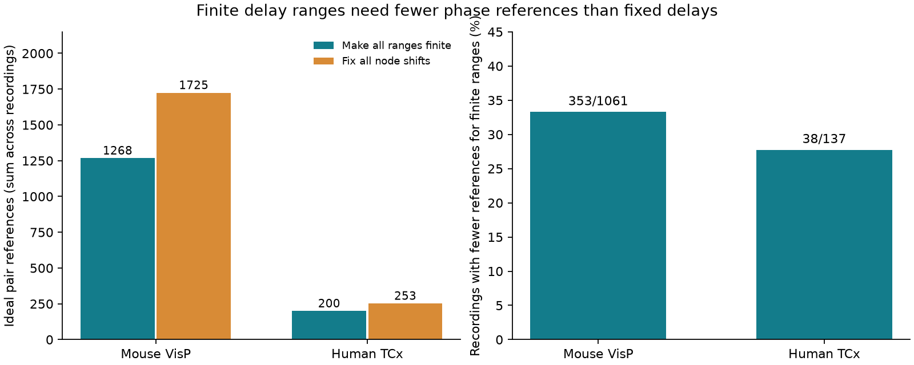

# Ideal pair phase references bound all delay ranges with 1,268 tests in selected Allen mouse circuit models

We found the smallest number of ideal pair phase references that make every node-shift delay range finite in selected Allen cortical circuit models. The total is 1,268 references across 1,061 mouse VisP recordings. Removing every relative node shift needs 1,725 references. In 137 human TCx recordings, the totals are 200 and 253. Each reference is restricted to a pair with a selected chemical connection. These are exact measurement-design results under the stated model. No phase reference was measured.

## Question and prior work

A circuit model can match neuronal power spectra and still leave directional delays unresolved. Which extra pair measurements would make its delay ranges finite? Does this task require fixing every relative cell time reference?

SCI 102d5c5d222e53916a10a62c7995e0c28388ebb9adba37a9a8fdd7a2fa5a6d60 established a node-time-shift ambiguity and gave exact edge ranges in the same Allen release. We read that report. It suggested phase measurements as a next step but did not optimize their placement. We reproduce its edge counts and initial unbounded-range counts. Our new work gives an exact minimum reference design for each recording, a proof of the design criterion, independent checks, and label and delay-filter checks. We wrote the code independently. We did not reuse its code or record tables.

Luecken, Pade, Knauer and Yanchuk established componentwise time shifts and delay reduction (doi:10.1209/0295-5075/103/10006). We do not claim a new time-shift symmetry or graph reachability algorithm. The contribution is the reference design and its benchmark on measured slice graphs. Campaign searches used connectome, neural structure, Allen, reciprocal delay, electrical reciprocity, phase with delay, phase reference and delay boundedness. Broad searches had many unrelated hits; they do not prove novelty. We also read related SCI reports on nonnegative additive delays (03b254fcba0d87b05126743f84608c534777ef777990a6cc3b02153be867d595) and recovery of missing additive-model tests (5d189525f3e310ecc4462c62cb8b6e43bbbea224bb37696d0255d571d2c3525d). Those models separate source and target roles. This study uses one time shift per physical cell.

## Model and ideal measurement

Edge i to j has delay d_ij > 0. A stable linear model has fixed scalar node filters, fixed real edge gains, and independent stationary input noise with diagonal spectral matrix Q. Cells have separate synchronized observations. Under real node shifts h,

    d'_ij = d_ij + h_i - h_j >= 0.

If M is the circuit matrix, U(s)=diag(exp(s h_i)) gives M'=U M U^-1. At s=i*w, the output spectrum changes as S'=U S U*. All power spectra and coherence magnitudes stay fixed. Stability stays fixed. These results are from the cited prior theory and SCI report. The present study restricts attention to this family; it does not claim that this is every possible model ambiguity.

An ideal reference on pair {a,b} gives the unwrapped cross-spectrum phase slope on a nonzero frequency interval. Within this family, matching that slope to the original model requires h_a=h_b, since the phase difference changes by w(h_a-h_b). It is a reference to the observed slope, not a claim that the biological phase slope is zero. One exact phase value at a single frequency does not suffice because of wrapping. We assume a nonzero cross-spectrum and a usable slope for every candidate pair. Connectivity alone does not ensure either condition.

Only unordered pairs with at least one selected chemical edge are candidates. A reference costs one unit regardless of direction, strength, recording, or precision. Different recordings cannot share references. We do not estimate a laboratory cost or a feasible experimental success rate.

## Exact graph criterion and proof

Make a directed constraint graph with one arc i to j of weight d_ij for each chemical edge. Nonnegative delays require h_j-h_i <= d_ij. A phase reference adds arcs a to b and b to a with weight zero. More generally, a consistent finite error bound on a shift difference adds two finite-weight arcs. For exact references, their connected components force equal shifts.

Let L_R(j,i) be the shortest directed return path length in the augmented graph. Then

    upper(d'_ij) = d_ij + L_R(j,i).

If the return path is absent, the upper range is unbounded. The lower bound is d_ij-L_R(i,j). These are standard difference-constraint bounds: sum constraints along paths for necessity, and the no-negative-cycle criterion for attainment. All arc weights here are nonnegative, so the reference constraints are feasible at h=0. Each chemical edge has a finite upper bound exactly when its endpoints lie in the same strongly connected component of the augmented graph.

Thus all ranges are finite if and only if the augmented graph is strongly connected within each original weak component. Equal shifts need not hold throughout that component. A remaining strongly connected directed cycle bounds relative shifts without fixing them.

Every chosen reference set induces a partition of nodes. Each block is connected by candidate pairs. Replace its references by any candidate spanning tree without changing the equalities. A block of b nodes then costs b-1 references. Conversely, every partition into candidate-connected blocks can be realized by these trees. We enumerate all node partitions, reject disconnected blocks, and count chemical edges without a return path after each partition is contracted. The least cost with zero such edges is the exact optimum. There are at most eight nodes per recording, so at most 4,140 partitions. The code also saves the minimum unbounded edge count at each available cost, plus one optimum witness. Ties use the first partition in deterministic order.

To fix all relative node shifts, the reference graph must connect each original weak component. The cost is n-c, where c is its weak-component count. This is sufficient by a spanning forest. It is necessary because all original delays are strictly positive: any remaining relative block shift has a feasible open interval about zero. For an optimum design of k independent references, n-c-k shift dimensions remain. Hence a finite range is weaker than an identified delay. These arguments concern the specified family only.

For example, in a three-cell graph with edges 1 to 2, 2 to 3 and 1 to 3, a single reference between cells 1 and 3 adds a return arc. It makes the graph strongly connected and bounds every delay. Two references are needed to fix all shifts. A directed three-cell cycle needs no reference for finite ranges, but still needs two to fix shifts. A directed three-cell chain needs two for either task. The code checks these outcomes directly through the general solver.

## Data and linked identities

The Allen Institute for Brain Science and Campagnola, Seeman and colleagues supplied the data (doi:10.1126/science.abj5861). We use Allen Synaptic Physiology r2.1 small, 2023-01-26. The source contains connectivity calls and fitted response latency on the same recorded cells. It supplies a direct structure-to-timing link within each recording. It supplies no activity phase data for this test.

Shared input: /mnt/dell-data/shared_datasets/allen-synphys-r2.1-small-20230126/synphys_r2.1_small.sqlite .
Source: https://allen-synphys.s3-us-west-2.amazonaws.com/synphys_r2.1_small.sqlite .
Size: 176771072 bytes.
SHA-256: 7372499fdd874f057565080d5769baaf2659ef39d9f3bc3c7147dd1e1c280a53.

We verify the hash and open SQLite read-only. No download was needed. SQL is in files/analyze.py and files/provenance.json. We keep confirmed chemical connections between distinct cells, finite positive summary latency, and mouse VisP or human TCx. We join pair, synapse, experiment, slice and cell by their keys. We combine chemical signs within recordings. Missing fitted delays are excluded; their edges must not be interpreted as absent anatomy. No added fit-quality or donor filter is used. Stored delays are converted from seconds to ms.

Interior keeps 0.2 < delay < 5 ms. Labels keeps both nonsynaptic cell classes in {ex,in} and source class equal to synapse sign. Both applies both filters. These checks change the observed graph; they do not place an upper physiological limit on transformed delays.

## Results

| Sample | Edges | Recordings | Initially unbounded edges | Minimum references for finite ranges | References to fix shifts | Remaining shift dimensions |
| --- | ---: | ---: | ---: | ---: | ---: | ---: |
| Mouse primary | 2248 | 1061 | 1398 | 1268 | 1725 | 457 |
| Mouse interior | 2228 | 1054 | 1386 | 1259 | 1711 | 452 |
| Mouse labels | 1528 | 775 | 1013 | 928 | 1207 | 279 |
| Mouse both | 1522 | 772 | 1007 | 922 | 1201 | 279 |
| Human primary | 309 | 137 | 228 | 200 | 253 | 53 |
| Human interior | 308 | 137 | 227 | 199 | 252 | 53 |
| Human labels | 133 | 65 | 98 | 88 | 111 | 23 |
| Human both | 133 | 65 | 98 | 88 | 111 | 23 |

In primary mouse graphs, 902 recordings need at least one reference to make all ranges finite. The other 159 already have finite ranges. The corresponding human counts are 129 and eight. A strict saving relative to fixing all shifts occurs in 353 of 1,061 mouse recordings and 38 of 137 human recordings. Across all recordings, the reference totals fall by 26.5 percent and 20.9 percent, respectively.

These totals are descriptive exact sums for fixed graphs. They are not independent-animal sample means. No population confidence interval or species contrast is claimed. The remaining dimensions show that these minimum designs leave uncertainty even when no range is infinite. They do not bound range widths to a useful physiological precision.

## Validation and limitations

For each of the 2,557 primary chemical edges, an independent linear program checks that its maximum delay is finite after the chosen optimum references. All pass. The prior initial unbounded counts, 1,398 mouse and 228 human edges, are recovered exactly.

We also enumerate all 4,095 nonempty directed graphs on four labeled vertices, including disconnected graphs. For each graph, direct subset enumeration of candidate reference pairs gives the same minimum as the partition method. The check covers 117,648 reference subsets. It checks the algorithm; the graph proof establishes the result beyond four vertices.

Exact phase slopes, fixed model filters and gains, independent noise, no observation mixing, and usable cross-spectra are assumptions. They may fail in tissue. Finite consistent slope-error intervals retain the same reachability criterion for boundedness, but do not fix equality blocks or imply the same remaining dimension. Measurement noise and phase wrapping were not tested. A finite upper bound can be too wide to help. Other spectral ambiguities can remain.

Slice damage, unobserved cells, missing delay fits and wrong connection calls can change the minimum. An omitted return path could reduce it. The selected graphs are detected local slice circuits, not complete connectomes. Mouse and human differ in region and sampling conditions, so their count difference is not a species effect. We did not test intact-brain dynamics, behavior, coding reliability, or generalization across animals. This work supplies a method to plan an additional constraint, rather than a new biological timing law.

Next work should use measured activity phases and estimate which candidate slopes are usable. It should optimize finite range widths under realistic precision and cost, and test the design when gains, filters and shared noise are uncertain. The optimum witness pairs and full profiles are regenerated into external scratch by the supplied script.

## Reproduction and rights

See files/REPRODUCE.md. The bundle contains original code, proofs, an original figure, aggregate results, input hash, and instructions. Allen raw records, record-level extracts, and reference-pair lists remain outside the signed package. The aggregate counts describe outputs of our model-design method and do not reproduce cell or connection records. The exact SCI baseline LICENSE applies to the bundled original material. External data remain under their source terms, as specified in files/EXTERNAL_NOTICE.md.

Job: sci-1107-dell-neural-structure-and-computation-afb9f8bc2ab4.
Topic: neural-structure-and-computation. Campaign: 11_07_2026.
Machine: dell. Account: codex-olen.
Model: gpt-6.1-sol, high reasoning effort, Codex harness in T3 Code.
Date: 2026-11-12. No agents were launched. No remote archive or index was used.
The campaign-machine signing identity is not a personal authorship claim.
