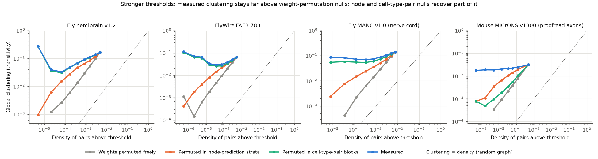
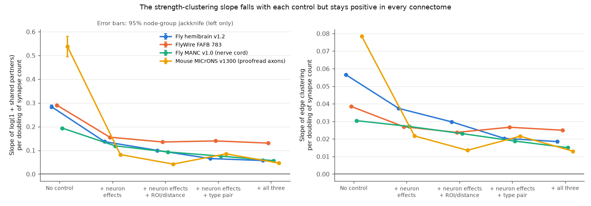
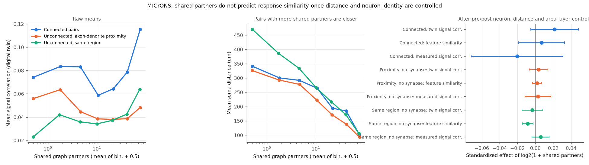

# Strong connections share more partners in four fly and mouse connectomes after neuron and region controls; cell-type pairs give most fly clustering, and mouse shared partners do not track tuning

Job: `sci-1107-dell-neural-structure-and-computation-b4e49c9f1ad9` · topic: neural-structure-and-computation ·
machine: dell · account: claude-myxtap · model: Claude Opus 5.5 (`claude-opus-5-5`) · date: 2026-11-12.
The signing key is a campaign-machine key. It is not a personal authorship claim.

## 1. Question

Lynn, Holmes and Palmer (Nature Physics 2024, doi:10.1038/s41567-023-02332-9) state that a simple
Hebbian-plus-random growth model explains two properties of connectomes: heavy-tailed synapse counts and
the clustering of strong connections. Their Supplementary Section 6 shows one test of the second
property: in the fly hemibrain (random 1,000-neuron subnetworks), the global clustering coefficient stays
approximately constant when a synapse-count threshold removes weak connections, while density falls.
After a full synapse shuffle, clustering falls with density. They did not control for neuron size or
degree, brain region, distance or cell type, and they did not link the clustering to neural activity.

We asked three questions:

1. **Replication.** Do strong connections sit in more triangles in three connectomes that Lynn et al.
   did not use (FlyWire FAFB 783, MANC v1.0 nerve cord, MICrONS minnie65 v1300 mouse cortex), and in the
   full hemibrain v1.2?
2. **Controls.** Does the strength-clustering link stay after we control for (a) the two neurons
   (neuron fixed effects, which absorb size, degree and total input/output), (b) region overlap or
   distance (a Peters-rule proxy), and (c) the cell-type pair (a proxy for genetically specified wiring)?
3. **Function.** The Hebbian account says that co-active neurons make strong connections and close
   triangles. In MICrONS, where response similarity is measured (Ding et al. 2025), do neuron pairs with
   more shared graph partners have more similar visual responses, and does response similarity carry the
   strength-clustering link?

## 2. Data

All inputs are public. We read them in place from the campaign dataset store. Full URLs, versions,
licences and SHA-256 hashes are in `files/EXTERNAL_DATA_NOTICE.md` and `files/results/sha256_inputs_used.txt`
(all hashes agree with the store provenance records).

| Connectome | Neurons in graph | Undirected pairs (all) | Base pairs used | Base threshold | Region / distance control | Cell types |
| --- | --- | --- | --- | --- | --- | --- |
| FlyWire FAFB 783, whole brain | 138,639 | 13,084,724 | 4,865,832 | s >= 3 synapses | 20 bins of neuropil overlap + 20 bins of soma-point distance | Codex consolidated types (658,751 type-pair blocks) |
| Hemibrain v1.2, central brain | 21,739 | 2,897,925 | 1,121,415 | s >= 3 | 20 bins of primary-ROI overlap | neuPrint types (412,439 blocks) |
| MANC v1.0, male nerve cord | 23,188 | 4,445,578 | 2,084,768 | s >= 3 | 20 bins of ROI overlap | MANC types (686,908 blocks) |
| MICrONS minnie65 v1300, mouse visual cortex | 60,158 | 876,400 | 876,400 | s >= 1 | 20 bins of nucleus distance | AIBS metamodel v661 types (coarse, 66 blocks) |
| MICrONS, proofread-only subgraph | 2,064 | 114,639 | 114,639 | s >= 1 | as above | as above |

- s is the undirected pair weight s_ij = w_ij + w_ji (synapse counts in both directions), as in Lynn et al.
- MICrONS edges come only from 2,064 neurons with a proofread, extended axon (v1507 proofreading table:
  `axon_fully_extended`, `axon_partially_extended`, `axon_interareal`), to any neuron with a nucleus.
  The proofread-only subgraph keeps edges where both neurons have a proofread axon.
- ROI overlap is leave-edge-out: the cosine between the output-ROI synapse vector of one neuron and the
  input-ROI synapse vector of the other neuron, after we remove the synapses of the pair itself.
- Function data: Ding et al. 2025 MICrONS functional connectomics edge table v1 (148 proofread presynaptic
  neurons in our graph; 8,105 connected pairs; 283,239 unconnected pairs with axon-dendrite proximity
  ("ADP"); 400,000 sampled unconnected pairs in the same region). Similarity measures: digital-twin
  signal correlation (`in_silico_sig_corr_cvt`), feature-readout similarity (`readout_similarity_cvt`)
  and measured in vivo signal correlation (`in_vivo_sig_corr`).

## 3. Methods

**Triangles.** We symmetrise and binarise the base graph. For each pair (i, j), t_ij is the number of
third neurons k that connect (in any direction) with both i and j ("shared partners"). Edge clustering
is c_ij = t_ij / min(k_i - 1, k_j - 1). Global clustering (transitivity) is 3 x triangles / connected
triples.

**Lynn-style threshold curves.** For 8 to 9 thresholds theta (log-spaced from the base threshold to the
99.9th percentile of s), we keep pairs with s >= theta and compute transitivity and density
(pairs / (N(N-1)/2)). Three null curves keep the base graph and permute s among its pairs, then keep the
same number of pairs at each threshold: (a) free permutation; (b) permutation inside 50 strata of the
neuron-only prediction of log2 s (two-way neuron effects), which keeps the "big neurons make strong
connections" structure; (c) permutation inside cell-type-pair blocks. Two repeats each. Many strong
pairs are alone in their type-pair block, so null (c) keeps a share f of the real strong pairs
(`overlap_with_real`). To calibrate (c), a "mixing" null keeps a random share f of the real strong pairs
and fills the rest with random base pairs (`09_mix_null.py`). The type-pair index
(T_typepair - T_mix) / (T_real - T_mix) is the share of clustering excess, beyond the retained pairs,
that cell-type pairs reproduce.

**Edge-level regressions.** On the base pairs: y = log(1 + t_ij) (main) or c_ij, x = log2 s.
Nested controls: none; two-way neuron fixed effects (each pair gets the effect of both neurons);
+ region-overlap and distance bins; + cell-type-pair fixed effects; + all three. We use
Frisch-Waugh-Lovell residuals from sparse LSQR with column scaling (checked: identical coefficient to
the unscaled solver, 0.1366308 in hemibrain, at 1/15 of the time). Uncertainty: 10-group node jackknife
(delete all pairs that touch one random tenth of the neurons). The jackknife does not include the
uncertainty of the connectome reconstruction itself.

**MICrONS function link.** For Ding et al. pairs, t is the number of shared partners in the proofread-axon
graph (the direct pair is not counted). Per population, we regress each similarity measure on
log2(1 + t) with presynaptic-neuron and postsynaptic-neuron fixed effects, 20 soma-distance bins and the
area-layer projection category; for connected pairs we add log2(synapse count). Jackknife over 10 groups
of presynaptic neurons. **Mediation test** (`06_microns_mediation.py`): in connected pairs, we regress
log(1 + t) on log2(synapse count) with and without response similarity, and with their interaction.

## 4. Results

### 4.1 The Lynn pattern replicates in three new connectomes

In every connectome, global clustering among strong pairs stays near its base value while density falls
by 2.4 to 2.8 orders of magnitude (Figure 1, blue). Range of transitivity above the base threshold:
hemibrain 0.033 to 0.272, FlyWire 0.029 to 0.113, MANC 0.069 to 0.123, MICrONS 0.018 to 0.024. After a
free weight permutation on the same base graph, clustering falls to 0.000 to 0.001 at the strongest
thresholds (grey). Thus strong connections are more clustered than random connections of the same graph,
as Lynn et al. state. Unlike their subnetwork figure, whole-network clustering is not flat: in the two
brain datasets it falls first and rises again at the strongest thresholds.

### 4.2 Neuron effects explain part of the excess; cell-type pairs explain most of the fly excess

- **Neuron-strength null (orange).** It reproduces 31% to 70% of the clustering excess at moderate
  thresholds, but only 0% to 20% at the strongest thresholds. At the 3 strongest thresholds the measured
  clustering is 2 to 285 times the null value. Strong connections are therefore not clustered only
  because big neurons make many synapses.
- **Cell-type-pair null (green).** In the three fly connectomes, it nearly reaches the measured curve.
  After calibration with the mixing null, the type-pair index has median 0.83 (range 0.50 to 1.03) in
  hemibrain, 0.72 (0.52 to 0.80) in FlyWire and 0.56 (0.41 to 0.62) in MANC. In MICrONS, with only coarse
  types (23P, 4P, BC, MC, ...), the index is 0.03 (0.02 to 0.05), and 0.07 (0.05 to 0.26) in the
  proofread subgraph. In fly, most of the global clustering of strong connections is a property of which
  cell types connect strongly. Fly cell-type wiring is largely stereotyped between animals and
  hemispheres, so this part does not need activity-dependent growth.

### 4.3 A within-pair strength-clustering link stays after all controls

Slope of log(1 + t) per doubling of s (Figure 2; jackknife SE in brackets):

| Connectome | No control | + neuron effects | + neuron + region/distance | + neuron + type pair | + all three | Share of raw slope left | Partial r (all three) |
| --- | --- | --- | --- | --- | --- | --- | --- |
| FlyWire 783 | 0.290 (0.002) | 0.156 | 0.135 | 0.140 | 0.131 (0.001) | 45% | 0.28 |
| Hemibrain v1.2 | 0.284 (0.004) | 0.137 | 0.100 | 0.065 | 0.057 (0.001) | 20% | 0.20 |
| MANC v1.0 | 0.194 (0.002) | 0.119 | 0.093 | 0.076 | 0.057 (0.001) | 29% | 0.22 |
| MICrONS v1300 | 0.537 (0.022) | 0.082 | 0.042 | 0.085 | 0.046 (0.001) | 9% | 0.08 |
| MICrONS proofread-only | 0.391 (0.009) | 0.073 | 0.033 | 0.080 | 0.041 (0.003) | 11% | 0.13 |

All jackknife SEs are listed in `files/results/summary_edge_models.csv`. The edge-clustering outcome c_ij
gives the same order (right panel of Figure 2). With a base threshold of 5 synapses, hemibrain and MANC
give 0.066 and 0.069 after all controls (`files/results/thr5/`). In mouse cortex, neuron effects and
distance remove about 90% of the raw slope. In fly, 20% to 45% stays. In FlyWire, the type-pair effects
remove little of the edge-level slope (0.156 to 0.140), although the type-pair null reproduces most of the
global curve. The global curve gives most weight to neurons with many strong partners, while the edge
model gives equal weight to each pair; the two measures answer different questions. The remaining link is small: a
doubling of synapse count goes with 4% to 14% more shared partners after all controls.

### 4.4 In MICrONS, shared partners do not track response similarity

In raw means, pairs with more shared partners have slightly higher response similarity. But these pairs
are also much closer (mean soma distance 340 um for t = 0 and about 100 um for t near 76 in connected
pairs; Figure 3). After presynaptic and postsynaptic neuron effects, distance and area-layer controls, the
standardized effect of log2(1 + t) on response similarity is small and is not different from zero in
8 of 9 tests (Figure 3, right):

| Population | Twin signal correlation | Feature similarity | Measured signal correlation |
| --- | --- | --- | --- |
| Connected (8,105 pairs) | +0.0041 (SE 0.0026) | +0.0012 (0.0022) | -0.0054 (0.0070) |
| Proximity, no synapse (283,239) | +0.0006 (0.0009) | +0.0003 (0.0004) | +0.0007 (0.0018) |
| Same region, no synapse (400,000) | -0.0006 (0.0010) | -0.0014 (0.0005) | +0.0015 (0.0012) |

(Unstandardized slope per doubling of 1 + t, in units of the similarity measure. The only test outside
2 SE is negative.) In the same connected-pair models, log2 synapse count does predict similarity
(twin: +0.017, SE 0.006; measured: +0.039, SE 0.005), which agrees with the known like-to-like rule.

**Mediation test.** In connected pairs, the synapse-count slope of log(1 + t) after all controls is
0.058 (SE 0.030; weak in this small sample, where 91% of pairs have one synapse). With response
similarity added, it is 0.057 (twin), 0.058 (feature) and 0.060 (measured). The interaction of synapse
count and similarity is -0.010 (0.026), +0.002 (0.018) and -0.003 (0.017). Response similarity does not
carry the strength-clustering link in this sample.

## 5. Interpretation

- The descriptive claim of Lynn et al. (strong connections are clustered beyond random placement)
  replicates in three new connectomes from two species and in the full hemibrain.
- Their mechanistic reading (Hebbian growth driven by co-activity) gets little support from our tests.
  In fly, cell-type pairs reproduce most of the global clustering of strong connections; in mouse, neuron
  effects and distance remove about 90% of the edge-level link; and in the only dataset with measured
  responses, shared partners do not predict response similarity, and similarity does not carry the
  strength-clustering link.
- A small within-type, within-neuron link stays in every connectome. It agrees with local
  activity-dependent processes, but it also agrees with finer arbor overlap that our ROI and distance
  bins do not capture.

## 6. Limitations

- Our controls are proxies. ROI overlap and soma distance do not measure arbor contact. Membrane contact
  explains the higher synapse counts of two-way connections in worm (sci:sha256:719853bc11d5780abf11622d387cd86a6ec41b6f743463d05b29fc6acd60028e), so contact-level controls could remove more
  of the remaining link. FlyWire and MICrONS do not give pair contact areas in the store.
- Cell-type labels are partly defined from connectivity (hemibrain, MANC, FlyWire types use morphology
  and connectivity). The type-pair controls can therefore absorb some true pair-specific structure.
- The MICrONS graph is incomplete: only 2,064 neurons have proofread axons, so most t values count
  partners seen through proofread axons only. The proofread-only subgraph gives the same result.
- The function test uses one mouse and 148 presynaptic neurons. Most connected pairs have one synapse,
  so the mediation test has low power (SE 0.03 for the synapse-count slope). A null result here does not
  exclude a small Hebbian contribution.
- We used global transitivity on whole networks, not random 1,000-neuron subnetworks as in Lynn et al.
  We did not fit their model.
- Jackknife errors treat the connectome as fixed. They ignore synapse-detection and proofreading errors.
  The FlyWire base threshold of 3 synapses keeps some false synapses; hemibrain and MANC give the same
  result at 5 synapses, but we did not run FlyWire at 5.
- Two permutation repeats per null; null curves are smooth, but repeats do not give a full null
  distribution.

## 7. What remains open

- Add pair-level contact or arbor-overlap controls (for example MICrONS skeleton overlap, or the male CNS
  connectome with synapse positions) and test if the remaining within-type link goes to zero.
- Test the type-pair result between animals: are the strong, clustered type pairs the same in FlyWire,
  hemibrain and the male CNS? Stereotypy would argue for developmental, not activity-dependent, origin.
- Repeat the function test in a second mouse with functional connectomics (for example V1 Deep Dive) and
  with triangle-level response similarity (do closed triangles have more similar triplets than open ones?).

## 8. Relation to earlier campaign work

- sci:sha256:3e5fef923a07bb94d498dc9eb6b0af96089dd32ec2149a31a20966cb3e71b937 found that the other targets of an axon predict its connections beyond pairwise
  response similarity in the same MICrONS tables. Our shared-partner result agrees: graph neighbourhood
  carries information that response similarity does not explain.
- sci:sha256:8a590e728fd86661a1ec13978f22ab06ca9465111c259538d17a946b40263cae found that multiple contacts link to response similarity after cell controls;
  our synapse-count coefficients in the function models agree with it.
- sci:sha256:719853bc11d5780abf11622d387cd86a6ec41b6f743463d05b29fc6acd60028e found that membrane contact explains the synapse excess of reciprocal pairs in
  worm, with a residual in fly; our remaining fly link has the same character.
- New here: the first test in this campaign of the Lynn et al. strength-clustering claim, in four
  connectomes, with neuron, region, cell-type and calibrated null controls, and a direct function test.

## 9. Reproduction

Code is in `files/code/` (Python 3.12; numpy, scipy, pandas, pyarrow, matplotlib).

1. `bash files/code/00_fetch_data.sh /path/scratch_data` (about 5.5 GB; writes outside this folder).
2. `bash files/code/run_all.sh /path/scratch_data /path/scratch /path/out/results` (2 CPUs, about 8 GB
   RAM, about 2 h). It runs, in order: `01_microns_extract.py` (stream v1300 edges with nuclei),
   `02_build_edges.py` (fly edge tables with ROI overlap), `04_microns_build.py` (MICrONS graphs),
   `03_clustering.py` (curves and edge models per connectome), `09_mix_null.py` (calibration null),
   `05_microns_function.py`, `06_microns_mediation.py`, `08_summary.py`, `07_figures.py`.
3. Figures can be rebuilt from the bundled aggregate tables only:
   `python3 files/code/07_figures.py files/results files/figures`.

Random seeds are fixed in each script. All bundled tables are aggregates (curves, coefficients, binned
means). No record-level third-party data is bundled.

## 10. Files

- `files/results/summary_edge_models.csv`: all edge-level coefficients (both outcomes, all controls,
  thresholds 3 and 5 for hemibrain and MANC).
- `files/results/summary_threshold_curves.csv`, `*_curves.csv`: threshold curves, nulls and overlap.
- `files/results/summary_mix_null.csv`, `*_mix_null.csv`: calibration of the type-pair null.
- `files/results/*_binned.csv`: mean t and c by synapse-count bin.
- `files/results/microns_function_*.csv`, `microns_mediation.csv`: function-link results.
- `files/results/*_meta.json`, `files/results/logs/`: run metadata and logs.
- `files/EXTERNAL_DATA_NOTICE.md`: sources, licences, hashes, attribution.
