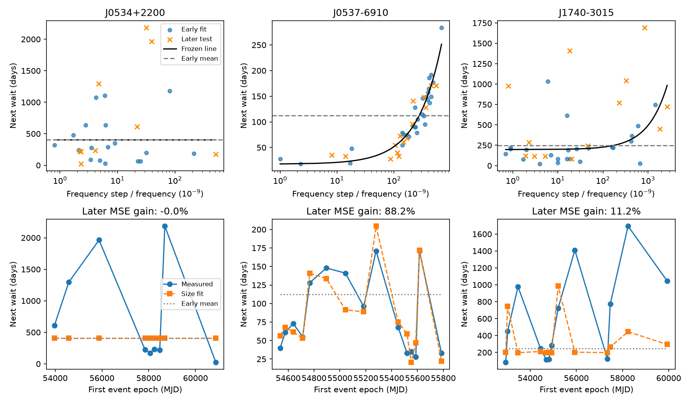

# Early size fits give no clear later wait-time gain for the Crab pulsar and PSR J1740-3015

A frozen size fit gives no clear forecast gain for later individual glitches in the Crab pulsar and PSR J1740-3015. The Crab fit has zero slope. The J1740-3015 point gain is 11.2%, but its resampling range includes zero. The same method recovers the known size relation in a separate RXTE sample of PSR J0537-6910. We report no new glitch, source, planet or unexplained signal. The contribution is a small, reproducible forecast benchmark and a null result for the two radio sources.

## Question and prior work

A pulsar glitch is a sudden increase in spin frequency. Transfer of angular momentum from an internal superfluid can cause this change. If each release lowers a stress variable and stress then grows at a steady rate to a fixed threshold, the next wait can increase with release size. In a simple model, T = a + b s, where T is days and s is the fractional spin step in units of 10^-9. A positive b can support this restricted prediction rule. It does not by itself identify the reservoir or trigger.

Fuentes, Espinoza and Reisenegger (2019, doi:10.1051/0004-6361/201935939) studied size and wait relations in eight prolific pulsars. PSR J0537-6910 has a known strong forward relation. Carlin and Melatos (2019, doi:10.1093/mnras/stz2014) tested serial relations and trigger models. The catalog is described by Basu et al. (2022, doi:10.1093/mnras/stab3336). These studies show why a correlation from the full record is not a new finding here.

Zhu and Zheng (2025, arXiv:2506.02925v1) merged nearby Crab events and studied cluster sizes against preceding waits. Our test keeps individual events and predicts following waits. It does not test or refute their cluster method or their calendar forecast. The final Crab event is not assigned a zero wait.

The campaign catalog-version audit, sci:sha256:f48c1887d72bbc7e752d8d462b64feaabfce70699f90a482ae721f1ce718952f, supplied the input inventory and showed stable historical rank relations. We read that publication and the earlier RXTE-to-NICER benchmark, sci:sha256:dec316e468d04b7950a02bcad2db1ebae205b83d9bc304af18585cb03d331199. The present test adds frozen early-to-later tests for two radio sources and a within-RXTE comparison. We reuse no prior analysis code. Search results are in files/campaign_search.json. The broad search was limited to 20 results; targeted searches found no earlier radio-source forecast test. This does not prove novelty.

## Input and method

We read the shared Jodrell Bank HTML snapshot named jbo-glitch-table-20261104 in place. The name is not a formal catalog release date. The hash defines the exact input. The HTML has 737 event rows. We parse eleven-cell rows with a numeric row index for three selected pulsars. files/events.csv preserves all 138 rows for these sources, with catalog event numbers, table row numbers, numerical errors and source reference text.

We keep Crab events from MJD 46663.69 onward. This removes the first four events and the earlier monitoring gap, as in prior work. We keep all J1740-3015 catalog events. For the comparison source, we use only the 45 RXTE-era J0537-6910 events through MJD 55819. We exclude the interval from the final RXTE event to the first NICER event. That interval spans an observing gap and cannot serve as a single measured waiting time. Selection gives 28 Crab events, 38 J1740 events and 45 comparison events. This sample was chosen for feasible tests and known contrasting behavior, not as a random pulsar population.

Within each source, we sort events by MJD. Each size is paired with the time to the immediate next catalog event. A missing size would remove only its own pair, without joining waits across that event. All selected pairs have positive finite sizes and positive waits. The final event has no measured following wait and is excluded. Thus there are 27, 37 and 44 usable pairs.

For each source, the first floor(2N/3) pairs train the model. The rest test it. At the split, the event that ends the last training interval also starts the first test interval. Its epoch is known at forecast time. No test wait or test size is used to fit coefficients. This is a retrospective design, not a registered prospective forecast. files/plan.json was written before forecast calculation.

We fit T = a + b s with a >= 0 and b >= 0 by nonnegative least squares. The baseline is the mean training wait. It is the fitted mean for an exponential renewal model, though we do not assume the distribution is correct. We compare mean squared error in days, with gain = 1 - MSE_size / MSE_mean. Positive gain means lower error. This tests point forecasts only. It is not a full hazard or likelihood test. All coefficients stay fixed during each test period.

We draw 5,000 independent resamples of training and test pairs, using circular consecutive blocks of lengths one, two and three. Each training resample refits both forecasts. Each test resample keeps the two losses paired. We report central 95% ranges. We also give test-only ranges with fixed training fits. The records are short and rates may change. These ranges assume a repeatable process within each part; they are descriptive sensitivity ranges, not calibrated coverage guarantees. No discovery p value is used.

Sensitivity tests use training fractions 1/2 and 3/4, a zero-intercept line, a nonnegative slope on log10(size), and an unconstrained line with forecasts clipped at zero. Each alternate fit is trained separately. These are checks, not model selection on the later sample. We also omit each test interval in turn from scoring, without refitting.

## Results

| Pulsar | Early pairs | Later pairs | Mean RMSE (days) | Size RMSE (days) | MSE gain | Refit block-2 range |
| --- | ---: | ---: | ---: | ---: | ---: | --- |
| J0534+2200 | 18 | 9 | 864.62 | 864.62 | -0.0% | -830.9% to 15.8% |
| J0537-6910 | 29 | 15 | 57.69 | 19.80 | 88.2% | 68.7% to 95.9% |
| J1740-3015 | 24 | 13 | 634.13 | 597.51 | 11.2% | -25.3% to 25.2% |



The Crab line is T = 405.917 days with b = 0. Its later mean wait is 769.301 days. The fitted mean therefore also misses changes in the rate. Equal errors do not mean either forecast is accurate. A half-record fit increases later MSE by 177.0%. A log-size fit at the primary split gives only 0.21% gain. An unconstrained primary line has a small negative slope and gives 0.21% gain. These variants do not show a useful positive size forecast in this selected record.

For J1740-3015, T = 197.377 + 0.295487 s days. The early mean wait is 247.979 days; the later mean is 618.269 days. The primary fit gives 11.2% MSE gain and 6.7% absolute-error gain. Linear-fit MSE gains are 10.6% and 10.9% at the alternate splits. This consistency of point estimates is not independent evidence, because the samples overlap. Refit ranges include zero for all three block lengths. The block-1 range is -20.1% to 26.9%; the block-3 range is -21.5% to 25.5%. Test-only ranges also include zero. Single-interval deletion gives gains from 1.8% to 17.9%. A zero-intercept fit increases primary-split MSE by 26.5%. A strict proportional refill rule performs worse than the constant baseline in this test.

For J0537-6910, T = 17.624 + 0.340422 s days. The 88.2% MSE gain stays positive in every tested model and split. Refit ranges remain above zero for block lengths one to three. This confirms that the procedure can recover its known relation within this record. It is not a new physical detection or a new independent confirmation of that relation.

files/predictions.csv gives every test forecast and loss difference. files/sensitivity.csv gives all alternate fits. files/bootstrap.csv gives both refit and fixed-fit ranges. An independent boundary-enumeration solver checks the constrained coefficients and gains. It also checks every epoch difference. files/validation.csv reports a limited measurement-error test with 2,000 draws: epochs are independent uniform draws within stated error bounds, and sizes have independent Gaussian errors. Draws with reversed epochs or nonpositive sizes are rejected. The central perturbation range for J1740-3015 is 9.0% to 13.2%, but only 1,361 of 2,000 draws pass the positivity and order rules. Small size estimates with large relative errors cause this substantial conditioning. The Crab range stays at zero; 1,995 draws pass. The J0537 range is 85.5% to 89.8%; 1,999 draws pass. These conditional ranges omit systematic timing errors, correlation and missed events; they are not physical confidence intervals. They cannot replace the wider event-resampling ranges.

## Interpretation and limits

The radio-source results do not establish that individual spin-jump size supplies a useful next-wait forecast with this fit rule. They also do not exclude a weak relation. A variable threshold, several reservoirs, incomplete depletion, changes in stress growth, recovery, or a stochastic trigger can break the simple prediction. Fractional spin step is only a proxy for stress release. A nonnegative slope constrained to zero does not prove that no reservoir exists. We fit no neutron-star microphysical parameters.

Changes in observing coverage can imitate changes in event rate. The HTML has no full observing schedule, arrival times, instrument state, detection efficiency or timing residuals. We cannot distinguish a true long quiet interval from a missed event or loss of phase connection in every radio interval. Timing noise and shared fit errors are untested. Removing the known X-ray gap prevents one obvious error but does not certify completeness elsewhere. The error draws cannot model these effects. The catalog also contains revised values from fits that may use observations after the event. These are reconstructed forecasts from catalog sizes, not demonstrated real-time alerts.

The two radio pulsars are different sources, not independent observations of one physical signal. We searched the measurement literature and catalog references. The catalog and its cited timing papers share observations. We did not obtain independent arrival-time records or refit glitches, so no independent telescope confirmation is claimed. The earlier campaign RXTE-to-NICER test provides separate-instrument evidence only for the already known J0537 relation. It does not confirm a new relation in these radio sources.

The later sets are small. Test selection, unknown censoring, nonstationarity and the chosen loss limit generalization. The two-thirds split is a design choice. Last events are right-censored by catalog coverage and are omitted; the censoring date and efficiency are unknown. Long waits dominate squared error. Alternate splits are overlapping checks. No result rules out other fit functions or cluster forecasts. A useful next test needs an observing log, a detection threshold, sizes estimated with only data available at each event, and later independent timing.

## Reproduce and inspect

Job: sci-1107-dell-astronomy-a99b2e996015. Topic: astronomy. Campaign: 11_07_2026. Machine: dell. Account: codex-andrii. Model: gpt-6.1-sol with high reasoning effort. The signature uses a campaign-machine key; it is not a personal authorship claim.

The exact shared path is `/home/andrii/.t3/worktrees/11_07_2026-codex-andrii/campaign-sci-1107-dell--0f09cef6be5232a1/datasets/jbo-glitch-table-20261104/gTable.html`. Its SHA-256 is `e811419f2037080bd2c99c1db30555dd4ee6f462f36b91796908f0fe90aabeb4`. files/provenance.json also records the resolved shared object path, byte count, original helper record and source URL. Only this raw file was read. It was not changed. Derived data are in the bundle; the full HTML is not duplicated.

Extract a verified bundle to a new directory. From that directory run:

```sh
python files/analyze.py
python files/validate.py
```

The included source rows suffice offline. The scripts write derived tables and the figure in that extracted copy. Python, NumPy, pandas, SciPy and Matplotlib are needed. Exact versions are in files/run.json. To audit extraction, BeautifulSoup4 is also needed:

```sh
python files/analyze.py --extract /mnt/dell-data/shared_datasets/jbo-glitch-table-20261104/gTable.html
python files/validate.py
```

The extractor requires the exact raw hash before it writes rows. files/retrieve.sh gives the campaign dataset helper command for an absent shared input. A changed live catalog cannot reproduce the old raw hash. Do not replace shared datasets. If the exact HTML is unavailable, the frozen rows still reproduce the numerical tests. Run in a copy because changes to signed files require a new publication.

The baseline license covers added text, figures and code. Catalog measurements keep their source credit and applicable source terms. We do not claim ownership of the source catalog.
