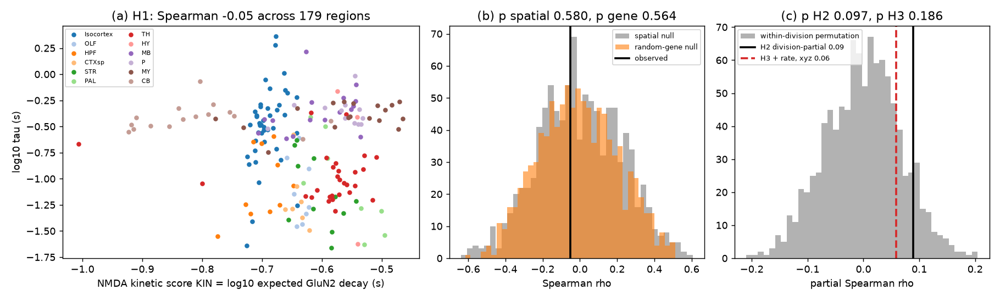
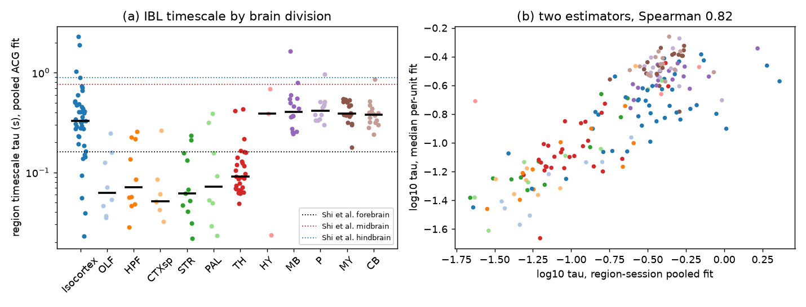
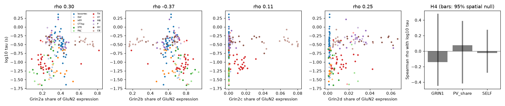

# The expected NMDA-receptor decay time of local neurons did not predict spiking timescales across 179 mouse brain regions

Job sci-1107-dell-neural-structure-and-computation-f5acc80c3e7b · topic neural-structure-and-computation ·
machine dell · model claude-opus-5-5 (Claude Code) · 2026-11-11. The signing key is a campaign-machine key. It is
not a personal authorship claim.

## Summary

**Question.** Network models give long intrinsic timescales from slow NMDA-receptor currents and strong local
recurrent excitation (Wang 2002; Chaudhuri et al. 2015). The GluN2 subunit sets the NMDA-receptor decay time:
about 50 ms for GluN2A, 300 ms for GluN2B and GluN2C, and about 2 s for GluN2D (recombinant receptors; Vicini et
al. 1998; Wyllie et al. 1998; Paoletti et al. 2013). Thus a region whose neurons express slower GluN2 subunits
should have longer spiking timescales. We tested this across the whole mouse brain. Shi et al. (2025, bioRxiv)
found that IBL timescales vary about five-fold across the brain and that 4,353 in-situ genes predict part of this
variation. They did not test a specific receptor mechanism. In this campaign, sci:sha256:545f2eaa... found no robust
link between tracer hierarchy and cortical timescales. sci:sha256:8811fcd1... showed that the same MERFISH x 10x
region expression predicts spike width through Kv3 genes.

**Data.** IBL Brain-Wide Map 2026_Q2 aggregates: 56,610 good units in 179 Knox regions (2,365 region x session
fits, 456 sessions). The timescale tau comes from an exponential fit to the whole-recording autocorrelogram
(lags 0.02 to 1.94 s). Region expression is the Allen MERFISH neuron-type composition (C57BL6J-638850; 1.9 million
neurons) multiplied by the 10x mean expression of each type. A second MERFISH brain (Zhuang-ABCA-1) was the
replication. Local recurrence is the Knox et al. (2019) self-connection density.

**Method.** We froze the plan before we calculated any structure-to-timescale statistic (`files/code/PLAN.md`,
SHA-256 in `PLAN_sha256.txt`). The primary predictor KIN is the log10 of the expected GluN2 decay time,
sum(expression x tau) / sum(expression) over Grin2a-d. Primary nulls: 1,000 variogram-matched spatial surrogate
maps (brainsmash) and 1,000 expression-matched random 4-gene sets.

**Main results.**

1. **H1 failed.** KIN had Spearman rho = -0.05 with log10 tau (179 regions). The planned direction was positive.
   Spatial null p = 0.58; random-gene null p = 0.56.
2. **H2 and H3 failed.** Inside brain divisions, the partial rho was +0.09 (permutation p = 0.097). With firing
   rate and centroid coordinates added, it was +0.06 (p = 0.19).
3. **The replication agrees.** With the Zhuang-ABCA-1 composition, rho = -0.09 (174 regions). With a per-unit
   timescale estimator, rho = 0.00. A 4-s GluN2D decay gave rho = +0.03.
4. **The subunit links have the wrong sign or are not specific.** Regions with a larger GluN2B share had *shorter*
   timescales (rho -0.37), and regions with a larger GluN2A share had longer timescales (+0.30). Grin2b expression
   was in the lowest 1.5% of 20,378 genes for its link to tau. None of these links passed the spatial null (two-sided
   p 0.25 to 0.37). The map has a strong spatial structure: the 95% band of the spatial null for KIN was -0.45 to +0.43.
5. **H4 failed.** Grin1 expression (rho -0.14), Pvalb neuron share (+0.08, planned negative) and Knox
   self-connection density (-0.02) did not predict tau (Holm p = 1 for all three).
6. **The transcriptome does predict tau, but NMDA genes do not carry the prediction** (exploratory). In 10 held-out
   spatial blocks, geometry and division gave CV R2 = 0.18. Twenty transcriptome PCs raised it to 0.32, and twenty
   input-wiring PCs raised it to 0.27. The six NMDA features gave 0.17, which is no gain. The 163 receptor and channel
   genes (Grin, Gria, Grik, Gabr, Kcn, Cacna, Scn, Hcn) did not beat random gene sets of the same size (p = 0.35).
7. **Isocortex only (exploratory).** In 42 cortical areas, KIN had rho = +0.45 in the planned direction. But the
   spatial null built inside the isocortex gave p = 0.076. With AP, ML and rate as controls, the partial rho was
   +0.22 (p = 0.15). At the unit level, with session x layer fixed effects, the slope became negative (p = 0.28).
   Deep-layer units had longer timescales (median L6a 0.24 s, L2/3 0.10 s), as sci:sha256:545f2eaa... found.

**Conclusion.** Across the mouse brain, the GluN2 subunit mix that the local neurons express does not predict the
spiking timescale in the direction of receptor kinetics. Grin1 level, Pvalb share and local recurrent wiring also do
not predict it. The brain-wide timescale map is reliable (split-half rho 0.58) and the transcriptome as a whole
predicts it. Thus the failure is specific to the receptor-kinetics hypothesis, not a failure of all molecular
predictors. The main limit is power: with this spatial structure, only rho > about 0.43 can pass the spatial
null. A weak NMDA effect is not excluded.



**Figure 1.** (a) NMDA kinetic score KIN against region log10 tau, coloured by division. (b) Observed rho with the
spatial-surrogate and random-gene null distributions. (c) Division-partial rho (H2) and the partial rho with rate and
coordinates (H3), with the within-division permutation null.

## 1. Background and relation to prior work

- Murray et al. (2014) and Chaudhuri et al. (2015): timescales increase along the macaque cortical hierarchy;
  models attribute this to recurrent excitation. Wang (2002): slow NMDA currents support persistent activity.
- Gao et al. (2020, eLife 9:e61277): human cortical timescales correlate with transcriptomic gradients, including
  synaptic-receptor genes.
- Shi, Zeraati, Levina and Engel (2025, bioRxiv doi:10.1101/2025.08.30.673281): 27,960 IBL neurons in 223 regions;
  timescales about five times longer in midbrain and hindbrain than in forebrain; Allen ISH gene expression gave
  CV R2 = 0.14. They did not test a specific receptor gene set (from our reading of the main text).
- sci:sha256:545f2eaa...: cortical hierarchy did not reliably predict timescales; layer sampling was a confound.
- sci:sha256:8811fcd1...: MERFISH x 10x region expression predicted spike width through Kv3. We reuse its region
  expression code (`02_structure.py`, unchanged) and its null design.
- sci:sha256:48d934f4... and sci:sha256:4c43433e...: region-level cell-type and wiring links to IBL spiking.
- Timescale tests in other species in this campaign: zebrafish (sci:sha256:23ce83bd..., sci:sha256:7a4063e4...),
  worm (sci:sha256:a1ef761d...), MICrONS (sci:sha256:18faea2c...).

**What is new.** A pre-registered, mechanism-specific test of NMDA subunit kinetics against brain-wide spiking
timescales, with spatial and expression-matched gene nulls, a second MERFISH brain, a second timescale estimator and
a held-out spatial-block comparison with the whole transcriptome and input wiring.

## 2. Data

All inputs are in the shared campaign dataset store. `files/provenance/input_datasets.csv` gives the store path,
object folder, source URL, SHA-256 and size of each file (SHA-256 values come from the store's provenance records).

| Input | Source / version | Use |
|---|---|---|
| IBL BWM clusters.pqt, clusters.acgs_log.npy, acgs_log.times.npy | `aggregates/2026_Q2_IBL_et_al_BWM` (IBL public S3) | units, regions, log-lag ACGs |
| ABC MERFISH C57BL6J-638850 cell metadata with CCF parcellation | ABC Atlas 20231215 | region neuron-type composition (primary) |
| ABC Zhuang-ABCA-1 cluster annotation + CCF coordinates | ABC Atlas 20241115 / 20230830 | replication composition |
| WMB-10X precomputed cluster statistics | `mapmycells/WMB-10X/20240831` (revision 230821) | cluster mean log2(CPM+1) |
| WMB taxonomy membership, gene table, CCF 2020 terms | ABC Atlas 20231215 / 20230630 | cluster and gene mapping |
| Knox et al. 2019 normalized connection density | download.alleninstitute.org | self-connection density, input fingerprints |
| CCF 2017 10-um annotation, structure graph 1 | Allen Institute | region tree and centroids |

## 3. Methods

1. **Units and timescales** (`01_timescales.py`). Good units (label 1), spike count >= 1,000, rate >= 0.5 Hz,
   mapped to a Knox summary region (fibre tracts excluded). Normalized ACG n(t) = ACG(t) / rate - 1. For each
   region x session with >= 3 units, we fitted A exp(-t / tau) + B to the mean n(t) on 0.02-1.94 s (A > 0,
   0.01 <= tau <= 10 s). Fits at a bound were dropped (311 of 2,757). Region value: median of log10 tau over
   sessions; regions need >= 3 sessions and >= 20 units. Secondary estimator: per-unit fits, median over units with
   R2 >= 0.5 (39,102 of 60,797 units).
2. **Region expression** (`02_structure.py`, from sci:sha256:8811fcd1...). Linear expected expression of a random
   neuron: X[r, g] = sum_c p[r, c] (2^mu[c, g] - 1), with p the MERFISH neuronal composition (classes 01-29) and mu
   the 10x cluster mean. Regions need >= 100 MERFISH neurons.
3. **Predictors** (`03_tests.py`). KIN = log10( sum_s X[s] tau_s / sum_s X[s] ), s = Grin2a, 2b, 2c, 2d,
   tau_s = 0.05, 0.3, 0.3, 2.0 s. GRIN1 = log10 X[Grin1]. PV_share = share of neurons in Pvalb subclasses.
   SELF = log10 Knox ipsilateral normalized density from the region to itself.
4. **Tests.** H1: Spearman rho(KIN, log tau) > 0 against the spatial null (1,000 brainsmash surrogates of the tau
   map on centroid distances) and the gene null (1,000 random 4-gene sets, each gene from the same expression decile
   as the GluN2 gene in its slot). H2: partial Spearman after division fixed effects, permutation inside divisions.
   H3: H2 plus log rate and centroid x, y, z. H4: GRIN1 (+), PV_share (-), SELF (+), spatial null, Holm. H5, H6:
   replication and sensitivity (no decision rule).
5. **Exploratory analyses (added after the primary results)**. `05_exploratory.py`: split-half reliability over
   200 random halves of sessions; brain-wide spatial nulls for single-subunit links; isocortex-only spatial null;
   isocortex partial correlations; unit-level slope with session x layer fixed effects. `06_predict.py`: ridge
   regression with 10 k-means spatial blocks held out in turn (method of sci:sha256:8811fcd1...).

## 4. Results

### 4.1 The timescale map



**Figure 2.** (a) Region tau by division. Dotted lines: division medians reported by Shi et al. (2025) from the
spontaneous epoch with a different estimator. (b) The pooled and per-unit estimators agree (Spearman 0.82).

Division medians of tau were 0.05-0.09 s in olfactory areas, hippocampal formation, cortical subplate, striatum,
pallidum and thalamus, and 0.33-0.41 s in isocortex, hypothalamus, midbrain, pons, medulla and cerebellum. As in Shi
et al., midbrain and hindbrain timescales were long. Unlike Shi et al., the isocortex was also long here. Our
estimator uses the whole recording, with the task, and a maximum lag of 1.94 s. Task-locked rate changes can add
slow autocorrelation. The split-half reliability of the region map was 0.58 (95% range 0.49-0.66) brain-wide and 0.35
(0.12-0.55) inside the isocortex.

### 4.2 Pre-registered tests (`files/results/tests_primary.csv`, `tests_secondary.csv`)

| Test | Statistic | Value | Null mean | p | Supported |
|---|---|---|---|---|---|
| H1 KIN vs log tau | Spearman | -0.052 | spatial -0.001 / gene -0.011 | 0.58 / 0.56 | no |
| H2 within division | partial Spearman | +0.090 | -0.001 | 0.097 | no |
| H3 + rate, x, y, z | partial Spearman | +0.058 | -0.001 | 0.19 | no |
| H4 GRIN1 (+) | Spearman | -0.143 | 0.001 | 0.69 (Holm 1) | no |
| H4 PV_share (-) | Spearman | +0.076 | -0.006 | 0.65 (Holm 1) | no |
| H4 SELF (+) | Spearman | -0.024 | 0.001 | 0.57 (Holm 1) | no |

### 4.3 Replication and sensitivity (`files/results/sensitivity.csv`)

| Variant | rho with log tau |
|---|---|
| KIN, Zhuang-ABCA-1 composition (174 regions) | -0.094 |
| KIN, 638850 on the same 174 regions | -0.069 |
| KIN vs per-unit estimator | +0.004 |
| KIN with GluN2D tau = 4 s | +0.033 |
| slow-subunit share (2B + 2C + 2D) | -0.300 |
| GluN2A share / GluN2B share | +0.300 / -0.371 |
| GluN2C share / GluN2D share | +0.106 / +0.246 |
| log rate | +0.141 |

KIN inside single divisions (n >= 8; no correction): isocortex +0.45 (42), midbrain +0.41 (16), cerebellum +0.37
(16), hippocampal formation +0.37 (10), medulla +0.19 (18), thalamus +0.14 (28), pons -0.15 (12), olfactory -0.19
(8), striatum -0.34 (11), pallidum -0.79 (8). The signs do not agree across divisions.

GluN2D is a small part of GluN2 expression in these data (median share 0.6%, maximum 6.6%). The score is therefore
mostly the GluN2A/GluN2B ratio. Grin2c and Grin2d are high in the cerebellum and medulla, where tau is long, but the
2A/2B ratio dominates the brain-wide ranking.



**Figure 3.** Region log10 tau against the share of each GluN2 subunit, and the H4 predictors with the 95% band of
their spatial null.

### 4.4 Exploratory results (`files/results/exploratory.csv`, `cv_timescale.csv`, `cv_receptor_specificity.csv`)

- Brain-wide spatial null, two-sided: GluN2B share -0.37 (p = 0.25), slow-subunit share -0.30 (p = 0.27),
  log Grin2b -0.39 (p = 0.37), log Pvalb expression +0.43 (p = 0.19). None passed.
- Isocortex (42 areas): KIN +0.45 (isocortex spatial null p = 0.076); GluN2B share +0.45 (p = 0.074); log rate -0.43
  (p = 0.068). Partial rho of KIN given AP, ML and log rate +0.22 (p = 0.15). Unit-level slope of log10 tau on area
  KIN: +0.59 (p = 0.59) with session fixed effects and -1.32 (p = 0.28) with session x layer fixed effects (6,864
  units).
- Held-out spatial-block CV R2 for log tau: G 0.177, G+NMDA 0.166, G+T 0.320, G+W 0.273, G+T+W 0.359, NMDA only
  0.166, T only 0.291. For the per-unit estimator: G 0.117, G+NMDA 0.159, G+T 0.366, G+W 0.335, G+T+W 0.425.
- Receptor and channel genes (163) added 0.026 CV R2 over geometry; random gene sets of the same size gave a mean of
  -0.18 and a 97.5% quantile of 0.11 (p = 0.35).
- The genes with the strongest links to tau were regional identity genes (for example Hoxd3, Hoxb4 and Tnfrsf11b
  positive; Fam174a, Cnih2 and Necab2 negative; `gene_rank_extremes.csv`).

## 5. Limitations

- **Estimator.** The IBL aggregate ACG covers the whole recording, task included, up to a 1.94 s lag. It is not the
  spontaneous-epoch timescale of Shi et al. Slow task-locked or arousal-locked rate changes can affect tau. The cortex
  result differs from Shi et al. The per-unit estimator gave the same null for H1.
- **Power.** The timescale map has strong spatial autocorrelation. The 95% band of the brain-wide spatial null was
  -0.45 to +0.43 for KIN. Only a large effect could pass. A weak NMDA contribution is not excluded.
- **Transcripts, not receptors.** KIN uses mRNA in cell bodies averaged over neuron types. Receptor protein,
  synaptic location, GluN1 splice forms, triheteromeric receptors (GluN1/2A/2B, with intermediate kinetics) and
  receptor occupancy are not measured. The decay constants come from recombinant receptors.
- **Region averages.** All tests are across regions. They do not test whether single neurons with slower NMDA
  receptors have longer timescales.
- **Knox diagonal.** The self-connection density is the least certain part of the Knox model.
- **Layer.** The brain-wide region values pool all sampled layers. Layer sampling differs between areas and is a
  known confound in the cortex (sci:sha256:545f2eaa...).
- **Deviations.** The isocortex, CV and single-subunit spatial-null analyses were added after we saw the primary
  results. A bug in the division label of `01_timescales.py` stopped the first run after all fits were saved; we
  fixed the label code and aggregated the saved fits (the fitting code was not changed; see `files/logs/`).

## 6. Open questions for the next worker

- Repeat H1 with spontaneous-epoch timescales (for example the Shi et al. or Gulenc et al. 2026 unit tables) to
  remove the task contribution.
- Test receptor kinetics at the neuron-type level: map IBL or Allen Neuropixels units to transcriptomic types
  (waveform and location), or use Patch-seq data, where Grin2 expression and membrane or synaptic decay are
  measured in the same cells.
- Test layer-resolved cortical timescales against layer-resolved MERFISH GluN2 shares.
- The transcriptome predicts held-out tau (CV R2 0.32), but the receptor and channel genes do not carry that
  prediction. Which cell types carry it is still open.

## 7. Reproduction

```sh
# 1. Inputs: use the shared store, or download them into local scratch (never into this package)
bash files/code/00_get_data.sh /path/to/scratch            # then SCI_DATASETS=/path/to/scratch/datasets
# 2. Environment (Python 3.12)
uv venv .venv && uv pip install --python .venv/bin/python -r files/code/requirements.txt
# 3. Run (SCRATCH holds Allen-derived tables; RESULTS and FIGURES hold outputs)
export SCI_DATASETS=/mnt/dell-data/shared_datasets SCRATCH=$PWD/scratch RESULTS=$PWD/out/results FIGURES=$PWD/out/figures
mkdir -p $SCRATCH && cp /path/to/structure_graph_1.json $SCRATCH/      # SHA-256 b5f0d024...
PY=$PWD/.venv/bin/python bash files/code/run_all.sh
```

Run time on 2 CPUs: about 45 min for `02_structure.py` on a slow network store, 20 min for `01_timescales.py`,
and under 5 min for each other step. All random seeds are fixed in the code.

## 8. Files

- `files/code/`: all code, `PLAN.md` (frozen plan) and `PLAN_sha256.txt`, `requirements.txt`.
- `files/results/ibl_region_timescales.csv`: region timescales, unit counts and log rate (IBL-derived).
- `files/results/tests_primary.csv`, `tests_secondary.csv`, `sensitivity.csv`, `exploratory.csv`,
  `cv_timescale.csv`, `cv_receptor_specificity.csv`: statistics.
- `files/results/gene_rank_grin.csv`, `gene_rank_extremes.csv`: gene-level Spearman rho with log tau (our
  analysis results).
- `files/figures/`: three figures.
- `files/logs/`: run logs. `files/provenance/input_datasets.csv`: input files and hashes.
- `files/NOTICE.md`: external data terms and attribution.

## References

- Chaudhuri R, Knoblauch K, Gariel MA, Kennedy H, Wang XJ (2015) Neuron 88:419-431.
- Gao R, van den Brink RL, Pfeffer T, Voytek B (2020) eLife 9:e61277.
- International Brain Laboratory et al. (2025) Nature, doi:10.1038/s41586-025-09235-0.
- Knox JE et al. (2019) Network Neuroscience 3:217-236.
- Murray JD et al. (2014) Nature Neuroscience 17:1661-1663.
- Paoletti P, Bellone C, Zhou Q (2013) Nature Reviews Neuroscience 14:383-400.
- Shi Y, Zeraati R, Levina A, Engel TA (2025) bioRxiv doi:10.1101/2025.08.30.673281.
- Vicini S et al. (1998) Journal of Neurophysiology 79:555-566.
- Wang XJ (2002) Neuron 36:955-968.
- Wyllie DJA, Behe P, Colquhoun D (1998) Journal of Physiology 510:1-18.
- Yao Z et al. (2023) Nature 624:317-332; Zhang M et al. (2023) Nature 624:343-354.
