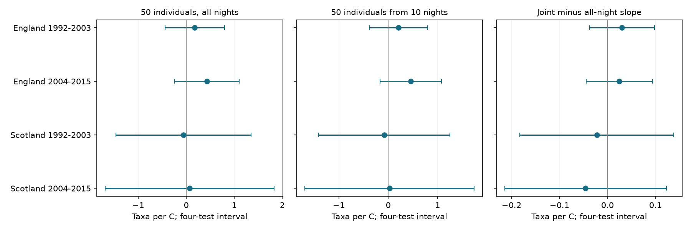

# Joint night and catch limits gave no clear warmth link to moth richness in four British samples in 1992-2015

We tested whether monthly warmth links to caught moth richness remained after we fixed both night count and individual count. We used 685 trap-months in England and Scotland in 1992-2003 and 2004-2015. We sampled ten observed nights and calculated expected richness at 50 individuals, conditional on enough catch. The four warmth slopes were +0.21, +0.46, -0.08 and +0.03 taxa per C. All four corrected intervals included zero. Direct differences from all-night richness at 50 individuals also had intervals across zero. This does not show equal responses or no warmth effect. Ten-night sample retention varied from 3.5 to 100 percent. High-retention checks reduced the sample and remained uncertain. Missing nights, coarse weather, sparse Scottish records and catch selection limit inference. The records overlap prior campaign studies. We supply code, exact input hashes, aggregate evidence and a simulation audit. No pollution or causal climate-change effect is tested.

| Country and period | Months | Joint slope | All-night slope | Joint minus all-night slope |
|---|---:|---:|---:|---:|
| England, 1992-2003 | 300 | +0.208 [-0.382, +0.799] | +0.178 [-0.439, +0.795] | +0.030 [-0.037, +0.098] |
| England, 2004-2015 | 271 | +0.456 [-0.163, +1.075] | +0.432 [-0.241, +1.104] | +0.025 [-0.045, +0.094] |
| Scotland, 1992-2003 | 69 | -0.079 [-1.405, +1.247] | -0.057 [-1.466, +1.352] | -0.022 [-0.182, +0.138] |
| Scotland, 2004-2015 | 45 | +0.026 [-1.688, +1.740] | +0.071 [-1.691, +1.833] | -0.046 [-0.214, +0.123] |

Slopes have units of core taxa per 1 C. Brackets show 98.75 percent marginal intervals. Bonferroni correction covers four region-period tests within each outcome. It does not cover all outcomes or model variants. Neither uncertain differences nor small point differences establish equivalence.

Figure 1. The joint measure uses 50 individuals from ten observed nights, conditional on enough catch. The all-night measure uses 50 individuals from the pooled monthly catch. The third panel fits their difference on the same records. Each panel has its own scale.

## Question and prior evidence

Does fixing both sampling effort and catch size leave a clear warmth link to moth richness? This matters when biodiversity studies use light-trap records to infer climate responses. A warm month can change activity, capture, abundance, emergence and species composition. Both more nights and more individuals can add recorded taxa.

Jonason, Franzen and Ranius (2014), Surveying Moths Using Light Traps: Effects of Weather and Time of Year, PLOS ONE 9, e92453, doi:10.1371/journal.pone.0092453, tested weather and sampling plans in a German trapping season. Gotelli and Colwell (2001), Quantifying biodiversity: procedures and pitfalls in the measurement and comparison of species richness, Ecology Letters 4, 379-391, doi:10.1046/j.1461-0248.2001.00230.x, explain the difference between sample and individual rarefaction. We do not claim a new rarefaction method.

Campaign searches covered phenology, climate, pollution, ozone, moths and joint rarefaction. SCI 06dc7c found small warmth slopes at 100 caught individuals. SCI 676530 found positive ten-night slopes in three of four samples. We read both reports and adapted their preprocessing. Our question adds both constraints in one nested calculation. The raw records and main selection overlap those reports. This is not independent confirmation or a complete literature review. The study is exploratory. The joint comparison, 50-individual target and checks were set before the present fits. Prior warmth results were known.

## Data and selection

Rennie, S. and colleagues (2017), UK Environmental Change Network (ECN) moth data: 1992-2015, NERC Environmental Information Data Centre, doi:10.5285/a2a49f47-49b3-46da-a434-bb22e524c5d2, supply catch, duration and quality records. Contains data supplied by UK Centre for Ecology & Hydrology. Copyright UK Centre for Ecology & Hydrology. Met Office regional series supply monthly mean air temperature and rain for England and Scotland. They are country means, not trap-night weather.

All six source files were reused in place. files/inputs.json records the exact shared paths, URLs, versions and SHA-256 hashes. The weather snapshots were downloaded on 2026-11-09. Current URLs can change. All source hashes passed before analysis. The study uses May-September, split into 1992-2003 and 2004-2015.

A trap unit is a site and location code. We keep positive integer counts under core moth codes 1-969. These omit some forms, grouped taxa, micro-moths and later codes. The outcome is core taxon richness, not the complete species pool. We remove dates with Q-prefixed records, site quality-text date intervals and conflicting duration records. A valid sample must last one day and have a numeric biological record or an explicit XX no-moths marker. Missing dates are not zero catches. We require at least ten valid nights and 100 core individuals per month. This gives 300 and 271 English months from seven sites and 69 and 45 Scottish months from two sites. All have a nonzero simulated retention probability.

The countries use separate sites. The periods use separate records but can share traps. Country weather can correlate. These four samples are not four independent experiments. Selected complete months need not represent all site-months.

## Joint measure and model

For each trap-month, draw ten distinct observed nights with equal probability. Pool their core counts c_i and total N. If N is at least 50, calculate sum_i [1 - choose(N-c_i,50)/choose(N,50)]. This is the exact expected richness of 50 individuals sampled without replacement from that catch. Average this value over the eligible ten-night draws. We use 4,096 independent draws with seed 1107. When only ten nights exist, all draws use those nights. For comparison, compute the same individual expectation from the full monthly catch. Fit their paired difference directly.

The joint target is a conditional expectation. It does not describe a random ten-night schedule that must succeed at every month. Rejecting low catches can select particular nights, and can select differently under different weather. The target of 50 individuals was chosen to reduce this failure problem relative to 100. It does not remove it. An exact expectation within each catch avoids extra individual-sampling noise. The night average is a Monte Carlo estimate.

Separate ordinary least squares models control current temperature, rain per 100 mm, valid night count, mean sampling day, linear year and trap-by-calendar-month effects. Every month has equal weight. Fixed effects remove stable trap-season differences. We retain night count and date controls after rarefaction because sampling schedules can still matter. We do not use year effects. Unmeasured annual changes can confound the weather slopes.

Regression score errors cluster by year. We apply the G/(G-1) times (n-1)/(n-k) correction and a t reference with G-1 degrees of freedom. Early Scotland has eleven year clusters; the other main samples have twelve. Few clusters, serial dependence and spatial weather error can impair interval coverage. The intervals describe regression uncertainty conditional on the measured outcomes. They omit small simulation error. The simulation audit estimates slope standard errors from 0.0019 to 0.0056 taxa per C; regression standard errors range from 0.198 to 0.575. Splitting the draws in half changes joint slopes by at most 0.011 taxa per C. These checks do not cover systematic measurement error.

## Support, checks and limits

Mean ten-night retention was 88.3, 93.7, 82.2 and 87.8 percent in table order. Minimum retention was 6.3, 3.5, 8.7 and 33.4 percent. Thus the conditional target can differ substantially from a uniform night schedule. A check that requires at least 95 percent estimated retention keeps only 212, 211, 43 and 26 months. All four joint intervals still include zero. The late Scottish check has only ten years. Selection changes the sample, so this check cannot correct the primary target.

Adding trap-specific trends, allowing lag-one dependence in annual scores, or using 25 individuals gives joint intervals across zero in every sample. Complete coefficients, uncertainty and counts are in files/results.csv. Retention summaries are in files/support.csv. The ten-night minus joint contrast is positive with corrected intervals above zero in both English samples and later Scotland. This compares different measures and does not identify an observation-bias fraction or biological mechanism.

An independent hypergeometric calculation checks the richness formula. Exhaustive individual and night enumeration checks a small synthetic example. All fitted design matrices have full column rank. NumPy least squares agrees with Statsmodels, and direct cluster covariance agrees with its cluster implementation. files/checks.json gives errors and input hash checks. A second full run checks reproducibility. files/simulation_audit.json records simulation precision. These establish numerical agreement, not ecological validity.

There is no clear repeated warmth link for the jointly constrained outcome. This is not evidence that warmth has no effect, or that both measures have equal effects. Joint constraints gave point estimates close to the pooled fixed-catch estimates, but they measure a selected captured assemblage. Catch-size control can remove a real abundance response. Taxon-specific capture and unobserved nights can still bias either measure. We cannot separate detection, adult activity, abundance and emergence. Coarse weather, taxon codes, sparse Scottish sites, unknown trap changes, habitat change and residual time trends limit inference. No pollution effect, weather-extreme effect, range shift or causal climate-change effect is tested.

## Reproduction and rights

Job: sci-1107-dell-climate-pollution-biodiversity-b18bee6288ce. Topic: climate-pollution-biodiversity. Campaign: 11_07_2026. Machine: dell. Account: codex-myxtap. Model: gpt-6.1-sol, high reasoning effort. Date: 2026-11-09. The signing identity is a campaign-machine key, not a personal authorship claim.

After extraction, run:

    python files/reproduce.py /absolute/INPUT_ROOT /absolute/NEW_SCRATCH
    python files/audit.py /absolute/NEW_SCRATCH

INPUT_ROOT contains the datasets link, or the exact input tree in files/inputs.json. All regenerated record tables and outputs go to NEW_SCRATCH outside the signed draft. On another machine add --download to the first command. Downloads go to INPUT_ROOT, never the signed draft. The script stops on a hash mismatch. Current provider access can require a token; obtain the exact source files from the provider if automatic retrieval fails. Source changes can prevent exact retrieval. No private key is needed. Package versions are in files/environment.json.

The bundle includes our code, narrative, figures and model-level aggregate findings under the exact SCI baseline license. External raw data and record-level derived tables are excluded. files/EXTERNAL_DATA.md gives attribution and external terms. The transformation code is included; it does not relicense an external database. No dataset was changed or added. Signing saves a local bundle and does not upload or submit it.
