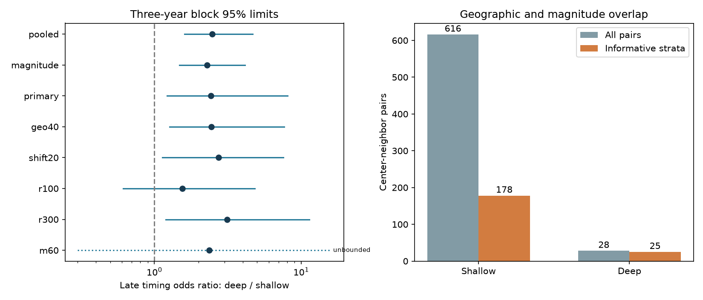

# Coarse location and magnitude matching retained a late timing excess near deep earthquakes in ComCat, 2001-2024

The late-versus-early timing odds near deep earthquakes were 2.43 times those near shallow earthquakes after matching in 20-degree location cells and three magnitude bands. The conditional 95% three-year block interval was 1.22 to 8.07. Seven groups in four location cells supplied the comparison. The result did not resolve an excess at 100 km. It does not show that deep aftershocks have a slower physical decay rate.

## Question and prior work

Does a reported depth contrast in nearby event timing remain within coarse location and magnitude groups? This matters because deep and shallow earthquakes have different locations and background activity. A global timing contrast can combine those differences with source dynamics.

The campaign study [2cd728eb](sci:sha256:2cd728eb163fc048b6c3edd516b5104f1aa4a3edadf257a09d6827843540c04c) found a larger late count share near deep centers after magnitude adjustment. It did not estimate a within-location timing contrast. It warned that only 28 deep pairs supported its primary result. We use its source snapshot, center rules, distance rule and time windows, with new code and a different estimator. This is a follow-up on the same observations. It is not independent confirmation. The campaign study 024ca74a tested recent counts for forecasts; it informed our decision to avoid that already tested question.

Wimpenny and colleagues (2023, doi:10.1029/2022JB026269) found low intermediate-depth aftershock productivity in global and regional catalogs. Baez and colleagues (2022, doi:10.1093/gji/ggac024) studied intermediate-depth productivity in Japan. Those studies motivate caution about sparse counts at depth. Neither finding establishes the timing contrast tested here. Intermediate depth is not our deep group.

We searched published campaign results before the test. Search terms and read IDs are in files/prior_search.json. The local plan in files/PLAN.txt was written before calculation. It is not an external registration. No other agents or private worker workspaces were used.

## Source and selection

We reused the unchanged shared file:
datasets/usgs-global-m55-2000-2025-20261109-earth-a76104/events.csv.
Its resolved path is /mnt/dell-data/shared_datasets/usgs-global-m55-2000-2025-20261109-earth-a76104/events.csv. These are campaign shared storage paths. We did not access the failed disk.

The source is the ANSS Comprehensive Earthquake Catalog (ComCat), a preferred-solution extract for 2000-2025 retrieved on 9 November 2026. It has 12,848 unique records, 2,240,222 bytes, and SHA-256 162e1e37336624494321d4b9c3f0b823f433ebaeb70430af8fa70b5b2ddb16c3. Source URL, retrieval time, paths and hash are in files/provenance.json. Used coordinates, depth and magnitude have no missing values. Preferred magnitudes use mixed scales, not one common Mw scale.

Centers have UTC origin years 2001-2024 and magnitude at least 6.5 and below 8. Shallow depth is 0-70 km; deep depth is greater than 300 km. We exclude a candidate if an equal or larger event occurs within 200 km surface distance and 30 days on either side. All source depths can exclude a candidate. This future-dependent rule is retrospective and cannot serve as a live forecast rule. It retains 646 shallow and 99 deep centers, as in the prior study.

Neighbors have magnitude at least 5.5. Their Cartesian chord distance from the center is at most 200 km. The radius of each location is 6371 km minus its catalog depth. Surface isolation distance uses a sphere of radius 6371 km. Early counts use elapsed days (1,7]; late counts use (7,30]. The first day is omitted. Buffer years cover these windows.

## Test method

The primary strata cross 20-degree latitude-longitude cells with magnitude bands [6.5,7), [7,7.5), [7.5,8). Cell indices are floor((latitude+90)/20) and floor((longitude+180)/20). For each stratum, let a be deep late pairs, b deep early pairs, c shallow late pairs and d shallow early pairs. With n=a+b+c+d, the Mantel-Haenszel odds ratio is sum(a*d/n) divided by sum(b*c/n). Empty strata contribute zero.

An odds ratio above one means that late versus early timing odds are higher for deep centers. This is a ratio of pair-count odds, not the odds that a center has an aftershock. Centers with no pairs remain in the support tables but do not contribute to this timing estimator. A stratum is informative if it has pairs from both depth groups and pairs in both windows. Strata with no such overlap cannot identify the within-stratum odds ratio. The method does not estimate or require a common number of events per center. With heterogeneous stratum effects, the combined ratio is a summary, not a universal effect.

We sample paired circular blocks of three calendar years from the 24 years. Each of 10,000 draws samples eight block starts, with seed 110726. Both depth groups receive the same year weights. We recompute the ratio from sampled annual counts. The interval uses empirical 2.5% and 97.5% quantiles and retains zero or infinite estimates. Undefined estimates are counted separately. The intervals condition on fixed source records, selection, cell boundaries and a time-block dependence model. They omit location and catalog uncertainty and do not sample geographic regions. We do not apply an independent-pair significance test.

The pooled and magnitude-only tests give context. Fixed checks change cells to 40 degrees, shift the 20-degree grid by ten degrees in both coordinates, change neighbor radius to 100 or 300 km, or raise neighbor magnitude to 6. Isolation stays fixed. Shifted longitude wraps at 360 degrees. These checks are not separate discoveries and have no multiple-test adjustment.

## Results

| Test | Late timing odds ratio | Conditional 95% limits | Informative strata | Undefined draws |
|---|---:|---|---:|---:|
| Pooled | 2.468 | 1.606 to 4.663 | 1 | 0 |
| Magnitude only | 2.290 | 1.482 to 4.134 | 3 | 0 |
| Primary location and magnitude | 2.427 | 1.215 to 8.071 | 7 | 0 |
| 40-degree cells | 2.443 | 1.265 to 7.667 | 10 | 0 |
| Shifted 20-degree cells | 2.731 | 1.130 to 7.556 | 8 | 0 |
| 100 km neighbors | 1.545 | 0.612 to 4.832 | 7 | 8 |
| 300 km neighbors | 3.134 | 1.196 to 11.342 | 8 | 0 |
| M6 neighbors | 2.357 | 0 to infinity | 3 | 659 |

There are 133 occupied primary strata; 25 contain centers of both depth groups. Only seven are informative. They include 88 shallow and 43 deep centers. They supply 109 early and 69 late shallow pairs, and nine early and 16 late deep pairs. Overall counts are 332 early and 284 late shallow pairs, and nine early and 19 late deep pairs. Thus matching uses 178 of 616 shallow pairs and 25 of 28 deep pairs. Retained centers need not have pairs. Counts can share neighbors.

The primary point ratio is close to the pooled and magnitude-only ratios. Coarse spatial grouping does not explain away the association in this snapshot. Precision falls after grouping. Twenty-one primary draws are infinite; none is undefined or zero. The 97.5% quantile remains finite. At the M6 threshold, 6.59% of draws are undefined and 28.85% are infinite. That check is poorly identified and does not resolve an effect.

Deleting one informative magnitude-location stratum gives point ratios from 1.76 to 3.07. The planned geographic deletion diagnostic removes all magnitude bands of a cell at once. Deleting each of the four informative cells gives ratios 2.89, 1.36, 3.07 and 2.47. The largest change follows removal of cell 3_17 (30-10 S, 160-180 E). This is evidence of spatial concentration. Half-period estimates are 3.11 for 2001-2012 and 3.34 for 2013-2024. These are descriptive point estimates with different stratum support, not independent tests or proof of temporal stability.

## Interpretation and limits

The result narrows one uncertainty in the prior campaign result: the timing association survives coarse location and magnitude matching at 200 km. It does not remove local tectonic or background differences within large cells. Only four location cells identify the primary contrast. Year blocks can preserve within-year shared-event dependence, but can miss dependence across years and long regional dependence. The interval is conditional on these regions and should not be read as a global population bound.

The late window is 23 days and the early window is six days. A larger late share does not mean that the late daily rate is higher. A higher ambient fraction near sparse deep sequences can raise late odds without slower aftershock decay. We have not estimated background-subtracted decay, assigned physical parent events, or fit an Omori law. The result therefore does not establish a mechanism, recovery time, or operational hazard change.

Mixed magnitudes, depth errors, revised catalog records, detection loss after large events, a fixed radius, future isolation, and unmeasured slab or fault properties remain limits. The 100 km interval includes equal odds; the result is not independent of spatial scale. More low-threshold data with verified completeness, background models and within-slab comparisons are needed for a physical test.

## Evidence, checks and reproduction

files/REPRODUCE.md gives commands. files/results contains all aggregate annual counts, point results, support tables, 10,000 draws, the figure and package versions. Raw records and event-level derivative tables remain external. files/EXTERNAL_DATA.md gives credit and source terms. The exact SCI baseline LICENSE applies to our bundled work; it does not replace external rights.

An independent standard-library calculation uses UTC datetime differences and scalar geometry. It matches all 594 primary annual rows and the primary ratio to relative tolerance 1e-12. See files/audit.json. A separate complete run gives identical results.csv, annual.csv, bootstrap.csv and support.json; see files/repeat.json. These checks do not validate the scientific assumptions. During development a timestamp unit conversion gave wrong counts. Those outputs were discarded. The final code explicitly converts to nanoseconds, matches the published source-selection counts, and passes the independent datetime audit.

Fresh retrieval writes to separate scratch and checks the exact source hash. ComCat can change historical records. Exact repeat then needs the original external shared snapshot; permanent access to those exact bytes is not assured. The package preserves the method and aggregate evidence without relying on private scratch.

Job: sci-1107-dell-earth-and-ocean-sciences-c3a396667620. Topic: earth-and-ocean-sciences. Campaign: 11_07_2026. Machine: dell. Account: codex-myxtap. Model: gpt-6.1-sol with high reasoning effort through Codex in T3 Code. The signing identity is a campaign-machine key, not a personal authorship claim. No private keys are included. No remote upload or index submission was made.
