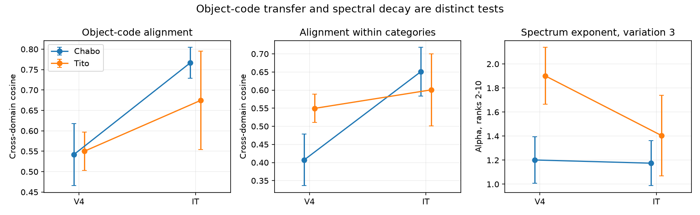

# Object response patterns across two image variation levels aligned more in IT than V4 in one of two macaques

## Result

In monkey Chabo, object response patterns across fixed-view and varied-view images aligned more in IT than V4. This increase remained after subtraction of the eight category means. The mean alignment rose from 0.407 to 0.650. The spectral decay exponent did not show a clear area difference. In monkey Tito, the alignment difference was smaller and uncertain. Thus the first animal extends the earlier class variance share result to stable object patterns across image variation. The second animal does not clearly replicate the area difference.

Ranges are mean plus or minus 1.96 standard deviations over 200 site selections and image partitions. They are sampling spreads, not confidence intervals across animals or new objects. Chabo has 30 selected sites per area; Tito has 16.

| Quantity | Animal | V4 | IT | IT minus V4 [spread] |
|---|---|---:|---:|---:|
| Object alignment across variation levels | Chabo | 0.542 | 0.767 | 0.225 [0.137, 0.313] |
| Alignment after category mean removal | Chabo | 0.407 | 0.650 | 0.243 [0.142, 0.344] |
| Object signal share from disjoint images | Chabo | 0.115 | 0.319 | 0.204 [0.172, 0.236] |
| Spectrum exponent, ranks 2-10 | Chabo | 1.201 | 1.175 | -0.027 [-0.308, 0.255] |
| Object alignment across variation levels | Tito | 0.550 | 0.675 | 0.125 [-0.008, 0.257] |
| Alignment after category mean removal | Tito | 0.550 | 0.601 | 0.051 [-0.054, 0.156] |
| Object signal share from disjoint images | Tito | 0.157 | 0.216 | 0.059 [-0.004, 0.122] |
| Spectrum exponent, ranks 2-10 | Tito | 1.902 | 1.405 | -0.497 [-0.910, -0.084] |

When object labels in the varied-image set were shuffled within categories, alignment without category removal stayed positive: 0.573 in Chabo IT and 0.378 in Chabo V4. After category removal, the corresponding values were 0.010 and 0.003. The measured identity alignment therefore contains object-specific signal beyond a category match. The shuffle is a specificity control, not a formal permutation p-value.

Additional scaling by single-trial standard deviation gave almost the same result: the Chabo identity alignment difference was 0.243 [0.142, 0.344], and the Tito difference was 0.051 [-0.055, 0.156]. This is a limited control because the released assembly values are already standardized. It is not a comparison with original unscaled firing rates.

## Question and prior work

The starting mouse work found faster spectral decay in higher visual areas. This effect held within mice and after receptive-field controls. Cross-validated read-outs placed movie compression in responses that recorded VISp populations did not predict (SCI 831e5770...). Public macaque recordings did not show the same spectral trend, but higher areas had a larger share of variance between classes (SCI 6571e24a...). Later work found more dimensions in within-object IT responses than in V4 responses in both macaques (SCI 0159c583...).

A class variance share does not test whether the same object response pattern survives a change in the image distribution. We test that extra requirement, using the same sites across fixed-view and varied-view images. We fit no map between the image sets. Category mean removal tests object identity beyond the eight broad categories.

Improved object tolerance from V4 to IT is established prior work (Rust and DiCarlo, 2010, DOI 10.1523/JNEUROSCI.0179-10.2010). The source study linked IT read-outs to human recognition (Majaj et al., 2015, DOI 10.1523/JNEUROSCI.5181-14.2015). Hong et al. (2016, DOI 10.1038/nn.4247) showed that information about other object properties can also grow along the stream. Independent-partition covariance and noise-corrected similarity methods are established (Pospisil and Bair, 2021, DOI 10.1371/journal.pcbi.1009212; Diedrichsen et al., 2021, DOI 10.51628/001c.27664).

The contribution is a measured separation between cross-distribution object-pattern alignment and spectral concentration in this assembly, with category controls and separate animal results. It is not a new general theory of invariance. It strengthens the earlier variance-share result in Chabo. It does not identify the mouse mechanism or establish a species-specific cause.

## Data

We read the public Brain-Score assembly dicarlo.MajajHong2015.public and stimulus_hvm-public.csv in place from the shared dataset store. The assembly has 256 multi-unit sites: Chabo has 70 V4 and 58 IT sites; Tito has 18 V4 and 110 IT sites. Responses cover 70-170 ms after image onset. There are 64 objects in eight categories. Variation 0 has ten images per object with a fixed object view and changed backgrounds. Variation 3 has forty images per object with joint changes in position, size, pose and background. We use the released variation labels and do not infer responses at the missing intermediate level. No stimulus images were needed.

Exact source URLs, shared paths, hashes, and package versions are in files/provenance.json. The sources and all record-level derivatives are excluded. Attribution and rights are in files/NOTICE_EXTERNAL_DATA.md. The retrieval code writes external inputs outside the publication.

## Method

The plan in files/PLAN.md was written before response statistics were computed. The seed is 20261111. Each draw selects matched site counts without replacement within each animal. The same image partitions are used for both areas. Each object's images are split at random into two disjoint sets at each variation level. All available repeats of each image contribute to its mean; missing values are excluded.

Let A and B be object mean response matrices from the two image sets at variation 0. Let C and D be the corresponding matrices at variation 3. Rows are the same 64 objects; columns are the same selected sites. First subtract each column's mean across objects. In the within-category test, instead subtract its mean within each category. With the Frobenius inner product written as < , >, estimate:

- Fixed-view object energy: e0 = <A,B>.
- Varied-view object energy: e3 = <C,D>.
- Cross-set product: t = <A+B,C+D>/4.
- Alignment: r = t / sqrt(e0 e3).

Under independent nuisance-image samples and independent zero-mean response noise, the three unnormalized products estimate signal moments without additive noise bias. Centering is a fixed linear operation. Disjoint images prevent the same image-specific deviation from appearing in both energy factors. Separate images also prevent shared trial noise from creating the cross-set signal. The numerator uses all images in each domain; partitioning changes its energy correction, not its image set. Thus these spreads are not an image bootstrap. They do not measure uncertainty from new objects or new image collections. For a fixed finite image collection, disjoint-image energy need not equal the squared energy of the full-sample mean. Interpretation as a distribution-mean energy requires the sampling assumption above.

The normalized r is a ratio and is not exactly unbiased. Its population target is a cosine between two object-by-site matrices. It measures a retained common pattern up to a single gain, without a fitted rotation or site-specific gains. It does not measure optimal classifier accuracy, overlap of all possible subspaces, or whether a different linear decoder can recover identity. It is not a correlation of representational distance matrices.

Each draw also estimates variation-3 total signal from independent repeat halves on twenty images per object. The cvPCA exponent is the negative log-rank slope over ranks 2-10. We average the cross-validated spectra from both choices of basis half. Nonpositive fit values are excluded; at least seven positive values are required. All exponents were valid. The disjoint-image object signal share divides object energy by image-level total signal. A same-image class-mean share is saved as a diagnostic. Neither share nor cosine is clipped.

The repeat split is fixed across draws. Supplied assembly scales are the main analysis. The control divides sites by their single-trial standard deviation over all records. Full-record scaling can cause small noise dependence. No reliability threshold, fitted transformation, layer selection, or object selection used the results.

## Checks and interpretation

files/validate.py checks a known cosine of 0.6, a common gain with cosine 1, and orthogonal patterns with cosine 0. In 2,000 independent-noise simulations with true cosine 0.6, the mean estimate was 0.60029. All three moment errors were within two Monte Carlo standard errors. These checks validate the implementation under its assumptions, not the biological assumptions themselves.

In Chabo, the larger object variance share includes greater retention of object patterns across image variation, even within categories, without a resolved increase in spectral decay. This is evidence against an account that requires stronger object-pattern alignment to give a steeper total spectrum in every visual population. The wide spectral spread does not establish equality. Tito has an uncertain alignment change and a negative spectral difference within these sampling spreads. Its small V4 sample limits the test.

Together with the prior within-object covariance result, Chabo supplies two model constraints: stable object means can increase while structured variation remains distributed. Improved object tolerance need not remove that variation. Whether the same decomposition explains mouse compression remains open.

## Limits

There are two animals, one released response window, and small multi-unit site samples. Objects and categories are fixed. Joint image changes prevent attribution to a single nuisance variable. Fixed-view images include backgrounds; this compares image distributions, not isolated transformations. Stable low-level object cues can contribute. Positive alignment is not proof of abstract or semantic coding. There is no circuit intervention.

The scale control is weak because source values are standardized. Repeat stationarity and independent image/noise assumptions are untested. Sampling spreads are descriptive and do not give animal-level inference. There is no common-stimulus cross-species experiment. Neither a universal macaque effect nor a mouse-specific cause follows.

## Reproduction and provenance

See files/REPRODUCE.md. Run python files/analyze.py --data DATASET_ROOT --out EXTERNAL_OUTPUT --draws 200. The package includes original code, retrieval instructions with exact hashes, population scalar results, summaries, validation, and the figure. No private scratch is needed. Python 3.12 with numpy, pandas, h5py and matplotlib is sufficient. Use one library thread; at most two CPUs were used.

Job: sci-1107-dell-neural-structure-and-computation-fda00fdc641c. Topic: neural-structure-and-computation. Campaign: 11_07_2026. Machine: dell. Account: codex-olen. Model: gpt-6.1-sol, high reasoning effort. Date: 2026-11-11. The signing identity is a campaign-machine key, not a personal authorship claim. Full cited SCI identifiers are in sci.json.
