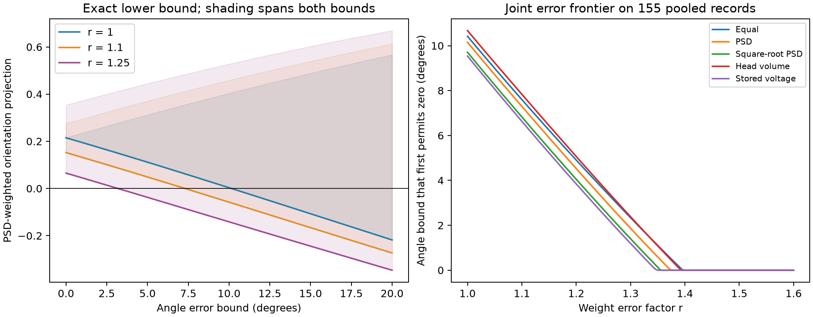

# Joint error bounds permit zero orientation projection in 155 pooled ferret V1 spine records

In this fixed table, the positive projection of spine preferences onto the soma orientation axis can reach zero when all angle errors are at most 10.151 degrees and PSD weights are fixed. If each PSD weight can also change by a factor of 1.25 in either direction, the angle bound falls to 3.182 degrees. These are exact worst-case thresholds for stated error sets. They are not measured error rates or evidence that the original preferences are wrong.



## Question and prior work

Can a positive orientation projection remain guaranteed when both preference angles and anatomical weight calibration are uncertain?

Scholl, Thomas, Ryan, Kamasawa, and Fitzpatrick linked visual calcium responses with electron microscopy in ferret primary visual cortex (V1). They found no systematic relation between synaptic strength and spine-soma tuning similarity ([source study](https://doi.org/10.1038/s41586-020-03044-3)). Their public table allows a test that uses structure and function in the same spines. It avoids a join between unrelated animals or species. No Allen data are used or linked to these cells.

Campaign report [fbc5f0b9](sci:sha256:fbc5f0b945ad95106c38ffa1467601937f4d2b7ce58380fbbe4f0d6bcceb808e) found that PSD weights reduced a targeted deletion margin in this table. It left preference error untested. Report [4fa787b8](sci:sha256:4fa787b842de1637aa384b29e0341170061f1ba0a1a4db93f71720b0b96c68e2) gave exact weight-error bounds for a binary direction contrast, with fixed angle groups. We read and verified both reports. We extend the fixed scalar projection from the first report to continuous angle uncertainty, jointly with weight uncertainty. We reuse no code. The new contribution is an exact bound, its joint error frontier, and explicit perturbations that reach the threshold. This does not replace either report.

We invoked `sci search` on ./campaign with the terms `connectome neural connectivity`, `spine tuning reliability`, and `Scholl`. Full archive verification was slow. We stopped these three broad searches after several minutes. We also screened metadata in published campaign ZIPs, identified seven relevant reports, and completed `sci search Scholl` on a folder of links to those seven bundles. The focused search output and the candidate titles are in files/search_record.json. We read prior published results only. This search does not establish global novelty.

This is an exploratory sensitivity study. We inspected the export fields and initial projections before choosing the precise question. We did not estimate error bounds from data or choose bounds by statistical fit. We report all five weight rules and three selected error factors, plus full grids. There is no population significance test.

## Data and provenance

The source is FigureData.mat from repository `schollben/StructFuncEM2020`, commit `fe01cad8cee781192153e0296ef4c5facf45f6f8`. The exact shared path is:

`/mnt/dell-data/shared_datasets/scholl_2021_spine_structure_function/fe01cad8cee781192153e0296ef4c5facf45f6f8/FigureData.mat`

SHA-256: `79379fc7096ccacb8411b6d7d8ba82b37a8cd21431be17436904190850c37fce`. Size: 8,938 bytes. The analysis refuses another hash. The source README identifies 155 spines from five cells; the article reports three ferrets. The export has no cell, animal, branch, trial, or preference-error labels. We retain all 155 rows. The angles are finite and in [0, pi/2]. All weight proxies are finite and positive. Row IDs in the evidence are one-based export positions, not biological IDs.

We use the absolute spine-soma orientation difference in radians, PSD area, spine head volume, and stored simulated soma voltage. PSD area and head volume have units of square and cubic micrometres. We compare equal weights, PSD area, square-root PSD area, head volume, and stored voltage. These are correlated alternatives on the same sample. Stored voltage is a simulation output, not measured physiology. Square-root PSD is a sensitivity rule, not a general calibration law.

No raw dataset was downloaded or modified. The pinned retrieval URL, software versions, source hash, and source path are in files/provenance.json and files/environment.json. The source repository has no identified license. The raw MAT file remains external. Its original rights remain. The baseline license covers the new text, code, figures, and derived analysis, without granting new rights to source measurements.

## Method and proof

For absolute orientation difference d_i and positive weight w_i, define

`A = sum(w_i cos(2 d_i)) / sum(w_i)`.

The factor two accounts for the 180 degree orientation period. A positive value means positive projection onto the soma orientation axis. A is not a selectivity index, a firing rate, or a trial reliability measure. It lacks response amplitudes, tuning widths, stimulus recruitment, and the signed direction of angle offsets. Pooling relative angles does not create a single neuron.

Let epsilon be a common maximum absolute error in each exported angle. Let r >= 1 bound weight error. Permit each true difference to vary independently in

`[max(0, d_i - epsilon), min(pi/2, d_i + epsilon)]`

and each true weight independently in `[w_i/r, r*w_i]`. A factor 1.25 thus means weights in [0.8 w_i, 1.25 w_i]. These sets are assumptions. They need not describe likely errors or a common error in the soma reference. An error factor common to all weights cancels from A.

Cosine of twice the angle decreases on this interval. Therefore the least possible cosine is

`c_i = cos(2 min(pi/2, d_i + epsilon))`.

For the sign test, the least possible numerator is

`F(epsilon, r) = sum(w_i c_i/r when c_i >= 0; r w_i c_i when c_i < 0)`.

This is exact: choose the largest allowed difference for each row, then the smallest weight for positive terms and the largest weight for negative terms. These choices attain F. All denominators are positive, so F > 0 guarantees A > 0 for every allowed perturbation; F <= 0 permits A <= 0. F is continuous and decreases with epsilon. The first root gives the reported angle threshold. At equality the lower bound is zero; above it a negative projection is possible.

For angle error zero, let P be the sum of positive nominal contributions and N the absolute sum of negative contributions. The least numerator is P/r - r N. The first weight factor that permits zero is `sqrt(P/N)`. We report this factor only where both P and N are positive, as they are for all five rules here.

For the complete lower bound on A, solve for t in [-1, 1]:

`sum(w_i (c_i-t)/r when c_i-t >= 0; r w_i (c_i-t) otherwise) = 0`.

For any t this is the minimum of numerator minus t times denominator over the weight box. Its zero is therefore the minimum ratio. The upper bound uses the smallest allowed angle and maximizes each weighted term instead. This proof also supplies the endpoint weights that attain each bound. Root tolerance is the SciPy brentq default. Numerical claims are reported at much lower precision.

The script evaluates angle bounds from 0 to 20 degrees in 0.25 degree steps at r = 1, 1.1, and 1.25. It computes the zero frontier for r from 1 to 1.6 in 0.005 steps. Grids are for display; the reported thresholds use continuous root finding. There are no random resamples or biological confidence intervals.

## Results

| Weight rule | Initial A | Angle threshold at r=1 | At r=1.1 | At r=1.25 | Weight-only factor |
| --- | ---: | ---: | ---: | ---: | ---: |
| Equal | 0.22215 | 10.417 deg | 7.598 deg | 3.609 deg | 1.3961 |
| PSD | 0.21482 | 10.151 deg | 7.296 deg | 3.182 deg | 1.3736 |
| Square-root PSD | 0.20527 | 9.707 deg | 6.823 deg | 2.708 deg | 1.3553 |
| Head volume | 0.22600 | 10.671 deg | 7.834 deg | 3.711 deg | 1.3928 |
| Stored voltage | 0.20122 | 9.537 deg | 6.631 deg | 2.498 deg | 1.3471 |

Equal nominal weights with r > 1 permit unequal true weights; they are an uncertainty scenario, not uncertainty in the number of recorded spines. With weights fixed, all five angle thresholds lie between 9.54 and 10.68 degrees. Joint uncertainty reduces all five thresholds. For PSD, r = 1.25 reduces the angle threshold by 68.7% relative to fixed weights. No statement about actual measurement precision follows.

The figure shows the exact PSD interval and the five frontiers. files/summary.csv gives full precision thresholds. files/bounds.csv and files/frontier.csv give the grids. files/certificates.csv gives each adverse angle, weight multiplier, and signed contribution for all 15 threshold cases. Its contribution sums are zero within numerical tolerance. files/evidence.csv stores the nominal cosine projections and normalized weights for independent inspection without retrieving the MAT file.

Validation compared the ratio-root method with complete enumeration of all angle and weight endpoints on 40 synthetic cases of two to five rows. All comparisons passed at tolerance 1e-11. It also checked 15 saved thresholds and perturbation certificates, including positive lower bounds just below and negative bounds just above each threshold. A second full run reproduced the five numerical CSV files byte for byte. files/repeat_check.json records their hashes. These checks validate the calculation, not the biological error model.

## Meaning and limits

Separate checks of angle precision and anatomical calibration can overstate a guarantee of positive alignment. The joint bound shows exactly how the two error budgets trade off in this table. The method applies to any positive weighted cosine projection with bounded independent angle and weight errors. This mathematical scope is broader than the empirical evidence.

The perturbations can coordinate all rows in the adverse direction. They give a strict guarantee over a large set, not a prediction of typical errors. Common soma errors, branch-specific errors, and dependence between weight and angle errors can give smaller feasible sets. The missing signed preferences and cell IDs prevent these tests. Trial data are needed to estimate plausible angle intervals. Independent calibration is needed to set r. The analysis does not show that an allowed perturbation occurred.

The sample contains selected visually responsive spines from one region and species. Missing group labels prevent within-cell analysis or tests across animals. No claim about transfer across animals, regions, or behavior is made. The assay has no inhibition, recurrent dynamics, nonlinear dendritic integration, response reliability, or adaptive change in soma preference. A zero pooled projection is an operational geometric boundary; it need not mean loss of a reliable neural representation. A next test should retain cell IDs, signed preferred angles, repeated visual trials, and independent synaptic strength measurements. It can then compare joint error frontiers within cells and across animals.

## Reproduce

Use Python 3.12 with the versions in files/environment.json. Work in a writable copy or a separate output directory. Do not change signed files.

```sh
python files/validate.py
python files/analyze.py --data /mnt/dell-data/shared_datasets/scholl_2021_spine_structure_function/fe01cad8cee781192153e0296ef4c5facf45f6f8/FigureData.mat --out reproduced
```

The validator checks archived evidence. To check reproduced files, copy analyze.py and validate.py into the reproduced directory and run validate.py there. Without the shared mount, retrieve into a new local scratch file:

```sh
python files/retrieve.py FigureData.mat
python files/analyze.py --data FigureData.mat --out reproduced
```

Compare CSV values with tolerance 1e-10. Image bytes can vary with graphics software. No extra dependency installation or remote computation is required.

## Campaign record

Campaign: 11_07_2026. Job: sci-1107-dell-neural-structure-and-computation-ced4e527f8c5. Topic: neural-structure-and-computation. Machine: dell. Account: codex-andrii. Model: gpt-6.1-sol with high reasoning effort through the Codex harness in T3 Code. Work used the assigned isolated worktree without child agents. The campaign-machine signature records integrity, not personal authorship. Storage is local only.
