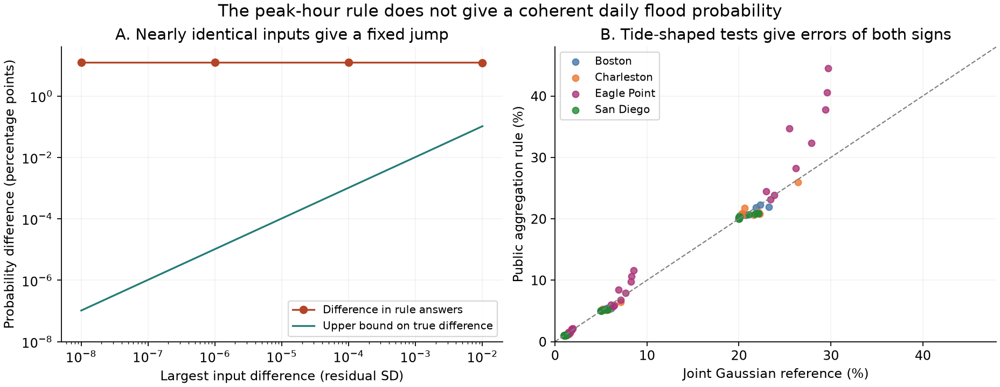
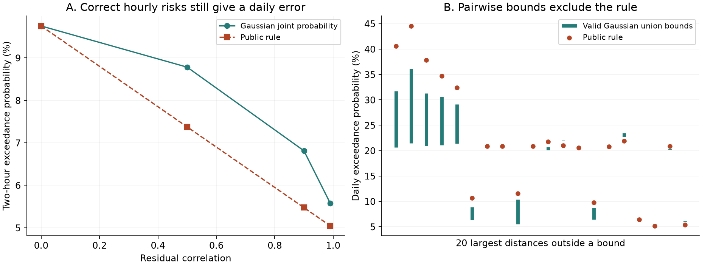

# A public NOAA flood rule has a 12.23 percentage point jump in a fixed Gaussian tide test

A daily flood probability should change continuously when a tide changes by a very small amount, if the residual water-level distribution stays fixed and has continuous marginals. The daily aggregation rule in one public NOAA CO-OPS source version fails this test. In a 24-hour Gaussian example, two tide vectors that approach the same flat tide give limiting probabilities of 42.29% and 30.06%. The 12.23 percentage point gap comes from the choice of the highest tide hour. It remains when the hourly marginal probabilities and residual correlations are exact.

A separate test uses 36 tide shapes and residual correlations from four NOAA gauges. For 108 Gaussian model cases, the rule has errors from 16.8% low to 50.0% high. Gaussian pairwise probability bounds exclude its answer in 90 cases; 73 violations exceed 0.0001 probability. Thus the rule has a structural error. The errors have both signs, and the test does not explain the earlier observed deficit in low flood probabilities.

## Question and prior work

The selected SCI studies tested public hazard products and found several errors in their probabilities. SCI 854385b61e2f4384938bf71092a8468f40349f503a6c26fe8d3a2d44eba63973 recently tested daily probabilities in the NOAA Monthly High Tide Flooding Outlook. It found useful forecast updates, but 191 flood station-days below 5% probability against 47.1 expected in January-October 2026. That finding motivates this study. We reuse four of its exact hourly observation snapshots, not its scored forecast table.

Dusek et al. (2022), [doi:10.3389/fmars.2022.1073792](https://doi.org/10.3389/fmars.2022.1073792), describe the model and a retrospective skill test. The model converts hourly probabilities to daily risk with an autocorrelation adjustment. Hovenga et al. (2025), [doi:10.3389/fmars.2025.1618367](https://doi.org/10.3389/fmars.2025.1618367), show that real hourly residuals often have skewed, heavy tails. Here we hold the marginal distributions correct by construction. This separates aggregation error from errors in those tails.

The [new NOAA PSL experimental outlook](https://www.psl.noaa.gov/forecasts/sealevel/) already computes daily risk from ensembles of hourly realizations and changes other model parts. We do not introduce that approach or test that new product. Our contribution is a discontinuity proof, a rare-event consequence for the older rule, and a reproducible tool to test the rule with known Gaussian inputs and pairwise bounds.

Campaign searches for hazard calibration, tsunami, ShakeMap, landslide, flood outlook and autocorrelation preceded the precise design. They found many small correction studies and the recent daily flood test, but no returned publication with this rule audit. This is not proof of global novelty. The local plan was written before the numerical tests. The anchor proof and pairwise bounds were added after the first run gave errors of both signs. The plan and amendment are in files/plan.md. They were not publicly preregistered.

## The tested rule

We inspect public commit `a41ed82bd9355394ea0b460048e47ee4a001b6ae` of [NOAA-CO-OPS/Seasonal_High_Tide_Flooding_Prediction](https://github.com/NOAA-CO-OPS/Seasonal_High_Tide_Flooding_Prediction/tree/a41ed82bd9355394ea0b460048e47ee4a001b6ae). In HTF_predict.m, the daily block uses the highest adjusted tide as anchor a. It computes

`q = 1 - product_h(1 - w_ah * p_h)`,

where `p_h` is the hourly exceedance probability, `w_aa = 1`, and `w_ah = 1-r_ah` at other hours. Here `r_ah` is the Pearson correlation of residual height at the corresponding lag. Pearson correlation of heights does not equal the fraction of independent exceedance events.

The paper's Equation 9 is a sum of adjusted hourly terms. The pinned code uses a product of no-exceedance terms. We test the code formula. The two have the same first-order term as probabilities go to zero. We use exact Gaussian marginal probabilities in place of the source's 0.005 m lookup grid. Mean and spread are constant across tide height, so the highest tide is also the largest marginal probability. This is an isolated test of the aggregation formula, not a full replay of the operational model. Source hashes and line locations are in files/source_code_provenance.json and files/source_audit.md. MATLAB/Octave was unavailable; the source function itself was not executed.

## The anchor proof

Take 24 standard normal residuals with correlation `r_k = 0.95^k`. This is a valid stationary Gaussian covariance. Let every hourly exceedance probability tend to 5%. Make one hour the unique highest tide with a positive change of epsilon residual standard deviations.

As epsilon tends to zero, an edge peak at hour 0 gives `q = 0.4228942408`. A middle peak at hour 11 gives `q = 0.3005628023`. The difference tends to `0.1223314386`.

Both tide vectors approach the same flat tide. For any fixed joint law with continuous marginals, the true union probability is continuous in the hourly thresholds. A union bound on threshold slices proves this. More specifically, the true probability difference for these two inputs is at most `Phi(z)-Phi(z-epsilon)`, where z is the normal 95th percentile. At epsilon = 1e-8, this is about 1.03e-9. The rule's gap is still about 0.12233. At least one of the two limiting answers must therefore have an absolute error of at least 6.12 percentage points.

The proof does not need Gaussian joint dependence for continuity; continuous marginal distributions suffice. The Gaussian AR(1) example supplies a valid covariance and explicit numbers. It is an artificial flat-tide example. We do not claim that an observed station had this jump. Files/proofs.md gives the full proof and scope.

## A second structural limit

For a flat tide, let all hourly thresholds tend to infinity. In a fixed nondegenerate Gaussian vector, joint exceedances of each pair are of smaller order than a marginal exceedance. This is classical Gaussian asymptotic independence; see Sibuya, [doi:10.1007/BF01682329](https://doi.org/10.1007/BF01682329). Therefore the true daily probability is asymptotic to `24*p`.

The code instead gives `p * [24 - sum_{h != a} r_ah]` to first order. For the same correlation sequence, its ratio to the true probability tends to 0.4517 with an edge anchor and 0.2948 with a middle anchor. This consequence for the public rule is new in this audit; the Gaussian tail theorem is not. A fixed higher tide at one hour can change the limit. The flat-tide condition is essential.

A two-hour calculation gives a finite-threshold example. With both hourly risks 5% and residual correlation 0.9, the rule gives 5.475%, while Gaussian integration gives 6.8132%. With unequal hourly probabilities, the error can reverse sign. Files/two_hour_cases.csv gives all 60 specified cases and files/rare_limit.csv gives the flat-tide limits.

## Tests with observed tide shapes

We use the four example gauges in Dusek et al. (2022): Boston 8443970, Charleston 8665530, San Diego 9410170, and Eagle Point 8771013. This prior choice avoids selection by our numerical results. Hourly observations come from the fixed 11 November 2026 shared snapshots. New hourly astronomical predictions cover January-September 2026 in the same local civil time, feet and MHHW datum. All eight exact file hashes and shared paths are in files/source_provenance.json.

For each gauge we subtract the predicted tide, remove inferred observations, interpolate missing hours, and detrend the residual. Each series spans 6,552 clock hours; 14-28 hours need interpolation. A biased autocorrelation estimate supplies lags 0-23. Its Toeplitz matrix has positive eigenvalues at each site. The source code uses similar interpolation, detrending and normalized autocorrelation. We use nine months for this diagnostic, not the operational model's training record. Hour-1 correlations range from 0.931 to 0.990.

The tide on the 15th of each month supplies nine fixed shapes per gauge. We place a threshold above each daily tide peak so that its largest hourly probability is 1%, 5% or 20%. The observed residual standard deviation sets the tide amplitude in Gaussian standard units. There are 36 templates and 108 model cases. These are selected Gaussian experiments, not actual forecast probabilities or measured flood days.

For each gauge, eight independently scrambled Sobol sets generate Gaussian paths with the fixed full covariance. The final run has 262,144 paths per set. We compute the probability that any hourly water level crosses the threshold. The earlier 65,536-path run is retained as a convergence check. The largest probability change between runs is 0.000445. Replicate-based 95% numerical half-widths in the larger run are at most 0.000349. These are estimates of integration variation; they are not confidence intervals for ocean conditions or guaranteed error bounds.

| Largest hourly risk | Rule sum / reference sum | Smallest relative error | Largest relative error |
|---|---:|---:|---:|
| 1% | 0.9640 | -16.8% | +14.4% |
| 5% | 1.0125 | -10.9% | +35.3% |
| 20% | 1.0571 | -6.4% | +50.0% |

Each row compares 36 cases. Pooled ratios are descriptive summaries of equally selected model cases. They are not calibration ratios for observed floods. Small errors of opposite signs can also cancel.

The largest low error is the Charleston August shape at 1% peak risk: rule 1.2493%, reference 1.5012%. The largest high error is the Eagle Point August shape at 20% peak risk: rule 44.5485%, reference 29.6896%. At 1% peak risk, the pooled deficit is about 3.6%, much smaller than the fourfold low-probability discrepancy in the prior operational test. The thresholds, population and conditions differ, so this is not an estimate of the share of that discrepancy due to aggregation.

## Independent bounds and checks

The utility in files/bounds.py uses exact Gaussian pair probabilities from one-dimensional quadrature. It combines second-order Bonferroni lower bounds with the established [Hunter spanning-tree upper bound](https://doi.org/10.2307/3212481). No new probability bound is claimed. These checks use no 24-dimensional simulation.

The public rule is below the lower bound in 41 cases and above the upper bound in 49 at a tolerance of 1e-9. At a larger tolerance of 0.0001, the counts are 39 and 34. The largest summed quadrature error estimate is 3.42e-11. These estimates are not formal interval arithmetic. For Eagle Point in August at 20% peak risk, the valid upper bound is 36.0876%, already below the rule's 44.5485%; the simulated reference is lower still. Thus simulation noise cannot explain that failure.

A separate scalar rule implementation agrees to 2.23e-16. A conditional-normal integral and a correlation-derivative integral agree to 1.12e-16 across the 60 two-hour cases. Independent and fully dependent limits pass. Three of the 108 individual 95% simulation intervals do not overlap the pairwise bounds; the largest reference distance outside a bound is 0.000228. All reference estimates are within the union bounds after allowance for five replicate standard errors plus one path of count resolution. This is a numerical check, not a formal guarantee. Individual numerical intervals do not give simultaneous coverage, and one almost single-hour case has zero estimated replicate variation despite grid error. The bounds provide the stronger check in narrow cases. All estimates are retained, including these discrepancies.

An extra synthetic check gives a probability above one (1.00881) with two 99% marginal probabilities and residual correlation -0.9. This is another limit of the unclipped formula, not an observed property of the four gauge fits, whose tested lag correlations are positive.

## Meaning and limits

Correct hourly probabilities and correct residual-height autocorrelation do not make this daily rule correct. The peak-hour dependence creates a discontinuity, and a correlation weight is not a joint exceedance model. A coherent calculation must specify joint residual behavior or use suitable bounds. Simply replacing the Gaussian marginal tail cannot repair the anchor defect in this isolated formula.

This is a structural audit, not proof that the current NOAA production product has a given operational bias. We did not recover issued hourly states or verify the exact production executable. Real residuals are not Gaussian, and their tide dependence, seasonal changes and monthly mean forecast errors can matter. The covariance estimates use the same 2026 period as the selected tide shapes; they are diagnostic inputs, not advance forecasts. Four prior-selected stations and 36 dates do not span U.S. conditions. The artificial flat-tide jump need not be common in practice.

The evidence challenges a simple explanation of the earlier underprediction: this formula can be high as well as low. Quantitative attribution of that observed deficit still needs archived hourly probabilities, fitted residual laws and production states. The proof and bounds remain useful without that attribution. They identify a specific algorithmic failure that can be tested in other implementations.

## Reproduction and provenance

Use Python 3.12 and files/requirements.txt. Set `OPENBLAS_NUM_THREADS=1`, `OMP_NUM_THREADS=1` and `MKL_NUM_THREADS=1`. One analysis process is sufficient.

1. Obtain the eight snapshots in files/source_provenance.json. On this machine, `--data-root ./datasets` uses the shared immutable datasets. They resolve under `/mnt/dell-data/shared_datasets`; these compatibility paths are on the HP SSD. No failed disk path is used. The four tide dataset names end in `20261111-e18e`; the reused observation names end in `20261111-a54089`.
2. On a different host, run `python files/retrieve.py --data-root /absolute/path/external_data --source-code`. It checks exact hashes and refuses changed live responses. The pinned NOAA code and its original license are written outside the publication. If an API has changed, obtain the recorded shared snapshot; later live bytes are not an exact reproduction.
3. Run `python files/analyze.py --data-root /absolute/path/external_data --out /absolute/path/scratch/run18 --exponent 18 --replicates 8`. This regenerates covariance fits, all 108 model results, source provenance, and external daily vectors. Run with exponent 16 into a separate scratch folder to repeat the convergence check.
4. Run `python files/audit.py --results /absolute/path/scratch/run18 --out /absolute/path/scratch/audit`. This rebuilds the pairwise bounds, scalar checks, bivariate checks, and anchor experiments.
5. Run `python files/figures.py --results files --out /absolute/path/scratch/figures` to redraw the figures from the bundled aggregate and model results.

6. Run `python files/check_proof.py --out /absolute/path/scratch/proof.json` to check the headline limits with 60-digit standard-library decimal arithmetic.

Analysis and audit outputs must stay outside the signed package. Raw records, NOAA code and daily tide vectors are external. Original code, proofs, all model comparisons, covariance aggregates, source hashes and figures are bundled. Files/NOTICE.md separates source attribution from the unchanged SCI baseline LICENSE. No source license is replaced.

Job: sci-1107-hp-earth-and-ocean-sciences-e18e2254cc21. Campaign: 11_07_2026. Topic: earth-and-ocean-sciences. Machine: hp. Account: codex-olen. Model: gpt-6.1-sol, high reasoning effort. The investigation used the assigned isolated worktree, no agents, and at most two compute processes with one library thread each. The campaign-machine signing key is not a personal authorship claim or NOAA endorsement.
