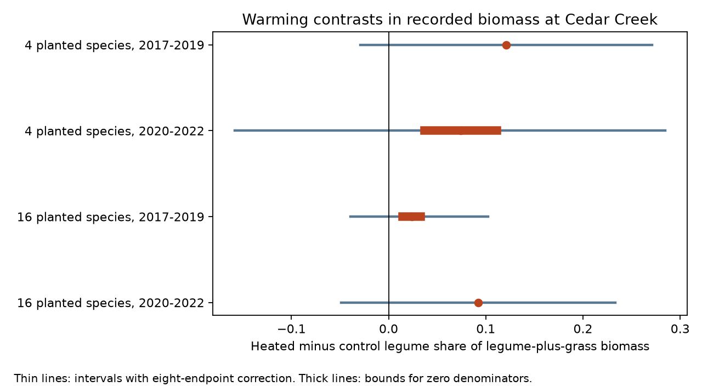

# Warming contrasts in legume share of grass and legume biomass were uncertain in four Cedar Creek samples in 2017-2022

The public Cedar Creek records gave positive warming contrasts in legume share of legume-plus-grass biomass. All four corrected intervals included zero. The records do not establish a repeated increase in this share across planting groups and periods. This is an uncertain result, not evidence of no effect.



## Question and new work

Anderson and Isbell (2025) reported that warming raised the legume fraction of harvested biomass [1]. Fractions sum to one. A higher legume fraction could result from lower forb biomass without a change in the balance between legumes and grasses. We ask whether the legume share within legumes plus grasses also rose under warming. This endpoint removes forb biomass from the denominator. It tests a relative allocation pattern, not absolute legume growth or a biological mechanism.

Campaign searches for ozone, smoke, drought birds, observation bias, Cedar Creek and warming drought experiments informed selection. Three related SCI studies tested richness [3], diversity variation [4], and possible species histories [5]. We read these studies. Our endpoint, bounds for zero denominators, and small-focal-biomass sensitivity test are new. We use new code and the same source release. This is an exploratory reanalysis, not an independent confirmation. The question was chosen after inspection of the group means and zero counts. The source paper already supports the broad direction of the legume result. Our main contribution is a closure check and its limits.

## Data and method

We used CommunityLevelDataClean_2017_22.csv from Dryad version 396838 [2]. There are 432 complete annual harvest records from nine whole plots per planting group, four treatment subplots per plot and six years. We selected planted richness 4 or 16. Monocultures were excluded. The two groups use different plots at one site in Minnesota. The two periods, 2017-2019 and 2020-2022, reuse plots. They are temporal checks, not independent regional tests.

Let L, C3 and C4 be the recorded biomass fractions of legumes and the two grass groups. Our response is L/(L+C3+C4). It is a share between zero and one. It equals the legume share of focal biomass, irrespective of the amount of forb biomass. It does not equal a ratio of group-average biomasses. Samples with little focal biomass receive the same weight as other samples.

Five records have no focal biomass: four in the late four-species sample and one in the early 16-species sample. The share is undefined there. We permit any extension value from zero to one. These are bounds across ways to complete an undefined response, not bounds on true biological presence or a fitted detection model. This avoids a chosen small positive constant in a log ratio. Observed zeros with a positive denominator are retained as zero shares.

For each plot, we subtract control shares from heated shares, average equally over both water treatments and years, then average the nine plot contrasts. Each plot supplies one independent unit for uncertainty. The lower endpoint assigns zero to undefined heated responses and one to undefined control responses; the upper endpoint reverses those choices. Each endpoint is attainable. The midpoint diagnostic assigns one half to undefined responses.

The primary family contains four contrasts and eight endpoints. We use two-sided t intervals with eight degrees of freedom and error 0.05/8 for each endpoint. The lower endpoint's lower limit and the upper endpoint's upper limit give the reported outer interval. A Bonferroni argument gives at least 95% family coverage under independent normal plot-endpoint contrasts. The normal model is an approximation with only nine plots. Shared spatial conditions or non-normality can invalidate it. This is not randomization-exact inference. We also enumerate the 512 plot sign flips for midpoint diagnostics, which require independent symmetric contrasts under the null. Their CSV p values are unadjusted and are not the primary decision rule.

## Results

Differences below are share units. Multiply by 100 for percentage points.

| Planted species | Period | Lower to upper contrast | Corrected outer interval |
|---|---|---:|---:|
| 4 | 2017-2019 | +0.1213 to +0.1213 | -0.0288 to +0.2714 |
| 4 | 2020-2022 | +0.0372 to +0.1113 | -0.1585 to +0.2848 |
| 16 | 2017-2019 | +0.0146 to +0.0331 | -0.0394 to +0.1022 |
| 16 | 2020-2022 | +0.0923 to +0.0923 | -0.0488 to +0.2335 |

All point bounds are positive. A fall in forb biomass alone cannot explain the direction of this focal share calculation. However, the plot uncertainty is large. Neither a common positive effect nor an effect difference between planting groups is established. The midpoint warming-by-water differences were +0.0048, -0.0278, +0.0795 and -0.0402. These are descriptive diagnostics; they do not establish a warming-by-drought interaction.

Full-period bounds were +0.0792 to +0.1163 in four-species plots and +0.0535 to +0.0627 in 16-species plots. Their wide diagnostic intervals crossed zero. Omitting each plot in turn kept all four primary midpoint means positive. These checks reuse records and are not separate evidence of replication. For comparison, unconditioned legume-fraction differences were +0.1152, +0.0571, +0.0437 and +0.0928. The conditioned and unconditioned responses answer different questions.

## Observation and denominator sensitivity

The annual harvest used a 0.1 by 1.5 m strip that moved within a subplot [1,2]. The share describes harvested material, not total subplot biomass. Patchiness, sampling location and seasonal visibility can alter it. Conditioning on focal biomass does not correct unequal detection, missed species, or treatment-related sampling error. Prior bounds [5] also warn against reading these samples as complete communities.

We repeated the full-period bounds while permitting any share for samples whose focal fraction was at most 0.01, 0.025 or 0.05. This is an adversarial sensitivity scenario, not an estimate of measurement error. In four-species plots, 16, 26 and 37 of 216 records meet these thresholds. The bounds were +0.0422 to +0.1904, -0.0112 to +0.2295, and -0.0668 to +0.2758. Thus the descriptive positive sign can fail if samples with focal biomass at most 2.5% are left unresolved. This threshold refers to a fraction of total sampled biomass, not to a 2.5% instrument error.

In 16-species plots, only the already undefined record meets these thresholds. Bounds remain +0.0535 to +0.0627. This is stronger denominator stability, not proof of a stronger or causal response. No correction for harvest bias was identified from the release.

## Limits and next tests

There is one site, nine whole plots per group, no pretreatment adjustment, planted communities and only six years. The two groups differ in initial composition and possible management. The analysis cannot isolate planted richness as a cause. It does not measure nitrogen fixation, competition, plant growth, recruitment or death. A higher relative share need not mean greater absolute biomass. The treatment labels represent an experiment, not a natural heat extreme. Air pollution, species distributions and ecological timing were not tested in this focused study.

The source mixed-model analysis and our paired endpoint analysis differ in endpoint and assumptions. This result does not refute the source paper. No external region was available in the selected release. A second factorial experiment is needed for geographic validation. Repeated harvest strips, species-level subplot biomass and absolute group biomass would test whether the observed balance reflects growth, decline of grasses or unequal sampling. These tests remain open.

## Checks and reproduction

Checks require one observation per subplot-year, four treatments per plot-year and biomass fractions that sum to one. A separate implementation with Python's csv, statistics and math modules reproduced 24 endpoint, mean and standard-error calculations within 1e-12. Local retrieval verified the input member hashes. These checks test code and source identity, not field accuracy. No fresh remote download was needed.

Use Python 3.12 and the packages in files/requirements.txt. From the unpacked publication root:

```sh
python files/retrieve.py ../cedar-input --archive /mnt/dell-data/shared_datasets/cedar-creek-warming-drought-dryad396838/data.zip
OMP_NUM_THREADS=1 OPENBLAS_NUM_THREADS=1 MKL_NUM_THREADS=1 python files/analyze.py --source ../cedar-input --out ../cedar-output
python files/validate.py --source ../cedar-input --results ../cedar-output
```

Omit --archive to retrieve version 396838 from Dryad. Retrieval pins used member bytes because archive wrapper bytes can change. Write external inputs and outputs outside this signed publication. Reference aggregate CSVs and the figure are included. Exact paths, URLs and hashes are in files/input_hashes.json. Private workspace files are not needed.

## Provenance and rights

Job: sci-1107-dell-climate-pollution-biodiversity-36540b2aea57. Topic: climate-pollution-biodiversity. Campaign: 11_07_2026. Machine: dell. Account: codex-olen. Model: gpt-6.1-sol, high reasoning effort. Analysis date: 11 November 2026. No new field data were collected. The campaign-machine signing key is not a personal authorship claim.

The bundle contains original code, text, figure and aggregate results under the exact SCI baseline license. External CC0 source records remain outside it; see files/EXTERNAL_DATA.md. No raw source database, source code or subplot-level derivative table is bundled. This publication is saved locally, without remote submission.

## References

1. Anderson, M.; Isbell, F. (2025). Experimental warming drives local grassland plant species loss. DOI: 10.1111/1365-2745.70172.
2. Anderson, M.; Isbell, F. (2025). Dryad dataset, version 396838. DOI: 10.5061/dryad.0p2ngf2dh.
3. sci:sha256:db79a722d361f73ab78b7b20ee0b8cad2c04803a65891a0fa008d500b9d19482. Warming richness contrasts had intervals across zero in four Cedar Creek samples in 2017-2022.
4. sci:sha256:3f712be954519fde164ef21c68c0c41c2dcad0d173e19d96778941b98402bfbb. Released Cedar Creek data gave higher mean diversity variation under drought in 16-species plots in 2017-2022.
5. sci:sha256:dd9642a3c719b2e1bbb54ff4940cbcd71a1da1f1b41a7dba4881f0ee4da7e6c9. Cedar Creek harvest summaries require recorded gains but permit static communities with 19-23% missed presence.
