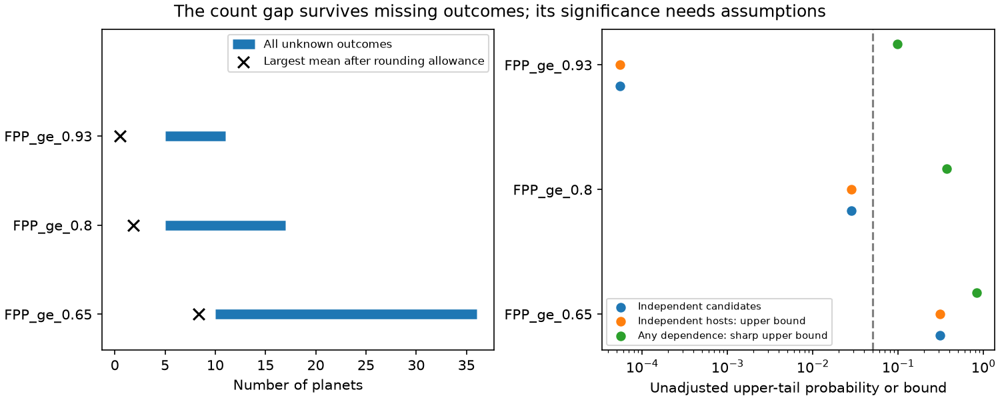

# Five measured-mass planets exceed the 2021 TRICERATOPS count for 16 high-FPP TOIs under independent hosts

The 2021 TRICERATOPS table contains 16 TESS Objects of Interest (TOIs) with reported false-positive probability (FPP) at least 0.93. Five have planets with measured masses in the published 2026 outcome table. Their published probabilities predict at most 0.49 planets after an allowance for rounding. Under independent hosts, the probability of at least five planets is 0.00005475. A correction for the full cutoff search and two outcome definitions gives 0.00887. All 16 targets have different TIC identifiers. This result does not require an assumption about the outcomes of unclassified targets or the probability of follow-up.

The result is narrower than a general recalibration. With arbitrary dependence between hosts, the sharp upper probability is 0.098. If only the four discoveries after 2021 are counted, the adjusted probability is 0.148. Thus this investigation finds a defect in the extreme published probabilities under independent hosts. It does not establish a fully forward rejection or a general correction factor for occurrence studies.



## Question and contribution

The selected SCI work found that 2021 TRICERATOPS FPP values predict too many false positives in later follow-up. Its full resolved sample is subject to selective follow-up and some planet validations use the same tool. We ask whether a count test can avoid those two problems. We also test rounding, host dependence, the search over cutoffs, and the time order of confirmations.

This study adds an exact test that uses known planets as a lower bound on the total planet count. It finds a small extreme-FPP group for which measured masses alone are enough to reject the numerical probabilities, conditional on independent hosts. It also shows that one early discovery is necessary for the cutoff-search-adjusted rejection. These are aggregate tests of published forecasts, not new planet detections. We did not run the current TRICERATOPS code.

Prior work includes Giacalone et al. (2021, doi:10.3847/1538-3881/abc6af), the selected SCI forecast test, and work on bounds for dependent Bernoulli sums (doi:10.1287/ijoo.2019.0038). The probability bounds are established methods; we do not claim their invention. The new contribution is their use with partially observed TESS outcomes, a full published-FPP cutoff search, and an audit of the physical and temporal endpoints. NASA separates reliability from completeness in its [Kepler documentation](https://exoplanetarchive.ipac.caltech.edu/docs/Kepler_completeness_reliability.html). This study concerns reliability only.

## Data and endpoint checks

We use the 385-row joined outcome table in SCI publication 434ee8c005d10e3938ec3e5252ee06ef6f7e8830823099f4b6726f2254df6b0f. We exclude 11 false alarms, since TRICERATOPS models astrophysical signals. There are 374 remaining rows on 338 TIC hosts. None of the 11 false alarms is in the main FPP >= 0.93 subset, so that subset is unchanged by their exclusion. We do not repeat the crossmatch or inspect new light curves. The frozen source, hash, exact retrieval code, upstream versions and terms are in files/PROVENANCE.md and files/EXTERNAL_NOTICE.md.

The strict endpoint accepts only a source planet_mass label and a period-matched archive association. The source requires a mass or minimum mass measured at at least three sigma, not a mass from a radius relation. We remove the source's flagged period mismatch from the known-planet set. We do not count the brown dwarf TOI-263.01 as a planet. Other confirmations are unknown in the strict endpoint, rather than false positives. We also give a broad confirmed-planet endpoint, with the same brown-dwarf exclusion. This endpoint is partly circular and serves as a sensitivity check.

The five strict successes at reported FPP at least 0.93 are LTT 9779 b, HATS-74 A b, TOI-762 A b, TOI-771 b and TOI-1272 b. Their transit and archive periods agree within 0.01 relative error. Their masses are supported by published studies, including [Jenkins et al.](https://exoplanetarchive.ipac.caltech.edu/overview/LTT%209779), [Jordan et al.](https://arxiv.org/abs/2112.01928), [Hartman et al.](https://arxiv.org/abs/2407.07187), [Lacedelli et al.](https://doi.org/10.1051/0004-6361/202554161) and [MacDougall et al.](https://arxiv.org/abs/2206.14327). The upstream archive row cites an earlier Mistry et al. paper for TOI-771; the later mass study supports the endpoint. This paragraph is an audit trail, not a new source table.

LTT 9779 b was published in 2020. It is not a new outcome after the January 2021 publication. We therefore test a lower count of four in a temporal sensitivity test. We leave all 16 candidates in the denominator. This is conservative for a test using only later confirmed discoveries. We have not dated every observation used by the original probability model; no full blind forecast claim is made.

## Method and proof

For a candidate i, let Y_i = 1 if its signal is a planet. The null gives planet probability q_i = 1 - FPP_i. The table gives FPP to two decimal places. To avoid treating a printed 1.00 as an exact certainty, we use q_i = 1 - max(0, FPP_i - 0.005). This is the largest planet probability if the table was rounded to the nearest 0.01. For the four reported FPP upper limits, we use q_i = 1. These choices make an upper-tail rejection harder. Additional allowances are tested separately.

For a subset chosen by the published probabilities, let S = sum Y_i. Let C be the number of known planets. If the accepted planet labels are correct, C <= S for every possible follow-up process. Therefore

Pr(C >= c) <= Pr(S >= c).

This inequality remains true when follow-up depends on the true outcome, brightness, or FPP. Unknown candidates can all be false positives. No model for missing outcomes is needed. Under independent candidates, we compute the exact Poisson-binomial distribution by polynomial convolution. Under independent hosts, candidates in one host can have arbitrary dependence. We bound their sum in convex order by a common-uniform Bernoulli coupling, convolve the host sums, and minimize a stop-loss or Chernoff bound. Convex order is preserved when independent sums are added. A stop-loss bound follows from 1{S >= k} <= (S-t)+/(k-t) for t < k. The bounds need not be tight. When each candidate has a different host, the exact independent tail applies.

For no dependence assumption, sort q from smallest to largest. Remove t largest probabilities and apply Markov's inequality to the rest. The resulting sharp Bernoulli upper bound is

min(1, min over t = 0,...,k-1 of sum of the smallest n-t probabilities / (k-t)).

This is a worst-case upper probability, not evidence that such dependence is present. The code checks this expression against a full joint-state linear program in 100 small cases. It also checks that the host convex bounds dominate the exact arbitrary-dependence linear-program tails for a single host.

We test every one of the 78 distinct reported FPP cutoffs, not just the best cutoff. We use two endpoint definitions. We use a Bonferroni multiplier of 162: 156 cutoff/endpoint tests plus six slots for three period diagnostics with two endpoints. The period diagnostics use the later period column and are descriptive. The multiplier is conservative for the cutoff search. The choice of this statistical audit after reading the prior result is not a prospective study registration. The adjusted values do not cover all possible analyses in the campaign.

## Results

| Test for the 16 TOIs with reported FPP >= 0.93 | Known planets | Largest expected planet count | Tail probability | Adjusted probability |
|---|---:|---:|---:|---:|
| Independent hosts; rounding allowance 0.005 | 5 | 0.49 | 0.00005475 | 0.00887 |
| Independent hosts; allowance 0.01 | 5 | 0.57 | 0.0001292 | 0.02093 |
| Independent hosts; allowance 0.02 | 5 | 0.73 | 0.0004698 | 0.07611 |
| Independent hosts; four later discoveries only | 4 | 0.49 | 0.0009144 | 0.14813 |
| Arbitrary dependence; rounding allowance 0.005 | 5 | 0.49 | upper bound 0.098 | no rejection even before correction |

The 0.005 allowance leaves a gap of at least 4.51 planets between known planets and the model mean. The known count is 10.2 times the largest model mean. This is a count comparison for this subset, not an occurrence correction or a fitted probability for another candidate. Even a 0.01 allowance leaves an adjusted rejection. An allowance of 0.02 does not. These allowances change the null probabilities; they are sensitivity tests, not uncertainty estimates for the code.

The broad FPP >= 0.5 group has 79 candidates. Eighteen have accepted measured masses after the period-mismatch exclusion. The model predicts about 22 planets after rounding. Thus the strict known count does not reject calibration there. The full astrophysical sample also gives no count rejection. The extreme tail, rather than a uniform factor-of-two correction, is the result that these assumptions support.

The separate mathematical count interval [known planets, n - known false positives] is valid for every completion of the unknown outcomes, conditional on the labels. It is not a confidence interval for a population mean. A model mean outside this interval is not a logical contradiction: a finite random count can differ from its mean. The tail tests measure that discrepancy under stated dependence assumptions.

## Limits and use

This result depends on five planet labels, correct catalogue associations, and independent hosts. TIC identifiers do not prove independent model errors; common priors and light-curve errors can create dependence between targets. The arbitrary-dependence result makes that limit explicit. Loss of one accepted success also removes the adjusted rejection. The source table, dispositions and mass significance are inherited published results; we checked the extreme successes against published studies but did not fit radial velocities again.

This is not a complete later-outcome test. One essential success predates publication. Statistical validation can also be circular, which is why the strict endpoint is central. A current TRICERATOPS run with added imaging or ground photometry can give different probabilities. The analysis does not identify a faulty prior or noise model. It cannot set a new validation threshold, provide a unique recalibration curve, or supply complete TESS planet-occurrence inputs. Missing targets, detection completeness and false alarms still need separate treatment.

A useful consequence is that a high published FPP should not by itself retire a candidate. In this tested extreme group, it would discard five planets with measured masses. A useful next test would freeze current FPP values, select targets for follow-up without using the desired outcome, and publish all results and unresolved targets.

## Reproduce

Use Python 3.12 with numpy, pandas, scipy and matplotlib, plus the configured SCI CLI. No network is needed if the source ZIP is present. From the unpacked publication:

```
python files/prepare.py /path/to/434ee8c005d10e3938ec3e5252ee06ef6f7e8830823099f4b6726f2254df6b0f.zip /path/to/external_scratch
OPENBLAS_NUM_THREADS=1 python files/analyze.py /path/to/external_scratch/tri2021_outcomes.csv /path/to/new_outputs
```

Keep new outputs outside the signed publication. The script produces the count audit, full cutoff scan, label and rounding sensitivity tests, one static PNG, software versions and mathematical checks. files/results holds the aggregate reference outputs. All eight reference result files were reproduced byte for byte from a separate verified retrieval. The 100 linear-program comparisons passed. No individual catalogue rows are bundled. The source SCI publication preserves its original joining and live retrieval scripts. Live retrieval will not reproduce the frozen 2026 snapshot; use the archived input hash for an exact test.

## Job record

Campaign 11_07_2026. Job sci-1107-dell-astronomy-cb1b102024ef. Topic astronomy. Machine dell. Account codex-myxtap. Model gpt-6.1-sol, high reasoning effort, in T3 Code through the Codex harness. Date 2026-11-09. This work used one worker and no child agents. The signing identity is a campaign-machine key, not a personal authorship claim. The signed bundle is saved locally; this worker does not upload it.
