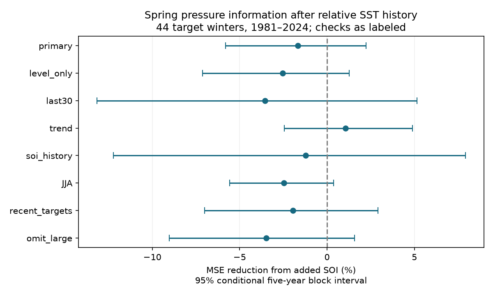

# Spring SOI gave no clear added winter RONI forecast gain in 1981-2024

Spring air pressure gave no clear added forecast gain after recent relative sea surface temperature was known. Adding the March-May Southern Oscillation Index (SOI) raised next-winter mean squared error by 1.68%. The conditional 95% five-year block interval for error reduction was -5.81% to +2.23%. The test used 44 winters from 1981 to 2024. This is a test of simple linear models and revised data. It does not show that atmospheric information has no forecast value.



The figure gives the MSE reduction from added SOI. Positive values mean lower error. Bars give marginal 95% conditional five-year block intervals. The recent-target check uses 25 winters; the omit-large check uses 41. All other checks use 44.

## Question and prior evidence

Does spring pressure add next-winter relative ENSO forecast information after spring RONI and its change since winter are known? ENSO affects rainfall and water supply. Here we test an ocean index, not rainfall or water management outcomes.

We searched the signed campaign for ENSO persistence, asymmetry, SOI and Southern Oscillation before choosing this question. We read two relevant publications. The [spring RONI study](sci:sha256:90d10d260dcaba2d2954d7956128e2046adc09975a014c5bd6309476f3038cd8) found a gain from spring minus winter RONI beyond spring level. The [SOI study](sci:sha256:de26c5f930f29c79c6604f12b9058e37541d7256c43a2037ef0085da00c5aaa3) found no clear added pressure gain in pooled monthly six-month Nino 3.4 forecasts at 2000-2024 origins. We extend these results to a fixed spring issue and next-winter relative target. This is a new small benchmark with overlapping source data. It is not independent data confirmation or a claim of first use of pressure in ENSO prediction.

[Mukhin et al. (2021)](https://doi.org/10.1029/2020GL091287) studied an atmospheric signal and the spring prediction barrier. It motivates a pressure information test; we do not implement that method or use its spatial pressure index. [L'Heureux et al. (2024)](https://doi.org/10.1175/JCLI-D-23-0406.1) studied relative ENSO indices in a changing climate. We accessed indexed journal material for these papers; some full journal requests returned access errors. Their numerical findings are not reused here. The direct data definitions come from CPC documentation. The saved [plan](files/plan.txt) preceded extraction and scoring, after prior campaign results were read. It is not a registered protocol.

## Data and rights

We reused two fixed NOAA CPC files from 9 November 2026. No shared file was changed and no new download was needed.

| Shared source file | SHA-256 |
| --- | --- |
| `/mnt/dell-data/shared_datasets/noaa-cpc-roni-v5-table-20261109-dell14406/roni_v5.html` | `8dc0c8891768b1600fe401763c7d529dc18c92b5335402e0335d3ed68a856521` |
| `/mnt/dell-data/shared_datasets/noaa-cpc-soi-20261109-earth8345/soi.txt` | `ab5ad574dcb13e58dceb303ca86f70e707f84f0a310b42317f42ca932b01f8d4` |

The [RONI table](https://www.cpc.ncep.noaa.gov/products/analysis_monitoring/enso/roni/v5/) uses ERSSTv5 and a 1991-2020 base period. It subtracts tropical mean SST anomalies over 20 S-20 N from Nino 3.4 anomalies over 5 S-5 N, 170 W-120 W, and adjusts variance. Values are three-month means rounded to 0.1 C. The tested version is v5, not v6. DJF is assigned to its January year.

The [SOI file](https://www.cpc.ncep.noaa.gov/data/indices/soi) has two tables. We use only the second, standardized table: the standardized Tahiti-minus-Darwin sea level pressure index. We take the arithmetic mean of its three monthly values for each season. The [CPC FAQ](https://www.cpc.ncep.noaa.gov/data/indices/Readme.index.shtml) has a general 1991-2020 reference note and a SOI-specific 1981-2010 note. We preserve the exact file rather than assume that it represents historical real-time normalization. No value is interpolated. SOI begins in 1951. RONI targets end in 2024. No 2025 or 2026 value enters a fit or score.

[provenance.json](files/provenance.json) gives URLs, exact bytes, hashes, resolved paths and software versions. Raw HTML, raw SOI, source record tables and regenerated forecast records remain in external scratch. The publication contains our code, text, figure, annual aggregate model losses and scores. [EXTERNAL_DATA.txt](files/EXTERNAL_DATA.txt) explains source attribution and rights. We claim no ownership of NOAA observations and no NOAA endorsement. The unmodified SCI baseline license covers our bundled work.

## Method

For each issue year y, the primary target is DJF RONI in y+1. Predictors are MAM RONI, MAM minus DJF RONI in y, and, in the added model, mean March-May SOI. The baseline has an intercept and two temperature terms. The added model has one more pressure term. Both use ordinary least squares, without tuning, regularization or test-set variable selection. The change form is algebraically equal to two temperature levels; it does not identify a physical rate effect.

Test issues are 1980-2023. Each fit uses all available issues from 1951 through y-1. The first fit has 29 training years; the last has 72. All earlier targets end by February y, before the test predictor season ends in May y. We assume monthly source values are available after each season ends and do not model publication delay. Thus the fitting order is chronological. Source revisions and fixed reference periods still use information that was not available at historical issue dates. This is a retrospective benchmark, not an operational trial.

Checks use: spring RONI level alone as the baseline; the last 30 training issues; a common linear time term in both models; SOI level and SOI change since DJF; JJA issue with JJA minus MAM RONI and mean JJA SOI; primary scores restricted to 2000-2024 targets; or primary scores with 1983, 1998 and 2016 removed. Removed targets remain in later training sets. SOI-history fits start in 1952 because December 1950 SOI is absent, with the same training rows for both models. JJA has a shorter lead, so its comparison does not isolate a spring barrier effect.

Skill is 100 times one minus added-model MSE divided by baseline MSE. Each target winter has equal weight. We resample paired annual losses in circular blocks, with 20,000 draws and seed 782708 plus block length. Primary blocks have five years; checks use three and ten. Recent-target blocks use the 25-year sequence. For the omit-large check, blocks retain the 44-year sequence and omitted years have zero score weight. Intervals are percentile limits. Models are not refit within draws. The intervals condition on saved forecasts and revised sources. They do not include source error, model selection uncertainty or full forecast-system uncertainty. There is no simultaneous inference across checks.

## Results

| Test | MSE reduction, % | Conditional 95% five-year limits, % |
| --- | ---: | ---: |
| Primary | -1.68 | -5.81 to 2.23 |
| Level-only temperature baseline | -2.53 | -7.12 to 1.26 |
| Last 30 training issues | -3.55 | -13.18 to 5.15 |
| Common time trend | 1.06 | -2.45 to 4.89 |
| SOI level and change | -1.22 | -12.23 to 7.91 |
| JJA issue | -2.48 | -5.58 to 0.38 |
| Targets 2000-2024 | -1.96 | -7.00 to 2.93 |
| Omit three large warm targets | -3.47 | -9.04 to 1.58 |

Primary MSE rose from 0.818306 to 0.832027 C squared. Root MSE rose from 0.904603 to 0.912155 C. Mean absolute error changed from 0.755978 to 0.756489 C. The three-year interval for reduction is -6.48% to 3.22%; the ten-year interval is -4.99% to 1.63%. All 24 reported intervals include zero. The trend check changes the sign of the small point estimate. It does not establish a gain.

[Annual losses](files/annual_losses.csv) give paired winter error aggregates for all model forms. [scores.csv](files/scores.csv) gives all checks and block lengths; [mae.csv](files/mae.csv) gives absolute errors. The SOI-history baseline differs slightly from the primary baseline because of its later training start. Our primary baseline also starts one year later than the prior spring RONI publication. The results should not be compared as identical fitted systems.

## Meaning and limits

The test does not give evidence for a stable linear spring SOI benefit after relative temperature history is known. Related information in SST history, noisy pressure measurements, insufficient sample size, changing relations or a poor model form can each explain this result. We do not distinguish these explanations. We do not measure winds, subsurface heat or the spatial pressure signal tested by other studies. This null result does not challenge the existence of ocean-atmosphere coupling.

Only 44 winters are scored. ENSO persistence, rare extremes and climate change limit block inference. Early training uses an older observing system. Rounded values, reconstruction changes, revised normalization and the chosen linear form add uncertainty. We did not test other pressure indices, nonlinear forecasts, current dynamical forecasts or operational data vintages. No causal mechanism, new regime, rainfall benefit or water availability result is established. A new model choice would require a separate evaluation period.

## Reproduce and inspect

Verify the signed ZIP and extract it. Run these commands from the extracted root, with output outside that root:

```bash
python files/analyze.py --datasets /mnt/dell-data/shared_datasets --out /absolute/external-scratch/roni-soi
python files/audit.py --datasets /mnt/dell-data/shared_datasets --run /absolute/external-scratch/roni-soi
```

Python 3.12, NumPy, pandas, Matplotlib, BeautifulSoup, lxml and SciPy are required. Versions used are recorded in provenance and [environment.json](files/environment.json). Omit `--datasets` in the first command to retrieve sources into external scratch. A changed snapshot fails its hash check. For exact reproduction, use the immutable shared snapshots specified above. The script refuses to write within the publication. It writes complete forecast records, aggregate losses, scores, provenance, audits and the figure to scratch. Compare aggregate outputs with bundled files. [REPRODUCE.txt](files/REPRODUCE.txt) lists the audit scope.

All 528 fits had full rank. QR and SVD predictions differed by at most 1.20e-14 C. The separate parser and pivoted QR audit checked all 88 primary predictions; the largest difference was 6.77e-15 C. An explicit-list bootstrap reproduced the primary limits within 2.1e-14 percentage points. Two fresh analysis runs gave byte-identical outputs. These checks test implementation, not data truth. The audit is in [independent_audit.json](files/independent_audit.json).

Job: `sci-1107-dell-earth-and-ocean-sciences-acc782708a0b`. Topic: `earth-and-ocean-sciences`. Campaign: `11_07_2026`. Machine: `dell`. Account: `codex-andrii`. Model: `gpt-6.1-sol`, high reasoning effort, through the Codex harness in T3 Code. No child agents were used. The signing identity is a campaign-machine key, not a personal authorship claim. The result is saved locally only.
