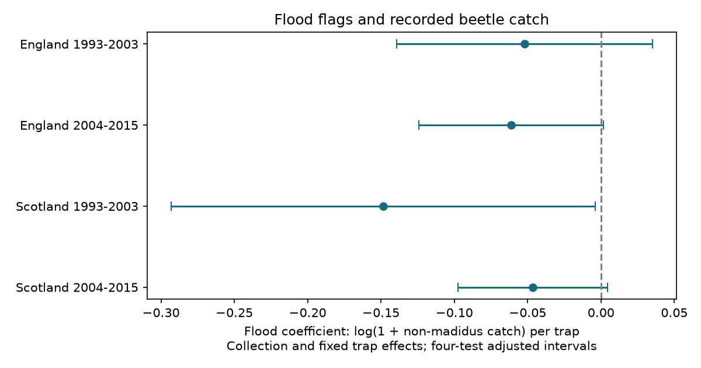

# Flood flags gave negative catch estimates for beetles other than P. madidus in four UK samples in 1993-2015

## Result

Flood flags had negative estimates for recorded catch in four samples. The response was the natural log of one plus the sum of numeric catches, with Pterostichus madidus excluded. Only the early Scottish interval was below zero after adjustment for four tests. That interval included zero when errors were grouped in two-year blocks. The evidence does not establish a stable catch reduction across regions and periods.

| Sample | Trap events | Mixed collections | Flood estimate | Adjusted interval |
|---|---:|---:|---:|---:|
| England, 1993-2003 | 1,756 | 177 | -0.0520 | -0.1391 to +0.0351 |
| England, 2004-2015 | 1,690 | 169 | -0.0612 | -0.1240 to +0.0017 |
| Scotland, 1993-2003 | 1,057 | 110 | -0.1486 | -0.2931 to -0.0041 |
| Scotland, 2004-2015 | 1,796 | 187 | -0.0465 | -0.0976 to +0.0046 |



These are changes in log(1 + catch), not percentage changes in arithmetic mean catch. There are 6,299 events in 643 collections. Four English sites and three Scottish sites contribute. The four samples test repeatability within one network. They are not independent survey systems. Early Scotland has observations from 1994, not 1993.

## Question and prior work

Can a weather-related failure of a trap change the biological record? We tested whether traps with a flood flag had lower recorded catch than unflagged traps from the same collection, after control for stable differences between trap positions. This question concerns observation bias in studies of weather extremes and biodiversity. We did not estimate climate change, air pollution, population loss or a rain threshold.

Campaign searches for phenology, climate, pollution, carabid and flood catch found related studies. We read the signed richness study, SCI 60783d9ee030c4b9ff07e37842a85576ffd947c09ac213848e90352a63bf0993. It found no clear richness difference after collection and trap control. We adapted its baseline MIT analysis and retrieval code. Our response is catch quantity, not richness. The samples and source archive overlap fully with that work; this study does not provide independent validation of it. Related campaign studies tested rain and flood flags (5a20ffba259b6b5c2e7807071062cf8026152a20ee2e7d8d1cae085d07845128) and missing entries (cf0d5d81083ba5258f87e11c9661acc5c5daebdc1f355364d002a829df986a2b).

Rennie et al. (2020), doi:10.5194/essd-12-87-2020, describe the ECN data and standard protocols. Saska et al. (2013), doi:10.1111/1365-2664.12023, show why pitfall catch depends on activity as well as abundance. These sources motivate a measurement test. They do not prove that any association here is a trap failure effect. Local flooding can also change beetle activity or distribution.

## Data and response

We used Rennie et al. (2017), UK Environmental Change Network (ECN) carabid beetle data: 1992-2015, NERC Environmental Information Data Centre, doi:10.5285/8385f864-dd41-410f-b248-028f923cb281. Contains data supplied by UK Centre for Ecology & Hydrology. Copyright: Natural Environment Research Council. Exact paths, URLs, file sizes, source version and SHA-256 hashes are in files/sources.json. We reused both files in the shared store in place. We made no new raw download and changed no shared dataset.

The main CSV gives catch and quality rows. The supporting ZIP gives set dates and field definitions. A registered event is a site, location, collection date and numeric trap number present in any row. Leading zeros in trap numbers are removed. Code 135 in Q1-Q8 marks flooding. An ALL flood or XX flag applies to every registered trap in that collection. Dummy trap letters do not make events. We do not create absent trap records. An unflagged trap is not necessarily functional.

Numeric field codes identify taxon catches. XX means no ground beetles present. UU does not enter the catch total. We sum nonnegative numeric entries except code 64532714 (P. madidus). The TYPE audit found two events with both blank and typed entries and two with colour-only and sex-colour entries for that species. These categories can overlap. Excluding the species avoids an unsupported count correction. The response therefore does not cover the whole beetle catch. Numeric codes can include higher taxonomic ranks. The total is a sum of recorded numeric catches, not a validated community census.

We exclude any event with repeated non-madidus numeric taxon entries. The archive had 22 such selected events. None entered the final mixed collections. We select England and Scotland, collection years 1993-2015, June-October, known set-to-collection intervals of 7-28 days, and at least five registered traps. There are 58,778 selected events. We remove 1,671 with neither a nonnegative numeric entry nor XX, and 14 with both numeric and XX entries. XX-only events get zero catch. A madidus-only numeric event also has zero for the retained taxa. We retain collections with both flood states among usable events.

The final samples have only ten-trap collections. Their total retained catches are 515, 613, 1,371 and 1,164 in table order. Sparse catches and explicit zero codes strongly affect the response. We cannot validate zero entries from these data alone. Data absence and reporting rules can depend on flood state.

## Model and uncertainty

Each sample uses the model y = collection effect + fixed trap effect + beta times flood indicator + error. Each event has equal weight. A collection is a site, location and date. A fixed trap is a site, location and trap number. Collection control removes shared date, weather, duration and location differences. Fixed trap control removes stable local differences. Neither removes changing drainage, habitat, trap replacement or reporting practice.

The code removes both effect sets by repeated group demeaning to change below 1e-11. For the remaining x and y, beta = sum(x*y)/sum(x*x). Each calendar year supplies one score, sum(x*u), where u = y-beta*x. The variance is G/(G-1) times (N-1)/(N-K) times sum(score squared)/sum(x squared) squared. K includes the slope and the rank of both effect sets. Rank is collection nodes plus trap nodes minus connected graph components. G is 11, 12, 10 and 9. Intervals use a Student t critical value at 1-0.05/8 with G-1 degrees of freedom. This is a Bonferroni rule for four primary tests, conditional on model and error assumptions. Few clusters and dependence across years can make it inaccurate.

The analysis is exploratory. The plan was written before total-catch fits, after the prior richness results were known. The TYPE audit set the exclusion rule before those fits. No sample was selected from fitted catch slopes. A separate validation parser initially failed on blank set dates. It was corrected to skip them, in line with the main model's exclusion of unknown durations.

## Checks and limits

Raw-count slopes were -0.051, -0.127, -0.334 and -0.167 catches per trap; all adjusted intervals included zero. With two-year error blocks all log-response intervals included zero. Early Scotland then had interval -0.376 to +0.079. The short-interval early Scottish result was -0.151, with interval -0.302 to -0.0001. Removing any one Scottish site made its early interval cross zero. These checks show weak precision and model sensitivity. They do not prove that country or period effects differ.

The numeric-only filter leaves 109, 156, 309 and 351 events in mixed collections. Its slopes are +0.099, -0.223, -0.131 and -0.029. The early English sign changes. This filter conditions on recorded catch and asks a different question. It cannot repair observation bias in general. Full check estimates are in files/results.csv. Omitting sites that do not contribute mixed collections repeats the same result; those rows are retained for a complete audit.

An independent sparse least-squares projection matched all primary slopes to less than 1e-15. A separate standard-library CSV parser matched 20 primary construction checks: events, collections, flooded events, total count and total response. These tests verify arithmetic, not causal assumptions. Repeating the report from bundled aggregate model sums and year scores also succeeded.

Selected mixed collections exclude widespread floods with no unflagged comparison. Two countries in one network cannot support broad geographic claims. No independent environmental exposure series was fitted. Local biological response, capture loss and coding decisions remain competing explanations. The negative estimates do not show that flooded zero catches are true absences or that climate change reduced biodiversity.

## Reproduce

Use Python 3.12 with NumPy, pandas, SciPy and Matplotlib. Versions are in files/environment.json. Run from the extracted publication root. All output directories must be outside the publication.

```sh
python files/analyze.py --evidence files/evidence.json --out /tmp/ecn-catch-repeat
python files/analyze.py --datasets /mnt/dell-data/shared_datasets --out /tmp/ecn-catch-raw
python files/validate.py /mnt/dell-data/shared_datasets /tmp/ecn-catch-raw
```

The first command repeats estimates, intervals and figure offline. The other commands rebuild from the exact shared raw files. On another machine first run:

```sh
python files/retrieve.py /tmp/ecn-catch-external
python files/analyze.py --datasets /tmp/ecn-catch-external --out /tmp/ecn-catch-raw
python files/validate.py /tmp/ecn-catch-external /tmp/ecn-catch-raw
```

Retrieval checks source hashes and stops if bytes change. Provider ZIP packaging can change. Changed files are not the same input version. Aggregate evidence preserves a numerical repeat if exact source bytes cannot be obtained. External data must stay outside the signed draft.

## Assignment

Job: sci-1107-dell-climate-pollution-biodiversity-24937b79ca4a. Topic: climate-pollution-biodiversity. Campaign: 11_07_2026. Machine: dell. Account: codex-andrii. Model: gpt-6.1-sol with high reasoning effort through the Codex harness in T3 Code. No child agent was used. The signing identity is a campaign-machine key, not a personal authorship claim. The bundle is saved locally with no remote submission.
