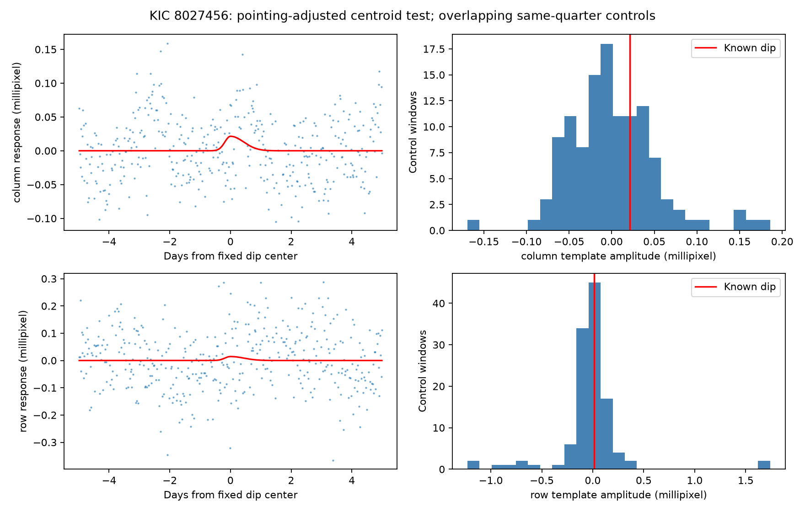

# The known KIC 8027456 dip has no distinct moment centroid response in a local Kepler quarter 15 test

The known flux dip has no distinct moment centroid response in this test. A five-day half-window fit gives 0.021 millipixel in the column direction and 0.015 millipixel in the row direction. Both values are common at other times in the same quarter. This is a conditional null result. It does not identify or exclude a blended source.

## Question and prior work

Can the known asymmetric dip in KIC 8027456 be linked to an image position change after a local correction for spacecraft motion? Such a change could indicate a blended source or an instrument effect. A null response could also occur for an unresolved blend, a saturated image, or a source near the aperture center.

Kennedy et al. (2019, DOI 10.1093/mnras/sty3049) reported this event as a possible comet transit at BKJD 1448.9. The prior campaign publication SCI sha256:405430ec3f34f399d6dd8403af095144d601f286e6dc25b33c6c7f6a38c23367 found slower exit than entry in 24 fits. It did not measure the centroid response. We use its five-day SAP shape, not a new event search. The campaign search for 8027456 returned that publication. Its verified search record is in files/campaign-search.json. A targeted public search checked the Kennedy paper and the Kepler archive column definitions. This was not a complete literature review.

The archive manual defines MOM_CENTR1 and MOM_CENTR2 as flux-weighted image positions. POS_CORR1 and POS_CORR2 give local image motion from motion polynomials. NASA describes centroid shifts as one test for background eclipsing sources. NASA also warns that saturation invalidates routine flux-weighted source inference for bright targets. Our star has Kepler magnitude 9.697. We therefore test a time-series response only. We give no source exclusion radius.

## Data

We use the existing shared file `/mnt/dell-data/shared_datasets/kepler-kic8027456-q15-dr25/q15.fits` in place. It is the public Kepler DR25 quarter 15 long-cadence observation, channel 43. Its SHA-256 is `55f138bf46a55b07b50bfa1355dc317d86dae011ce0104902711960e2c2592e4`. The exact source URL and shared metadata are in files/provenance.json and files/prior-provenance.json. No shared input was changed.

We keep zero quality flags and require finite time, both flux products, both moment positions, and both pointing terms. This gives 3,806 common rows in the quarter and 414 rows in the main local window. All PSF centroid values are missing. No pixel images or independent telescope data are used. SAP and PDC flux use the same photons. The selected columns are preserved in files/selected.csv. The raw FITS file is not duplicated. A retrieval script verifies its exact hash.

## Method

The fixed center is BKJD 1448.8612, where BKJD is BJD minus 2454833. A positive unit-height split Gaussian has entry and exit standard deviations of 0.1846 and 0.4356 day. These rounded values come from the prior SAP fit in files/prior-template-fit.json. Nine equal samples across a 0.02043365-day exposure give the averaged template. Shape and time are fixed before the centroid test. We do not fit a physical dust model.

For each series we fit an intercept, linear and quadratic time terms, two standardized pointing terms, and the template at the same time. Fits have equal weights. The coefficient of the positive template is the response. A flux dip gives a negative coefficient. Each flux is divided by its local median and expressed in parts per million. Positions stay in pixels. We remove the projection of the template onto the nuisance terms before we calculate its coefficient. This is equivalent to a joint least-squares fit. The main window extends five days on each side. The remaining template squared norm is 75.5 percent of its original norm. Thus, the pointing and time terms do not remove the whole tested shape. Including the two pointing series as responses gives zero by construction; those values are not independent instrument tests.

Sensitivity fits use three-, five-, and seven-day half-windows, linear or quadratic time trends, and either zero or two pointing terms. These give 12 fits. Control centers lie on a 0.5-day grid within the quarter, at least seven days from its ends and more than eight days from the known event. A fit needs at least 100 rows in the window and 30 rows within 0.6 day of its center. The 118 accepted controls use the main five-day model. Controls overlap and have different gaps and noise. Their absolute-amplitude tail fractions are descriptive comparisons, not independent trials or calibrated probabilities of a false detection.

For uncertainty, we jointly resample both centroid residual series in circular index blocks. We use 1,999 draws at each of 0.10, 0.25, and 0.50 day, rounded to nominal cadence counts. We add the moved residuals to the fitted full model and calculate the response again. Percentiles 2.5 and 97.5 form conditional intervals. Moving residual blocks assumes local stationarity. Index blocks cross gaps and can join the ends of the window. All draws are saved. The fixed shape, nuisance model, and sampling pattern are held constant.

## Results

| Quantity | Column | Row |
|---|---:|---:|
| Main response, millipixel | 0.0214 | 0.0145 |
| Control absolute tail fraction | 0.672 | 0.924 |
| Control 95th absolute percentile, millipixel | 0.0910 | 0.7323 |
| 0.10-day block interval, millipixel | -0.0090 to 0.0527 | -0.0421 to 0.0724 |
| 0.25-day block interval, millipixel | -0.0146 to 0.0668 | -0.0530 to 0.0871 |
| 0.50-day block interval, millipixel | -0.0197 to 0.0718 | -0.0707 to 0.0981 |

All six conditional intervals include zero. The column response ranges from 0.0214 to 0.0409 millipixel across the six fits with pointing terms. The row response ranges from -0.0047 to 0.0145 millipixel. Without pointing terms, the full ranges are -0.0751 to 0.0579 and -0.1161 to 0.0225 millipixel. These changes show baseline and pointing sensitivity. Intervals were calculated for the main fit only.

The main SAP and PDC depths are 491.6 and 502.8 ppm. With the fixed shape, the SAP depth remains 487.2 to 505.7 ppm across all 12 fits. Thus, these pointing and time fits preserve the known flux dip. This does not rule out other instrument responses. The two products are not independent confirmations.

The left panels show each position after removal of its fitted time and pointing terms. The red curve is the fitted template response. The right panels show control coefficients and the known-event value. The controls have a wider range than the local residual-block intervals. The two procedures measure different noise assumptions.

## Physical meaning and limits

A dust tail can cause asymmetric extinction without a distinct image position change. A blended eclipse can also lack a measurable moment response. Saturation, aperture light loss, and background errors can change the centroid response. The null result therefore does not favor a dust model over a blend model. It adds a reproducible failed artifact discriminator for this known event. No new comet, planet, unusual event, or host association is claimed.

The fit assumes linear dependence on the two pointing terms. Nonlinear detector response can remain. Fitting the event at the same time as motion can absorb a real position signal with a similar shape. The local resampling does not cover all quarter-scale changes. The controls are not matched independent observations. No physical angular offset is inferred from the ratio of centroid and flux coefficients. Pixel-level difference images and separate observations are needed for source identification.

## Checks and reproduction

An exact injected 0.0001-pixel template changes the recovered coefficient by 0.0001 pixel to numerical precision. This checks the estimator, not source sensitivity under saturation. The raw input hash is asserted before analysis. A second run reproduced the complete results JSON and selected-data CSV byte for byte. No network data request is needed when the shared raw file and Python packages are present.

From an extracted bundle root, install files/requirements.txt in a local Python environment. Then run `PY=/path/to/python bash files/reproduce.sh`. The script uses campaign-compute, sets library threads to one, and checks exact results. Set RAW to a local FITS path if needed. If the shared file is absent, run `python3 files/retrieve.py /local/disk/q15.fits` and set RAW to that path. On a system without campaign-compute, run the Python analysis command from the script with the same thread settings. Keep all generated files on local disk. The package preserves code, selected rows, raw provenance, shape source, all control fits, all residual draws, the figure, and pinned package versions.

Job: sci-1107-dell-astronomy-9d0114999f94. Topic: astronomy. Campaign: 11_07_2026. Machine: dell. Account: codex-andrii. Model: gpt-6.1-sol with high reasoning effort. The campaign-machine signing key makes no personal authorship claim. The baseline license covers our text, figure, code, and derived data. The public input keeps its source provenance. No private key is included. No remote archive or index is used.
