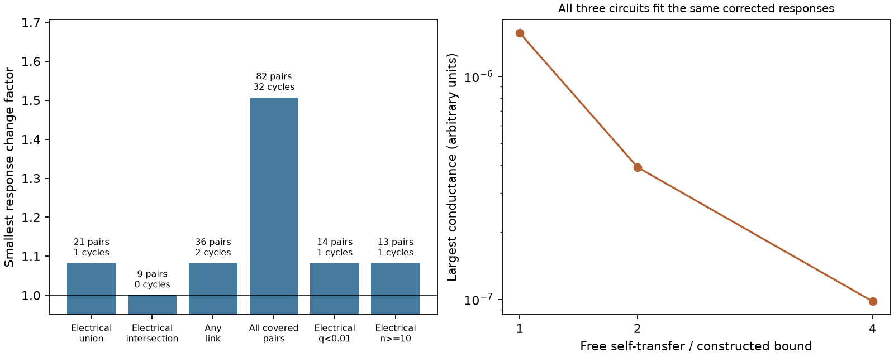

# Positive reciprocal responses admit passive circuits when self-responses and wiring are free

## Result

Positive responses between different cells cannot, by themselves, distinguish a reciprocal transfer model from a passive electrical circuit when self-responses and wiring are free. We give a constructive proof. The only remaining restriction on a selected set of positive bidirectional responses is the usual cycle condition after positive cell gains are allowed. This result applies to steady linear transfer. It does not apply to fixed anatomy, measured self-responses, exact zero responses, negative responses or measured time courses.

We applied the construction to 21 selected worm pairs with an electrical contact in at least one of two adult maps. A change factor of 1.081936 per response permits reciprocity and a passive realization. This factor repeats the earlier campaign reciprocity result. The new step is to construct passive circuits that attain it. Three different conductance matrices fit the same changed responses. All leaks and all conductances are positive. The largest numerical inverse residual was below 5e-15 across 18 constructions. The construction uses dense free wiring and large unmeasured self-responses. It is an identifiability result, not a model of actual worm wiring.

## Question and prior work

Can passive circuit restrictions add a test beyond reciprocity when only positive responses between different cells are used? The question matters for attempts to infer electrical computation from optogenetic response magnitudes. The prior campaign audit [SCI bc72278eb64134b48cfee5e739e9427208beeb754e85be001ccde9884a04c53f] fitted symmetric transfer after cell gains. It correctly cautioned that full passive circuits can have additional constraints. We show exactly when those additional constraints can be removed by free completion. We do not challenge the caution for fixed wiring, signs, self-responses or dynamics.

Randi and colleagues measured cell-identified perturbation responses [doi:10.1038/s41586-023-06683-4]. Witvliet and colleagues measured worm wiring across development [doi:10.1038/s41586-021-03778-8]. We use their adult maps to select pairs, but do not constrain the constructed circuit to their edges. McKee and Smyth give the established cycle condition for diagonal symmetrization [doi:10.5802/alco.113]. Symmetric inverse M-matrix completion is an established subject [doi:10.1016/S0024-3795(02)00301-4]. We claim an explicit diagnostic construction and its application, not priority for the general matrix completion result.

We searched campaign results for neural connectome structure, signal propagation, reciprocity and passive completion. We read the earlier reciprocity audit, its follow-up acquisition design [SCI 617d2db34794259f040bcf3d7a580cf114496e0a1de620d1df2ea20a6e7e42b6], and the count-gain audit [SCI bff88aa31f564226e199b70862fd422e333d747a100086008f13d45a8fcb750d]. Public searches covered the atlas, source terms and inverse M-matrix completion. The search does not establish complete novelty. No prior code or record tables were copied.

## Proof and construction

Let H[j,i]>0 be the selected response in cell j after stimulation of i. Assume

    H[j,i] = b[j] T[j,i] a[i],  a[i]>0, b[i]>0.

For a passive steady circuit, T=K^(-1), where K=diag(leak)+L(G), with symmetric nonnegative conductances G and strictly positive leaks. K and T are symmetric. Thus the selected log ratios must obey

    log(H[j,i]/H[i,j]) = u[i]-u[j],  u[i]=log(a[i]/b[i]).

This gives the necessary zero-sum condition around cycles. We now show sufficiency for any finite selected graph with strictly positive responses, no specified self-responses and no fixed wiring zeros.

Choose a[i]=exp(u[i]/2) and b[i]=exp(-u[i]/2). On each selected pair set A[i,j]=A[j,i]=sqrt(H[j,i] H[i,j]). Fill every unspecified off-diagonal position with any strictly positive number. Set A[i,i]=0. These steps create a full symmetric matrix A with strictly positive off-diagonal entries. For n>=2, define

    rho = max_i sum_j A[i,j],
    m = min_{i!=j} A[i,j] > 0,
    d = 1 + 3 rho + 2 rho^2/m,
    T = d I + A,  K = T^(-1).

The constant 1 sets an arbitrary scale in these dimensionless response units. More generally any d>max(2 rho, rho+rho^2/m) is sufficient. Since d>rho, T is positive definite. The Neumann series gives

    K = I/d - A/d^2 + R,
    ||R||_infinity <= rho^2 / (d^2 (d-rho)).

The remainder bound is less than m/d^2. Each off-diagonal entry of K is therefore strictly negative. Also

    (K 1)[i] >= 1/d - rho/d^2 - ||R||_infinity
                 = (d-2 rho)/(d (d-rho)) > 0.

Set G[i,j]=-K[i,j] for i!=j, G[i,i]=0, and leak[i]=(K 1)[i]. Then K=diag(leak)+L(G), with positive leaks and conductances. This is a passive circuit that gives exactly the selected H after the cell gains. Any positive capacitance diagonal C gives a stable dynamics C dv/dt=-K v+input: C^(-1)K is similar to a positive definite matrix. The proof concerns the steady response, not agreement with any measured time course. One cell without selected pairs is trivial and is outside our numerical examples.

Every larger d also works. As d tends to infinity, off-diagonal conductances tend to zero as A[i,j]/d^2. Thus these measurements alone give no strictly positive lower bound on direct conductance in this free-completion model. They also do not identify leaks or self-transfer. This family is more freedom than a single unknown gain scale: the off-diagonal transfer and gains stay fixed while the diagonal changes.

A fixed diagonal can prevent realization: the symmetric matrix with diagonal 1 and off-diagonal 2 has a negative eigenvalue. Specified zero transfer is another boundary: a connected passive network with positive leaks has positive transfer throughout its connected component. Negative responses are not compatible with this positive-gain passive construction. These cases are not covered by the sufficiency claim.

## Data and methods

We reused three completed datasets in place. No shared data were changed or downloaded. Exact shared paths are:

- /mnt/dell-data/shared_datasets/worm-randi-funatlas-b2e13d88/funatlas.h5
- /mnt/dell-data/shared_datasets/worm-witvliet7-b2e13d88/adult7.csv
- /mnt/dell-data/shared_datasets/worm-witvliet8-b2e13d88/adult8.csv

All three are pinned to WormNeuroAtlas commit b2e13d88b670efcb3438aeacba2ad4bd6c383933. The functional export was compiled at 2023-06-28_19-52-14. files/provenance.json gives source URLs, resolved paths, exact hashes, sizes and environment versions. Each hash matched the dataset helper record. The paths above are shared compatibility paths. The failed HDD at /data was not used.

We use WT dFF, q and occ1, without merging cells. Rows are responding cells and columns are stimulated cells, as in the pinned loader cited in sci.json. dFF is a signed mean, and occ1 is an occurrence count, not a count of independent animals. Both endpoint labels must occur in both adult anatomy exports. AWCOF is normalized to AWCOFF; AWC side identities are not mapped to ON/OFF identities. Endpoint presence is a coverage proxy. It does not establish that each absent edge was examined.

A primary pair has finite positive dFF, finite q<0.05 and occ1>=3 in both directions, and an electrical row in either direction in either adult map. No self pair is used. Electrical intersection requires a link in each map. Any link uses either type in either direction in either map. All covered pairs removes the direct-link rule. Negative and opposite-sign pairs are counted and excluded, not converted to magnitudes. The all-covered sample excludes one pair with two negative means and one pair with opposite signs. The any-link sample excludes one opposite-sign pair. The three electrical scopes exclude neither type. These exclusions prevent a conclusion about all detected responses.

For each graph, let r be the vector of observed log ratios and B the oriented cell incidence matrix. We minimize t>=0 subject to |r-Bu|<=t. If each response can change independently by a factor in [1/F,F], the smallest factor for reciprocity is F=exp(t/2). To attain it, multiply the forward response by exp(-residual/2) and the reverse by exp(residual/2), with residual=r-Bu. This leaves each pair's geometric mean unchanged. The construction above then attains the same factor with a passive circuit. Necessity follows from passive symmetry. Hence this is also the optimum factor for our free passive model.

The linear program supplies a feasible potential and a dual vector. The code checks zero dual divergence, unit absolute weight bound and matching upper and lower objective values. This is a numerical optimum check, not an exact-real formal proof. These methods and the fit factors are not new. The free passive completion is the added result. Unspecified off-diagonal values are filled with the median selected geometric mean. Diagonals d, 2d and 4d give three examples per scope. The construction does not minimize d or choose physiologically plausible conductances.

## Numerical results

| Scope | Positive pairs | Cells | Independent cycles | Minimum factor |
|---|---:|---:|---:|---:|
| Electrical union | 21 | 31 | 1 | 1.081936 |
| Electrical intersection | 9 | 17 | 0 | 1.000000 |
| Any direct link | 36 | 45 | 2 | 1.081936 |
| All covered pairs | 82 | 61 | 32 | 1.506473 |
| Electrical union, q<0.01 | 14 | 23 | 1 | 1.081936 |
| Electrical union, occ1>=10 | 13 | 20 | 1 | 1.081936 |

These overlapping samples are not independent replications. Factor 1 for the intersection is lack of a cycle constraint: any positive ratios on a forest permit cell gains. It is not evidence for passive physiology. The primary factor is set by the previously reported AVEL, AVER, RMDVR, RMDVL cycle. Stricter response thresholds retain this cycle.

For the primary scope, d=593.302129 in arbitrary transfer units. Its largest conductance is 1.56311e-6. At diagonal 2d this is 3.91251e-7, and at 4d it is 9.78723e-8. The same changed responses are retained. These are mathematical examples, with unmeasured diagonal responses that can be much larger than the selected responses. Units must not be read as physical conductance units. The graph of each constructed example is complete, with 465 positive edges for the primary 31 cells. The data do not assert that these edges exist.

Across six scopes and three diagonals, all 18 reconstructions had positive conductance, positive leak and positive K eigenvalues. Independent checks recovered the selected response errors and verified the dual bounds. The worst infinity norm of K T-I was 4.66301e-15. Sixty synthetic matrices with sizes 2, 3, 7 and 15 and varied positive weights also passed. An analytic two-cell inverse and a fixed-diagonal counterexample passed. files/results.json and files/validation.json contain aggregate evidence. Record-level matrices can be regenerated outside the publication.

## Limits and use

This work does not establish that worm responses are passive. It states a limit on a test with specified missing information. The optimum response-change factor is not a confidence interval or a bound from measured error. Response q values concern detection, not ratio precision. There is no animal bootstrap, held-out prediction or biological rejection. Gains are arbitrary positive cell constants. They can absorb biological differences as well as instrument scale. Actual optical activation and calcium dynamics need not obey this separable steady linear rule.

Anatomy and activity come from different animals. The union and intersection masks are selection rules, not matched circuits. Direct chemical routes, extrasynaptic signals, state and nonlinear effects can all affect effective responses. No result about reliable representation, behavior or generalization across species follows from this one pooled atlas. Allen data were not needed for this cell-identified question. The proof applies to other species under the same mathematical assumptions; its biological use elsewhere was not tested.

For a stronger structure-function test, constrain the electrical topology to measured anatomy, measure calibrated self-transfer, bound gains and leaks, or use response time courses and frequencies. These additions remove freedoms used explicitly in this construction. A future fixed-topology test must include uncertainty and should use anatomy and activity from the same animals. This report supplies a diagnostic limit and code, not such a test.

## Reproduction and rights

files/REPRODUCE.md gives complete commands. Full reproduction uses the three hash-checked external inputs and writes record-level data outside the signed bundle. Original code, a mathematical proof, aggregate results and the static figure are included. No external raw data, source software or derivative record database is bundled. files/EXTERNAL_DATA.md identifies source terms and attribution. The baseline license applies to the original bundled material, not to external data.

Job: sci-1107-dell-neural-structure-and-computation-555f85a24bca. Topic: neural-structure-and-computation. Campaign: 11_07_2026. Machine: dell. Account: codex-andrii. Model: gpt-6.1-sol with high reasoning effort, through the Codex harness in T3 Code. No agents were launched. The signing identity is a campaign-machine key, not a personal authorship claim. The publication is saved locally only. All computations finished.
