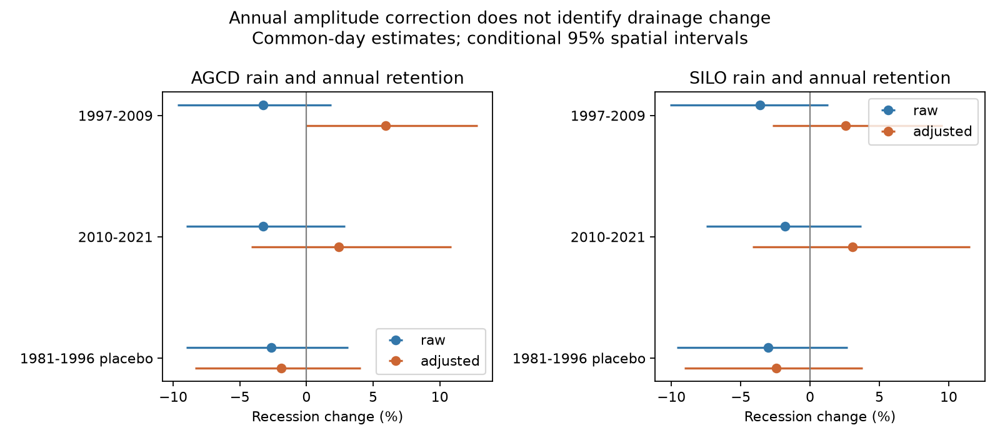

# Annual flow correction left no clear recession change in 158-163 south-east Australian catchments in 2010-2021

We test whether the annual runoff loss and the recession change can be described by one constant flow amplitude per catchment and period. We divide test-period daily flow by the published annual weather-adjusted retention. We then compare recession at equal corrected flow, season and dry-spell age. We use the same days for the raw and corrected comparisons.

## Evidence and result

The table gives geometric rate changes and conditional 95% spatial limits. Difference is corrected minus raw in log units. Reference years are 1951-1996, except the placebo reference is 1951-1980.

| Rain | Test years | Catchments | Raw rate change | Corrected rate change | Difference in log units |
| --- | --- | ---: | --- | --- | --- |
| AGCD | 2010-2021 | 158 | -3.3% [-9.0, +2.9] | +2.4% [-4.1, +10.9] | +0.057 [+0.026, +0.097] |
| AGCD | 1997-2009 | 151 | -3.3% [-9.7, +1.9] | +5.9% [-0.1, +12.8] | +0.091 [+0.047, +0.149] |
| AGCD | 1981-1996 placebo | 83 | -2.6% [-9.0, +3.1] | -1.9% [-8.4, +4.1] | +0.008 [-0.004, +0.021] |
| SILO | 2010-2021 | 163 | -1.8% [-7.5, +3.7] | +3.1% [-4.2, +11.5] | +0.049 [+0.024, +0.081] |
| SILO | 1997-2009 | 152 | -3.6% [-10.1, +1.3] | +2.6% [-2.7, +9.5] | +0.062 [+0.027, +0.117] |
| SILO | 1981-1996 placebo | 83 | -3.0% [-9.6, +2.7] | -2.4% [-9.1, +3.8] | +0.006 [-0.007, +0.020] |



The figure uses common-day support in each catchment. These data test a specified constant-amplitude description. They do not identify a cause. The corrected late-period contrast must be near zero for that description to fit both signatures under this method. The full table gives own-support estimates as a sensitivity check. In the late common-day test, AGCD gave +2.4% [-4.1, +10.9] after correction, and SILO gave +3.1% [-4.2, +11.5]. The raw comparisons also had intervals across zero. Thus the test does not resolve an additional late-period recession change. It does not establish equivalence to zero or show that amplitude caused the annual loss. The result differs from a claim that uniform scaling explains the earlier pooled 11% rise: that pooled southern test has different years, catchments and supported days.

## Question and prior evidence

Campaign studies found a rainfall-adjusted runoff loss after 1997. Source 7cecffa9 found faster recession at equal flow. Source c8882d21 then found that dry-spell-age matching retained a pooled rise, but late-period and long-spell increases were small and uncertain. Source 95ea56ac tested a fixed-mapping leakage restriction and noted the flow-gain ambiguity in an algebraic example. We extend that example with a raw-daily-data amplitude test, an annual fit constraint and iterative common-day support. This is a new analysis of overlapping observations, not an independent replication.

[Kirchner (2009)](https://doi.org/10.1029/2008WR006912) gives the single-store framework. [Dralle et al. (2015)](https://doi.org/10.1002/2015GL066007) established the scale dependence of power-law recession coefficients. If Q=c*U and -dU/dt=a*U^b, then -dQ/dt=a*c^(1-b)*Q^b. Thus c<1 and b>1 give faster recession at equal measured Q with no change in the underlying U clock. This scaling identity is prior knowledge. The numerical application and matched-day test here are new. [Fowler et al. (2022)](https://hess.copernicus.org/articles/26/6073/2022/) review regional physical hypotheses.

## Data and method

Daily flow and rain are CAMELS-AUS v2.03 (Fowler, Zhang and Hou, 2025), with 1950 for initial spell age and 1951-2021 for tests. Exact shared paths, original URLs, archive and used member SHA-256 hashes are in files/provenance.json. The shared root resolves to the HP SSD mount. No data are read from the failed disk. Raw archives and daily arrays stay outside this package. files/retrieve.py can retrieve the same archives to separate scratch. The source rights and all reused code are credited in files/DATA_NOTICE.md.

Annual c is obs_mean/pred_mean from the source Fu-form annual rainfall-runoff model. The source model was fitted in 1951-1996 and controls annual rain, prior-year rain and temperature. We use all positive finite SE-AU ratios, including values above one, and select no catchment by a recession result. The source group has 175 catchments. Not all have enough common daily support. This c is a fitted period-mean counterfactual, not a measured daily gain. P1 uses 1997-2009 and P2 uses 2010-2021. The placebo fit uses 1951-1980 to predict 1981-1996. SILO uses its own annual fit except in the placebo, where only the AGCD annual retention is supplied. That row is a mixed-product sensitivity check.

Dry-day pairs have positive decreasing Q and rain below 1 mm on the preceding, current and next days. We exclude pairs across calendar-year boundaries to avoid correction steps. x is log midpoint flow and y is log daily decrease. Twenty reference flow bins cross six two-month seasons and five age classes (2, 3-4, 5-7, 8-14, 15+ dry days). Each cell needs five days per era. At least 100 supported days and 100 candidate days per era are required. Within-cell flow differences are removed with a common slope fitted after cell-by-era demeaning. Test cell counts weight the contrasts. See analyze.py for exact definitions.

We run the estimator on raw Q and corrected Q/c. For the common-day test, we intersect supported day indices and repeat support filtering until it stops changing. Reference bin edges stay fixed from each full reference candidate set. Each version refits its slope and may assign the same days to different flow cells. Thus this controls day selection, but it does not enforce the same cell weights or equal storage. The own-support result allows support to change. Both are paired by catchment. In the saved intersection rows, coverage is calculated after the day restriction and is therefore one by construction; it is not coverage of all candidate days. Use own-support coverage to inspect the original support loss. The first-order column uses (1-b)*log(c), as a local approximation only. On common days, the fitted mean local slope was 0.86 (AGCD) and 0.83 (SILO) in the late test. These slopes are below one, so correction can increase the conditional contrast. A generic assumption of b above one would give the wrong sign in this fitted domain. These local slopes do not measure a physical aquifer exponent. The own-support late estimates were +0.6% raw and -1.0% corrected with AGCD, and +0.8% raw and +0.7% corrected with SILO; all limits crossed zero. The common-day difference therefore depends on changing cell assignment and weights, even after days are held fixed. This sensitivity is a main limit of the test, not evidence of extra drainage.

Regional results have equal catchment weights. We resample whole 2-degree outlet cells with replacement 9,999 times, seed 421083. Limits condition on observed years, support, fitted annual c and daily slopes. They exclude temporal sampling, annual-fit uncertainty and source errors. They are not calibrated causal confidence intervals. No test-date search or multiplicity correction is used. The plan preceded new results; the support and boundary implementation details were recorded before result inspection.

## Limits and meaning

A constant amplitude cannot in general capture a wet-year-dependent loss, changes in flow timing or changes in recession-curve shape. A nonzero corrected contrast can reflect those failures. A zero corrected contrast would only show compatibility, not prove a gauge error or unchanged stores. This test does not independently measure leakage, recharge, groundwater level, stream-connected area or actual evaporation. Rain-free days can have delayed recharge. Two related rain products are not independent repeats. Finite differences, flow quantisation, rating changes, dry-day selection and a single fitted local slope can bias results. The placebo tests an earlier contrast with different weather and support; it is not a causal correction.

The question is narrower than whether runoff fell. We test whether a single uniform hydrograph scale accounts for both annual and daily signatures. The physical cause of the regional loss remains open. The eastern US is not tested.

## Reproduce and inspect

From the extracted publication directory, with Python 3.12, NumPy, pandas, SciPy and matplotlib:

```sh
sh files/reproduce.sh /absolute/path/to/external-scratch /absolute/path/to/external-output
```

Set DATASET_ROOT to the shared dataset root if it differs from /mnt/dell-data/shared_datasets. On another machine first run `python files/retrieve.py /absolute/path/to/external-inputs` and use that path as DATASET_ROOT. Retrieval writes original archives and source provenance outside the signed package. The daily arrays need about 167 MiB compressed. No private scratch is required. The bundled compatible annual fit statistics permit the repeat; their upstream raw-model rebuild instructions are in the cited sources.

For a short audit without raw inputs, copy files/results/catchments.csv and summary.csv to separate output and run `python files/audit.py /path/to/output`. It independently checks table arithmetic and an exact finite-difference synthetic amplitude case. All 9,999 regional draws, catchment estimates and environment versions are included. Run figures.py on that output to rebuild the display. `retrieve_statistics.py /path/to/campaign` verifies both upstream signed ZIPs and the used members. Preparation checks raw archive hashes against immutable dataset records.

Job: sci-1107-dell-earth-and-ocean-sciences-421083451494. Topic: earth-and-ocean-sciences. Campaign: 11_07_2026. Machine: dell. Account: codex-myxtap. Model: gpt-6.1-sol with high reasoning effort, Codex in T3 Code. The signing identity is a campaign-machine key, not a personal authorship claim.
