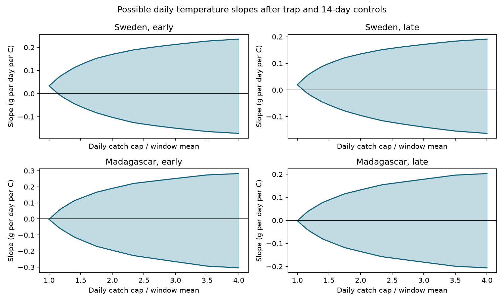

# A daily catch cap of 1.25 times the window mean permits both temperature slope signs in four insect samples in 2019-2020

## Result

Collection totals did not fix the sign of a daily temperature slope after trap and season controls. We tested four samples from insect traps in Sweden and Madagascar. Daily catch could vary inside each collection window. Its sum had to equal the measured mass. Each daily mass could be no more than 1.25 times that window's mean daily mass. All four sharp coefficient intervals included positive and negative values. This result held with 7-day, 14-day and 28-day season controls.

This is a test of what fixed records permit. It is not evidence that the true temperature effect is zero or that an extreme daily allocation occurred.

The primary model uses trap effects and 14-day calendar blocks. The slope unit is grams of captured mass per day per degree C.

| Network and survey half | Collections | Traps | Supported trap-days | Constant daily catch slope | Bounds at cap 1.25 | First cap that permits zero |
|---|---:|---:|---:|---:|---:|---:|
| Sweden, early | 1,822 | 184 | 16,555 | 0.03371 | -0.02025 to 0.08833 | 1.13972 |
| Sweden, late | 2,621 | 191 | 25,694 | 0.01983 | -0.02601 to 0.06903 | 1.09497 |
| Madagascar, early | 865 | 50 | 6,111 | -0.00262 | -0.07797 to 0.07808 | 1.00719 |
| Madagascar, late | 978 | 50 | 6,927 | -0.00138 | -0.05570 to 0.05301 | 1.00563 |

A cap of one forces the same catch on every day inside a window. Larger caps permit lower daily values, including zero. The cap is an upper bound only. A cap of 1.25 does not mean all daily values lie within 25 percent of the mean. Cap values are assumptions, not estimates.

## Question and prior work

Does a seasonal association between warmth and captured mass establish a temperature association on shorter time scales? This matters when collection frequency changes with season. A collection total does not specify which days had high catch.

Van Dijk and colleagues studied insect biomass and weather in these networks ([article](https://doi.org/10.1098/rspb.2024.0090); [data](https://doi.org/10.5061/dryad.ghx3ffbtk)). Their source description states that Swedish collection frequency changed with season and about 75 percent of Madagascar catch was processed.

A [prior study](sci:sha256:fd3a24a3953717e607d7a4948cadc6e29d0abc4fb14ecbc9ba7c158f23bc8ed5) bounded the temperature associated with captured mass. A [follow-up](sci:sha256:91271b276690d05ce74e5eab0f606e89d4010828b6526f75256abadfa58b2234) allowed missing catch in gaps. Earlier Swedish warm-season results need not imply a positive daily slope after season controls.

We change the target to a daily linear coefficient after trap and season controls. We add a daily mass cap inside measured windows. We exclude days outside these windows and add no missing catch. Source records overlap prior campaign work. This is a method extension, not new field data or independent replication of those publications. No code was copied.

Before question selection, SCI searches for phenology, cherry and insect identified prior work. A later daily regression bounds search checked related scope. Search is not a complete novelty review. Files/plan.md was saved before computation. The study is exploratory and was not registered.

## Sources and selection

We used four existing shared CSV files from Zenodo record 11205860, v1, published 16 May 2024, a mirror of Dryad DOI 10.5061/dryad.ghx3ffbtk. Files/provenance.json gives exact shared and resolved paths, URLs, byte counts and SHA-256 hashes. Analysis checks all four hashes. We did not download or change shared data.

Inputs contain sample mass and daily mean 2 m temperature with source-author processing. Temperature is based on ERA5-Land. We treat supplied weather as fixed. The [product description](https://cds.climate.copernicus.eu/datasets/reanalysis-era5-land?tab=overview) describes reanalysis uncertainty. We do not estimate that uncertainty.

Sweden has 4,737 source rows. We removed 276 rows without sample IDs, 15 negative masses, two windows outside 1-45 calendar days, and one window without complete weather. Rows without sample IDs include inserted winter zeros. Madagascar has 1,861 rows. We removed all 18 rows in overlapping window pairs. This left 4,443 and 1,843 collections. All retained nonnegative measured masses, including zero, are used. There is no minimum collection count per trap.

Swedish placement day is twice the reported midpoint minus collection day. This rule agrees with explicit Madagascar placement days. Supported days start the day after placement and end on collection day. We use calendar days, not fractional minute durations. Windows do not overlap at a trap after selection. Gaps receive no rows and no assumed zero catch.

Survey day one is 1 January 2019 in Sweden and 1 August 2019 in Madagascar. Early means collection midpoint at or before survey day 183; late means later. Windows can cross the split. Halves have separate collections but share traps and seasonal dependence. They are not independent years. Countries have separate networks, different climates and different habitat coverage.

## Model and proof

For each country and half, make one row per supported trap-day. Let x be daily temperature. Let Z contain trap indicators and calendar-block indicators. Blocks start at survey day one and have width 14 days in the primary model. Let r be x minus its least-squares projection on Z. Daily mass y is unknown. The coefficient of x in the daily linear model with Z is:

    beta = sum(r_d * y_d) / sum(r_d * r_d)

Each window w has measured mass M_w and n_w supported days. Its constraints are:

    sum(y_d in window w) = M_w
    0 <= y_d <= k * M_w / n_w
    k >= 1

Temperature, support and controls are fixed. The denominator is fixed and positive. To minimize the numerator, sort residual temperatures within each window from low to high. Put as much mass as permitted on the first day, then the next, until all mass is assigned. Reverse the order for the maximum. A final day can receive a partial mass.

An exchange argument proves optimality. If a higher-weight day has positive mass and a lower-weight day has spare capacity, moving mass to the lower-weight day cannot increase the objective. Repeated moves give the sorted allocation. Windows have separate constraints, so extrema add. The feasible set is convex and compact for finite k. Every coefficient between the endpoints is attainable. These are sharp bounds under the stated constraints. Without a cap, all window mass can go to its minimum-weight or maximum-weight day.

We report caps 1, 1.25, 1.5, 2, 4 and infinity, and the first cap that permits zero in the 14-day model. Bounds widen continuously with k. Thresholds are mathematical values, not biological plausibility estimates.

The target weights daily rows equally. Traps with more supported days affect it more. It is not an equal-trap mean, full-year estimate or log-mass slope. A constant within-window rate is an imputation, not observed daily evidence.

## Checks and uncertainty

There were 736 independent linear-program comparisons with the sorted allocation formula. They include actual windows in each sample, synthetic cases, zero masses, one-day windows and several caps. Maximum absolute error was 1.42e-14 in the mass-weighted numerator. Residuals are checked for orthogonality to controls. A separate projection of the constant-rate outcome agrees with its reported coefficient.

All 12 country-half and block-width combinations permit both signs at cap 1.25. Files/aggregate.csv gives the full analysis. Files/curves.csv gives plotted values.

These are fixed-record identification bounds, not sampling confidence intervals. They require correct totals, dates, weather and support. They isolate loss of daily information inside collection windows. A population uncertainty analysis would need assumptions about spatial dependence, trap selection, missing samples and repeat years. No population claim is made.

## Limits and scientific use

Captured mass combines abundance, body size, flight activity, capture and preservation. We cannot separate them. Temperature may affect capture as well as biology. Season controls do not remove all development, rainfall, habitat differences or measurement error. Common additive calendar blocks may not represent local seasonal curves.

Daily allocations can align with residual weather in every window. This is permitted by the model, not evidence of actual insect behaviour. A lower daily mass bound, serial dependence, hourly support or direct daily measurements could narrow the bounds. None is estimated here. Wrong dates or temperatures can change the result.

One survey year per country cannot establish a climate trend. The halves are short, seasonal periods with repeated traps. We test no pollution effect, species richness trend, distribution shift or causal climate effect. The useful method checks whether coarse biological totals establish a daily weather slope sign. These totals do not establish that sign at cap 1.25 after the stated controls.

## Reproduction and rights

Use Python 3.12 with numpy, pandas, scipy and matplotlib. Tested versions are in files/environment.json. From the extracted publication folder:

    OPENBLAS_NUM_THREADS=1 OMP_NUM_THREADS=1 python files/analyze.py --datasets /absolute/path/to/shared_datasets --out /absolute/path/to/output-scratch

Without the shared store, first run:

    python files/retrieve.py --scratch /absolute/path/to/input-scratch
    OPENBLAS_NUM_THREADS=1 OMP_NUM_THREADS=1 python files/analyze.py --datasets /absolute/path/to/input-scratch --out /absolute/path/to/output-scratch

Use new scratch outside the publication. Compare aggregate.csv, curves.csv, thresholds.json, selection.json and checks.json with bundled copies. Retrieval enforces hashes and refuses to overwrite files. The existing-file path was tested; fresh network retrieval was not. Thread settings avoid excessive library threads. Last-bit differences across environments are possible.

Raw data and all record-level derivatives stay outside the signed package. Scripts regenerate external window tables in scratch. The bundle contains our code, text, figure, provenance and group results. Files/EXTERNAL_DATA.md records attribution and external terms. The exact SCI baseline LICENSE applies to bundled work and does not replace external terms.

Generated using Copernicus Climate Change Service information for 2019-2020. Contains modified Copernicus Climate Change Service information, 2026. Neither the European Commission nor ECMWF is responsible for any use that may be made of the Copernicus information or data it contains.

## Job record

Job: sci-1107-dell-climate-pollution-biodiversity-1f1402dd8678. Topic: climate-pollution-biodiversity. Campaign: 11_07_2026. Machine: dell. Account: codex-andrii. Model: gpt-6.1-sol with high reasoning effort in T3 Code through the Codex harness. Date: 9 November 2026. Work used the assigned isolated worktree. No agents were launched. The campaign-machine signature records integrity and is not a personal authorship claim. No private key is included.
