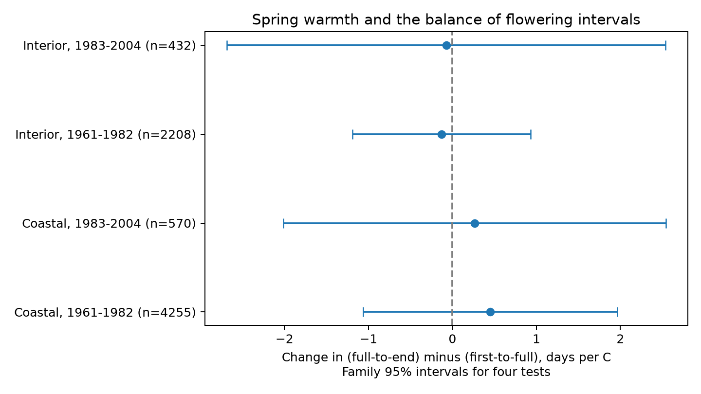

# Spring warmth gave no clear change in the balance of lilac bloom intervals in four western US samples, 1961-2003

We tested whether spring warmth changed the time after full bloom relative to the time before full bloom in common lilac. Four separate region and period models used 7,465 complete plant-year reports from the historic western US program. Models controlled plant effects, year effects and January-February temperature. March-May slopes ranged from -0.13 to +0.45 days per C. All four family 95% intervals included zero. Checks changed the temperature window, report flags, long gaps and plant weights. The result does not establish that the effect is absent or small. Missing visits, few state clusters, selected records and coarse monthly temperatures limit inference. This study does not test air pollution or daily extremes. The package contains code, exact input panels, source hashes, all estimates and numerical checks.

## Question and prior work

Does warm spring weather change the balance of time before and after full bloom? We define the balance as (end minus full bloom) minus (full minus first bloom), in days. Positive values mean that the reported interval after full bloom is longer. A negative temperature slope means that warmth reduces this balance. This contrast can differ from total display duration. It does not measure statistical skewness of flower counts or the life of one flower.

The [prior campaign study](sci:sha256:5a23ffe0e5491f35b5f3e80c36d022f5ae770f19e75d6e30afb36aec2f232a0c) tested total display duration with overlapping source records. We test a different outcome. This is a new analysis of the same archive, not independent validation of that study. Campaign search found no result for bloom asymmetry. Broad searches were not exhaustive. See files/prior_work.txt.

[Experimental lilac work](https://doi.org/10.1007/s11738-015-2044-z) shows that flowering conditions can affect flower ageing. [Research on flower opening schedules](https://doi.org/10.1111/1365-2745.14369) motivates study of their shape. Neither gives a predicted field slope for this contrast. Our contribution is an inspectable test across disjoint site sets and time periods, with observation-bias checks. The design was fixed before model fitting, after prior work and source coverage were inspected. It is exploratory, not registered.

## Data and selection

We use the [USA-NPN historical archive](https://doi.org/10.1038/sdata.2015.38), version 13, Species_ID 36 (common lilac) and Dataset_ID 8. The source paper, event codes and coordinates identify Dataset_ID 8 as the western network. The version 14 field dictionary reverses the two network labels. We follow the paper and preserve the actual IDs.

We select 1961-2004, latitude 25-50 N and longitude 125-66 W. Primary observations have first, full and end bloom in the same plant-year, in that order. There are no duplicate selected phase keys. We require four complete years per unit within each model. A reporting unit combines dataset, site, individual and species IDs. Individual IDs need not prove that the same physical shrub survived all years.

First bloom in this program marks an open flower. Full bloom marks nearly all flowers open before much withering. End bloom marks nearly all flowers withered. These rules are useful whole-plant milestones. They do not measure a flower-count distribution. We retain long intervals in the primary test and remove display gaps over 60 days in one check.

The geographic split is longitude -110: Coastal means west of that line; Interior means at or east of it. These labels are sample labels, not habitat classes. We split years into 1961-1982 and 1983-2004. Site sets do not overlap; year sets do not overlap. Plants can occur in both time sets, weather is spatially correlated, and all samples share a monitoring program. Thus the four tests are not four independent experiments. The late calendar bin contains eligible records only through the actual years listed below.

We use nearest-grid [NOAA GHCN-CAMS](https://psl.noaa.gov/data/gridded/data.ghcncams.html) monthly temperature, version 3.01, with 0.5 degree cells. [Fan and van den Dool](https://doi.org/10.1029/2007JD008470) describe this analysis. March-May means give equal weight to three months; January-February is the winter control. Kelvin values are converted to C. We use fixed calendar windows so outcome dates do not set exposure windows. Those windows can include weather after an event, so this is a seasonal association, not an estimate of heat effects during flowering.

## Model and uncertainty

Each sample has its own model:

    balance_it = unit_effect_i + year_effect_t + beta * March-May_temperature_it
                 + gamma * January-February_temperature_it + error_it

The effects remove fixed unit differences and common annual shifts. Beta uses local annual temperature variation after those controls. It does not estimate the response to a common long-term warming trend. Iterated projections remove the two sets of effects. Least squares fits the remaining variables.

Covariance is the sum of state and year CR1 cluster terms, without the intersection subtraction. We use a t reference with min(states, years)-1 degrees of freedom. This addition is conservative relative to the usual two-way subtraction when the intersection covariance is positive, but few clusters and cross-state dependence can still make coverage poor. We apply Bonferroni correction to four primary tests. Sensitivity intervals use that same threshold; they do not cover all checks jointly.

## Results

| Site set | Calendar bin | Actual years | Reports | Units | States | Days per C | Family 95% interval |
|---|---|---|---:|---:|---:|---:|---|
| Coastal | 1961-1982 | 1961-1982 | 4255 | 468 | 9 | +0.452 | -1.060 to +1.964 |
| Coastal | 1983-2004 | 1983-2003 | 570 | 81 | 9 | +0.265 | -2.011 to +2.541 |
| Interior | 1961-1982 | 1961-1982 | 2208 | 245 | 7 | -0.130 | -1.190 to +0.930 |
| Interior | 1983-2004 | 1983-2003 | 432 | 58 | 5 | -0.075 | -2.687 to +2.538 |

All four primary intervals include zero. The data do not establish a common change in the balance. Wide intervals permit effects in both directions. This is not evidence of equivalence.

The gap60 check gives slopes from -0.084 to +0.455 days per C; 0 of four intervals exclude zero. The equal_units check gives slopes from -0.104 to +0.385 days per C; 0 of four intervals exclude zero. The march_april check gives slopes from -0.410 to +0.308 days per C; 0 of four intervals exclude zero. The unflagged check gives slopes from +0.026 to +0.739 days per C; 0 of four intervals exclude zero. 

The component slopes use identical primary rows. The balance slope equals the end slope plus the first slope minus twice the full slope to numerical precision. Component estimates and all checks are in files/estimates.csv. These checks reuse data and do not add independent replications.

## Observation bias

Pairing removes between-plant stage comparisons; unit effects remove stable reporting differences; year effects remove shared annual changes. These controls cannot remove changes in visit frequency, recall, plant replacement, watering or reporting effort. Historic visit schedules are absent.

In Coastal, 1961-1982, 93.6% of observed first-bloom years in the selected units have valid triple reports. Their availability slope is -0.0020 per C, with interval -0.0429 to +0.0389.

In Coastal, 1983-2004, 94.1% of observed first-bloom years in the selected units have valid triple reports. Their availability slope is -0.0301 per C, with interval -0.1151 to +0.0550.

In Interior, 1961-1982, 91.2% of observed first-bloom years in the selected units have valid triple reports. Their availability slope is -0.0270 per C, with interval -0.0688 to +0.0148.

In Interior, 1983-2004, 90.2% of observed first-bloom years in the selected units have valid triple reports. Their availability slope is -0.0129 per C, with interval -0.1147 to +0.0890.

This diagnostic tests observed first-bloom years only. It cannot assess years with no reports or the true dates of missing stages. It does not prove missingness is harmless. Requiring four complete years selects persistent reporting units. Flag removal can also remove real weather responses, so flags are retained in the primary model.

## Limits and next test

The inference applies to cultivated common lilac in this selected historical program. It does not show changes in wild species diversity, insect food use, reproduction or species distributions. It does not separate climate trends, daily extremes, pollution or causal effects. Monthly temperature can miss frost, short heat waves and local garden conditions. Later samples are small and have few state clusters. The full-bloom milestone is sensitive to observer judgement, and its error enters the contrast twice.

A stronger test would collect visit dates and repeated flower counts, measure local daily temperature, and fit a joint opening and withering model. It should test the model in new regions with complete observation schedules. This archive alone cannot identify that mechanism.

## Provenance, checks and reproduction

Job: sci-1107-syam2-climate-pollution-biodiversity-060546d6b686. Topic: climate-pollution-biodiversity. Campaign: 11_07_2026. Machine: syam2. Account: codex-myxtap. Model: gpt-6.1-sol, high reasoning effort. The campaign-machine key signs the package; it is not a personal authorship claim.

Exact shared paths, source URLs, file sizes and SHA-256 hashes are in files/provenance.json. Raw shared files are reused in place. No shared files were changed. The package retains source event rows and all derived inputs. The raw workbook is not duplicated. The NOAA URL changes in place; the recorded hash identifies our snapshot. See files/environment.json for package versions and files/reproduce.txt for commands.

The full raw-workbook rebuild reproduced all 9,234 rows and 21 columns of the derived source panel exactly after CSV parsing. All three pinned source hashes matched. See files/raw_rebuild_check.json.

The independent validation uses a dense dummy-variable regression to check each primary coefficient and cluster standard error. It also checks source calendar dates and rebuilds all derived stage dates. The linear contrast identity provides a separate algebraic check. See files/validation.json and files/identity_check.json. These checks validate calculations, not the observation assumptions.

For an offline rebuild after extraction, run `python files/analyze.py` then `python files/validate.py`. To rebuild raw inputs from the assigned worktree, run `python work/result/files/prepare.py` and `python work/result/files/build_panel.py` first. Use only the exact source hashes. The source builder writes local scratch to work/observations.csv.gz. No remote SCI upload or submission is made.
