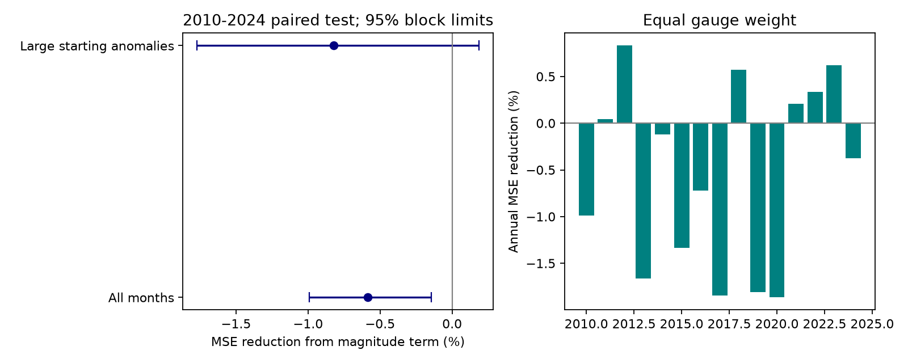

# An anomaly size term raised one-month sea-level error at 217 gauges in 2010-2024

Adding one anomaly size term to a linear model with two monthly lags raised mean squared error (MSE) by 0.586%. The conditional 95% three-year block interval for MSE reduction was -0.992% to -0.145%. RMSE rose from 83.628 to 83.873 mm. This simple term did not improve prediction in this sample. It does not show that coastal recovery is linear.



## Question and prior work

Does the size of a coastal sea-level anomaly give useful information about the next month's level beyond two linear monthly lags? A large anomaly could have a different recovery rate from a small one. Better estimates of monthly levels can help coastal planning. Monthly levels do not give storm surge peaks or flood counts.

Damped persistence is an established reference. Frederikse et al. (2022), doi:10.1029/2021JC018137, use a first-order model after seasonal adjustment at Charleston. Their model and physical forecast methods motivate a local memory reference. We do not test their ocean model. Holgate et al. (2013), doi:10.2112/JCOASTRES-D-12-00175.1, describe the PSMSL data service.

We searched the campaign before the test. Terms included earthquake, ocean recovery, hydrology, sea level seasonal amplitude, river recession, tsunami, Arctic river, sea level persistence forecast, PSMSL autoregressive, sea level forecast neighboring, sea level anomaly magnitude and sea level nonlinear memory. We read three close publications:

- [Decay test](sci:sha256:a60f6e277cdcf5776abb1b80169b04a16e2546c88171db6d73526050de692058): anomaly decay beat fixed carry, but the gain over a trend and seasonal reference was small and uncertain.
- [Second-lag test](sci:sha256:5e38e5669f172a0a90abe25ea895629dbde1a212bca1fa7fe75b6af629db13d1): two lags gave a small gain in December-origin year-ahead prediction. The result depended on block length.
- [Sign test](sci:sha256:297f795f30d598a03f8c1ab32990de9fbe9380da2790a036cc6ccbe80d5a544b): an absolute-anomaly term did not improve one-month prediction at six US gauges.

Our test adds a signed size term, r times abs(r), at 217 gauges. This term changes the response with size on both sides of zero. It differs from the earlier absolute-anomaly term, which changes the response with sign. We also use all monthly origins. The source records overlap with those studies. This is not independent confirmation with new measurements. No prior code was reused.

## Data and rights

We use PSMSL (2026), Revised Local Reference monthly data, database date 19 October 2026. Credit belongs to PSMSL and the national authorities that supplied the records. Shared path:

`/mnt/dell-data/shared_datasets/psmsl-rlr-monthly-20261019/rlr_monthly.zip`

Source: <https://psmsl.org/data/obtaining/rlr.monthly.data/rlr_monthly.zip>.

Archive SHA-256: `b22f65f5fcbc5021809f1d4eef279269f5e78a08bdc8d28aabd22adfe4dcf57e`.

[provenance.json](files/provenance.json) gives the resolved object path and hashes of every archive member read. We reused the archive in place and made no download. The [format notes](https://psmsl.org/data/obtaining/notes.php) give monthly means in mm and dates as year plus (month minus 0.5)/12. The [complete-data page](https://psmsl.org/data/obtaining/complete.php) identifies the archive date and station flags.

We require station flag N. We reject level -99999, nonfinite levels, nonzero attention flags and interpolated months with missing-day code 99. Other missing-day counts remain. Empty files are skipped. Each gauge must have at least 95% accepted months in 1980-2009 and separately in 2010-2024. This selects 217 gauges. Later availability affects this selection, so it is retrospective. It does not make the gauges a random or uniform sample of coasts. We use the supplied reference adjustments. We did not inspect every station's benchmark history.

The signed package contains our code, text, figure and aggregate error statistics. It excludes source observations, station tables, residual series, fitted site coefficients and record-level predictions. The PSMSL pages require source credit, but did not establish rights to grant the SCI baseline for the whole source archive. External records and derivative tables therefore stay outside the package. The aggregate statistics are original model evaluation results and cannot reconstruct the source records. See [external notice](files/EXTERNAL_DATA_NOTICE.txt). No external license is replaced.

## Model and test

[plan.txt](files/plan.txt) was saved before scores were computed. It is not an external registration. For each test year from 2010 to 2024, fit an intercept, a linear trend and 11 month indicators to the preceding 20 calendar years. Require at least 90% accepted training months. Let B(t) be the resulting trend and seasonal fit. Let r(t) be observed level minus B(t), and s be the population standard deviation of accepted training residuals.

Fit the following residual models by ordinary least squares, without an intercept:

`Reference: r(t) = a1*r(t-1) + a2*r(t-2) + error`

`Size model: r(t) = b1*r(t-1) + b2*r(t-2) + c*r(t-1)*abs(r(t-1))/s + error`

Use only complete consecutive triples. Gaps are not bridged. Both models use exactly the same training transitions and test targets. There is no tuning, clipping or regularization. Coefficients remain fixed within each test year. Predictions use the observed previous two months as they become available, including earlier months of the test year. These are repeated one-month predictions. They are not twelve-month forecasts made in December. Adding B(t) gives predictions of level in mm and leaves the paired residual errors unchanged. Every training target precedes the test year. Observations are revised records; no release-delay or vintage test is made.

For positive r, c below zero bends the predicted response down. For negative r it bends the response up. This is consistent with a stronger return towards zero, conditional on the other lag. Coefficients alone cannot identify physical recovery. Continuing wind, pressure, currents, heat, land motion and errors all enter the residual. The fitted c median was -0.00469, with interquartile limits -0.0520 to 0.0426. About 52.7% of main fits had c below zero. These descriptive values do not show a common physical effect.

For each station-year, average squared errors over its accepted targets. Then average across gauges within each year and across the 15 years. Report reduction as 100 times (1 minus size-model MSE divided by reference MSE). Negative reduction means increased error. A cell-weight check first averages within occupied 10-degree latitude-longitude cells. This reduces dense-site weight but does not give global representation.

Uncertainty uses 19,999 circular moving-block draws of test years. The primary block has three years. All gauges use the same resampled years to retain shared annual variation. Each draw recomputes the MSE ratio. One- and five-year blocks are checks. The intervals condition on saved forecasts. They omit refit, source revision and site-selection uncertainty. Fifteen test years provide weak support for long climate dependence. Gauges are not independent replicates.

The planned large-anomaly subset requires abs(r(t-1)) at least 1.5 times s. Its threshold uses training data only. It keeps both positive and negative anomalies. Within-year weighting uses gauges that have such targets, so it is a different estimand from the all-month score. The threshold does not define a flood or a rare storm event.

## Results

The primary test has 38,618 monthly targets and 3,255 station-year fits. All 217 gauges have at least one target in all 15 years. Support differs among training-window checks.

| Test | MSE reduction (%) | 95% three-year block interval (%) |
|---|---:|---:|
| All months, 20-year training, gauge weight | -0.586 | -0.992 to -0.145 |
| All months, 20-year training, cell weight | -1.042 | -1.894 to -0.474 |
| Large anomalies, 20-year training, gauge weight | -0.820 | -1.771 to 0.187 |
| Large anomalies, 20-year training, cell weight | -2.267 | -3.754 to -0.859 |
| All months, 10-year training, gauge weight | -2.343 | -3.291 to -1.483 |
| All months, 30-year training, gauge weight | -0.287 | -0.708 to 0.131 |

The main one-year block interval was -1.062% to -0.108%; the five-year interval was -0.979% to -0.197%. Thus the main increase in error did not depend on the three tested block lengths. The main point effect is small. The large-anomaly gauge-weight interval includes zero. Longer training reduces the point loss, which is consistent with estimation cost from an extra term; this comparison alone does not establish that explanation. We did not select a training window after scoring. All planned results, including all block lengths, are in [summary.csv](files/summary.csv). Annual aggregate losses and counts are in [annual.csv](files/annual.csv).

The evidence does not support added accuracy from this one size term in this sample. It does not rule out smaller effects, seasonal nonlinear response, other functional forms or useful external forcing. No causal driver was tested. The unrestricted quadratic term can extrapolate poorly for rare anomalies. A future test could use a fixed bounded response form and a separate period. Another useful test would condition on pressure and wind to separate continuing forcing from local memory. These tests were not done.

## Validation and reproduction

A separate QR solver checked each nonlinear fit's test predictions. The largest difference was 2.96e-12 mm. A separate standard-library reduction of saved record-level predictions checks primary yearly losses and target counts. [audit_external.json](files/audit_external.json) gives its result. [check_aggregates.py](files/check_aggregates.py) independently recomputes every summary row and bootstrap interval from bundled annual scores and saved resampling indices. [audit_aggregate.json](files/audit_aggregate.json) gives its result. These checks test implementation, not physical assumptions or interval coverage.

Verify the signed ZIP with `sci verify BUNDLE.zip --json`. Extract a copy, then check the aggregate evidence without source data:

```sh
OPENBLAS_NUM_THREADS=1 python files/check_aggregates.py
```

Full regeneration needs Python 3.12, NumPy, pandas and Matplotlib. Exact versions are in [diagnostics.json](files/diagnostics.json). From the extracted root, choose a new output directory outside the publication:

```sh
OPENBLAS_NUM_THREADS=1 python files/analyze.py /path/to/rlr_monthly.zip /tmp/sea_size_repeat
python files/audit_external.py /tmp/sea_size_repeat
```

The script verifies the archive hash before fitting. It writes raw-derived tables only into separate scratch. Compare annual.csv, summary.csv, diagnostics.json and result.png with the bundle. The source path will differ; numerical rounding and image rendering can vary with software versions. The retrieval helper `python files/retrieve.py /tmp/psmsl_external` downloads the live provider file into new external scratch and rejects a changed hash. A changed release cannot silently replace the exact snapshot. Full refitting depends on access to the external 19 October 2026 archive; the aggregate check needs no network or external records.

## Campaign record

Campaign 11_07_2026. Job sci-1107-dell-earth-and-ocean-sciences-b3ee1a3461b4. Topic earth-and-ocean-sciences. Machine dell. Account codex-olen. Model gpt-6.1-sol, high reasoning effort, through T3 Code and the Codex harness. No agents were launched. Computations used this assigned workspace. The campaign-machine signature is not a personal authorship claim. The worker stores the signed bundle locally and does not upload or submit it. No private key is included.
