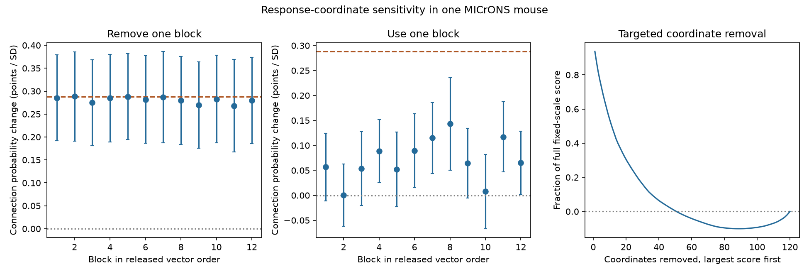

# Removing each ten-coordinate block retained a positive response wiring slope in one MICrONS mouse

We tested whether a response similarity and wiring relation depends on one block of a released response vector. The sample had 295,348 candidate pairs and 8,128 connected pairs from one MICrONS mouse. A linear probability model controlled separate source and target cell effects and four proximity terms. The full-vector slope was 0.288 percentage points per SD of correlation. All 12 fits that removed one ten-coordinate block retained positive slopes, from 0.268 to 0.288 points. All 12 conditional family intervals excluded zero. Only three block-only family intervals excluded zero. An exact fixed-scale score allocation required removal of at least 51 of 120 coordinates to remove its positive sign. This certificate keeps the original centering and scale. It does not apply to Pearson correlation after removal. Adaptive removal of the 12 largest-score coordinates with Pearson correlation recomputed also kept a positive point estimate. These tests describe numerical sensitivity in one selected mouse panel. They do not establish transfer to new animals, stimuli or behavioral states.

## Question and prior work

A circuit can link cells that have similar average responses. Such a relation can depend on a small part of the response measurement. We test whether the measured wiring slope survives removal of each of 12 disjoint coordinate blocks. A positive result supports stability to these removals. It does not prove stable coding across conditions.

Ding and colleagues reported functional wiring rules in mouse visual cortex. The MICrONS Consortium supplied matched calcium imaging and electron microscopy data with Allen Institute contributions. We use their public v1 node and pair tables. Sources: [Ding et al.](https://doi.org/10.1038/s41586-025-08840-3), [MICrONS Consortium](https://doi.org/10.1038/s41586-025-08790-w), [data inventory](https://www.microns-explorer.org/cortical-mm3).

The campaign search preceded the test plan. A [prior cell-control analysis](sci:sha256:c59a7cc9c394931da48264dbdd64f4dd2ef21ea50f820313c35558be9be14d07) tested response similarity after separate cell effects. A [prior vector audit](sci:sha256:748aa272d79394531e3e34931a140943b795b6f92d05e7aa412e7134fd27d14a) showed that the node vectors reproduce the released pair correlations. Our test changes response coordinates and uses a linear probability model. It is not a numerical replication of the prior Poisson model. We reuse no prior analysis code or derived tables. files/prior_search.json records the search titles and IDs. The plan was saved before new fits. The adaptive top-12 Pearson fit is a post hoc extension.

## Data and method

There were 295,371 Connected or ADP candidate rows with positive axon and dendrite proximity lengths. Recursive removal of degree-one cell roles removed 23 rows, leaving 295,348 pairs, 148 source cells, 11,012 target cells and 8,128 connected pairs. All models use these same rows. The initial panel uses 11,035 response vectors, each with 120 finite entries.

A linear probability model controls separate source and target cell effects, centered log axon and dendrite proximity lengths, and their squares. Each pair has equal weight. The predictor is Pearson response correlation. Slopes are probability changes per pooled SD of that predictor. Each fit uses its own predictor SD; raw slopes and SDs are also stored. The full connection fraction is 2.752 percent.

Block 1 contains coordinates 1-10; block 12 contains coordinates 111-120. The released coordinate order is retained. We have not mapped these coordinates to scene, time or behavioral labels. Thus the test concerns measurement support, not temporal or behavioral generalization. Each block-removal fit and block-only fit centers and normalizes its selected responses again.

Shared-neuron score intervals allow rows with any common biological cell to depend. Family intervals use Bonferroni correction across each group of 12 fits. They are conditional diagnostics without a high-dimensional leverage correction. files/METHODS.md gives equations, numerical tolerance and assumptions.

## Results

The full slope was 0.288 percentage points per SD, with a nominal 95 percent interval of 0.192 to 0.384. Removing any one block kept the slope positive. The range was 0.268 to 0.288. All 12 omission family intervals excluded zero.

All block-only point estimates were positive, but only 3 of 12 family intervals excluded zero. Small blocks therefore gave weaker evidence than the complete measurement. No inference treats these blocks as independent samples.

All values in the table are percentage points per SD. The family column uses 12 fits even for the full-vector reference row; its interval is conservative and is not a separate planned family.

| Fit | Slope | Nominal 95 percent interval | Family interval |
|---|---:|---:|---:|
| full | 0.2882 | 0.1921 to 0.3843 | 0.1477 to 0.4287 |
| omit_01 | 0.2854 | 0.1918 to 0.3790 | 0.1486 to 0.4223 |
| omit_02 | 0.2883 | 0.1912 to 0.3854 | 0.1463 to 0.4302 |
| omit_03 | 0.2749 | 0.1811 to 0.3687 | 0.1378 to 0.4120 |
| omit_04 | 0.2849 | 0.1892 to 0.3806 | 0.1450 to 0.4248 |
| omit_05 | 0.2881 | 0.1941 to 0.3821 | 0.1507 to 0.4255 |
| omit_06 | 0.2816 | 0.1860 to 0.3773 | 0.1418 to 0.4214 |
| omit_07 | 0.2872 | 0.1878 to 0.3866 | 0.1418 to 0.4326 |
| omit_08 | 0.2795 | 0.1836 to 0.3753 | 0.1393 to 0.4196 |
| omit_09 | 0.2694 | 0.1753 to 0.3635 | 0.1319 to 0.4070 |
| omit_10 | 0.2827 | 0.1872 to 0.3781 | 0.1432 to 0.4222 |
| omit_11 | 0.2681 | 0.1673 to 0.3690 | 0.1207 to 0.4156 |
| omit_12 | 0.2797 | 0.1858 to 0.3737 | 0.1424 to 0.4171 |
| only_01 | 0.0566 | -0.0114 to 0.1245 | -0.0428 to 0.1559 |
| only_02 | 0.0005 | -0.0619 to 0.0630 | -0.0908 to 0.0918 |
| only_03 | 0.0538 | -0.0200 to 0.1275 | -0.0541 to 0.1616 |
| only_04 | 0.0888 | 0.0257 to 0.1520 | -0.0035 to 0.1811 |
| only_05 | 0.0520 | -0.0231 to 0.1271 | -0.0578 to 0.1617 |
| only_06 | 0.0896 | 0.0157 to 0.1635 | -0.0185 to 0.1977 |
| only_07 | 0.1150 | 0.0437 to 0.1862 | 0.0108 to 0.2191 |
| only_08 | 0.1431 | 0.0506 to 0.2356 | 0.0078 to 0.2783 |
| only_09 | 0.0644 | -0.0053 to 0.1341 | -0.0375 to 0.1663 |
| only_10 | 0.0077 | -0.0668 to 0.0822 | -0.1012 to 0.1166 |
| only_11 | 0.1171 | 0.0468 to 0.1873 | 0.0144 to 0.2198 |
| only_12 | 0.0654 | 0.0025 to 0.1283 | -0.0265 to 0.1573 |

The exact full-vector partial numerator was 106.658661. Its coordinate contributions sum to this value. The 12 largest contributions supplied 52.09 percent of that score. Removing the largest contributions first required at least 51 coordinates to make the fixed-scale score nonpositive. This is an exact statement about the observed score under fixed full-vector centering and normalization. It is not a guarantee for re-estimated Pearson correlations, prediction or biological coding.

As a post hoc check, removal of the 12 largest-score coordinates followed by fresh Pearson centering and normalization gave a positive slope of 0.240 percentage points per SD. This adaptive estimate uses the wiring outcome for coordinate selection. It has no confirmatory interpretation.

## Checks and limits

Reconstructed full-vector correlations matched released pair values within 2.63e-07. Alternating projection stopped after 31 iterations with maximum removed mean 4.98e-12. The independent checker uses NumPy correlations, a separate sparse nuisance solver and a direct dyadic score enumeration. Its numerical results are in files/checks.json.

This is one mouse and a selected set of proofread source cells in a finite tissue volume. The response vectors are trial means. They do not give trial-level uncertainty or simultaneous coupling for most cross-scan pairs. Registration, calcium measurement, limited anatomy and detection errors remain possible. Separate additive cell effects do not remove all cell-pair confounding. A linear probability slope need not match a nonlinear slope. The interval calculation permits shared-cell dependence but does not cover arbitrary tissue dependence; coverage is not established with many fitted cell effects.

The removal tests share most coordinates and all wiring outcomes. They are not independent replications. Stable positive slopes after these numerical removals do not establish causal wiring, a reliable neural code, transfer to unobserved stimuli, or a general rule across regions, animals or behaviors. Mapping stimulus identities and testing separate animals are necessary next steps.

## Provenance and reproduction

The exact raw inputs are the public BossDB functional_connectomics/node_and_edge_properties/v1 tables. No new download was needed and no shared data were changed.

- Edge input: /mnt/dell-data/shared_datasets/microns-funconn-ding2025-v1-edge-data/edge_data_v1.pkl. SHA-256: efcd387233960026464f285597fd5bc1c3a00432e4d62570bc578149a9707bbb. Bytes: 201511086.
- Node input: /mnt/dell-data/shared_datasets/microns-funconn-ding2025-v1-node-data/node_data_v1.pkl. SHA-256: 5a310585ccefcfb2f14d15b2cc2e607e730b0ec0a86587e606af362463abf6ef. Bytes: 294635032.

files/provenance.json records the exact URLs and resolved shared paths. Hashes were checked before loading. The bundle preserves selected pairs, complete response vectors for the panel, original analysis and checking code, all fit results, exact score contributions, a static figure and retrieval commands. See files/REPRODUCE.md. From the bundle root:

    OPENBLAS_NUM_THREADS=2 python files/analyze.py --data files --out /tmp/microns-block-rerun

The SCI baseline license covers this report and original code. The reused data remain attributed to the MICrONS source studies; this report claims no new rights over them.

## Campaign record

Campaign: 11_07_2026. Job: sci-1107-dell-neural-structure-and-computation-7af35cfc6136. Topic: neural-structure-and-computation. Machine: dell. Account: codex-andrii. Model: gpt-6.1-sol with high reasoning effort through T3 Code and the Codex harness. One worker ran this study without child agents. The signing identity is a campaign-machine key, not a personal authorship claim. Private keys are not included. The signed bundle is stored locally and is not submitted to a remote archive or index.
