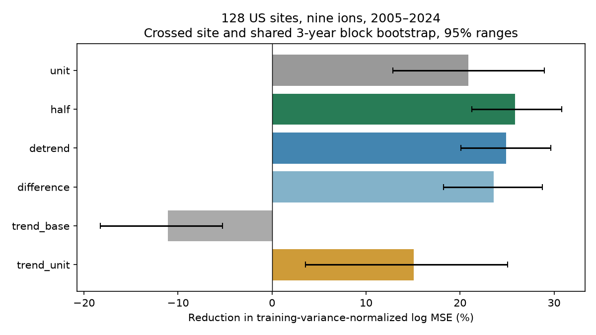

# Fixed rain terms reduced aggregate wet-deposition error at 128 US sites in 2005-2024

Observed annual rain improved later wet-deposition estimates when the model used a recent pollution level and a fixed rain term. A half-strength rain term reduced training-variance-normalized log error by 25.9%. A crossed site and shared-year bootstrap gave a 95% range of 21.2% to 30.8%. The full-strength term gave 20.9% [12.9%, 29.0%]. These are conditional response estimates. They are not forecasts issued before rain was known.

The planned mean of series percentage gains was 24.9% for the half-strength term. Its bootstrap range was -24.0% to 27.1%. Small reference errors made this score unstable. The evidence supports aggregate loss reduction in this panel. It does not establish a precise gain for a new site or year.



## Question and prior evidence

SCI 2c15bea979291ab376d4a1f94f52b24e394207928c25e470339008603ae127d3 found no useful median forward gain for annual wet-deposition models selected from climate windows. Its family screen rejected these models. This was a failed positive control because deposition depends directly on rain. We test whether a fixed rain predictor with a recent pollution level can give useful later estimates. The question concerns model design within a previously tested system. It adds no independent field records.

The deposition identity is established practice. The National Park Service multiplies concentration by precipitation to obtain wet deposition and uses concentration to study pollution trends separately from annual rain variation. Zhang et al. (2019, doi:10.1029/2018JD029051) used precipitation correction in model-observation fusion. Our contribution is a past-only level update, fixed rain terms, a later-period test, and an uncertainty audit. We do not claim to invent the identity, dilution, or precipitation correction.

Campaign searches covered climate forecasts, false signals, and wet deposition. The local plan in files/plan.txt was written before response-data inspection in this investigation. It is not a timestamped registration. We had read the earlier results. The six main model choices, score definitions, periods, windows and bootstrap were set in that plan. The extra fixed-denominator score audit was added after the initial results showed instability. No model or threshold was then changed.

## Data and scope

We acquired the NADP National Trends Network annual calendar-year export on 11 November 2026. Its two input hashes match those in the earlier signed study. The source terms state that data are public domain unless marked otherwise and require source acknowledgement. We acknowledge: National Atmospheric Deposition Program (NRSP-3). 2026. NADP Program Office, Wisconsin State Laboratory of Hygiene, 465 Henry Mall, Madison, WI 53706.

We retain sites in 24-50 N and 125-66 W, annual records in 1978-2024, positive concentration and precipitation, at least 15 valid years through 2004 and at least 10 valid years in 2005-2024. NADP sequesters values that fail its annual data requirements as -9. We do not fill these values. The ions are Ca, Mg, K, Na, NH4, NO3, Cl, SO4 and H. H mass concentration is 10^(-pH) times 1008 mg/L. Deposition is concentration in mg/L times rain in cm times 0.1, in kg/ha. We use natural logarithms throughout.

There are 128 sites and 1,152 site-ion series. The main comparison has 18,360 site-ion-years (2,040 distinct site-years). An estimate requires at least three valid observations in the previous five calendar years and at least five in the previous ten years. The latter rule gives a common sample for the trend comparators. The eligibility rule of ten test observations applies before these forecast-history filters; some series have fewer scored years. We retain all scored rows, including sparse ones. Selection for a long record can limit transport to other sites.

Raw files, site tables, annual errors and individual coefficients stay outside the signed package. Exact hashes, paths, version and URLs are in files/provenance.json. No shared dataset was used or added. The retrieval script can regenerate external inputs. Source changes can prevent exact reproduction.

## Models

Let y be log deposition and x be log annual rain. B is the average y in the previous five calendar years. Each rain model is

    predicted y = B + beta * (current x - average past x).

The past x average uses exactly the same records as B. beta=1 is equivalent to adding current log rain to the recent mean log concentration. beta=0.5 allows a smaller deposition response. Both coefficients were fixed in the plan. They were not selected from later losses.

Two additional coefficients use only data through 2004. The detrend coefficient regresses linearly detrended y on detrended x. The difference coefficient regresses consecutive-year changes in y on changes in x, with an intercept. These coefficients are frozen for all test years. They are not clipped. An additional comparator fits a line to the previous ten years of y. Its rain version fits a line to log concentration over the same years and adds current x. All level updates use only years before the target year.

A next-year rain control replaces current x by x in the following year. It uses future information and cannot be deployed. We compare it with the current-rain models only on records where both are available. A control that substitutes recent average rain for current rain is exactly B and has zero incremental gain.

## Scores and uncertainty

For each site-ion series the planned score is 1 - MSE(model)/MSE(B). We average within ions and then across nine ions. This gives equal weight to each ion and site. It is sensitive to a small B denominator. No record is removed to improve this score.

The other planned score first divides squared errors by each series' pre-2005 sample variance of log deposition. It pools these normalized errors within each ion and computes 1 - mean(model error)/mean(B error), then averages over ions. This is the aggregate score in the title and figure. It gives more weight to series with larger later errors relative to their training variance. It is not a physical mass-error score, a national deposition total, or the average series percentage gain.

We use 2,000 bootstrap draws, seed 1107. Sites are resampled with replacement, retaining all ions. The same resampled years apply to every site and ion. Each time draw concatenates seven random circular three-year blocks from 2005-2024 and retains the first 20 positions. Models are not refitted. Intervals are percentile ranges conditional on fitted coefficients, observed history, selected sites and these 20 years. This approach retains common annual variation but cannot establish performance in a new climate regime. There are only 20 test years.

## Results

| Model | Mean series gain | Aggregate gain | Aggregate 95% range |
|---|---:|---:|---:|
| beta=1 | 15.0% | 20.9% | 12.9 to 29.0% |
| beta=0.5 | 24.9% | 25.9% | 21.2 to 30.8% |
| Frozen detrended beta | 21.8% | 24.9% | 20.1 to 29.7% |
| Frozen difference beta | 19.8% | 23.6% | 18.3 to 28.8% |
| Recent deposition trend | -17.1% | -11.1% | -18.3 to -5.3% |
| Recent concentration trend plus rain | 3.8% | 15.1% | 3.6 to 25.0% |

The half-strength term beat the unit term by 4.94 aggregate percentage points [1.01, 9.57]. It did not clearly beat the frozen detrended term: 0.93 points [-1.50, 4.28]. The trend-plus-rain model beat the trend-only comparator by 26.14 points [16.58, 35.73]. These are descriptive paired intervals; no adjustment for multiple model comparisons was applied.

The half-strength term had positive mean series gains in every ion: Ca 15.1%, Mg 21.2%, K 17.9%, Na 22.9%, NH4 33.9%, NO3 35.4%, Cl 29.6%, SO4 25.8% and H 22.5%. The unit term lost for Ca (-11.1%). Median detrended training coefficients ranged from 0.51 for Ca to 0.87 for H. Values below one are consistent with concentration dilution or other shared drivers. This test does not identify a causal dilution coefficient.

On the 15,705 matched control rows, aggregate gains were 18.5% for beta=1, 24.7% for beta=0.5, 24.0% for detrended beta, and -49.8% for next-year rain. This supports year-specific information rather than only a smooth shared trend. It is an imperfect control: serial rain dependence and different process lags remain possible.

## Sensitivity and the unstable percentage score

For the half-strength term, aggregate gains were 26.9%, 25.9% and 21.1% with three-, five- and ten-year level windows. For the main five-year window, aggregate gains were 25.2% in 2005-2014 and 26.9% in 2015-2024. Thus aggregate reduction persisted in both halves and all three windows. Their scored samples differ because of missing history.

However, the mean series gain was -37.5% with the three-year window and negative in both halves of the five-year test. One three-year-window nitrate series had only one scored year and nearly zero reference error; its relative loss was very large. Shorter test subsets made this problem worse. We did not drop these cases. In the main full-period five-year test the primary bootstrap interval for beta=0.5 was -24.0% to 27.1%; for beta=1 it was -190.8% to 17.1%. These broad intervals must accompany the positive point estimates.

As an additional diagnostic, we kept each full-test series reference denominator fixed during the bootstrap and resampled only additive error differences. The half-term range became 20.3% to 29.9%. This answers a different, conditional question and was added after the results. It does not replace the planned interval. Both this diagnostic and the planned aggregate score show that the broad percentage intervals arise in part from denominator instability.

## Interpretation and limits

A rejected climate-window model is not evidence that the response has no useful climate information. Here, a fixed positive rain term and a recent pollution level gave lower aggregate later error. This narrows the earlier failed positive control. It suggests that a screen should be tied to a specified predictor and model, not assigned to wet deposition as a whole.

This is not a controlled comparison with the earlier window-search engine. We use on-site annual gauge rain, log rain, fixed coefficients, different history filters and a direct rain predictor. The earlier study used gridded weather and searched temperature and precipitation windows. We cannot assign the improvement to one of these differences or claim that the earlier screen was miscomputed. We did not recompute its false-signal rate for these new models.

The target deposition contains the same measured rain used as predictor by definition. This is a useful concentration-to-deposition reconstruction, but a partly shared measurement. It cannot independently establish atmospheric causation. It does not test dry deposition, ecological injury, or a forecast before rain is known. The rain coefficient of one is an identity conditional on concentration, not a guarantee that concentration is independent of rain. A beta of one-half is an empirical conservative option in this panel, not a universal physical constant.

The sample is one national network with common methods and trends. Nine ions are not nine independent system replications. Emission changes, observation error, source revisions, source availability lag, spatial dependence beyond sites and changes in missingness limit transfer. We score log errors, not high-load extremes in kg/ha. A next step is to test archived rain forecasts and weather input errors at an explicit issue date. The present result supplies a conditional benchmark for that test.

## Reproduce

Use Python 3.12 with numpy, pandas and matplotlib. Keep downloaded records and error tables outside the signed draft:

```sh
sh files/fetch_nadp.sh /absolute/external/raw
OPENBLAS_NUM_THREADS=1 OMP_NUM_THREADS=1 MKL_NUM_THREADS=1 python files/analyze.py /absolute/external/raw /absolute/external/output
OPENBLAS_NUM_THREADS=1 python files/robustness.py /absolute/external/output
OPENBLAS_NUM_THREADS=1 python files/audit.py /absolute/external/output
OPENBLAS_NUM_THREADS=1 python files/audit_raw.py /absolute/external/raw /absolute/external/output
```

Compare input hashes with files/provenance.json before interpreting an exact reproduction. The scripts reproduce aggregate tables and the figure. The analysis script writes a fresh provenance file with the reproduction paths. The signed provenance also records this job and machine. The record tables remain external. No private scratch is needed if the same source export can be retrieved. A revised export must be documented rather than silently accepted as the original.

The independent score audit checked all 63 strategy/window/period results. The independent raw-data audit reconstructs the baseline and both fixed rain forecasts from scalar log products. Input-key, finite-error, split and deposition-identity checks also passed. Full code, plan, input hashes, aggregate tables and figure are in this bundle.

Job: sci-1107-dell-climate-pollution-biodiversity-eda572fc857a. Topic: climate-pollution-biodiversity. Machine: dell. Model: gpt-6.1-sol. The campaign key identifies the machine; it is not a personal authorship claim.
