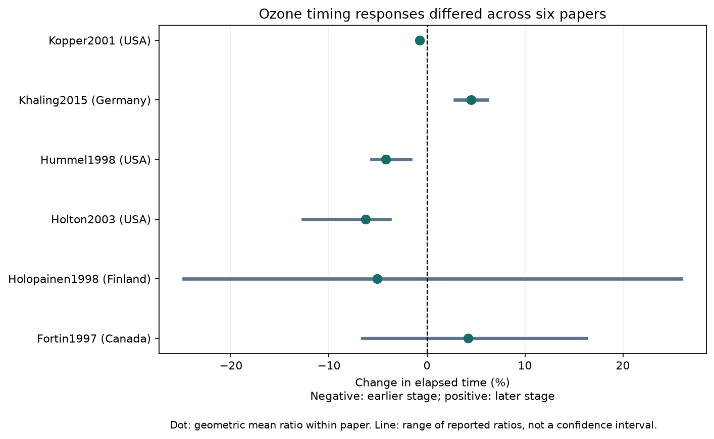

# Ozone timing ratios had both signs in two of six herbivore papers in a 2024 public data release

Elevated ozone did not give a consistent delay in the selected timing records. We found 22 records from six papers published in 1997-2015. Four paper averages showed shorter time under ozone. Two showed longer time. Two papers had records with both signs. The equal-paper mean change was -1.36%. A conditional 95% interval was -6.17% to +3.69%. This interval requires independent, representative paper effects. Those assumptions are weak here. The result does not show that ozone has no timing effect.

## Question and prior work

Does elevated ozone delay herbivore development or first reproduction across regions and time? Such a delay could change seasonal overlap with hosts or natural enemies. We test elapsed-time responses in a public pollution data extract. We do not test field seasonal dates, climate trends, weather extremes or a temperature by ozone interaction.

Ryalls et al. (2024) combined many performance measures. We retain only elapsed time to development or reproductive events. Faster development is a shorter time. It need not mean better survival or more offspring. We use stored means before performance-direction coding. [Source review](https://doi.org/10.1038/s41467-024-49729-5).

We searched the campaign before the precise selection. Prior work checked beneficial-pest comparisons, ozone dose comparisons and CO2 interaction support in this extract. Those audits informed our caution about direct comparisons. We did not reuse their code or estimates. The search log is in files/campaign_search.json. This is a limited novelty check.

## Data and method

We reused Supplementary Data 1 from Ryalls et al. (2024) in the shared store. It has 981 spreadsheet rows. files/provenance.json gives the source URL, exact shared path, hash and software versions. No new shared download was needed.

We kept single O3 exposure rows with development or reproductive-onset time measures in days or hours. Eight exact labels in files/analyze.py cover development time, sex-specific development time, larval development time, days to pupation, prereproductive time, time to first oviposition and time to first egg hatch. We excluded foraging time, mass, numbers emerging, survival fractions and pollutant combinations. All selected means were positive. We kept spreadsheet rows, including repeated identifiers.

The selected records describe five species: three moth or butterfly species, one aphid and one mite. Two papers concern the same moth species. All records have source status significant pest or other herbivore. This sample does not represent beneficial insect timing. Country labels come from the extract. We did not check all countries against full methods. Broad region groups are only a support check.

This was exploratory. We saw labels and individual values before we fixed the summaries. No preregistration is claimed.

For each row, we calculated r = ln(Xe/Xc), using exposed and control elapsed-time means. We averaged r within paper, then averaged the six paper means. We report 100*(exp(mean)-1), a ratio of geometric means. It is not a mean difference in days. Hours and days give the same ratio.

Equal paper weights reduce the influence of papers with more doses, sexes, host groups or outcomes. They do not remove selective publication or reporting. We did not count 22 rows as independent experiments. Rows can share controls. The source does not give all error covariances.

We give a Student t interval from the six paper means, with five degrees of freedom, as a conditional summary. It requires independent, representative paper effects. It is not a validated population interval. The row-weighted interval in the machine output is a naive diagnostic and must not be used for inference. A two-sided paper sign test gives P = 0.6875 under independent, equiprobable signs. The same dependence limits apply.

Kopper (2001) and Holton (2003) used Aspen FACE. They are not independent site replications. A sensitivity combines their paper means into one facility mean. Other papers may also share species, investigators or methods. [Kopper paper](https://academic.oup.com/ee/article-abstract/30/6/1119/507045); [Holton paper](https://aspenface.mtu.edu/pdfs/HoltonEtAl-Oecol2003.pdf).

Other checks use development measures alone, within-paper medians, row weights and omission of each paper. A numerical check uses products of raw ratios to reproduce geometric means without logarithms.

## Results

| Paper | Source country | Records | Mean time change | Range across records |
| --- | --- | ---: | ---: | ---: |
| Fortin 1997 | Canada | 4 | +4.21% | -6.58% to +16.24% |
| Holopainen 1998 | Finland | 6 | -5.07% | -24.81% to +25.97% |
| Holton 2003 | USA | 4 | -6.27% | -12.68% to -3.77% |
| Hummel 1998 | USA | 4 | -4.20% | -5.62% to -1.68% |
| Khaling 2015 | Germany | 2 | +4.51% | +2.87% to +6.18% |
| Kopper 2001 | USA | 2 | -0.77% | -1.08% to -0.46% |

Ranges show variation across stored ratios, not uncertainty intervals.

Equal row weights gave -2.27%. Within-paper medians gave -1.54%. Combining the Aspen FACE papers gave -0.91%, with conditional interval -6.61% to +5.13%. Omitting each paper gave means from -2.49% to -0.35%. The development-only selection left four papers and gave +0.32%, with conditional interval -7.53% to +8.84%. The weak negative average thus depends in part on endpoint scope.

In Fortin (1997), the mean ratio was +14.12% for records marked 1992 and -4.84% for records marked 1993. In Holopainen (1998), it was -10.28% for records marked during shoot elongation and +0.44% after fumigation. The latter mean is close to zero and differs across doses. These are descriptive checks. We did not test whether context differences exceed sampling error. Sex, dose, exposure history and host state can differ. These results motivate context-specific tests; they do not prove a mechanism.

The Hummel study abstract describes faster onset of reproduction. The Khaling study reports impaired development. Both are compatible with our timing signs. [Hummel abstract](https://hero.epa.gov/reference/26724/); [Khaling study](https://doi.org/10.1016/j.envpol.2015.01.019). The papers already reported their own outcomes. Our added result is the endpoint-specific cross-paper audit and sensitivity analysis.

## Region and time support

We split North America from Europe and publication years through 2000 from later years. The four cells have 2, 2, 1 and 1 papers. Each European cell has one paper. Both later North American papers share Aspen FACE. These cells do not provide independent repeated region by period tests. Publication year is not observation year. Only the Canadian labels above identify two exposure years in this audit. We make no trend claim.

## Limits and use

The selected data give no common delay. They do not establish zero effects or common acceleration. Few papers, mixed endpoints, unequal doses and host backgrounds limit pooled interpretation. We did not re-extract original figures or check every treatment assignment against full papers. Extraction error can change small ratios. The source review searched papers only through November 2022. This is not an updated systematic review.

Observation bias here includes selection of published papers and reported outcomes. Equal paper weights address outcome count only. There are no visit histories to correct field effort or detection. These timing records cannot establish a climate-driven field mismatch. A useful next test would cross temperature and ozone treatments, measure host and herbivore timing together, repeat endpoints at separate sites and years, and report control covariances. This release cannot supply that test.

## Reproduction and rights

Use Python 3.12 with files/requirements.txt in a private environment. From an extracted publication folder, run:

    python files/retrieve.py --external ../external-source
    python files/analyze.py --raw ../external-source/supplementary_data_1.xlsx --out ../reproduced --scratch ../external-derived

On this campaign machine the shared file is datasets/ryalls2024-invertebrate-pollution-moesm4/supplementary_data_1.xlsx relative to the investigation worktree. Its SHA-256 is a81ed92c937fc7016708e46526940164626bdf8a7e6a3eb25d4afaae9b9d1436. The code checks this hash. If source bytes change, stop and obtain this version. Do not substitute another version silently.

The external scratch outputs selected_rows.csv and ozone_selection_audit.csv permit record-level inspection. Other outputs are aggregate results, numerical checks and a static PNG. Figure bytes can vary with the plotting environment.

The source workbook and original articles are outside the package. Our code, narrative, figure and attributed aggregate calculations are inside it. files/EXTERNAL_DATA_NOTICE.txt identifies source terms and changes. The exact SCI baseline license applies to bundled materials.

Job: sci-1107-dell-climate-pollution-biodiversity-9ecca6f990b4. Topic: climate-pollution-biodiversity. Campaign: 11_07_2026. Machine: dell. Account: codex-andrii. Model: gpt-6.1-sol, high reasoning effort. The campaign-machine signature is not a personal authorship claim.
