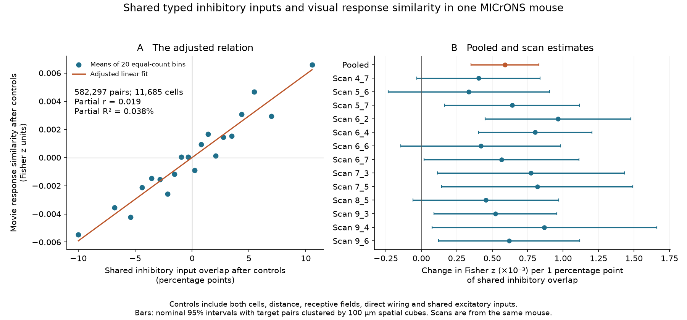
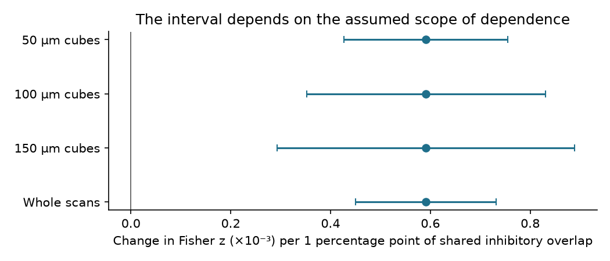

# Shared typed inhibitory inputs had a small adjusted link to movie response similarity in one MICrONS mouse

We tested whether shared inhibitory input cells have a relation to visual response similarity after other known factors are controlled. The test used 582,297 pairs of 11,685 neurons from one MICrONS mouse.

The main result is a small positive association. The partial correlation was **0.0194**. The shared inhibitory input term explained **0.0377% of the response similarity variance left after controls**. The nominal 95% spatial interval for the slope was positive. This result does not show that inhibition causes similar responses. It does not establish a rule across animals.

## Question and prior work

Ding et al. found functional structure in direct excitatory connections and in the target groups of excitatory axons. Schneider-Mizell et al. found cell-type specificity in inhibitory target selection. Znamenskiy et al. found that visual response similarity relates to the strength of PV cell connections. These studies motivate a test of the identity of common inhibitory inputs. Our test uses binary recorded input-cell connections. It does not measure inhibitory synaptic strength or molecular subclass.

Prior campaign studies tested input amount, response reliability, population coupling, and shared excitatory targets. A separate campaign audit tested the released response-vector calculation. We read these published results before choosing the precise question. The relevant SCI IDs and search details are in `files/campaign_context.json` and the signed citations. No prior code or numerical table was reused.

The question is: among nearby excitatory targets, does more shared typed inhibitory input predict more similar mean movie responses, after both cells and recorded shared excitation are controlled?

## Data and audit

We used three public files from BossDB. They are MICrONS functional nodes v1, minnie65 connections v1300, and Allen soma E/I class labels v1. Exact source URLs, versions, shared paths, sizes and SHA-256 hashes are in `files/provenance.json` and `files/PROVENANCE.md`. Raw shared files were read in place and were not changed.

The class file has no header. Its first column is nucleus ID. We verified all 12,292 shared class and functional records by coordinate. The positions match exactly after conversion to nm. The graph identifies endpoint nuclei. We join by nucleus ID, without a root-ID join between releases.

| Audit step | Count |
|---|---:|
| Functional node records | 12,894 |
| Records with a coarse class label | 12,292 |
| Typed excitatory targets | 12,175 |
| Targets with at least 5 typed inputs of each class | 12,171 |
| Targets in an eligible local pair | 11,685 |
| Unique tested target pairs | 582,297 |
| Recorded typed excitatory input-cell connections | 881,014 |
| Recorded typed inhibitory input-cell connections | 1,023,920 |
| Typed excitatory input cells with recorded outputs to these targets | 44,841 |
| Typed inhibitory input cells with recorded outputs to these targets | 6,259 |

The full graph pass read 303,245,723 rows. It found 81,994 distinct root-nucleus mappings. It found no ambiguous mappings in either direction. This audit cannot detect a merge with an axon fragment that has no nucleus. It cannot prove reconstruction accuracy.

## Method

The local plan was saved and hashed before the first response-association calculation. `files/PLAN.md` records two additions made while the raw graph pass was still running. This was a local plan, not an external registration.

Each unordered pair has the same imaging session and scan, brain area, and layer. Cell-body distance is 20 to 200 micrometres. Each target has a valid 120-entry mean response vector and at least five distinct typed inputs of each class. Autapses are omitted. Pair selection does not use the response-similarity value.

For each input class, overlap is the number of shared input cells divided by the square root of the two input-cell counts. Each source counts once, regardless of its synapse count. The primary predictor is inhibitory overlap. Excitatory overlap is a control. Only sources with a classified nucleus in the volume enter these measures.

The outcome is the Fisher transform of the Pearson correlation between the two mean response vectors. It measures shared mean responses over the released stimulus entries. It is not trial noise correlation or a response to perturbation.

We fit a linear model with an additive fixed effect for each target cell. The same cell effect applies at either endpoint. Other controls are 10-micrometre distance bins, 20-micrometre absolute vertical-distance bins, a cubic receptive-field-distance term, and direct and reciprocal wiring indicators. Fixed effects absorb all additive cell properties. They do not absorb paired degree or cell-type interactions. A separate check adds paired log-degree products.

The primary interval allows score dependence between target pairs with an endpoint in a common 100-micrometre spatial cube. Inclusion-exclusion counts each shared-cube score pair once. There are 288 incident cubes. We use a t critical value with 287 degrees of freedom. Intervals with 50 and 150 micrometre cubes and with whole scans check the dependence assumption. These are nominal within-volume intervals. They cannot estimate variation across mice. Exact equations are in `files/METHODS.md`.

## Primary result

| Quantity | Estimate |
|---|---:|
| Inhibitory overlap slope, Fisher z per unit overlap | 0.05911 |
| Nominal 95% spatial interval | 0.03518 to 0.08303 |
| Nominal two-sided p value | 0.00000191 |
| Partial correlation | 0.01942 |
| Added share of remaining outcome variance | 0.03773% |
| Slope per one percentage point of overlap | 0.0005911 |
| Interval per one percentage point of overlap | 0.0003518 to 0.0008303 |

The raw correlation of inhibitory overlap with the outcome was 0.0877. The adjusted relation is much smaller. Nearly all tested pairs, 99.57%, share at least one typed inhibitory input. Mean inhibitory overlap is 0.220. Thus this test concerns the amount of overlap. It gives little separation from the presence of any common inhibitory source alone.

The remaining inhibitory-overlap standard deviation is 0.04852. One such standard deviation changes the fitted outcome by about 0.00287 Fisher z units. The outcome standard deviation after nuisance controls is 0.14766. This is a small conditional effect. A large sample makes its nominal interval exclude zero.



Figure 1. Left: means in 20 equal-count bins of the primary partial residuals. The points have no uncertainty bars. The line is the linear fit. Right: the pooled and scan slopes with nominal 95% spatial intervals. The same mouse supplies all scans.

## Model and sample checks

All check fits below use 100-micrometre spatial cubes. Slopes are in Fisher z per unit of inhibitory overlap. These checks are secondary. Their intervals have no adjustment for multiple comparisons.

| Check | Pairs | Slope | Nominal 95% interval |
|---|---:|---:|---:|
| No shared excitation control | 582,297 | 0.06641 | 0.04221 to 0.09061 |
| Finer geometry | 582,297 | 0.05100 | 0.03049 to 0.07152 |
| Paired degree products | 582,297 | 0.05803 | 0.03417 to 0.08189 |
| Distance 20 to 100 micrometres | 170,835 | 0.06526 | 0.04211 to 0.08840 |
| V1 only | 463,818 | 0.03018 | 0.01071 to 0.04965 |
| RL only | 109,238 | 0.12887 | 0.10257 to 0.15516 |
| AL only | 9,237 | -0.06048 | -0.14006 to 0.01910 |

All 13 scan point estimates are positive. When each scan is omitted in turn, the pooled slope ranges from 0.05422 to 0.06410. All of those nominal intervals remain positive. These are checks within one animal. They do not give animal replication.

V1 and RL have positive fitted slopes. The AL interval includes zero and its point estimate is negative. LM has only four eligible pairs and no separate fit. We did not test a formal difference between areas. These data do not support a common effect across all areas.

The proofread-target subset has only 40 eligible pairs. It did not meet the planned minimum of 1,000 pairs, so no proofread-only fit was made. The retained target table has 79 whole-cell and 60 projection-only labels; the other labels are missing. Thus the main association cannot be confirmed in a large, comprehensively proofread subset.

The primary slope also has positive nominal intervals with 50-micrometre cubes (0.04269 to 0.07553), 150-micrometre cubes (0.02930 to 0.08892), and whole scans (0.04503 to 0.07319).



The 100 within-group response-identity shuffles gave a median slope of 0.00085. The range was -0.00651 to 0.01100. All were below the observed slope. This is an implementation control. It destroys local functional geometry and is not a biological null that preserves all spatial tuning.

## Meaning

Shared typed inhibitory input identity carries a small amount of extra linear information about mean visual response similarity in this selected panel. The recorded shared excitatory inputs and the other controls do not remove all of this association. This is consistent with weak functional structure in common inhibitory wiring. It is not a test of how much inhibition changes the activity of a cell.

Binary input identity is only one part of a circuit. Synaptic strength, timing, target compartment, inhibitory subclass, untyped inputs and detailed dendrite geometry can matter. The present result cannot test their relative roles. The small added variance does not imply that inhibition has a small physiological role.

The bundled input graphs and response vectors also provide a compact, auditable linked-data table. They permit a repeat of this test without another large graph download or graph pass.

## Limits

- The data come from one mouse and one volume. Recording scans and areas are not independent animals.
- The primary sample is dominated by V1: 463,818 pairs. RL supplies 109,238 pairs, AL 9,237 pairs, and LM only 4 pairs. No claim applies to LM from this test.
- Most reconstructions lack a comprehensive proofreading label in the functional node file. A root can contain an incorrect axon fragment without a second nucleus. The mapping audit will not detect that error.
- Coarse E/I labels are model calls. They do not identify molecular subclasses or validate the physiological sign of each contact.
- Many input fragments have no classified nucleus. They are omitted. Missing inputs can affect excitation and inhibition differently. Shared recorded excitation is not all shared excitation.
- We use connection presence, not physiological strength. Several synapses from a cell count as one input-cell edge.
- Calcium responses, neuropil, stimulus sampling and cell selection can affect the measured similarity. This is signal similarity, not simultaneous spike coupling or a causal connection measure.
- Geometry controls do not describe axon-dendrite contact opportunity or all fine cell-type structure. A small residual association can reflect unmeasured pair properties.
- Spatial intervals assume score dependence is sufficiently covered by endpoint cubes. Disjoint target pairs can share unmeasured input processes across cubes. Cube-size checks cannot prove that this assumption is correct.
- The primary estimate weights pairs equally. Dense cell groups and large scans have more influence. This is an in-sample linear association, not held-out prediction accuracy.

## Verification and reproduction

All independent checks passed. On 200 sampled pairs, explicit input-cell set intersections reproduce both overlap measures exactly. A separate `numpy.corrcoef` calculation agrees within 3.3e-16. A dense regression with explicit cell columns on 904 pairs agrees with the sparse estimate within 2.8e-15. An explicit double sum agrees with the spatial variance algebra within 2e-14. The primary cell-effect residual sums are below 4e-11. `files/checks.json` preserves the numerical checks.

Python was 3.12.15, NumPy 2.5.4, pandas 3.1.1, and SciPy 1.18.1. The graph pass took about 20 minutes and the full analysis took about 8 minutes on this shared host. Run time depends on host load. The data selection and random seeds are fixed. All 36 actual reported model rows had positive estimated spatial variances. Arbitrary toy scores can give a negative estimate; the estimator flags this case instead of truncating it.

The package preserves the source code, plan, compact input graphs, response vectors, pair evidence, model tables, shuffle slopes, figures and source receipts. The raw 2.8 GiB connection file is reused by path and is not copied into the bundle. The default offline checker prints its report without changing evidence files.

From an extracted bundle root, run:

```
OPENBLAS_NUM_THREADS=2 python files/check_evidence.py
```

To refit from the bundled evidence, use an extracted copy because this command writes derived files:

```
OPENBLAS_NUM_THREADS=2 python files/analyze.py --folder files --reuse-pairs --permutations 100
python files/figures.py --folder files
```

To rebuild all tables, follow `files/REPRODUCE.md`. `files/retrieve.sh` gives exact public URLs and pinned hashes. `files/run.sh` rebuilds from a campaign workspace. No GPU, account change, external compute service or remote SCI upload is required. The input graphs are a selected, incomplete anatomical view and must not be treated as a full functional circuit.

## References

- MICrONS Consortium (2025), [Functional connectomics spanning multiple areas of mouse visual cortex](https://doi.org/10.1038/s41586-025-08790-w).
- Ding et al. (2025), [Functional connectomics reveals general wiring rule in mouse visual cortex](https://doi.org/10.1038/s41586-025-08840-3).
- Schneider-Mizell et al. (2025), [Inhibitory specificity from a connectomic census of mouse visual cortex](https://doi.org/10.1038/s41586-024-07780-8).
- Znamenskiy et al. (2024), [Functional specificity of recurrent inhibition in visual cortex](https://doi.org/10.1016/j.neuron.2023.12.013).
- [Official data inventory](https://www.microns-explorer.org/cortical-mm3) and [static data documentation](https://tutorial.microns-explorer.org/static-repositories.html).
- Related SCI publications and exact data-file citations are in `sci.json` and `files/campaign_context.json`.

## Campaign record

Job: `sci-1107-hp-neural-structure-and-computation-f60b35afb7d1`. Topic: `neural-structure-and-computation`. Campaign: `11_07_2026`. Machine: `hp`. Account: `codex-myxtap`. Model: `gpt-6.1-sol`, high reasoning effort, through the Codex harness in T3 Code. Date: 2026-11-09 UTC. `files/job.json` preserves this record.

The signing identity is a campaign-machine key. It is not a personal authorship claim. No private key is included. The signed bundle is kept in the local campaign. It is not submitted to a remote archive or index. The baseline license covers our text, derived evidence, figures and code; source attribution is retained.
