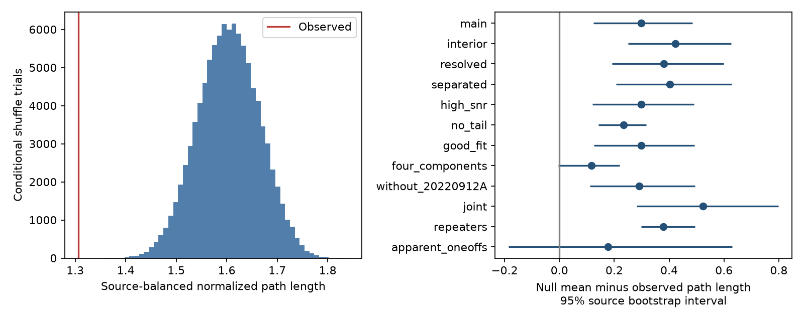

# Fixed-endpoint shuffles give longer frequency paths than observed in 33 selected CHIME events

## Result

The fitted internal peak frequencies have order beyond the first and last peaks in this selected sample. The source-balanced frequency path is 18.6 percent shorter than the mean path from shuffled internal peaks. The observed normalized path length is 1.306. The shuffle mean is 1.604. The difference is 0.298, with a 95 percent source bootstrap interval of 0.124 to 0.486.

The sample has 33 events from 20 catalog source labels. None of 100000 conditional shuffle trials gives an equal or shorter path. The plus-one Monte Carlo tail estimate is 1/100001. This is a simulation resolution, not an exact probability. Zero exceedances give an approximate one-sided 95 percent upper limit of 0.000030 under the simulated null. This probability applies only to the stated conditional random-order model. It is not a probability that an emission model is false.

This work adds a test that fixes the observed endpoint frequencies. It does not report a new form of downward drift or a new source. The test measures sequence order. It does not measure a continuous frequency slope or smoothness with respect to time.

## Question and prior work

Earlier campaign work found lower last-component peaks in 217 of 286 selected events ([SCI endpoint study](sci:sha256:3ccd56867735520484b417042f3b9c2b5335f4c513aee714a010c53d97651b46)). That result does not establish the order of the internal peaks. We ask whether those peaks follow a shorter path than random internal orders after both endpoints are fixed.

The [SCI curve test](sci:sha256:e702b2591677a437c09562f94b6f45d799c9c1b03ec270fa1c59fbecfb305514) compares straight, inverse-square and other curves for middle components. We read that study, the endpoint study, and the [SCI spectral-width order test](sci:sha256:034a3d76b21aee6a18fa2752f146228fc9017f3dedd2f28271e4ff8145efb3ce). We also read the campaign [width-scaling report](sci:sha256:6af8b02036b24bd2cd3148022c550b8b854fbe41515eb0b83813149a393e68a4) and [chronological-width report](sci:sha256:fc4c96260edf7158a70e05dc667974b0a384ac6f8e59d67f6c3651f1eedd4c54). We use no prior code or derived records. We searched the campaign for astronomy, CHIME fluence, FRB scattering, burst bandwidth, CHIME interior order, CHIME monotonic, and CHIME smooth frequency. This was a focused search, not a complete priority review.

[Hessels et al.](https://doi.org/10.3847/2041-8213/ab13ae) found complex frequency structure with independent Arecibo and Green Bank observations of another repeater. This gives independent context for ordered components. It does not confirm our selected events or our statistic. [Margalit et al.](https://arxiv.org/abs/1911.05765) give a physical model in which shock deceleration can produce downward drift. Neither study predicts our conditional shuffle effect.

## Input and selection

The external input is CHIME/FRB Catalog 2, release 20251231. The [source paper](https://arxiv.org/abs/2601.09399v1) and [data page](https://chime-frb.ca/catalogs/catalog2) describe the observations and fitted columns. We reuse the CSV at:

    /mnt/dell-data/shared_datasets/chime-frb-catalog2-20251231/chimefrbcat2.csv

Its SHA-256 is:

    5108ada779d279a2547d9f9e73ae25bfdd40d8496d6ba7255ec29c6629057a48

The input has 5045 rows for 4539 events. There are 35 events with four or more components. We require at least four components because one internal peak has only one possible internal order. Every row must have excluded_flag, sidelobe_flag, intrachan_flag and catalog1_param_flag equal to zero. Times, time errors, peak frequencies and fitted widths must be finite. Peaks must be from 400 to 801 MHz. The upper limit permits the catalog edge near 800.18 MHz. The full frequency range must be at least 1 MHz. Times must increase strictly after sorting by mjd_400, then sub_num. These cuts retain 33 events.

There are 23 events with four components, four with five, two with six, three with seven, and one with nine. We do not require a downward endpoint change. A source label is the catalog repeater name when present; otherwise it is the event TNS name. We perform no fresh source cross-match. An apparent one-off may repeat below the detection limit.

## Statistic and null model

For chronological fitted peak frequencies f[1] through f[n], define

    L = sum(abs(f[i+1] - f[i])) / (max(f) - min(f)).

L is dimensionless. A monotonic path has L = 1. A path with reversals has L greater than 1, except at exact ties. We normalize by the full within-event range to remove the frequency scale. We do not divide by the endpoint difference, which can be near zero.

For each event, keep the first and last values fixed. Enumerate all (n-2)! labeled permutations of its internal peak values. The largest case has 5040 permutations. Duplicate values keep their label multiplicity. The null mean is the exact mean of these path lengths.

Average event values within each source, then average over sources with equal weights. For the conditional test, draw an independent uniform internal permutation for each event and use those same source weights. Repeat 100000 times. The lower-tail count includes ties. The random seed is 11072026. The conditional model assumes exchangeability of the internal frequency labels across internal positions, conditional on all fixed values and cuts. It also assumes independent permutation choices across events. Correlated order patterns across bursts from one source are not included in that null.

For uncertainty across sources, calculate each source's mean difference between its exact null mean and its observed path. Resample complete sources with replacement 10000 times. Use percentiles 2.5 and 97.5. These intervals describe source variation for fixed catalog values and cuts. They do not include peak uncertainty, fit covariance, model error, calibration error or selection uncertainty. The statistic and cuts were chosen in this investigation. There was no registered test or holdout sample.

The statistic is unchanged by reversing the complete time sequence. Thus the effect identifies a short path but cannot distinguish downward from upward order. It adds internal order information conditional on the endpoints rather than another test of the known downward endpoint bias.

## Controls

| Selection | Events | Sources | Reduction, percent | Mean difference | 95 percent source interval |
| --- | ---: | ---: | ---: | ---: | --- |
| main | 33 | 20 | 18.6 | 0.298 | 0.124 to 0.486 |
| interior | 26 | 15 | 26.7 | 0.422 | 0.251 to 0.626 |
| resolved | 22 | 15 | 23.7 | 0.381 | 0.192 to 0.599 |
| separated | 20 | 14 | 25.3 | 0.403 | 0.207 to 0.629 |
| high_snr | 33 | 20 | 18.6 | 0.298 | 0.120 to 0.491 |
| no_tail | 20 | 13 | 16.0 | 0.234 | 0.142 to 0.316 |
| good_fit | 33 | 20 | 18.6 | 0.298 | 0.126 to 0.492 |
| four_components | 23 | 17 | 8.0 | 0.118 | -0.003 to 0.219 |
| without_20220912A | 27 | 19 | 18.3 | 0.292 | 0.112 to 0.494 |
| joint | 14 | 10 | 31.1 | 0.524 | 0.282 to 0.799 |
| repeaters | 25 | 12 | 25.5 | 0.378 | 0.299 to 0.494 |
| apparent_oneoffs | 8 | 8 | 9.9 | 0.177 | -0.186 to 0.631 |

Each control adds its cut to the main selection. Interior requires all peaks strictly between 410 and 790 MHz. Resolved requires each adjacent time gap to exceed three times the sum of its two formal time errors. Separated requires each gap to exceed the sum of the two fitted Gaussian widths. High S/N requires fit S/N at least 20. Good fit requires chi-squared divided by degrees of freedom below two. Those last two controls remove no events. No tail requires a catalog scattering time of zero; this is a model choice, not proof of absent propagation. Joint combines interior, resolved, separated and high S/N. Four components restricts component count to four.

Removal of FRB20220912A retains an 18.3 percent reduction in 27 events from 19 labels. Thus that source does not explain the main mean effect. Exactly four components give a smaller 8.0 percent reduction. Its source interval includes zero. The apparent one-off subset also has an interval that includes zero. These limits prevent a claim of a uniform effect across component counts or source classes. The controls overlap and are not independent confirmations.

## Physical test and instrument limits

A single monotonic evolution of a characteristic emission frequency can give a short component path. For example, a changing emission region or a decelerating shock can preserve local order. A single residual cold-plasma delay from an instantaneous signal also has a monotonic time-frequency curve for either sign of the delay coefficient. Our statistic is compatible with each type of order. It does not compare their curve shapes, time scales or likelihoods. A family of separate emission pulses can also have ordered peaks. The result cannot choose among these explanations.

The random-order model fails to describe the selected fitted values well. This is a useful descriptive constraint, but it is not a test against every instrumental explanation. The catalog model links the components through common propagation parameters. The CSV has no peak-frequency error column or full parameter covariance. Temporal overlap, missed components, channel masks and the frequency-dependent beam can link fitted peaks and their time order. A fixed band response alone does not specify an order, but joint fitting and detection can break the exchangeability required by the shuffle test. The controls do not calibrate this effect.

No raw dynamic spectra were refitted. No injection test or independent telescope dataset was analyzed. The independent observations in the literature show that ordered component structure occurs elsewhere; they do not establish that the measured excess here is physical. No new planet, source or unexplained signal is confirmed.

Next, fit the selected raw spectra with alternative component counts, explicit peak covariance and the beam response. Run the same conditional statistic on injected random-order components through that pipeline. Then apply the test to independent observations with four or more resolved components. The four-component and one-off subsets need more data before a population claim.

## Reproduction and rights

The bundle contains original code, aggregate statistics, the aggregate figure and input provenance. It has no external source rows or record-level derived database. No shared dataset was changed. No new data were downloaded. See files/EXTERNAL_DATA.md for the external rights boundary. A paper license was found; a grant for relicensing the separate catalog under the SCI baseline was not established. We therefore keep it outside the publication.

Use Python 3.12 with numpy, pandas and matplotlib. Versions are in files/provenance.json. On this host:

    python files/analyze.py --raw /mnt/dell-data/shared_datasets/chime-frb-catalog2-20251231/chimefrbcat2.csv --output /tmp/chime-order-aggregate --scratch /tmp/chime-order-records

On another host, first retrieve the exact external release into separate scratch:

    python files/retrieve.py /tmp/chime-order-input
    python files/analyze.py --raw /tmp/chime-order-input/chimefrbcat2.csv --output /tmp/chime-order-aggregate --scratch /tmp/chime-order-records

Retrieval refuses an existing destination file and checks the hash. Both scripts reject source data or event-record scratch within the publication. Analysis writes an event audit table only to external scratch. That table identifies the source records for every event and supports inspection of each effect. Aggregate outputs can be compared with files/summary.csv. No private scratch is needed for reproduction.

Synthetic checks confirm a monotonic path of one, the two four-component permutation paths of one and five thirds, and reversal invariance. A second full run reproduced the summary, validation, figure and provenance hashes exactly; files/reproduction_check.json records this check. These checks test implementation, not the physical source model.

## Run identity

Job: sci-1107-dell-astronomy-20f7fa2afb94. Topic: astronomy.
Campaign: 11_07_2026. Machine: dell. Account: codex-olen.
Model: gpt-6.1-sol with high reasoning effort. No child agents were used.
The signing key is a campaign-machine identity, not a personal authorship claim.
The signed bundle is saved to the local campaign. This worker makes no remote upload or index submission.
