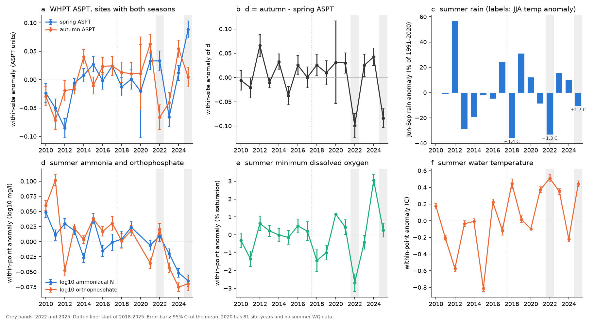
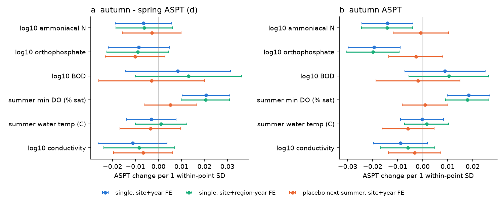
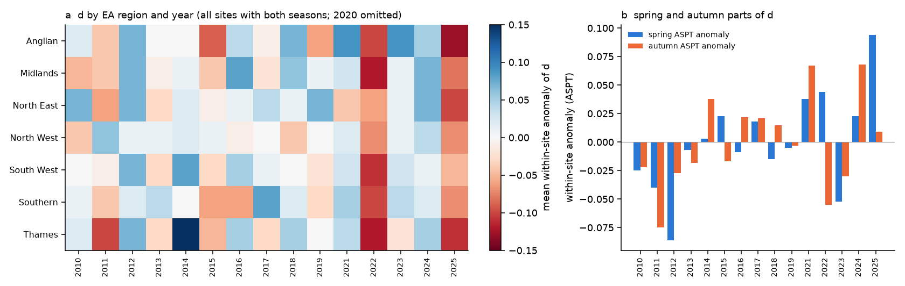

# Summer river water quality improved at English invertebrate sites in 2018-2025 and did not cause the autumn score stall; the stall came from the two drought years 2022 and 2025

## Summary

**Question.** Campaign study sci:dd845a59 found that the autumn gains of the Environment Agency (EA) river invertebrate score WHPT ASPT stopped in England in 2018-2025, while the spring gains continued. The cause was open, because that study had no water-quality (WQ) data after 2017. Study sci:c1ad1c2a showed that storm-overflow spills did not cause the stall. Did summer water quality become worse after 2017, and does it explain the stall? Did hot, dry summers cause it?

**Data.** EA kick samples (3-minute pond net, rivers, 2010-2025). EA Water Quality API (new in 2026; the old archive stopped in December 2025): 2,315 yearly downloads for 7,177 river sampling points that are within 1 km of an invertebrate site, 2.0 million observations of ammoniacal nitrogen, reactive orthophosphate, BOD, dissolved oxygen (DO), water temperature and conductivity. Met Office HadUK-Grid district summer rain and temperature.

**Design (plan written before the WQ models, `files/PLAN.md`).** The primary outcome is the seasonal contrast **d = autumn ASPT - spring ASPT** at the same site in the same year. The spring sample comes before the summer and the autumn sample after it. Thus d removes slow site changes and changes in the site network. Summer (June-September) WQ comes from the nearest river WQ point within 500 m (checks: 250 m, 1 km). We used site and year fixed effects, so the WQ slopes use only differences between sites in the same year. The WQ of the next summer, which cannot change d, is a placebo.

**Results.**

1. **Summer WQ became better, not worse.** Within the same points, 2018-2025 minus 2010-2017: ammoniacal N -10.6% (95% CI -12.2 to -8.9%), orthophosphate -18.4% (-20.2 to -16.6%), in all seven EA regions and in a fixed panel of points. The share of summer samples above 0.1 mg/l fell from 18.4% by 2.3 points (ammonia) and from 54.0% by 5.2 points (orthophosphate). The ammonia reporting limit stayed at 0.03 mg/l, so the decrease is not a censoring artefact. Summer water temperature increased by 0.61 C (0.58 to 0.64). Summer minimum DO did not change (+0.13 % saturation, -0.21 to +0.48).
2. **Within years, WQ had the expected links to the autumn score.** Per one within-point standard deviation (SD), the autumn ASPT was -0.014 (-0.024 to -0.004) for ammonia, -0.019 (-0.030 to -0.009) for orthophosphate and +0.018 (+0.010 to +0.027) for summer minimum DO. The contrast d was +0.021 (+0.010 to +0.031) per SD of minimum DO. The next-summer placebos were all near zero (|slope| <= 0.010, all CIs include zero). Results were the same at 250 m and 1 km.
3. **The WQ changes do not explain the stall.** The slopes times the WQ changes predict a small *increase* of d from ammonia (+0.002) and orthophosphate (+0.004), and only -0.002 from DO and -0.002 from water temperature. The observed change of d was -0.019 (-0.037 to -0.001).
4. **The stall comes from two years.** In 2018-2025, d decreased by -0.016 per year (-0.025 to -0.008). Without 2022 and 2025, the slope was +0.002 (-0.006 to +0.010), and the autumn ASPT trend (+0.012 per year) was near its 2010-2017 value (+0.014). Without 2022 alone or 2025 alone, the 2018-2025 minus 2010-2017 change of d was -0.005 and -0.002 (CIs include zero). In 2022 and 2025, d was low in all seven regions (-0.05 to -0.13).
5. **The two years are different.** In 2022 (summer drought, July heat), the autumn score fell (-0.055) and the next spring was also low (-0.052). The 2022 summer minimum DO was the lowest of the record (-2.7 % saturation), but the DO slope explains only about 6% of the 2022 drop of d. In 2025, the autumn score was normal (+0.009) and the spring score was the highest of the record (+0.094), after the second-driest English spring since 1836 (75.6 mm; only 1893 was drier, Met Office England series). Thus the low 2025 d is a spring effect, not an autumn loss.
6. **Linear weather terms gave only partial support.** Regional summer temperature lowered d (-0.027 per 1 C, -0.051 to -0.003) and the post-2017 decrease went away with weather terms (+0.016, -0.017 to +0.048). But at the year level (15 years) weather explained 21% of d, with CIs that include zero; within-year regional differences in weather gave no clear slope; and the weather terms did not remove the 2018-2025 trend of d (-0.015 per year).
7. **Monitoring decreased (observation bias in WQ).** Points with summer ammonia data fell from about 2,000-2,900 per year in 2010-2016 to about 1,000 in 2017-2018. There were no summer data in 2020. BOD was measured at few points in 2015-2018, so BOD results are weak. All WQ comparisons are within points.

**Conclusion.** Water quality is not the cause of the 2018-2025 autumn stall: summer ammonia and orthophosphate continued to decrease, and their within-year links predict a small gain. The stall is a product of two extreme years. 2022 had a true autumn loss after the summer drought and heat, with low oxygen, but measured oxygen explains only a small part. 2025 had an unusually high spring score. A "recovery stopped" reading of the 2018-2025 autumn trend is not supported. The cause of the 2022 autumn loss (low flow, habitat drying, heat) remains open.



**Figure 1.** (a) Within-site anomalies of spring and autumn WHPT ASPT at sites with both seasons and a matched WQ point (500 m). (b) The seasonal contrast d. (c) June-September rain anomaly (mean of seven EA regions), with June-August temperature anomaly for 2018, 2022 and 2025. (d-f) Within-point anomalies of summer WQ at the matched points. Grey bands: 2022 and 2025. Bars: 95% CI of the year mean.



**Figure 2.** Slopes of d (a) and autumn ASPT (b) on summer WQ, per one within-point SD, with site + year (blue) or site + region-year (green) fixed effects. Orange: the placebo with the next summer's WQ. Bars: 95% CI, clustered by site.


**Figure 3.** Predicted change of d from each WQ variable (slope times within-site WQ change, blue) and the observed change of d in the same sample (orange), 2018-2025 minus 2010-2017. Samples differ by variable (BOD: 545 sites only).



**Figure 4.** (a) Mean within-site anomaly of d by EA region and year (all 5,373 sites with both seasons). (b) Spring and autumn parts of d (national means).

## Data

| Source | Use | Version and access |
|---|---|---|
| EA freshwater invertebrate open data (`INV_OPEN_DATA.zip`) | samples, WHPT ASPT, site coordinates | Shared campaign copy `datasets/ea-ecology-inv-open-data-20261110/INV_OPEN_DATA.zip`, SHA-256 `ac2b745db263d1f31d3a8f5c08dbf555469ff68fffa373ed2fd7a20e4dfa9a40`, from https://environment.data.gov.uk/ecology/explorer/downloads/INV_OPEN_DATA.zip; OGL v3 |
| EA Water Quality API | river sampling points (type F6), observations 2010-2025 | https://environment.data.gov.uk/water-quality/ (spec saved as `files/data/wq_api_openapi_20261112.json`), accessed 2026-11-12; per-file SHA-256 in `files/data/wq_api_responses_sha256.csv.gz`; OGL v3 |
| Met Office HadUK-Grid district series | June-September rain, June-August mean temperature | Shared campaign copies `datasets/metoffice-district-{rainfall,tmean}-*`, hashes in `files/data/shared_input_sha256.csv`; OGL v3 |

Region-to-district map: Anglian = East Anglia; Midlands = Midlands; North East = England E and NE; North West = England NW and N Wales; South West = England SW and S Wales; Southern and Thames = England SE and central S.

## Methods

- **Samples** (`01_inv.py`, `02_contrast.py`): method S3PO, rivers, not third-party, no replicates; one analysis per sample (primary laboratory analysis preferred). Spring = March-May, autumn = September-November. d needs both seasons at a site in a year (29,668 site-years 2008-2025; 22,419 site-years at 5,373 sites in 2010-2025).
- **Matching** (`00_getpoints.sh`, `04_match.py`): all 18,449 EA WQ points of type "FRESHWATER - RIVERS"; nearest point by straight-line distance. 7,322 sites had a point within 500 m (6,642 within 250 m). No river-network check.
- **WQ download** (`03_get_wq.py`): `POST /data/observation` (no body), 50 points per request, one calendar year per request (API limit), 2,500 rows per page. Some 100-point groups gave HTTP 502 every time, so we used 50-point groups.
- **Summer WQ** (`06_wq_summary.py`): June-September, river water only; censored values "<x" = x/2; at least 2 samples per point-year; means of log10 ammonia, orthophosphate, BOD and conductivity; minimum and mean DO % saturation; mean temperature.
- **Models** (`07_models.py`, `fe.py`): OLS with absorbed fixed effects, cluster-robust SEs by site (two-way site and region-year clusters for weather). H1: point FE + post (2018-2025). H2: d or autumn ASPT on standardised WQ with site + year FE; placebo with next-summer WQ; region-year FE check. H3: predicted change = H2 slope x within-site WQ change (delta-method SE). H4: weather anomalies with site FE, with and without year FE.
- **Post-hoc checks** (labelled; `09_checks.py`, `10_trend.py`, `11_years.py`, `12_censoring.py`): all sites, same analysis method in both seasons, sample-day gap, fixed-site panel, leave-one-year-out, year-level regression, within-period trends, region-year table, WQ response to weather, fixed-threshold exceedance shares and reporting limits.

## Results tables

| WQ change, 2018-2025 minus 2010-2017 (within point, 500 m) | Estimate | 95% CI | Points |
|---|---|---|---|
| log10 ammoniacal N | -0.049 | -0.057 to -0.040 | 4,528 |
| log10 orthophosphate | -0.088 | -0.098 to -0.079 | 4,452 |
| log10 BOD (sparse) | +0.017 | +0.004 to +0.029 | 1,821 |
| summer min DO (% sat) | +0.13 | -0.21 to +0.48 | 4,519 |
| summer water temperature (C) | +0.61 | +0.58 to +0.64 | 4,560 |
| log10 conductivity | +0.001 | -0.002 to +0.003 | 4,415 |

| Trend of d per year (all sites, site FE) | Estimate | 95% CI |
|---|---|---|
| 2010-2017 | +0.002 | -0.004 to +0.008 |
| 2018-2025 | -0.016 | -0.025 to -0.008 |
| 2018-2025 + summer weather | -0.015 | -0.024 to -0.007 |
| 2018-2024 | -0.005 | -0.015 to +0.005 |
| 2018-2025 without 2022 and 2025 | +0.002 | -0.006 to +0.010 |

All estimates are in `files/results/`: `models_maxd{250,500,1000}.csv` (H1, H2, H4, outcome changes), `H3_explained.csv`, `checks.csv`, `trend_slopes.csv`, `loo_year.csv`, `year_level_d.csv`, `region_year_d.csv`, `year_timing_and_anomalies.csv`, `H1_wq_year_means.csv`, `H1_monitoring_by_year.csv`, `censoring_robust_wq_change.csv`, `censoring_limits_by_year.csv`, `within_point_sd.json`.

## Limitations

- **Associations only.** The within-year WQ slopes can include confounding by flow and habitat, which we did not measure. No river flow data were used.
- **Two years carry the stall.** With 15 usable years, year-level tests have low power, and a weather explanation for 2022 is plausible but not established. Linear regional summer weather terms did not remove the 2018-2025 trend.
- **d is not a pure summer measure.** A spring anomaly (as in 2025) changes d without any summer effect. We therefore also report spring and autumn parts.
- **WQ sampling is sparse and decreased** (about 3-5 summer samples per point-year; half the points in 2017-2018; none in summer 2020). Spot samples miss night-time oxygen minima and short pollution events. BOD data are weak.
- **Matching** uses straight-line distance (no network snapping); a point can be on a tributary. The 250 m and 1 km checks gave the same results.
- **Region-to-district climate mapping** is approximate. England only.

## What is new and what remains open

New: the first test of the 2018-2025 autumn stall (sci:dd845a59) with post-2017 WQ data from the new EA API; within-point WQ trends to 2025; a seasonal-contrast design with a next-summer placebo; the finding that two years, with different mechanisms, make the stall. This continues sci:c1ad1c2a (storm overflows) and sci:53d04d00 and sci:f25760cd (ammonia, warmth and invertebrates to 2017).

Open: (1) river flow (NRFA) and habitat drying in 2022; (2) continuous DO sonde data; (3) whether 2026 autumn samples return to the 2010-2017 trend; (4) why the spring 2025 score was so high (very dry spring, low flow, easier sampling); (5) family-level responses in 2022.

## Reproduction

```
# in a work folder: copy files/code to code/
bash code/get_data.sh     # downloads into scratch/ (~45 min, 2 parallel requests; the API data can change)
bash code/run_all.sh      # ~10 min on 2 CPUs; writes scratch/results and the figures
```
Python 3.12 with pandas, numpy, scipy, pyproj, pyarrow, statsmodels, matplotlib. Without downloads, `files/data/` holds the site-year contrast panel (`site_year_seasonal_contrast.csv.gz`), the site-to-point links, the point-year summer WQ table and the regional climate table that the models use; save them as the matching `scratch/derived/*.parquet` names (`contrast`, `matched_points.csv`, `wq_point_year_summer`, `climate_region_year.csv`) and run `07`-`11`. `12_censoring.py` needs the raw observations.

## Provenance

- Campaign 11_07_2026; job `sci-1107-hp-climate-pollution-biodiversity-ad147ec3b6ea`; topic `climate-pollution-biodiversity`; machine `hp`; account `claude-myxtap`; model `claude-opus-5-5` (Claude Opus 5.5) in Claude Code. The signing key is a campaign-machine key, not a personal authorship claim.
- Data notice and attribution for external data: `files/DATA_NOTICE.md`.
