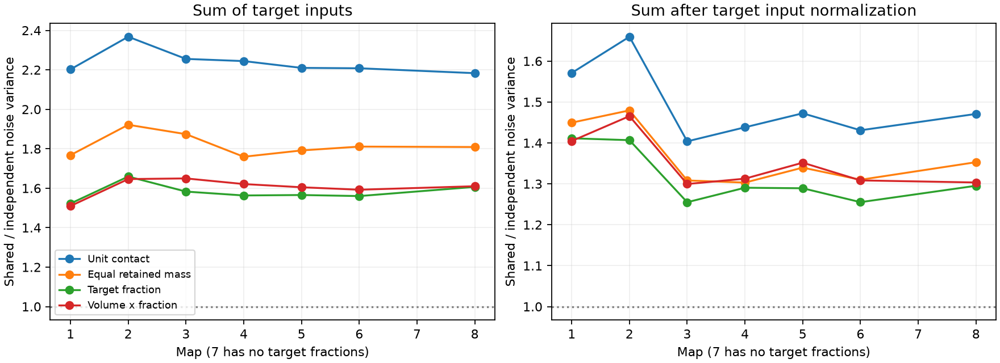

# Target fractions reduced shared-release sum-noise ratios in seven partial worm map models

Annotated target fractions gave shared-to-independent sum-noise variance ratios of 1.522 to 1.659 in seven selected C. elegans brain maps. Unit contact strengths gave ratios of 2.183 to 2.368. Thus the amplitude rule changed the size of the predicted noise increase. It did not remove that increase. This is a model sensitivity result. It is not a measurement of release probability, synaptic current, or behaviour.

## Question and prior work

Does the sum-noise increase reported for shared release remain as large when targets at one site have different strengths? Witvliet et al. (2021; doi:10.1038/s41586-021-03778-8) released eight brain reconstructions across development. The source analysis assigns synapse size to targets with the stored post_weights fractions. This provides a structural proxy for unequal strength, not a physiological calibration.

The campaign publication SCI 0a2a89fa7d5a reported summed-input noise ratios above two with unit strengths. It also showed that shared noise can help some contrast readouts. We reuse its published 162-cell panel and test amplitude rules. We do not claim a new covariance identity. Prior neural coding work shows that correlation effects depend on the readout (Latham and Nirenberg, 2005; doi:10.1523/JNEUROSCI.5319-04.2005). Our contribution is the quantitative sensitivity test with the released target fractions. Searches preceded this test; files/search_notes.txt records the scope.

## Data and selection

We used the unchanged shared data at /mnt/dell-data/shared_datasets/witvliet2021-primary-synapses-N-0646af9/DatasetN_synapses.json. N is 1 through 8. The source commit is 0646af9d25896ae660f97d462eab2d67282f5625 in dwitvliet/nature2021. Files/provenance.json gives each exact resolved path, source URL, byte count, and SHA-256. Map 7 lacks all post_weights fields and is excluded from the weighted comparison. Maps 1 to 4 are L1, map 5 is L2, map 6 is L3, and map 8 is adult. These are different animals, not repeated scans of one animal.

We retain sites with a panel source and at least one distinct panel target other than the source. We exclude other targets without redistributing their fractions. Duplicate target annotations are merged: their fractions are added. We count one contact for each distinct retained target at a site. There are 1 to 36 duplicate labels per map. All retained fractions and sizes are positive. The fractions in each full raw site sum to one within 2.3e-16. Files/audit.json records checks. No record-level source data or transformed database is bundled.

## Model and exact calculation

Let W[s,j] be the positive strength from release site s to target j. Each site releases with an independent Bernoulli variable Z[s] with common probability p, where 0 < p < 1. All targets of a site share its release event. Thus X = W.T Z. The comparison model gives each site-target contact its own independent release with the same p and strength. The means and individual-target variances match within each amplitude rule.

The shared covariance is p(1-p) W.T W. The independent covariance is p(1-p) diag(sum_s W[s,j]^2). For a readout a, the ratio is:

    R(a) = sum_s (sum_j a[j] W[s,j])^2 /
           sum_s sum_j (a[j] W[s,j])^2

The main readout has a[j] = 1. The second readout has a[j] = 1 / sum_s W[s,j] for targets with input and zero otherwise. The factor p(1-p) cancels. Neither an absolute variance nor a biological time scale is estimated.

We compare four rules at the same retained sites:

- unit_contact: strength one per distinct retained target.
- equal_retained_mass: the sum of retained annotated fractions at a site is divided equally among its retained targets.
- target_fraction: each target has its stored fraction, with duplicates added.
- volume_fraction: target fraction times stored site size.

The equal-mass rule isolates within-site inequality from changes in total retained site amplitude. For fixed positive total t[s] and retained target count k[s], equal strengths minimize sum_j W[s,j]^2 to t[s]^2/k[s]. The sum-readout numerator remains sum_s t[s]^2. Therefore unequal fractions cannot raise the main ratio above the equal-mass rule. This proof does not apply to a readout whose weights also change between rules. With any nonnegative strengths and nonnegative readout, the ratio is at least one by expansion of the square. These facts explain the direction of part of the result; the measured map ratios specify its size.

## Results

| Map | Stage | Sites | Unit | Equal retained mass | Target fraction | Volume times fraction |
|---|---|---:|---:|---:|---:|---:|
| 1 | L1 | 588 | 2.202 | 1.768 | 1.522 | 1.510 |
| 2 | L1 | 800 | 2.368 | 1.922 | 1.659 | 1.646 |
| 3 | L1 | 923 | 2.255 | 1.874 | 1.583 | 1.650 |
| 4 | L1 | 1249 | 2.244 | 1.760 | 1.563 | 1.621 |
| 5 | L2 | 1760 | 2.210 | 1.792 | 1.566 | 1.605 |
| 6 | L3 | 1855 | 2.208 | 1.811 | 1.560 | 1.592 |
| 8 | Adult | 3253 | 2.183 | 1.809 | 1.607 | 1.610 |

Target fractions reduced the main ratio from the unit rule by 0.577 to 0.709. Equal retained mass gave intermediate values in all maps. Within-site inequality reduced the ratio by a further 0.196 to 0.291 from the equal-mass rule. Volume scaling gave ratios of 1.510 to 1.650. It did not restore the unit-contact result. This comparison does not hold the mean signal fixed across rules. It compares dependence effects within each rule.

After target input normalization, target fractions gave ratios of 1.255 to 1.411; unit strengths gave 1.404 to 1.659. The decrease therefore also appeared with this readout, which reduces the influence of large total target inputs.

Files/summary.csv gives all ratios, source-deletion ranges, and source bootstrap ranges. Files/contrasts.csv gives paired changes from unit strengths. We resample whole source neurons 2000 times within each map with seed 20261109. A source brings all of its retained sites to a resample. The paired percentile ranges for target-fraction minus unit ratios are below zero in all seven maps. These ranges describe sensitivity to the sampled source mixture. They are not animal population confidence intervals: neurons interact, sources are not exchangeable animals, and only one adult weighted map is available. The full maps, not bootstrap samples, are the primary evidence.

## Limits and interpretation

Shared release is an assumption. Structural polyads do not establish that one vesicle event affects all targets with the same timing or release probability. Stored volume and target fraction do not measure conductance. Receptor density, transmitter sign, postsynaptic saturation, release probability, and temporal filtering are absent. All inputs are treated as positive. Negative readout weights can remove the ratio bound. We do not fit activity data, estimate information, or test behavioural reliability.

The panel and tissue volume omit neurons and contacts. Fraction mass outside the panel is lost rather than redistributed. Duplicate annotations require a convention. The lack of map 7 fractions prevents an adult replication test. Seven related maps cannot establish a principle across species or brain regions. No developmental trend is inferred. The result supports reporting amplitude sensitivity when contact counts are used to predict release-noise magnitude.

## Reproduction and rights

Use Python 3.12 with NumPy, pandas, and Matplotlib. Files/environment.json records exact versions from this run. No additional package installation is needed in the campaign environment.

From the worktree:

    python work/result/files/analyze.py --datasets ./datasets --out ./work/reproduction

The script regenerates all aggregate tables, the figure, provenance and synthetic checks. The output folder must be local scratch, separate from shared raw data. To obtain the exact external source files on another machine:

    python work/result/files/retrieve.py --scratch /absolute/path/to/local-scratch
    python work/result/files/analyze.py --datasets /absolute/path/to/local-scratch --out /absolute/path/to/derived-output

The retrieval script checks the recorded source hashes and refuses to write inside the publication. Source files remain external. Network retrieval can fail; existing shared data allow offline analysis. The unit-contact ratios reproduce the earlier campaign table at its printed precision. Synthetic two-target tests verify weighted covariance and variance identities.

Files/EXTERNAL_NOTICE.txt separates source terms from the baseline license on this package. The package includes original code, text, figure and map-level statistical results. The panel is reused from the baseline SCI publication with attribution. Source JSON, source code, and transformed site or neuron records are not relicensed or bundled.

Job: sci-1107-dell-neural-structure-and-computation-d09fa56c2f41.
Topic: neural-structure-and-computation. Campaign: 11_07_2026.
Machine: dell. Account: codex-andrii. Model: gpt-6.1-sol, high reasoning effort.
The configured campaign-machine key signs this result. It is not a personal authorship claim.
