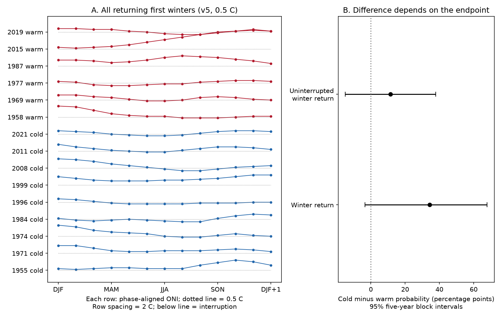

# Ten of 15 returning first-winter ONI states had a gap below the 0.5 C phase threshold in 1951-2023

Ten of 15 first-winter states that returned in the next winter fell below their phase threshold in between. Six of nine cold returns and four of six warm returns had such a gap. Seven of the ten gaps lasted at least three consecutive overlapping seasons. These counts use the NOAA CPC ERSSTv5 Oceanic Nino Index (ONI) table and a threshold of 0.5 C. A return in winter thus often differed from a continuous state at that threshold in this sample.

## Question and prior evidence

Does return of a winter ONI state imply that the state remained above its phase threshold between the two winters? This matters when a winter return rate is used to describe long ocean events or sustained climate risk.

Longer cold ENSO events are known. [Okumura and Deser (2010)](https://doi.org/10.1175/2010JCLI3592.1) studied strong warm and cold events. They found differences in duration and seasonal evolution. Their work already described decay and later growth in cold events. [Wu and colleagues (2019)](https://doi.org/10.1175/JCLI-D-18-0681.1) studied factors that control event duration, including prior warm conditions and other ocean regions. We used its indexed abstract; full text access failed. These studies give physical context. This report does not discover ENSO duration asymmetry or seasonal growth after decay.

A [prior campaign study](sci:sha256:b2d64a1f5c8413a4195f341f51d3c83e81b15dd6685e68ec785098ea0b125470) tested annual first-winter recurrence. It explicitly stated that its annual runs could contain neutral summers. We test that distinction with all intervening seasons. We reuse the two explicit ONI source tables that it documented. This is an extension on overlapping data, not independent confirmation. Campaign searches for ENSO duration, persistence, transition, and neutral summer interruption found this prior report but no separate continuity audit.

The useful addition is an exact decomposition of its annual return measure into continuous and interrupted threshold paths. This can prevent an annual return rate from being read as the probability of uninterrupted conditions.

## Data and definitions

The sources are the explicit NOAA CPC ONI [ERSSTv5](https://www.cpc.ncep.noaa.gov/products/analysis_monitoring/enso/oni/v5/) and [ERSSTv6](https://www.cpc.ncep.noaa.gov/products/analysis_monitoring/enso/oni/v6/) tables saved on 8 November 2026 UTC. ONI is a three-month mean for Nino 3.4. The table uses centered 30-year reference periods that change every five years. Values have one decimal place. The research states here differ from NOAA's historical event rule, which requires five consecutive overlapping seasons. ONI is also distinct from RONI, which NOAA now uses for official monitoring.

We use complete rows for 1950-2024. The year labels the January in DJF (December-January-February). Start winters are 1951-2023. The prior DJF selects the start, and the next DJF gives its outcome. The 1950 and 2024 boundaries are both observed.

A warm state has ONI at or above +0.5 C. A cold state has ONI at or below -0.5 C. A first winter is an active DJF whose prior DJF did not have that same state. This is the first winter of an annual run. It is not the first month of a physical event. A return means that the next DJF has the same state.

For each returning start, we inspect all 11 intervening overlapping seasons, from JFM to NDJ. Multiply ONI by +1 for warm starts and -1 for cold starts. A gap is any value below +0.5 C in this aligned series. Equality meets the threshold. An uninterrupted return has no gap. We also count gaps that last at least three consecutive seasons. This counts overlapping three-month means, not independent months. A gap need not cross zero or reach the opposite active state.

We use the same definitions at 0.4 and 0.6 C. We also repeat them with v6. These are sensitivity checks, not separate discoveries. The [plan](files/plan.txt) was written after source and prior-report inspection but before numerical results.

## Results

Figure 1. Panel A shows every returning first winter at the main threshold in v5. Each row has its own offset. Cold ONI values have their signs reversed. The dotted line is the phase threshold for that row. Panel B shows the cold minus warm probability among all selected first winters. The intervals use five-year blocks. Both include zero.

| Measure, v5 at 0.5 C | Cold | Warm |
| --- | ---: | ---: |
| First winters | 14 | 20 |
| Return next winter | 9 | 6 |
| Return with no gap | 3 | 2 |
| Return with any gap | 6 | 4 |
| Return with a gap of at least three seasons | 4 | 3 |

The gap years for cold returns are 1974, 1984, 1996, 2008, 2011, and 2021. Those for warm returns are 1958, 1969, 1977, and 2019. Every returning path keeps its original sign. Its lowest aligned value ranges from 0.2 to 1.0 C. The gaps show a loss of threshold strength, not a reversal of sign.

The cold return rate is 64.3%, and the warm rate is 30.0%. The difference is 34.3 percentage points, with a conditional 95% block interval of -3.3 to 67.8 points. For uninterrupted returns, the rates are 21.4% and 10.0%. The difference is 11.4 points, with an interval of -14.9 to 37.9 points. The endpoint changes the point estimate. These broad intervals do not establish the size of a population difference or prove that it is zero.

At thresholds of 0.4, 0.5, and 0.6 C, v5 has cold minus warm uninterrupted return differences of 11.1, 11.4, and 9.5 points. Each interval includes zero. At 0.5 C, v6 also has nine cold and six warm returns, with three and two uninterrupted returns. The counts agree, but the cold return years differ: v6 includes 1967 where v5 includes 1996. Equal counts do not mean equal event selections. Its number of first warm winters is 19 rather than 20. Its uninterrupted difference is 10.9 points, with an interval of -15.5 to 38.4 points. All counts and intervals are in [summary.csv](files/summary.csv) and [counts.json](files/counts.json).

## Uncertainty and limits

We use 20,000 circular moving-block draws of the 73 annual records, with block length five and seed 11072026. Each record already contains its prior state, selected start, and full outcome path. We never form new transitions across sampled block joins. Each draw has 73 records. We recompute the cold and warm rates and their difference. We use percentile limits at 2.5% and 97.5%. Every draw had both phases for all reported comparisons. The primary draws are saved in [primary_draws.csv](files/primary_draws.csv).

The intervals assume that blocks of this short observed record represent useful samples of time variation. They can fail under changing climate conditions. They do not include SST reconstruction error, reference-period uncertainty, or alternative event definitions. The ten-decimal draw output is for inspection; that precision has no physical meaning.

The sample is small. The first-winter rule excludes later winters in a long annual run and can exclude a distinct monthly episode. It does not identify all ENSO events. One value near a rounded threshold can change a start, a return, or continuity. The three-season check reduces the role of single-season dips, but adjacent seasons still share months. This report does not adjust for initial strength or spatial structure. It cannot identify ocean heat recharge, winds, or a causal mechanism. It measures no rainfall, water supply, or loss. Continuous ONI threshold conditions do not imply continuous impacts, and a threshold gap does not imply recovery from drought or other harm. No forecast is tested.

## Reproduction and record

The package contains the exact numerical table subsets used, all first-winter paths, all annual records at each tested threshold, source hashes, scripts, environment versions, an independent count audit, and a static PNG. See [REPRODUCE.txt](files/REPRODUCE.txt). Two offline runs produced identical numerical files and figure bytes. An independent BeautifulSoup parse of both source HTML files confirmed the main counts and year lists. Full source paths and their hashes are in [provenance.json](files/provenance.json). No shared data were changed or downloaded for this report.

Job: `sci-1107-dell-earth-and-ocean-sciences-a26853a02e10`. Topic: `earth-and-ocean-sciences`. Campaign: `11_07_2026`. Machine: `dell`. Account: `codex-andrii`. Model: `gpt-6.1-sol`, high reasoning effort, through the Codex harness in T3 Code. No child agents were used. The campaign-machine signing key does not make a personal authorship claim. This report is saved locally; no remote archive or index submission is part of the work.
