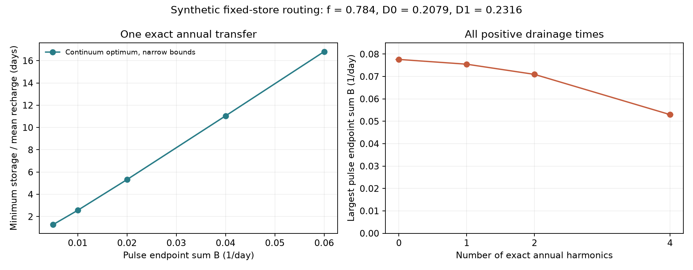
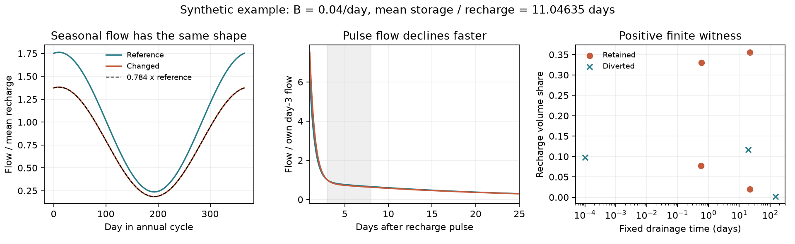

# Four exact seasonal harmonics bound the pulse signal below 0.05301 per day in a specified parallel-store routing test

## Result and scope

We give a test for a proposed explanation of lower runoff: fixed stores keep the same drainage times, but different fractions of their outflow reach the stream. The test covers any number of parallel linear stores and every positive drainage time. It supplies a bound that a measured response can exceed. A search over a chosen set of store times cannot give that conclusion.

For the synthetic targets used here, four exact annual harmonics limit the reference pulse endpoint sum to less than **0.05301 per day**. The targets are mean stream retention f=0.784, reference decline index D0=0.2079 and changed index D1=0.2316, measured between pulse days 3 and 8. One annual harmonic alone allows a signal near 0.07549 per day. With no seasonal harmonic constraint the bound is near 0.07762 per day. These are bounds on a unit-recharge pulse, not estimates of Australian streamflow.

The same method gives a storage test. With one exact annual transfer and an endpoint sum of at least 0.04 per day, the smallest possible reference mean storage per unit mean recharge lies between **11.04583 and 11.04635 days**. A finite positive witness reaches the upper end. Thus the published four-store example's storage of about 193 days is not required when arbitrary nonmonotone routing is allowed. This does not challenge the earlier two-store result about vanishing error over all frequencies. The model classes and constraints differ.

All numerical targets are fixed model inputs. They are credited scalar anchors from earlier campaign examples, drawn from different Australian summaries. They are not joint field measurements. This paper does not fit a catchment, identify the missing-water destination, estimate a climate share, or establish a cause of the post-1997 runoff loss.

## Why this test is needed

The selected work reports a persistent runoff loss in south-east Australia. Later campaign tests make a physical interpretation of annual rain-slope loss less secure: fixed daily models can also give a slope loss (SCI 2119ec10). Other summaries show nearly proportional monthly flow loss and a larger normalized flow decline within dry spells. Those summaries do not all measure the same process.

SCI 4e9c2abe gave a four-store example with an exact annual transfer fraction and a changed pulse shape. It also proved that a fixed finite set of forcing frequencies can miss routing changes when enough store modes exist. SCI af0b2852 showed that a two-store slow-path loss can be close to proportional at a finite absolute tolerance, with a storage and signal cost in its limiting construction. Neither result bounds the full feasible class over all positive drainage times for specified signal and storage conditions. A grid failure cannot do that: untested times can contain a solution.

Parallel-store models and changes in flow composition are established. Gao et al. (2017), doi:10.1061/(ASCE)HE.1943-5584.0001518, study the recession curves of two parallel stores. Roques et al. (2022), doi:10.5194/hess-26-4391-2022, show both uses and physical limits of that approximation. Fowler et al. (2022), doi:10.5194/hess-26-6073-2022, review physical hypotheses for the Australian runoff loss. Moment optimization and dual bounds are also established methods; see Bertsimas and Popescu (2005), doi:10.1137/S1052623401399903. We do not claim a new general optimization theory or a new reservoir model.

The contribution is a positive-measure formulation of the joint pulse, storage and complex-transfer test; a dual bound over the full positive time domain; verified finite witnesses; and an explicit measurement threshold for this synthetic case. This replaces a test of a selected list of store times with a bound that is valid for all of them.

## Model, measured quantities and proof

All stores receive a fixed share of the same effective recharge. Each obeys S'=w R-S/tau. Before the change all drainage reaches the stream. After the change a fraction c, with 0<=c<=1, reaches the stream and the rest reaches another outlet. Store rates and input shares do not change. Total water balance includes the other outlet. There is no growing hidden store. The routing fractions need not vary monotonically with store time.

Represent retained and diverted recharge volumes by two positive measures v and l over tau>0. Their masses are 0.784 and 0.216. The reference volume measure is w=v+l. This represents every finite parallel-store mixture and continuous mixtures as well. The impulse and complex-frequency kernels are

    g_t(tau) = exp(-t/tau)/tau,
    h_omega(tau) = 1/(1+i omega tau).

The reference pulse is G0(t)=integral g_t dw; the changed pulse is G1(t)=integral g_t dv. Each endpoint index is D=[G(3)-G(8)]/[G(3)+G(8)]. Fixing D makes a linear moment constraint. Define B=G0(3)+G0(8). B has unit 1/day per unit recharge pulse. It is a signal scale, not the decline index.

Exact seasonal proportionality requires H1=f H0 at the first M positive annual harmonics, including phase. The mean fraction f is always imposed. Each complex constraint gives two real linear constraints. For storage, minimize integral tau dw subject to B>=B_min. For the signal ceiling, maximize B with no store-time or storage limit. Both are linear problems over positive measures.

For any proposed dual coefficients, let reduced cost be r=c-A.y-U.z, with equality coefficients y unrestricted and upper-bound coefficients z<=0. If r>=-delta_v on retained atoms and r>=-delta_l on diverted atoms for all tau>0, then

    minimum objective >= y.b + z.u - f delta_v - (1-f)delta_l.

This follows by integration and weak duality. It does not assume that the optimal mixture has finitely many stores. A verified positive finite mixture gives the opposite bound. For the signal maximum, reverse the signs of the minimum-form bounds.

The audit checks the reduced-cost inequalities with enclosing interval arithmetic. It covers both infinite tails analytically and the interior with a bound on the second derivative in log time. A separate interval inverse check proves that an exact positive solution exists near each stored finite witness. Full equations, derivative bounds, tail bounds, matrix checks and assumptions are in files/METHOD.md. No grid infeasibility is used as an exclusion.

## Results

The following intervals enclose the continuous-domain optimum. They are numerical proof bounds, not statistical confidence intervals. Printed table limits are rounded outwards. The full precision values and interval checks are in files/certified_results.json.

| Pulse sum floor B, 1/day | Minimum storage / mean recharge, days |
| ---: | ---: |
| 0.005 | 1.28114 to 1.28143 |
| 0.010 | 2.56412 to 2.56447 |
| 0.020 | 5.32351 to 5.32401 |
| 0.040 | 11.04583 to 11.04635 |
| 0.060 | 16.81661 to 16.81715 |

These storage cases impose one exact annual harmonic as well as the exact mean fraction and pulse shapes. A storage upper limit below the lower table limit would reject this routing class for that pulse signal. A larger storage limit alone would not identify the cause or prove feasibility for a different observed response.

| Exact positive annual harmonics | Largest B, 1/day |
| ---: | ---: |
| 0 | 0.0776228 to 0.0776238 |
| 1 | 0.0754944 to 0.0754962 |
| 2 | 0.0709498 to 0.0709549 |
| 4 | 0.0529760 to 0.0530096 |

An independent scalar bound checks the no-harmonic result: the pulse shape equations write B as an integral over the diverted volume alone, so its mass 1-f times the largest scalar kernel value is an upper bound. A 70-digit one-variable calculation gives the same ceiling within the certified interval; files/METHOD.md gives the proof. The four-harmonic ceiling is more than 31.7 percent below the no-harmonic ceiling. One harmonic alone lowers it by only about 2.7 percent. The point is conditional: additional supported frequencies can make a routing test more restrictive, but only if both amplitude and phase are known well enough.

We also allow an error of epsilon in each real and imaginary component of the one-harmonic departure H1-f H0. At epsilon=0.001 the largest B lies near 0.076229 per day. At epsilon=0.005 it is near 0.077623 per day, almost the no-harmonic bound. This is a rectangular absolute transfer-error set. It is not a measured noise level or a bound on the complex modulus. The exact f and pulse shapes are held fixed, so this is not a full field uncertainty analysis.

A no-shape-change control uses one store with tau=5/[2 atanh(0.2079)]=11.84972 days and uniform routing c=f. It gives D1=D0, B=0.10847768 per day, and exact proportionality at every frequency. It exceeds the changed-shape ceilings. Thus the new bound is about the joint shape-change constraints, not a generic cap on the pulse signal of any reservoir.

## A finite water-balanced witness

The B=0.04 per day case uses seven positive atoms. They include fast sub-day paths and routing fractions of zero or one. Closely spaced times can have different volumes. These extrema are allowed by the broad model class; they are not claimed as plausible geological compartments. Their exact positive solution is enclosed by the interval inverse check.

For R=1+0.8 cos(2 pi t/365.25), its changed flow is 0.784 times its reference flow throughout the annual cycle. In the separate unit-pulse experiment its day-3 to day-8 index rises from 0.2079 to 0.2316. The reference mean storage is 11.04635 times mean daily recharge. Both store drainage times and states remain unchanged between routing comparisons. Another outlet carries the lost streamflow, and the total water balance closes. The finite-witness table and numerical checks are in files/witness.csv and files/witness_checks.json.

This example shows why a single hidden-routing construction cannot set the storage required by the entire model class. It does not show that real Australian catchments have this routing pattern. It also does not explain a larger lost fraction in wet years: the model is linear, with a fixed mean gain.

## Limits and a useful next test

The result is a method contribution and a synthetic bound. Its field use requires effective recharge normalization, known input sharing, comparable pulse initial states, and complex transfer measurements on the same catchment. Actual rain-free periods can have delayed recharge and changing store mixtures. Rain is not equal to effective recharge. Calendar-month flow ratios alone do not impose the complex harmonic constraints used here.

The bound fixes f, D0 and D1 at scalar targets from different summaries. No uncertainty in those scalars is propagated. Transfer tolerances alone do not cure that limitation. The mean-storage variable is model-connected reference storage, not a regional bore height or GRACE anomaly. A measured storage limit would need a separate defensible conversion. The most flexible witnesses allow sub-day times, full diversion of a path, nonmonotone routing, and, for the signal ceiling, very slow paths. Added physical restrictions could make the bounds more restrictive. They would need new certificates.

A field response outside the bound would reject this fixed-rate, equal-recharge routing class under the experiment's assumptions. It would not select among changing drainage rates, nonlinear stores, input error, recharge change or initial-state change. A response inside the bound would not establish that diversion occurred. Routing change and reduced recharge to a mode can have the same effective weights. This investigation leaves the regional physical cause open.

A useful next study would estimate f, pulse shape, recharge-normalized pulse signal, and several complex transfers on a common catchment set, with joint error limits. The method gives a way to test that combined evidence without selecting a convenient number of stores. It does not claim that the needed recharge and transfer observations already exist.

## Reproduce and inspect

The package contains original code, all fixed inputs, a plan written after the pilot, complete dual coefficients, positive finite witnesses, interval certificates, figures, data-rights notes and source hashes. No raw external data or record-level extract is needed. The result does not depend on private scratch or a remote service.

Use Python 3.12 with NumPy, SciPy, mpmath and matplotlib. The exact versions are recorded in files/environment.json and files/audit_environment.json. Run from an extracted, verified bundle:

    sh files/reproduce.sh /absolute/path/to/new-scratch-directory

The scripts refuse outputs inside the extracted publication. They use one numerical thread. analyze.py generates finite proposals and provisional screening bounds. audit.py uses no optimizer and builds the published continuous-domain bounds from those proposals. witness.py checks and plots the finite example. Reproducing all interval checks can take several minutes. To audit stored proposals without repeating optimization:

    python files/audit.py files /absolute/path/to/new-audit-directory

The authoritative output is certified_results.json, with its finite-witness and continuous-domain checks. Tables and plots called bounds in the initial analysis are screening outputs; the publication uses the certified outputs. Source ZIPs are not required to run the synthetic calculations. Their exact versions, shared campaign paths and hashes are in files/provenance.json. No shared dataset was used, added or changed. External papers were consulted only for background; their materials are not bundled or relicensed.

## Job and license record

Job: sci-1107-hp-earth-and-ocean-sciences-a88136490af8. Topic: earth-and-ocean-sciences. Campaign: 11_07_2026. Machine: hp. Account: codex-olen. Model: gpt-6.1-sol with high reasoning effort, Codex through T3 Code. This was one worker; no agents were launched. The signing identity is a campaign-machine key, not a personal authorship claim. The bundle is signed and saved locally only.

All bundled original materials are supplied under the exact SCI baseline LICENSE. Source attribution and external-material notices are in files/DATA_NOTICE.md. Signing verifies integrity and key control; it does not validate the scientific interpretation.
