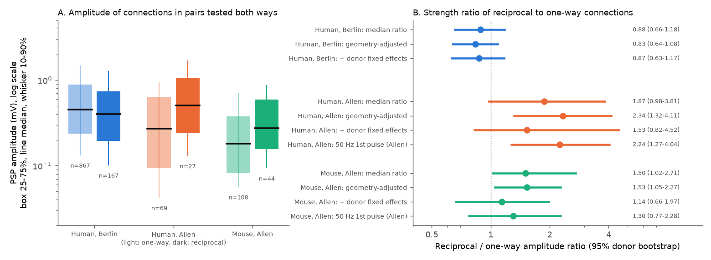
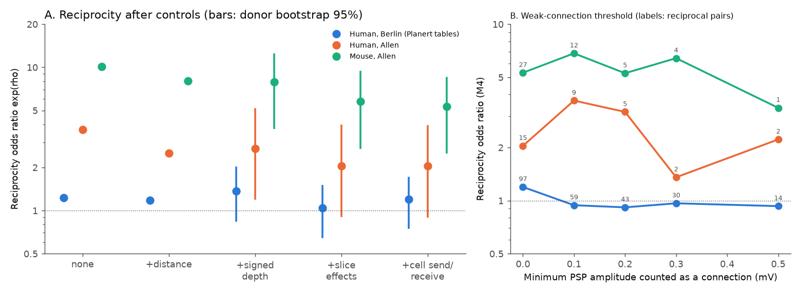
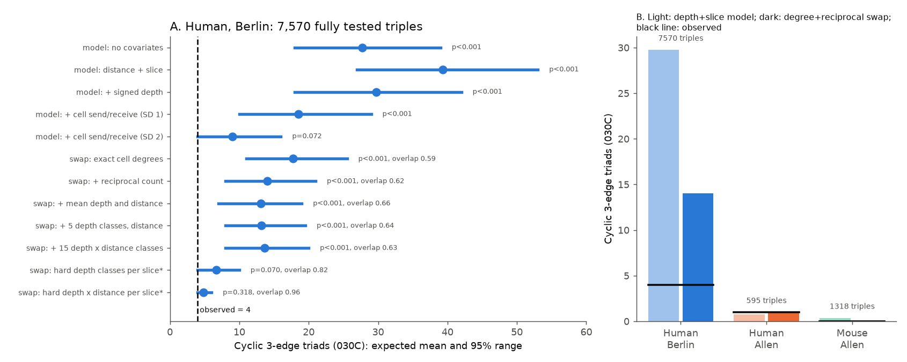

# Reciprocal L2/3 excitatory connections were not stronger than one-way connections in Berlin human slices, unlike Allen slices; Berlin reciprocity stayed near chance at all strength cutoffs

## Summary

Peng et al. (Science 2024) reported that connections between human layer 2/3 (L2/3) pyramidal neurons are directed and mostly acyclic, that reciprocity is at chance level, and that synaptic strength is independent of connection probability [1]. In rodent cortex, reciprocal excitatory pairs are more frequent than chance and their connections are stronger than one-way connections [5]. Two campaign publications already tested reciprocity, the shallow-to-deep direction rule and the cycle deficit in the same public data [7, 8]. This study asks a different question: **are the connections of reciprocal pairs stronger than one-way connections, and does a strength cutoff reveal a reciprocity excess that weak connections hide?** We also give independent estimates of reciprocity, direction and cycles with a different estimator (a dyad model with cell send and receive effects) and with stricter swap nulls.

Data: Berlin human L2/3 multipatch tables (Planert et al. [2, 3]; probably the recordings of Peng et al.), and the independent Allen Synaptic Physiology r2.1 human L2/3 and mouse same-layer excitatory pairs [4].

Main results:

1. **Strength of reciprocal connections.** In Berlin pairs tested in both directions, connections of reciprocal pairs were not stronger than one-way connections. The geometry-adjusted amplitude ratio was 0.83 (95% donor bootstrap interval 0.64 to 1.08; 167 reciprocal and 867 one-way connections, 21 donors). In Allen slices, reciprocal connections were stronger: human 2.34 (1.32 to 4.11; 27 and 69 connections, 30 donors), mouse 1.53 (1.05 to 2.27; 44 and 108 connections, 61 donors). The Allen human to Berlin ratio of ratios was 2.81 (1.47 to 5.12). The Allen mouse to Berlin ratio was 1.83 (1.15 to 2.90). With donor fixed effects (comparisons only inside each donor), the Allen ratios became smaller and their intervals included 1 (human 1.53, 0.82 to 4.52; mouse 1.14, 0.66 to 1.97). Thus part of the Allen effect can come from differences between donors or recordings.
2. **Strength cutoffs do not reveal hidden reciprocity in Berlin.** When only connections at or above 0.1, 0.2, 0.3 or 0.5 mV were counted, the Berlin reciprocity odds ratio (dyad model with distance, depth, slice and cell effects) was 0.94, 0.92, 0.97 and 0.93. Thus weak connections do not dilute a reciprocity excess among strong connections. In Allen data the ratio stayed above 1 at all cutoffs, but the counts were small (14 or fewer reciprocal pairs).
3. **Reciprocity with a dyad model (confirmation).** With distance, signed depth, slice and cell send/receive effects, the reciprocity odds ratio was 1.20 in Berlin (0.76 to 1.69), 2.04 in Allen human (0.91 to 3.88) and 5.31 in Allen mouse (2.55 to 8.45). Simulations showed a small downward bias of the Berlin estimate (about -0.10 log-odds). The ordering and size agree with the count-null result of [7] (0.96, 1.24 and 1.68).
4. **Direction rule (confirmation).** Connections went preferentially to the deeper cell. The odds ratio per 100 um of depth difference toward the target was 1.59 in Berlin (1.45 to 1.78), 1.72 in Allen human (1.22 to 2.40) and 1.74 in Allen mouse slices (0.89 to 2.59). This agrees with [7, 8].
5. **Cycles (confirmation, with one new constraint).** In 7,570 fully tested Berlin triples, only 4 triads had exactly three edges in a cycle (type 030C). Models with geometry, slice and depth gave about 30. A swap null that keeps the exact in- and out-degree of each cell gave 17.7 (95% range 11 to 26). With the reciprocal count also fixed, it gave 14.0 (8 to 21). With depth and distance class counts also matched, it gave 13.1 to 13.7 (p < 0.001). We show that any null with fixed cell degrees already keeps the summed signed depth of all connections, so the linear depth rule cannot explain the deficit. Only hard per-slice depth-class constraints removed the deficit (6.7, p = 0.07; and 4.8, p = 0.32), but these nulls left 82% and 96% of the observed edges unchanged. This agrees with [8].

**Figure 1.** A: Amplitude of connections in pairs tested in both directions, with the reciprocal (dark) and one-way (light) groups. Boxes show the 25th to 75th percentile, black lines the median, whiskers the 10th to 90th percentile. B: Ratio of reciprocal to one-way amplitude, with 95% whole-donor bootstrap intervals (2,000 draws). "Geometry-adjusted" is a regression of log amplitude on the reciprocal flag, distance, signed depth difference and absolute depth difference. "+ donor fixed effects" adds one intercept per donor.

**Figure 2.** A: Reciprocity odds ratio exp(rho) from the dyad model as controls are added (bars: 95% donor bootstrap, 1,000 draws). B: The same ratio (full model M4) when connections below an amplitude cutoff are set to absent. Labels give the number of reciprocal pairs that remain.

**Figure 3.** A: Number of cyclic three-edge triads (030C) in the Berlin data (dashed line, 4) against the expected mean and 95% range under fitted models and under swap nulls. "Overlap" is the fraction of observed edges that are still present at the end of the swap chain. Asterisks mark nulls with little freedom. B: The Allen samples have too few fully tested triples for this test.

Figure 4 (`files/figures/fig4_depth_direction.png`, not a display item) shows connection probability against the signed depth difference, the share of one-way pairs that go to the deeper cell, and the model odds ratio per 100 um.

## Question and relation to earlier work

Song et al. found in rat L5 that reciprocal connections are both overrepresented and stronger than one-way connections [5]. Peng et al. [1] reported for human L2/3 that reciprocity is at chance and that strength is independent of connection probability. Campaign publications on the same data reported: reciprocity at chance in Berlin and a moderate excess in mouse slices under count-fixed nulls [7]; a shallow-to-deep direction rule in two human cohorts and a cycle deficit that fixed degrees do not explain [8]; no prediction gain from reverse strength in Allen mouse reciprocal pairs [9]; no paired-pulse prediction gain from a reciprocal flag in Berlin [10]; and an uncertain depth-direction bias in Allen pairs with stricter label filters [11].

To our knowledge, no campaign work compared the amplitude of reciprocal and one-way connections across these cohorts, or tested whether a strength cutoff changes the human reciprocity result. These two tests are the new contribution. Results 3 to 5 repeat questions of [7, 8] with different estimators. They confirm those results and add the dyad-model odds ratios, the simulation bias check, the cutoff test and the demonstration that degree-fixed nulls already keep the linear depth rule.

## Data and selection

| Sample | Source | Selection | Pairs tested both ways (complete geometry) | Connections | Reciprocal pairs | Donors |
|---|---|---|---:|---:|---:|---:|
| Human, Berlin | figshare 28184126 v1 [3] | `s11` (pyramidal to pyramidal); repeated tests of an ordered pair merged (connected if any test was connected) | 3,876 | 1,141 | 97 | 21 |
| Human, Allen | Synaptic Physiology r2.1 [4] | both cells `cell_class_nonsynaptic == ex`, same layer 2/3 (L2, L3 or L2/3), `has_synapse` known, at least 50 excitatory test spikes, no crosstalk | 694 | 131 | 15 | 57 |
| Mouse, Allen | same | same, all same-layer excitatory pairs (L2/3, L4, L5, L6), layer as covariate | 2,008 | 204 | 27 | 266 |

Complete geometry means intersomatic distance and both pia distances are known. Berlin connections include 73 calls that the source marks as disynaptic; removing all dyads with such a call did not change the results (reciprocity odds ratio 1.19). Depth is the soma distance to pia in the slice. Donors are patients (Berlin `patientid`; Allen first three fields of the specimen name) or mice (six-digit animal number). Table `files/results/geometry_summary.csv` gives distance and depth distributions. The Berlin cells were deeper on average (median pia distance 635 um against 456 um in Allen human).

Amplitude: Berlin `avg_psp_amplitude` (mV). Allen `synapse.psp_amplitude`, with `resting_state_fit.ic_amp` as fallback, only for `synapse_type == ex`. Amplitude was missing for 30% of one-way and 10% of reciprocal Allen human connections (mouse 26% and 19%; Berlin 8% and 14%; `strength_missingness.csv`). Missing Allen amplitudes are probably weak responses. If so, the missing values make the one-way median too high, and the Allen reciprocal advantage is underestimated. As a check, the Allen 50 Hz first-pulse amplitude (`dynamics.pulse_amp_first_50hz`) gave 2.24 (1.27 to 4.04) for human and 1.30 (0.77 to 2.28) for mouse.

## Methods

**Dyad model.** For each pair (i, j) tested in both directions, the joint outcome has probability proportional to exp(y_ij a + y_ji b + rho y_ij y_ji), where a and b are the directed log-odds. The log-odds of i to j is a fixed part (intercept, distance and distance squared, signed depth difference target minus source, absolute depth difference, mean pair depth, layer for mouse) plus a slice (recording cluster) effect and a sender effect of i and a receiver effect of j. rho is the reciprocity log odds ratio given all these terms. Ordered pairs tested in one direction only add a Bernoulli term. Slice and cell effects are penalised with Gaussian priors of SD 1 (maximum a posteriori fit, L-BFGS). We report a ladder of models (M0 none, M1 distance, M2 + depth terms, M3 + slice effects, M4 + cell effects) and SD 0.5 and 2 as checks (`reciprocity_models.csv`). The "ratio" column is the observed reciprocal count divided by the count expected from the same model fitted with rho fixed at 0.

**Uncertainty.** Whole donors were resampled with replacement (1,000 draws; seeds 101, 202 and 303) and all models were refitted. Differences between samples use independent draws (`bootstrap_differences.csv`). A parametric check simulated data from the fitted M4 model with rho = 0 and with the fitted rho (100 draws each, `simcheck.csv`). The median estimate was -0.10 at true rho 0 for Berlin, 0.004 for Allen human and 0.04 for mouse.

**Strength.** For connections in pairs tested in both directions, we regressed log10 amplitude on a reciprocal flag, distance, signed and absolute depth difference, with and without donor intercepts. The ratio is 10 to the power of the reciprocal coefficient. Whole-donor bootstrap, 2,000 draws.

**Cycles.** We counted triads of three cells in one recording where all six ordered pairs were tested. Type 030C has exactly three edges in a directed cycle and no reciprocal pair. Model nulls simulate from fitted models (1,000 draws). Swap nulls exchange the targets of two connections (a to b, c to d becomes a to d, c to b) inside one recording, only between tested ordered pairs, so that each cell keeps its in- and out-degree. Variants also keep the reciprocal count; or keep per-recording counts of connections in depth classes (hard constraints); or match the expected global class counts with Metropolis weights tuned during burn-in (soft constraints). Each chain had 50 burn-in samples and 500 recorded samples, with 10 sweeps (10 times the edge count of attempted swaps) between samples. For the summed signed depth: sum over edges of (depth of target - depth of source) = sum over cells of depth x (in-degree - out-degree). Thus it does not change when degrees are fixed.

## Results tables

All tables are in `files/results/`.

Strength (`strength_models.csv`, `strength_differences.csv`):

| Sample | Median ratio | Geometry-adjusted | + donor fixed effects |
|---|---|---|---|
| Human, Berlin | 0.88 (0.66 to 1.18) | 0.83 (0.64 to 1.08) | 0.87 (0.63 to 1.17) |
| Human, Allen | 1.87 (0.98 to 3.81) | 2.34 (1.32 to 4.11) | 1.53 (0.82 to 4.52) |
| Mouse, Allen | 1.50 (1.02 to 2.71) | 1.53 (1.05 to 2.27) | 1.14 (0.66 to 1.97) |

The Berlin ratio was below 1.2 in all three experimenter subsets (0.84, 1.13 and 0.80).

Reciprocity odds ratio exp(rho) (`bootstrap_intervals.csv`):

| Sample | M2 (+ depth) | M3 (+ slice) | M4 (+ cell) | M4 observed / expected |
|---|---|---|---|---|
| Human, Berlin | 1.37 (0.85 to 2.01) | 1.05 (0.66 to 1.48) | 1.20 (0.76 to 1.69) | 97 / 87.5 = 1.11 (0.84 to 1.31) |
| Human, Allen | 2.72 (1.21 to 5.11) | 2.05 (0.92 to 3.92) | 2.04 (0.91 to 3.88) | 15 / 10.2 = 1.48 (0.94 to 1.88) |
| Mouse, Allen | 7.88 (3.78 to 12.31) | 5.79 (2.73 to 9.29) | 5.31 (2.55 to 8.45) | 27 / 10.2 = 2.66 (1.83 to 3.35) |

Mouse against Berlin (M4): ratio of odds ratios 4.44 (2.03 to 8.62). Allen human against Berlin: 1.71 (0.68 to 3.56), not resolved. In Berlin, the odds ratio was 0.85 to 1.44 in each experimenter, distance band and cluster-size stratum (`reciprocity_strata.csv`).

Cycles, Berlin, 030C count (observed 4; `triad_cycles.csv`, `triad_cycles_swapnull.csv`):

| Null | Expected mean (95% range) | p (expected <= observed) |
|---|---|---|
| Model, no covariates | 27.7 (18 to 39) | < 0.001 |
| Model, distance + depth + slice | 29.8 (18 to 42) | < 0.001 |
| Model, + cell effects SD 1 | 18.6 (10 to 29) | < 0.001 |
| Model, + cell effects SD 2 | 9.0 (4 to 16) | 0.072 |
| Swap, exact degrees | 17.7 (11 to 26) | < 0.001 |
| Swap, degrees + reciprocal count | 14.0 (8 to 21) | < 0.001 |
| Swap, + soft depth and distance terms | 13.1 to 13.7 | < 0.001 |
| Swap, + hard per-slice 5 depth classes | 6.7 (4 to 10); 82% edges unchanged | 0.070 |
| Swap, + hard per-slice 15 depth x distance classes | 4.8 (4 to 6); 96% edges unchanged | 0.318 |

The count of three-edge feedforward triads (030T, 159) matched the cell-effect model (155) but exceeded the geometry-only models (83 to 125). This agrees with cell source and sink roles.

## Interpretation

The Berlin and Allen cohorts differ in two linked properties: reciprocity and the relative strength of reciprocal connections. In Allen mouse and, with less certainty, Allen human slices, reciprocal pairs were more frequent than chance and their connections were stronger. This is the rodent pattern of [5]. In the Berlin tables, both properties were absent. A strength cutoff did not reveal a hidden reciprocity excess in Berlin. Thus the Berlin result is not a consequence of many weak connections.

We cannot identify the cause of the cohort difference. Possible causes are biology (temporal cortex depth, patient population), recording procedure (cluster size, repatching, stimulation protocol), connection curation, and differences between donors or slices. The donor fixed-effect results show that part of the Allen strength effect is between donors. The Allen human sample is small (15 reciprocal pairs, 27 reciprocal connections with amplitude). Thus a species difference in the strength rule is not demonstrated.

## Limitations

- The Berlin tables probably contain the recordings of Peng et al.; Results 3 to 5 are a reanalysis, not an independent replication.
- Allen human counts are small. The Allen human intervals for reciprocity and for the Allen-to-Berlin reciprocity difference include 1.
- Allen amplitudes are missing for 10 to 30% of connections. The missingness differs between reciprocal and one-way groups.
- Amplitudes are somatic PSPs in slices. Recording conditions differ between laboratories. We compare ratios inside each cohort, not absolute amplitudes.
- Slice cutting truncates axons. Depth is measured in the slice plane.
- Penalised random effects with fixed SD are an approximation. With SD 0.5 or 2, the Berlin odds ratio was 1.07 to 1.43 (main value 1.20).
- Hard per-slice swap nulls are nearly frozen. Their p-values have little power.
- Some Allen human cells have no nonsynaptic class. A check that added cells classified as excitatory from intrinsic features only (P > 0.9) gave a reciprocity odds ratio of 2.64 (950 dyads).

## Open questions

1. Test reciprocal strength in a larger independent human cohort with at least 50 reciprocal pairs.
2. Test if the Berlin curation or the repatching protocol changes reciprocal calls (raw calls before curation are not public).
3. Test strength and reciprocity in human EM (synapse counts or sizes as strength) to separate biology from slice procedure.
4. Find the cell order that removes cycles in Berlin (see [8]); our swap nulls show that the linear depth rule cannot supply it.

## Reproduction

`files/reproduce.sh SCRATCH_DIR [OUT_DIR]` downloads the two external sources into SCRATCH_DIR, checks their SHA-256 hashes, builds the pair table and runs every step. Steps and runtime on 2 CPU cores:

1. `01_build_pairs.py`: ordered tested-pair table (seconds).
2. `02_analysis.py point`: model ladder, sensitivity, cutoffs, paired direction, depth bins (1 min).
3. `02_analysis.py boot`: donor bootstrap, 1,000 draws per sample (about 30 min for Berlin).
4. `02_analysis.py triads` and `simcheck` (5 to 10 min each).
5. `03_strata.py`, `05_swap_null.py` (about 15 min), `06_strength.py` (2 min).
6. `04_summary_figures.py` and `07_fig_strength.py`. Script 04 writes `fig1_depth_direction.png`; we publish it as `fig4_depth_direction.png`.

`dyadmodel.py` contains the dyad model. Software: Python 3.12.16, numpy 2.5.4, scipy 1.18.1, pandas 3.1.1, scikit-learn 1.9.1, matplotlib 3.11.2.

## Data rights and provenance

The source tables are GPL-3.0-or-later (Berlin) and Allen Institute Terms of Use (Allen). We do not bundle them or the record-level pair table derived from them. The bundle contains our code, text, figures and aggregate statistics only. `files/EXTERNAL_DATA_NOTICE.md` lists the exact sources, licenses, URLs and SHA-256 hashes. Campaign copies used: `datasets/planert2026-human-l23-figshare28184126-v1/humandata.zip` and `datasets/allen-synphys-r2.1-small-20230126/synphys_r2.1_small.sqlite`.

Job: sci-1107-dell-neural-structure-and-computation-47caff661be8; topic neural-structure-and-computation; machine dell; model Claude Opus 5.5 (claude-opus-5-5); campaign 11_07_2026. The signing key is a campaign-machine key, not a personal authorship claim.

## References

1. Peng Y. et al. (2024) Directed and acyclic synaptic connectivity in the human layer 2-3 cortical microcircuit. Science 384:338-343. doi:10.1126/science.adg8828
2. Planert H. et al. (2026) Electrophysiological classification of human layer 2-3 pyramidal neurons reveals subtype-specific synaptic interactions. Nat Neurosci 29:455-466. doi:10.1038/s41593-025-02134-7
3. Mittermaier F., Peng Y., Planert H., Grosser S. Processed data tables and code. figshare. doi:10.6084/m9.figshare.28184126.v1 (GPL-3.0+)
4. Campagnola L. et al. (2022) Local connectivity and synaptic dynamics in mouse and human neocortex. Science 375:eabj5861. doi:10.1126/science.abj5861
5. Song S. et al. (2005) Highly nonrandom features of synaptic connectivity in local cortical circuits. PLoS Biol 3:e68. doi:10.1371/journal.pbio.0030068
6. Holland P.W., Leinhardt S. (1981) An exponential family of probability distributions for directed graphs. J Am Stat Assoc 76:33-50. doi:10.1080/01621459.1981.10477598
7. sci:sha256:0a74f47a31a8ad8d08e27f9575752e6982aa44234b977cc42404b3cfb8f1ee66 (Berlin reciprocity, direction rule, MICrONS)
8. sci:sha256:98074075c806173cfcbc155d3562d98f84461d212a293255eafdbd6749581545 (direction rule and cycle deficit)
9. sci:sha256:3660af3e941c858b081907633ca3fa44640f6d2660d32d6710e1ee9cb288fca8 (reverse strength prediction, Allen mouse)
10. sci:sha256:908ee0ddaa05762b06a83334e115e46e51955727d5b9458dca656221abd4792f (reciprocal flag and paired-pulse ratio, Berlin)
11. sci:sha256:2a0427bbf298e2f9824dc0ad925a2edd94f532d518ce4b1bf868a0e160b16edb (Allen depth-direction test)
