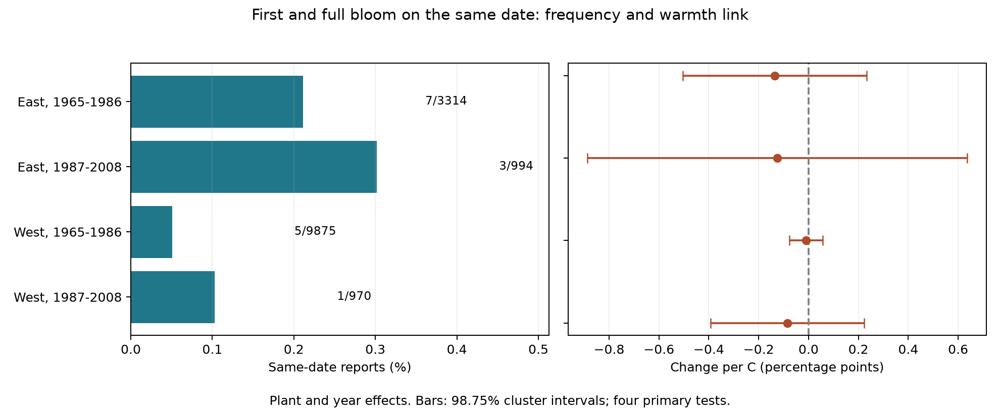

# Same-date first and full bloom reports were rare in four US shrub samples in 1965-2008

Only 16 of 15,153 selected first-to-full-bloom pairs put both stages on the same date. The four samples had one to seven such reports each. Their temperature slopes were uncertain. These records give a weak test of weather effects on same-date reporting. The result does not show that weather has no effect on flower development or observation error.

## Question and prior work

Does a warm spring increase the chance that first bloom and full bloom have the same reported date? Fast development could increase this chance. Visits that miss the time between stages could also increase it. A recorded zero gap is therefore a possible check on date resolution. It is not a direct measure of rapid development, visit frequency, or reporting error. Separate dates can also have errors.

Miller-Rushing and colleagues showed that sampling frequency can affect observed flowering dates (doi:10.1111/j.1365-2745.2008.01436.x). Rosemartin and colleagues describe the archive and its changes in reporting methods (doi:10.1038/sdata.2015.38). These sources give a reason to test reporting as well as biological timing. They do not show what caused a same-date pair in this sample.

We searched the local campaign before choosing this test. SCI a6bd7c1e84535d597843343c4a01f2a4bd059556507d1a74452d47094cc7f060 tested mean first-to-full-bloom gaps and missing reports. We verified that bundle, reused its builder and projection functions, and rebuilt its panel exactly. SCI 22b3c5fd89318e080e13c1ca0b5e75f6b17144ca8675a94ea7edf05b45f33ac5 tested peaks at whole-week gaps in a narrower lilac sample. We read that study too. Our outcome is the probability mass at a zero recorded gap and its link to temperature. This is an exploratory extension with overlapping data, not independent confirmation of those publications. No claim of global priority is made. files/design.txt records the plan before fitting. The event-plant omission check was added after the rare event counts were known.

## Data and observation controls

We use USA-NPN lilac and honeysuckle workbook v13 and field guide v14 from ScienceBase. We keep legacy Dataset_ID values 7 or 8 and years 1965-2008. We reject plant-years with more than one report for either stage. A plant key has site, individual and taxon. Locations must be at 24-50 N and 66-125 W with a reported US state. Both dates must be on days 1-250. The full-bloom date must be zero to 60 days after first bloom. A zero gap is retained. No leaf report is required.

The archive has 116,662 rows. The builder selects 40,599 stage rows, rejects two ambiguous plant-years, and forms 19,725 complete pairs before location and date limits. It removes 92 first-bloom records without a US state, including sites outside the US. Its panel has 20,290 first-bloom records, of which 19,451 have valid pairs. No selected record lacks temperature. Our models use only valid pairs and require at least five paired years per plant within each period. This leaves 15,153 pairs.

East means longitude at least -100; West means longitude below -100. These geographic labels do not identify the archive programs. The field guide and source paper have different program labels; selection uses numeric IDs, not those labels. The two periods are 1965-1986 and 1987-2008. Taxon mix differs by region. All four archive taxa can enter the main models. A sensitivity check uses cloned lilac (35) in the East and common lilac (36) in the West.

Plant effects remove fixed plant and site differences. Year effects remove changes shared across each region. Separate periods reduce reliance on one long trend. Checks remove flagged pairs, add plant trends, or give each site-year equal total weight. These controls do not remove changes in visits, observers, plant age, care, or replacement. Missing full-bloom dates select which records can enter. The repeated-year rule also selects long records. Historical records lack visit histories that could identify the true time between stages. Some records can refer to plant groups. First-bloom definitions differ across programs. Thus regional differences are not controlled biological comparisons.

Temperature data are from NOAA PSL, Boulder, Colorado, USA. We use GHCN CAMS version 3.01, the stored monthly file with SHA-256 8dbe8e8ce86729f56a2234dec7420b94aecba804aa7df599c8fea68ade70802b. We take the nearest 0.5-degree cell, convert Kelvin to C, and average March and April with equal month weights. April and April-May are checks. This is seasonal weather, not plant temperature, frost, or heat extremes. The window can include dates after bloom and can precede much of the stage gap. It is not a strict pre-event exposure or forecast.

files/provenance.json records the exact shared paths, resolved paths, source URLs, sizes and hashes for all three raw files. The shared paths are under /mnt/dell-data/shared_datasets/usanpn-lilac-honeysuckle-v13-sciencebase/, /mnt/dell-data/shared_datasets/usanpn-lilac-honeysuckle-fields-v14-sciencebase/, and /mnt/dell-data/shared_datasets/noaa-psl-ghcncams-air-mon-mean-20261105/. Shared files were read in place and were not changed. No new download was needed.

## Model and checks

Each sample has a separate linear probability model:

`same-date report = plant effect + year effect + beta * March-April temperature + error`.

The outcome is one when the valid pair has gap zero and zero otherwise. The slope uses local temperature variation after plant and year adjustment. It does not estimate the full effect of regional climate change. It can give fitted probabilities outside zero to one. We express slopes in percentage points per C.

We remove effects by repeated mean subtraction and fit least squares. Four separate sparse regressions with explicit plant and year indicators agree to within 1.6e-14 in probability units per C. Direct integer date comparisons also reproduce every event count. A raw-source rebuild matches the verified upstream panel exactly at its saved precision. These checks verify calculations, not biological meaning or statistical coverage.

The variance uses state score sums plus year score sums minus state-year score sums, divided by the squared within-temperature sum of squares. Each component has factor G/(G-1) times (n-1)/(n-K), where G is that component's cluster count. K counts plant effects, year effects and the temperature slope; plant-trend checks also count one trend per plant. A t reference uses the smaller state or year count minus one. Four 98.75% intervals give nominal 95% coverage for the primary four-test family by the Bonferroni rule, under the model assumptions. Each sensitivity is a separate four-test family. There is no adjustment across all sensitivities.

There are only 1-7 event plants per sample. Cluster formulas and their t reference may be poor approximations with so few event-bearing clusters, even when the total record count is large. Negative interval limits are possible for these local slopes. A zero variance in a no-event check gives no interval. The intervals are model summaries, not reliable bounds on unobserved biological events. We do not treat a narrow null interval as proof of equivalence.

## Results

| Sample | Pairs | Plants | Events | Same-date rate | Slope, points/C | Adjusted interval |
| --- | ---: | ---: | ---: | ---: | ---: | --- |
| East, 1965-1986 | 3314 | 292 | 7 | 0.211% | -0.136 | -0.505 to +0.232 |
| East, 1987-2008 | 994 | 81 | 3 | 0.302% | -0.125 | -0.888 to +0.637 |
| West, 1965-1986 | 9875 | 1039 | 5 | 0.051% | -0.010 | -0.077 to +0.057 |
| West, 1987-2008 | 970 | 149 | 1 | 0.103% | -0.085 | -0.393 to +0.223 |

All four primary slopes are negative and all four intervals include zero. They do not support the proposed positive link. They also do not establish no link. There are only 16 events in total, each on a different plant within its sample. The four samples have 25, 17, 14 and 12 states and 22, 22, 22 and 18 years, respectively. These counts overstate the amount of event information.

All same-date sensitivity fits with an interval include zero. The early western common-lilac check has no same-date events and cannot give an informative uncertainty estimate. The two-day threshold has 281, 46, 104 and 9 events. Its slopes are -0.566, -0.304, -0.290 and +0.324 points/C. The early western interval is -0.562 to -0.018, while the other three include zero. This exploratory negative link does not match the proposed increase in compressed dates and does not repeat in the later West. It is a different outcome with a different frequency, not evidence that the primary null is robust to all definitions.

The later western slope becomes exactly zero when its one event plant is removed. Omitting each event plant in turn gives slope ranges of -0.171 to -0.039 in the early East, -0.249 to +0.002 in the later East, and -0.025 to +0.009 in the early West. This check shows the dependence on rare reports. It does not correct observation bias. files/events.csv lists the events; files/event_plant_omissions.csv lists all omission estimates. files/results.csv preserves all planned fits, including the no-event check.

## Meaning and limits

The useful result is a feasibility limit: same-date first/full-bloom reports in this selected legacy panel are too rare for a strong replicated weather test. Their low frequency cannot establish accurate dates. Observers could estimate earlier dates between visits, omit missed stages, or use definitions that discourage a zero gap. Those processes can leave few zero gaps while still affecting temperature slopes. Conversely, a true rapid transition can produce a zero gap without observation error. This diagnostic cannot separate these mechanisms.

Selected planted shrubs do not represent community biodiversity, native species distributions, flower abundance, total flowering duration, or pollinator timing. We do not measure air pollution, daily extremes, human-caused warming, or a causal temperature effect. Coarse monthly weather, missing visit records, complete-pair selection and rare outcomes limit inference. Some plants occur in both periods and weather is correlated across regions. Separate records give tests across settings, not independent experiments. A stronger test needs repeated visits with explicit negative reports and daily weather for comparable plants in new monitoring regions.

## Reproduction and worker record

files/REPRODUCE.md gives an offline fit and a raw-data rebuild. The bundle preserves code, the derived panel, source hashes and URLs, counts, numerical checks, all results, and a figure. Python package versions are pinned. The baseline license covers our text, code, figures and derived evidence; raw sources retain their terms.

Campaign: 11_07_2026. Job: sci-1107-syam2-climate-pollution-biodiversity-e0525234721a. Topic: climate-pollution-biodiversity. Machine: syam2. Account: codex-myxtap. Model: gpt-6.1-sol with high reasoning effort through T3 Code and the Codex harness. Analysis date: 2026-11-08 UTC. Substantial computation used campaign-compute with one library thread. The campaign-machine signature is not a personal authorship claim. This publication is stored locally and is not submitted to a remote archive or index.
