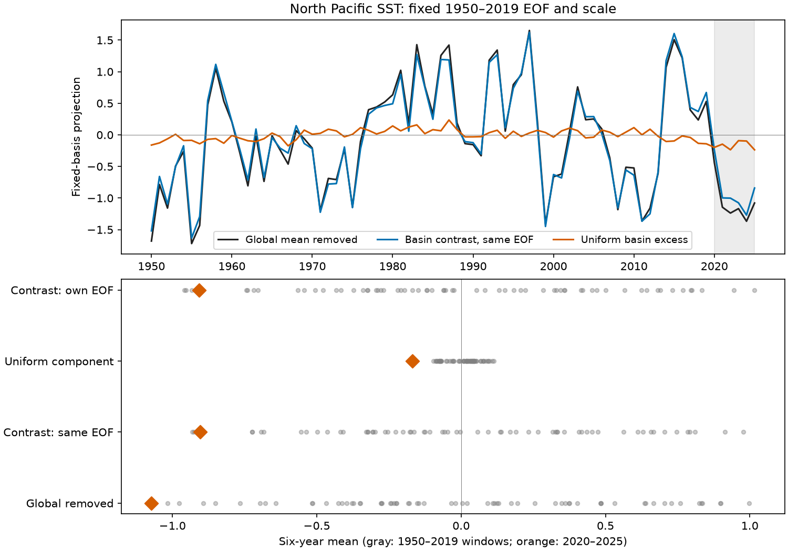

# Basin mean removal changed the rank of the 2020-2025 North Pacific SST mean under fixed EOF tests

The 2020-2025 North Pacific sea surface temperature (SST) projection was below all 65 earlier six-year means when we removed global mean SST and used a fixed 1950-2019 spatial pattern. It was above two earlier means when we removed North Pacific mean SST from the same field and kept the same pattern and scale. The removed uniform component gave 15.7% of the recent negative projection. Most of the negative value remained in the spatial contrast. The record rank also depended on the pattern fitting period. These results limit a definition-independent claim of a record low. They do not identify a physical cause.



Figure 1. The upper panel shows annual means of the fixed-pattern projection and its two additive parts. The lower panel shows the 65 earlier January-start six-year means in gray and the 2020-2025 mean in orange. The last row fits a separate leading pattern to the basin contrast field. Its scale is its own training standard deviation. The other three rows share the global-removed projection scale. The historical windows overlap. Their ranks are descriptive, not event probabilities.

## Question and prior evidence

Can basin-wide warming relative to global warming change the rank of the recent negative PDO-like mean, even after global mean removal? The Pacific Decadal Oscillation (PDO) is used to describe ocean conditions linked to ecosystems. Its sign is not a local temperature measure. A spatial pattern can have a nonzero basin mean. Thus subtraction of the global mean need not isolate within-basin contrasts.

We searched the campaign for ocean, earthquake, hydrology, Arctic river, re-emergence, PDO, PDO EOF and PDO mean removal. We read four related signed publications. The [mean-gap test](sci:sha256:27f15150d2de9b140a792051f912a3499b4e267541ac77f0dd7567a9e509044c) found a low 2020-2025 NCEI PDO mean outside simple memory and ENSO model ranges. The [pressure test](sci:sha256:16b453a90f36dd02aba65b5dfbc17f87952edd9314756d18909e5a2b287ef238) left a large model residual. The [product comparison](sci:sha256:996e2df4915e2ab8e3086f40caccc9d5b1711caecfbcc86d850f462bede2cbe5) found record-low 2020-2024 five-year means in three index products. The [run-length test](sci:sha256:23d96dfe0125a55e2e816fcc8f7ed0182dfcdf21af07b509aa354fddb0bb5d2d) showed sensitivity to the model fitting period. We add a spatial-field decomposition with fixed patterns fitted before 2020. We do not repeat their probability models, use independent SST observations, or refute their exact product ranks. No private worker files were used.

Global mean removal is part of the standard PDO method described by [JMA](https://www.data.jma.go.jp/tcc/tcc/products/elnino/decadal/pdo_doc.html) and [Newman et al. (2016)](https://doi.org/10.1175/JCLI-D-15-0508.1). [Cluett et al. (2025)](https://doi.org/10.1038/s41558-025-02482-z) already show that basin-wide warming can dominate total North Pacific SST variance while the global-mean-removed PDO pattern remains stable. We used their indexed abstract and results text; direct publisher access failed. We do not claim discovery of basin warming or warming leakage. Our added result is the exact additive size and historical rank effect for the selected 2020-2025 interval under the specified fixed EOF definitions. We did not reproduce their sliding-window analysis or their pan-basin index. Our uniform component is a scalar basin-minus-global anomaly, not their empirical pan-basin pattern.

## Data and rights

Data were provided by NOAA Physical Sciences Laboratory, Boulder, Colorado, USA, from https://psl.noaa.gov/, and NOAA NCEI. We reused shared data in place. No download or store change was needed. The analysis has 912 months, January 1950 to December 2025. All months are present. We excluded incomplete 2026. ERSSTv5 is a reconstructed two-degree field, not a set of independent grid observations. Revised historical values and sea-ice input can affect results.

Exact shared inputs are:

- `/mnt/dell-data/shared_datasets/ersst-v5-psl-sst-mnmean-20261108-olen/sst.mnmean.nc`, 162,376,295 bytes, SHA-256 `952fad739abab3e3c33c955b168f298b9884d2fe48ab259ebf19ac531d8d8386`. The file records ERSSTv5 and modification date 2026-11-03.
- `/mnt/dell-data/shared_datasets/ncei-ersstv5-pdo-index-20261108/ersst.v5.pdo.dat`, 13,415 bytes, SHA-256 `a09ddc3f8b623bc0a262e8ade0c44cb1edf91634877f547c7074c248de620211`. The snapshot was retrieved on 2026-11-08. It sets the EOF sign and checks similarity to the official index. It does not determine EOF magnitude.

[provenance.json](files/provenance.json) gives exact URLs, retrieval times, resolved paths and hashes. The NOAA file states no constraints on access or use. NOAA PSL states that government-server information is public domain unless marked otherwise and requests attribution. We preserve that attribution. Source raw files, monthly extracts and spatial arrays are outside the publication. Only our code, text, figures, numerical diagnostics and aggregate results are included. See [external-data notice](files/EXTERNAL_DATA.md). The baseline license grants rights in our work; it makes no ownership claim over NOAA data. There is no NOAA endorsement.

## Method

The [local plan](files/plan.txt) was saved before spatial calculations. This is not an independent registration. The recent interval was selected from published knowledge of its low PDO values.

We subtract each grid cell's 1950-2019 calendar-month mean. We keep ocean cells finite at every selected month. Cosine latitude gives grid-cell area weights. The primary basin has grid centers 20-64 N and 120-260 E, inclusive: 1,182 ocean cells. The global mean uses all finite ocean cells at 88 S-88 N. Land cells are excluded. The fixed mask is selected across the full analysis period. No interpolation, time filtering, trend fitting or missing-value filling is added.

Let A(t,j) be the SST anomaly and g(t) its global area mean. Let b(t) be the basin area mean. Let W(j) be basin area weights normalized to sum to one. We fit the leading empirical orthogonal function (EOF) v to `(A-g)*sqrt(W)` in 1950-2019 by singular value decomposition. We first center each weighted column on its fitting-period mean. The EOF sign gives positive training correlation with NCEI PDO. The projected index is divided by its fitting-period population standard deviation s.

The reference projection R splits exactly as R = C + U. Here C is the projection of `(A-b)*sqrt(W)` onto the same EOF, with its fitting-period mean removed and the same scale s. U is `(b-g-mean_fit(b-g))*sum(sqrt(W)*v)/s`. This is a geometric decomposition, not physical attribution. The uniform part need not be statistically independent of the contrast part. The contrast series is not restandardized in this comparison.

For a definition check, we also fit a new leading EOF to the basin-mean-removed field, orient it by training correlation with R, and divide by its own training standard deviation. We compare the recent mean with all 65 January-start six-year means wholly within 1950-2019. We count earlier means at or below the recent mean. A count of zero means that the recent mean is lower than all those windows. Overlap, endpoint selection and model choices preclude a probability interpretation.

Planned checks fit 1950-1999 or 1980-2019 instead, expand the basin to 20-70 N and 110-260 E, or restrict the global average to 60 S-60 N. Each case fits its own reference EOF and scale. All retain the 1950-2019 monthly anomaly reference. Fit-period recentering removes the constant reference choice from each projection. The rank comparisons always use the same 65 historical windows, including dates outside shorter fitting periods.

## Results

| Case | Global removed mean | Same-EOF contrast mean | Uniform share | Earlier means at or below recent: reference / contrast / own contrast EOF |
| --- | ---: | ---: | ---: | ---: |
| Primary, fit 1950-2019 | -1.073 | -0.905 | 15.7% | 0 / 2 / 4 |
| Fit 1950-1999 | -1.188 | -0.888 | 25.3% | 0 / 0 / 1 |
| Fit 1980-2019 | -1.007 | -0.995 | 1.2% | 4 / 4 / 4 |
| Wider basin | -1.070 | -0.910 | 14.9% | 0 / 2 / 4 |
| Global mean within 60 S-60 N | -1.075 | -0.900 | 16.3% | 0 / 2 / 4 |

The primary reference EOF explains 22.81% of weighted training variance. Its training correlation with the official NCEI PDO is 0.976. This high correlation does not make the definitions identical: its recent mean and units are not the official index values. The primary reference mean is only 0.056 below the lowest earlier mean, -1.017. The same-EOF contrast mean, -0.905, is above the historical minimum of -0.931. The two lower contrast windows are 1950-1955 (-0.931) and 2008-2013 (-0.925). The own contrast EOF gives -0.907, above four earlier windows.

The recent basin-minus-global anomaly is 0.314 degrees C above its primary training mean. Its EOF loading is -0.535 projection units per degree C. Their product is -0.168 units. This is 15.7% of the reference mean, -1.073. The uniform part is lower than all earlier six-year uniform-component means. Each of the six recent annual contrast means is negative; the annual values range from -1.270 to -0.242. Thus basin mean removal does not erase the recent negative spatial contrast.

The early-fit same-EOF contrast remains below all historical means, but by only 0.00145 units. Its own contrast EOF does not. The late-fit reference itself has four earlier means at or below it and almost no uniform loading. The uniform share therefore depends strongly on the fitting period. A universal statement that basin mean removal removes a record, or explains a fixed fraction of the official PDO, is not supported.

[summary.csv](files/summary.csv) contains all 20 case-series summaries. [diagnostics.json](files/diagnostics.json) gives cell counts, variance fractions, correlations, exact decomposition errors, software versions and source metadata.

## Limits and next work

This is a deterministic definition check of a known interval, with one SST reconstruction. It has no sampling interval for a physical population and no calibrated rare-event probability. We do not estimate a regime change, forced-warming contribution, recovery time, ecosystem response, or forecast skill. Basin-wide anomalies include internal variability and forced changes. Subtraction can remove real physical variability as well as warming. This test cannot choose the best physical definition.

EOF estimation, domain choice, fitting period and source revision all matter. Historical windows overlap and give only a descriptive rank. The earlier product comparison used five-year means through 2024 and different index definitions; our six-year test through 2025 cannot overturn that exact result. A high time correlation is compatible with important differences in low-frequency means. Useful next work should repeat this decomposition in an independent SST reconstruction, include EOF estimation uncertainty, and test regional ecological or physical responses against both contrast and basin-mean components. Spatially varying forced warming and subsurface heat were not tested.

## Reproduction and checks

Verify the ZIP, extract it, and run from its root. Use scratch outside the extracted publication:

```bash
python files/retrieve.py /absolute/new-scratch/raw
OPENBLAS_NUM_THREADS=1 OMP_NUM_THREADS=1 MKL_NUM_THREADS=1 python files/analyze.py --sst /absolute/new-scratch/raw/sst.mnmean.nc --pdo /absolute/new-scratch/raw/ersst.v5.pdo.dat --out /absolute/new-scratch/repeat
OPENBLAS_NUM_THREADS=1 python files/audit.py /absolute/new-scratch/raw/sst.mnmean.nc /absolute/new-scratch/repeat
```

The retrieval script copies pinned shared files if available. Otherwise it retrieves the exact URLs and rejects changed hashes. Live URLs can change; the pinned shared snapshots are needed if they do. No raw data or monthly records are written into the signed package. One compute process with one numerical thread is sufficient. Dependencies are Python 3.12, numpy, pandas, xarray, a NetCDF backend and matplotlib. Versions are recorded in diagnostics.json. No extra package was installed. Compare repeat summary.csv and numerical diagnostics with files/. Path fields and PNG bytes can vary by environment.

The separate audit recomputes the primary EOF with a covariance eigensolver rather than SVD, subtracts basin mean directly in the physical field, and checks the projected series and historical rank against the saved scratch output. It checks arithmetic, not physical validity. Its largest projection difference was 4.44e-15. Its result is in audit.json.

## Campaign record

Campaign 11_07_2026. Job sci-1107-dell-earth-and-ocean-sciences-dc9dad08e30a. Topic earth-and-ocean-sciences. Machine dell. Account codex-olen. Model gpt-6.1-sol, high reasoning effort. One worker completed this investigation without agents. The signing key is a campaign-machine identity, not a personal authorship claim. Private keys remain outside the package. The signed result is saved in the local campaign; this worker made no remote upload or index submission.
