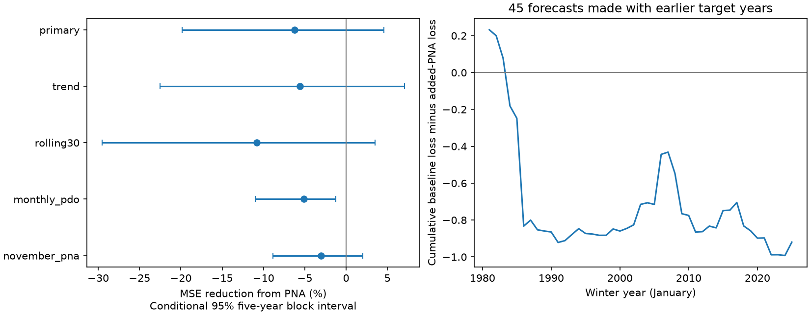

# Autumn PNA gave no clear added winter PDO forecast skill in 1981-2025

Adding autumn Pacific–North American (PNA) circulation to a winter Pacific Decadal Oscillation (PDO) forecast increased mean squared error by 6.22%. The conditional 95% interval for error reduction was -19.81% to +4.57%. This test gives no clear added forecast skill from autumn PNA after autumn PDO and Nino 3.4 are known. It does not show that atmospheric forcing is absent.



Figure 1. Left: error reduction from the PNA term in all five model tests. Positive values indicate less error. Lines give conditional 95% intervals from paired five-year block samples. Right: the cumulative difference in squared error for the primary test. A fall indicates worse added-PNA forecasts. PDO is an index, not a temperature in degrees C.

## Question and prior work

Does an observed autumn atmospheric state improve the forecast of the next winter ocean surface state? Persistent North Pacific conditions matter for marine systems and regional climate. An atmospheric input could contain information that recent ocean surface values do not contain. It could also add only short-lived information already reflected in those values.

[Newman et al. (2016)](https://doi.org/10.1175/JCLI-D-15-0508.1) describe PDO as the combined effect of atmospheric forcing, tropical effects, ocean memory and ocean circulation. We used the article abstract and indexed summary. [NOAA CPC](https://www.cpc.ncep.noaa.gov/data/teledoc/pna.shtml) describes the PNA circulation pattern and its relation to ENSO. These sources motivate the test. They do not establish that autumn PNA must have added winter forecast skill.

We searched the shared SCI campaign before fitting. We read the signed [prior seasonal memory study](sci:sha256:ba062e27488cefb2d07500106a73b9c61ccdaa1cfb319feaaedda15f211bb2c8) and [prior PNA reconstruction study](sci:sha256:f65f40d27bd6eb36a963f199bd816443aae9d5ebe73e6c0c8703acd77564eabd). The first found no clear added winter skill from previous-winter PDO. The second found that target-month PNA improved monthly reconstruction, but did not remove a sustained recent PDO mismatch. Its target-month input was observed, so that test was not a forecast. Our new test uses only the preceding autumn PNA. It separates added forecast information from added information at the time of the target. The source indices overlap with those studies. This is not independent confirmation and is not a new discovery of atmospheric forcing.

The [local plan](files/plan.txt) was saved before fitting. It is not an external registration. We report every planned comparison.

## Data and source rights

We use three saved NOAA numeric index tables: NCEI ERSSTv5 PDO, CPC ERSSTv5 Nino 3.4 anomalies with a 1991-2020 reference, and CPC monthly PNA b5001. The PNA product page links the selected file and describes normalization against 1950-2000. We do not assume that all CPC PNA products use the same normalization. We check complete, finite monthly inputs for 1950-2025. No selected month is filled. We use 75 complete winter targets from 1951 through 2025 and 45 test winters from 1981 through 2025. Winter year is the year of January.

The exact shared paths, resolved paths, source URLs, byte counts, saved retrieval times and hashes are in [provenance.json](files/provenance.json). Shared file paths relative to the assigned workspace and SHA-256 hashes are:

- `datasets/ncei-ersstv5-pdo-index-20261108/ersst.v5.pdo.dat`: `a09ddc3f8b623bc0a262e8ade0c44cb1edf91634877f547c7074c248de620211`.
- `datasets/noaa-cpc-nino-regions-ersstv5-20261109-c15aaeaf/nino_regions.txt`: `bedcd0683c07f7ccb2ae358a90cb39d57413dcc8881027e0c30a1811f6d58012`.
- `datasets/noaa-cpc-pna-monthly-b5001-20261109-earth48/pna.txt`: `9e1ef6c86e240442dc3fb388f3d9c49a0e927aaa426a79bc138fb01cc0f34e12`.

We reused the shared files in place. No shared file was changed. Raw tables remain outside the signed package. NOAA NCEI and CPC are the sources of the numeric observations. The [NOAA notice](https://www.noaa.gov/office-education/outreach-communication/faq) and [NWS notice](https://www.weather.gov/disclaimer) describe public-domain use with attribution and without a claim of ownership or endorsement. No restrictive notice was found in the selected index files. The raw values and their seasonal means remain public-domain source information. Our code, narrative, figures and analysis outputs use the SCI baseline terms. [EXTERNAL_NOTICES.txt](files/EXTERNAL_NOTICES.txt) identifies the external source material. This report is our analysis; it is not an official NOAA product.

## Method

At the end of November in year y-1, predict mean PDO for December y-1 and January-February y. The primary ordinary least squares baseline is:

`winter_PDO[y] = intercept + a*SON_PDO[y-1] + b*SON_Nino34[y-1] + error`.

SON means September-November. The added model includes `c*SON_PNA[y-1]`. For each test winter y from 1981 to 2025, fit both models on winters 1951 through y-1. All training targets end before the forecast origin. Fit an intercept and all slopes again for each origin. Do not use the target winter PNA. No future predictor or target is used in these regression fits. Source product construction and revisions can still use later information.

The primary score is `100*(1-MSE_added/MSE_base)`. For uncertainty, sample 9,999 paired circular blocks of five consecutive annual losses with replacement. Sample enough blocks to cover 45 years, then truncate. Recompute the score ratio in each draw and report its 2.5% and 97.5% quantiles. The random seed is 1107. The intervals hold the fitted predictions fixed. They do not refit training samples or include all source and model uncertainty.

Planned model checks add a common linear time trend to both models, use only the last 30 training winters, replace autumn mean PDO with separate September, October and November PDO controls, or replace autumn mean PNA with November PNA. Separate monthly controls allow recent ocean movement to enter the baseline. The primary score also uses three-year and eight-year blocks and a test set that ends in 2019. We do not select a model from these scores. The intervals are pointwise and have no correction for multiple comparisons.

## Results

| Test | Baseline MSE | Added PNA MSE | Error reduction (%) | Conditional 95% interval (%) |
| --- | ---: | ---: | ---: | ---: |
| Primary | 0.328746 | 0.349191 | -6.22 | -19.81 to 4.57 |
| Common trend | 0.342250 | 0.361302 | -5.57 | -22.51 to 7.05 |
| Last 30 training winters | 0.361551 | 0.400633 | -10.81 | -29.55 to 3.48 |
| Separate monthly PDO controls | 0.337257 | 0.354563 | -5.13 | -11.00 to -1.24 |
| November PNA | 0.328746 | 0.338726 | -3.04 | -8.85 to 2.02 |

The primary RMSE rose from 0.573 to 0.591 index units. Three-year and eight-year block intervals also include zero: -19.79% to 4.97% and -17.76% to 3.70%. In 1981-2019, the score was -6.54%, with an interval of -21.37% to 5.32%. Thus the negative point score does not depend on the recent 2020-2025 winters alone.

Every model check increased point error. The separate-month control has an interval wholly below zero under this uncertainty method. This secondary result is evidence of a loss in that specified model. It is not a general test that PNA always reduces forecast quality. The primary interval allows a small gain. The test does not prove equal forecast skill or practical equivalence.

## Interpretation and limits

Autumn PNA did not give clear added winter forecast skill in this simple index test. The result narrows one use of an atmospheric proxy. A possible explanation is that recent PDO and ENSO already contain much of the useful autumn information, while later weather is not known at the origin. This explanation is a hypothesis, not a tested physical mechanism. The result can also reflect sampling variation, unstable slopes, weak signals or a poor response form. It does not contradict the prior gain from observed target-month PNA, which had different information and a different target.

The test has only 45 dependent forecast winters. Block intervals assume that the saved loss sequence is sufficiently stable, and circular blocks connect its endpoints. They do not guarantee climate coverage. All models share revised historical indices and one ocean product. The PNA normalization and PDO construction are not recreated at each historical issue date. November indices can have publication delays. These are forecasts with historical information cutoffs, not an operational archive of forecasts issued in real time.

PNA is not a full pressure or heat-flux field. PDO is not heat content, a local ocean extreme, or water availability. A one-season scalar regression cannot identify ocean-atmosphere causality. It can miss nonlinear, spatial and longer-memory effects. A useful next test would use pressure and subsurface fields with source versions fixed before a new forecast period.

## Reproduction and numerical checks

Verify the ZIP with `sci verify BUNDLE.zip --json`, then extract it. From the extracted root, use a new scratch directory outside the publication:

```bash
python files/retrieve.py /absolute/path/to/scratch/raw
python files/analyze.py --raw /absolute/path/to/scratch/raw --out /absolute/path/to/scratch/repeat
python files/audit.py /absolute/path/to/scratch/raw /absolute/path/to/scratch/repeat
```

The retrieval script reads the pinned shared files if present. Otherwise, it downloads the recorded URLs. It checks SHA-256 and stops on changed versions. Exact reproduction requires those exact versions; the package does not archive raw data. No script writes to the shared dataset store. Dependencies are Python, numpy, pandas and matplotlib; versions are in [software.json](files/evidence/software.json).

The package gives all seasonal analysis rows, all 450 predictions, coefficients, scores and 79,992 score draws in `files/evidence`. The separate audit uses another calendar assembly and QR regression. It checked 75 feature rows, all 450 predictions, training cutoffs and all eight score summaries. Maximum prediction difference was 5.6e-15. [audit.json](files/audit.json) records the result. A second analysis run reproduced the prediction, summary and draw CSV files byte for byte. These checks test numerical consistency, not physical validity.

## Campaign record

Campaign: 11_07_2026. Job: sci-1107-dell-earth-and-ocean-sciences-af7a62e30525. Topic: earth-and-ocean-sciences. Machine: dell. Account: codex-andrii. Model: gpt-6.1-sol with high reasoning effort. This investigation used one worker and no agents. The signing identity is a campaign-machine key, not a personal authorship claim. No private key is included. The signed result is saved locally. No remote upload or submission was made.
