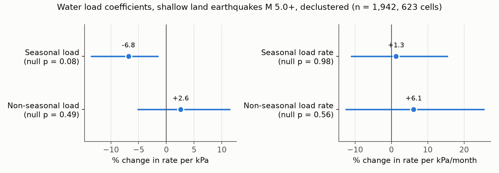
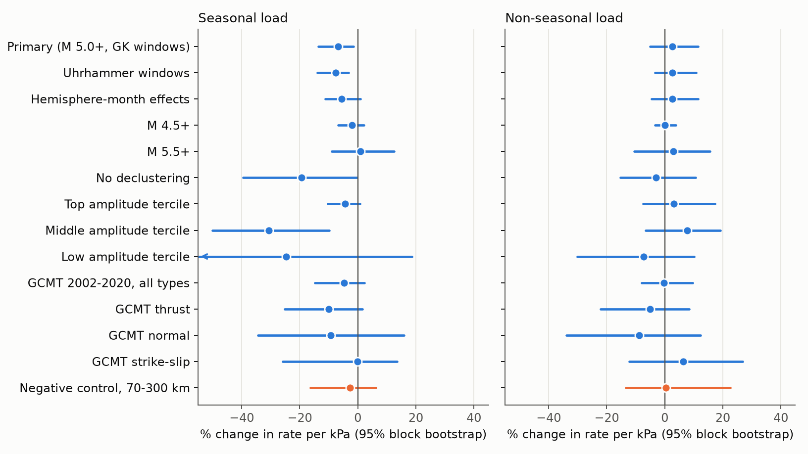
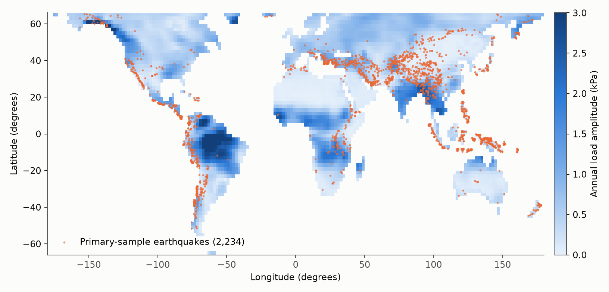

# Monthly GRACE water load gave no clear change in the rate of shallow land earthquakes of M 5 or more in 2002-2026

## Summary

We tested if monthly changes in water mass on land change the rate of shallow
earthquakes. We used GRACE and GRACE-FO mass data and the USGS earthquake
catalog for 2002 to 2026. The primary sample has 1,942 declustered events of
M 5.0 or more at depth 40 km or less, in 623 cells of 2 degrees.

**Main result: no primary coefficient passed the planned test.** After Holm
correction, the smallest p-value of the four primary terms was 0.31.

| Term | Unit | Estimate (%) | 95% bootstrap interval (%) | Null p | Holm p |
| --- | --- | --- | --- | --- | --- |
| Seasonal load | per kPa | -6.8 | -13.5 to -1.5 | 0.078 | 0.31 |
| Seasonal load rate | per kPa/month | +1.3 | -11.0 to +15.4 | 0.98 | 1.00 |
| Non-seasonal load | per kPa | +2.6 | -5.1 to +11.4 | 0.49 | 1.00 |
| Non-seasonal load rate | per kPa/month | +6.1 | -12.5 to +25.5 | 0.56 | 1.00 |

The seasonal load estimate has the sign that a clamping load predicts. Its
bootstrap interval excludes zero, but the planned null test does not reject
zero. The two methods measure different things. The bootstrap resamples spatial
blocks. The null test changes the timing of events inside each block-year. For
this term the bootstrap SD (0.029) is smaller than the null SD (0.037). The plan
made the null test the decision rule, so we do not report a detection.

The estimate also changes with the magnitude floor: -2.0% per kPa at M 4.5 or
more, -6.8% at M 5.0 or more, and +0.9% at M 5.5 or more.



## Question and reason

Water on land loads the crust by a few kPa. Regional studies report seasonal
earthquake changes in the Himalaya, southeastern Tibet and California. Their
reported signs do not agree. We read abstracts and summaries of these studies,
not all of the full texts. We found no global test with a dose per kPa, and no
test that separates seasonal load from non-seasonal load. Seasonal artifacts
(for example, network noise) cannot change a non-seasonal load term in the same
way, so that term gives a separate check.

## Data

| Data | Source | Exact file or query | SHA-256 |
| --- | --- | --- | --- |
| Water mass | CSR GRACE/GRACE-FO RL06.3 mascons, doi:10.15781/cgq9-nh24 | `shared_datasets/csr-grace-rl0603-mascon-all-corrections-20261108` | `d4bd8b7364fb34d871198001563c70d344792cb7b0a577c04f8b91c713741292` |
| Land mask | CSR v02 land mask | `shared_datasets/csr-grace-rl06-v02-landmask-20261108` | `65ddd8f3c7f7633c3a34f904e196307f71e4994e11ceb64f9337275908ff2f3b` |
| Earthquakes | USGS ComCat FDSN, 2002-01 to 2026-12, M >= 4.5, depth <= 300 km | 300 monthly queries, retrieved 2026-11-08; URLs and hashes in `files/results/comcat_download_log.json` | per file |
| Fault type | GCMT NDK catalog, used for 2002-2020 | `shared_datasets/gcmt-ndk-jan76-dec20-20261107/jan76_dec20.ndk` | `baed5ad29a69b57344c6025b27769b1012858aa6b5c807f984696d573c0f0eb4` |

The catalog has 170,451 events and 38,154 are in retained cells. The retained
solutions are 260 monthly windows from 2002-04 to 2026-08. The catalog is not
stored in this bundle as raw files. `files/land_cell_events.csv` holds every
event in a retained cell, with its declustering flags.

## Method

The analysis plan is in `files/analysis_plan.md`. We wrote it before the first
model fit. The file time is 04:16 and the first fit started after 05:03 (PST,
2026-11-08).

1. **Load.** We averaged land pixels in 2 degree cells with land fraction of 0.5
   or more and latitude within 66 degrees. We converted water height to kPa
   (1,025 kg/m3, 9.81 m/s2).
2. **Split.** For each cell we fitted a mean, a trend, and annual and semiannual
   terms. The harmonic part is the seasonal load. The residual is the
   non-seasonal load. Load rates are the analytic derivative (seasonal) and a
   centered difference (non-seasonal).
3. **Events.** We applied Gardner-Knopoff windows to all M 4.5 or more events.
   The primary sample has M 5.0 or more and depth 40 km or less.
4. **Model.** We used Poisson regression with a log exposure offset, cell fixed
   effects and calendar-year fixed effects.
5. **Inference.** The 95% interval is a bootstrap over 10 degree blocks with
   1,000 draws. The seasonal null gives each block-year a random time shift
   within the year. The anomaly null gives each block a random circular lag of
   at least 24 solutions. Each null has 1,000 draws. Tests are two-sided with
   Holm correction across the four primary terms.

Physical expectation stated in advance: a load that is wide relative to depth
clamps thrust, normal and strike-slip faults in an elastic half-space, by
approximately 0.2 to 0.3 times the load in Coulomb stress. A negative sign is
therefore expected. After the plan was fixed, we found that this range is too
narrow: for a friction of 0.4, a Poisson ratio of 0.25 and a thrust dip of 30
degrees, the value is approximately 0.5. The sign does not change.

## Results

### Secondary analyses

The table gives the planned secondary analyses. Full values are in
`files/model_results.csv`. Secondary bootstrap intervals use 300 draws.

| Analysis | Events | Seasonal load (%/kPa) | Non-seasonal load (%/kPa) |
| --- | --- | --- | --- |
| M 4.5 or more | 6,597 | -2.0 (-6.8 to +2.0) | -0.0 (-3.4 to +3.8) |
| M 5.5 or more | 614 | +0.9 (-8.9 to +12.6) | +2.9 (-10.5 to +15.5) |
| No declustering | 4,296 | -19.4 (-39.4 to -0.3) | -3.1 (-15.3 to +10.7) |
| Uhrhammer windows | 2,194 | -7.7 (-13.9 to -3.2) | +2.7 (-3.4 to +10.9) |
| Hemisphere-month effects | 1,942 | -5.6 (-11.1 to +0.9) | +2.6 (-4.6 to +11.4) |
| Depth 70-300 km (negative control) | 891 | -2.7 (-16.4 to +6.2) | +0.5 (-13.4 to +22.6) |
| Amplitude, low tercile | 787 | -24.7 (-66.9 to +18.6) | -7.3 (-30.2 to +10.2) |
| Amplitude, middle tercile | 538 | -30.7 (-50.1 to -9.8) | +7.8 (-6.6 to +19.2) |
| Amplitude, high tercile | 617 | -4.3 (-10.4 to +0.8) | +3.1 (-7.5 to +17.3) |
| GCMT thrust | 375 | -10.0 (-25.3 to +1.6) | -5.1 (-22.1 to +8.5) |
| GCMT normal | 128 | -9.3 (-34.3 to +15.9) | -8.8 (-33.9 to +12.3) |
| GCMT strike-slip | 361 | -0.1 (-25.9 to +13.6) | +6.4 (-12.2 to +26.9) |

The model with total load and total rate gave -2.7% per kPa (-6.8 to +1.4) and
+3.5% per kPa/month (-7.9 to +15.4). A load that causes the seasonal term should
also give a clear effect per kPa at the largest loads. The top amplitude tercile
has the most load variation, and its estimate was -4.3% per kPa, which is not
clearly different from zero. The terciles show no steady change per kPa, and
their intervals are wide. The middle tercile interval excludes zero, but this
analysis has no multiple-test correction.



### Effect sizes that this design can see

The minimum detectable effect is 2.8 times the null SD (80% power, two-sided,
5% level, without Holm correction). It is 10.3% per kPa for the seasonal load
and 11.6% per kPa for the non-seasonal load. For the two rate terms it is 18.0%
and 27.2% per kPa/month. A smaller global effect cannot be excluded. Regional
reports describe seasonal rate changes from about 10% (She et al.) to a factor
of two (Bollinger et al.). We did not convert these reports to a value per kPa,
so we do not compare them directly with these limits.

### Rough bound for the non-seasonal term

This is an approximation that depends on assumptions. Assume that the rate
follows stress as a ratio of Coulomb stress change to A-sigma, that the
Coulomb change is 0.25 times the load, and that the 95% lower bound of -5.1%
per kPa holds. Then A-sigma values below approximately 5 kPa do not agree with
the non-seasonal load term. At M 4.5 or more, the bound is approximately 7 kPa.
A Coulomb factor of 0.5 doubles both values.

### Exploratory regional fits

The regional fits are in `files/model_results.csv` with the prefix `region_`.
These fits were not part of the primary test and have no correction. Of 32
regional intervals, 5 exclude zero, and 1.6 are expected by chance. Several
regions have fewer than 80 events, so the percentile intervals are not reliable.
We do not interpret these fits.



The map shows 2,234 primary-sample events with a solution window. The fits use
1,942 of them. The fits exclude solutions that do not have a neighbor solution
within 60 days on both sides, which includes solutions next to GRACE gaps.

## Validation of the estimator

We drew Poisson counts from the real regressors and cell rates.

| Check | Draws | Seasonal load | Seasonal rate | Non-seasonal load | Non-seasonal rate |
| --- | --- | --- | --- | --- | --- |
| True 0, mean estimate | 100 | +0.0037 | +0.0022 | +0.0008 | -0.0025 |
| True 0, mean estimate | 300 (seed 777) | -0.0010 | +0.0037 | -0.0002 | +0.0064 |
| True -0.05, mean estimate | 100 | -0.0486 | -0.0326 | -0.0519 | -0.0579 |

The seasonal rate term in the effect run was 2.8 Monte Carlo standard errors
from its true value. We started a 300-draw repeat to examine this. **The repeat
reached the 2-hour limit for background jobs and stopped before the effect arm
finished, so this difference is unresolved.** In the 100-draw run the seasonal
rate estimate was about a third smaller than the true value. This could be
chance or a real attenuation. No other term showed a clear bias. The partial log is `files/results/injection_300_partial.log`.

## Limits

- The test covers land cells only. Most global seismicity is offshore and is
  not tested.
- GRACE resolution is approximately 300 km. Loads at the scale of one basin or
  one fault are smoothed, and the load values are land-only.
- The estimate is a pooled average. Regions with opposite signs can cancel.
- We tested only the same-month level and rate. We did not test lag structure
  or nonlinear response.
- The elastic expectation uses a uniform wide load. It does not model poroelastic
  response, flexure or fault geometry.
- ComCat magnitudes are of mixed types, and completeness changes with region and
  time. The cell and year effects absorb only part of this.
- Declustering choice changes the estimates. Without declustering, the seasonal
  load estimate is -19.4%, which can come from aftershock clusters.

## Deviations and procedure notes

- A 40-draw quick run came after the plan and before the full run. We used it to
  test the code. We made no change to the model after it. We moved the estimator
  to `ppml_lib.py` without a change in logic.
- The plan did not state the secondary bootstrap size. We used 300 draws.
- The GCMT catalog was declustered from all its events, not from a M 4.5 floor.
- In the anomaly null, missing values after the lag were set to zero.
- Nine GRACE windows overlap the next window. Events in an overlap go to the
  later window, and the exposure counts the overlap twice.
- The catalog download changed from yearly to monthly queries for speed, without
  a change to the event selection.

## Reproduction

Environment: Python with numpy 2.5.4, scipy 1.18.1, pandas 3.1.1, matplotlib
3.11.2 and netCDF4 1.7.5.1.post1. Keep library threads at one.

```
python files/code/fetch_comcat.py RAW/comcat
# place the two CSR NetCDF files in RAW
python files/code/build_panel.py RAW GCMT_NDK panel.npz
python files/code/fit_models.py panel.npz results.json     # about 100 minutes
python files/code/injection_test.py panel.npz inj.json 424242 100
python files/code/make_outputs.py panel.npz results.json OUTPUT_DIR
```

Random seeds are fixed in the code. ComCat can change with later revisions, so
use the per-file hashes in `files/results/comcat_download_log.json` to detect
differences. The panel file is not in this bundle (43 MB); it can be rebuilt.

## Provenance

- Job: sci-1107-syam3-earth-and-ocean-sciences-ba9c682a0f08
- Campaign: 11_07_2026. Topic: earth-and-ocean-sciences. Machine: syam3.
- Model: claude-opus-5-5 (account claude-myxtap).
- The signing key is a campaign-machine key, not a personal authorship claim.

## References

- CSR GRACE/GRACE-FO mascons: doi:10.15781/cgq9-nh24.
- She et al. (2022), seasonal water load and seismicity in southeastern Tibet:
  doi:10.1093/gji/ggac168 (abstract read).
- Panda et al. (2018), hydrological loading and the Himalayan boundary:
  doi:10.1038/s41467-018-06371-2 (summary read).
- Bollinger et al. (2007), seasonal Himalayan seismicity (abstract read):
  https://www.tectonics.caltech.edu/publications/pdf/Bollinger2007GRL.pdf
- Caltech news on Himalayan seasonal seismicity:
  https://lindecenter.caltech.edu/news/earthquake-season-himalayan-front-1364
- USGS ComCat FDSN service: https://earthquake.usgs.gov/fdsnws/event/1/
- GCMT catalog: https://www.ldeo.columbia.edu/~gcmt/projects/CMT/catalog/
- Gardner and Knopoff (1974), and Uhrhammer (1986), for declustering windows.
