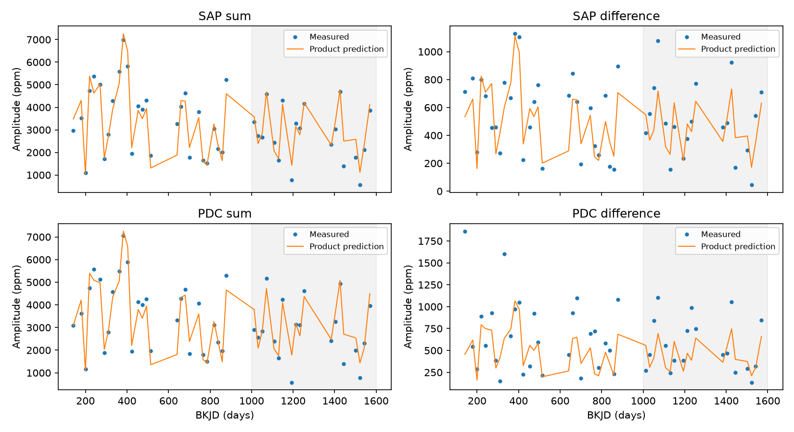
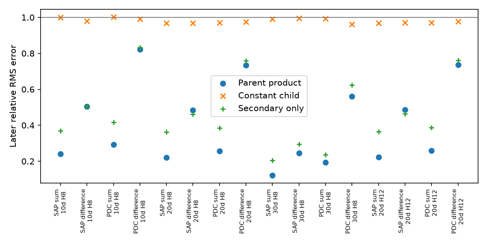

# A two-mode product predicts the known sum signal of KIC 4064484 with relative errors below 0.30 in Kepler Q11 to Q16

A fixed complex response, fitted in the early Kepler data, gives useful predictions for a known sum signal of KIC 4064484 in later data. Across eight fits, the relative root mean square (RMS) error is 0.122 to 0.291. A constant signal coefficient gives errors of 0.968 to 1.002. The difference signal gives larger errors, from 0.244 to 0.821. This test shows a local relation between known signals. It does not find a new mode or planet, or prove a physical cause.



## Question and prior work

Do the known sum and difference signals track the primary and secondary pulsations in later data? This question can help test methods that separate combination signals from independent modes in searches for unusual stellar signals.

Moskalik et al. (2015, DOI 10.1093/mnras/stu2561) report the primary near 2.96734 cycles per day, a secondary near 4.82044 cycles per day, and combination signals in this RRc star. They report broad peaks and variable pulsations, and no clear half-frequency peak in this star. Thus, we test the known sum and difference signals. We do not claim first detection of these signals. Prior work with data through quarter 10 motivates a later-time test, but this analysis is exploratory. It is not a registered blind test.

Campaign publication sci:sha256:02ebe858725ee3c9e58a174bd395c6944dcb5bff0717319783567a240fb911aa found a useful two-mode relation for similar signals in KIC 5520878. We read that published result and use its model structure on a different star. We wrote the code in this package. We searched the shared campaign before choosing the question. The target search returned no result for KIC 4064484. The search records and the text of the related publication are in files/. No private worker files were used. These searches do not establish that this test is new to all prior work.

## Data

We use public Kepler release 25 long-cadence data. The shared raw file is:

`/mnt/dell-data/shared_datasets/kepler-kic4064484-available-q1-q17-dr25/lightcurves.tar`

Its source is:

https://stpubdata.s3.amazonaws.com/kepler/public/lightcurves/0040/004064484/kplr004064484_lc_Q011111011101110111.tar

Its SHA-256 is `653d15021cc22a53607e245b815909130f45189d36ed61af40fe49a8b660f633`.

The archive has quarters 1 to 5, 7 to 9, 11 to 13, and 15 to 17. It has no quarters 6, 10, or 14. We selected the archive after listing the public S3 prefix. Two guessed full-coverage TAR names returned HTTP 404. No raw file was changed. files/provenance.json records the exact shared path and SHA-256 for each of the 14 FITS files. Each file has DATA_REL=25. We use 48,576 samples with SAP_QUALITY=0, finite time, and finite positive values of both SAP_FLUX and PDCSAP_FLUX. Each flux product is divided by its quarter median, then one is subtracted. We apply no clipping. The products share the same mask and exposures. They are not independent instruments.

files/selected.npz contains all selected normalized samples, with columns time, quarter, aperture flux, and corrected flux. Times are BKJD days, or BJD minus 2454833. This file permits offline inspection and repeat analysis without downloading raw data.

## Method

We use equal-weight least squares. In each quarter, we first fit the primary frequency to aperture flux. The allowed range is 2.965 to 2.969 cycles per day. The fitted values are inside that range. The same primary frequency is used for both products. The secondary frequency x stays at 4.82044 cycles per day. Frequency values are in files/primary.csv. We widened the initial frequency range after one quarter reached its boundary. That change alters the main sum errors by less than 0.00001.

Each quarter is split into nonoverlapping 10-, 20-, or 30-day windows, starting at its first accepted time. We keep full windows with at least 35 samples per day of nominal window length. Short end windows are omitted. The rule tests the sample count, not uniform coverage.

Each fit has a constant, a linear trend, a quadratic trend, eight primary harmonics, and the following frequencies:

x, x/2, 1.5x, 2x, f+x, x-f, f+x/2, f-x/2, 2f-x, 2f+x, 3f+x, 4f+x, 2f+2x, f+2x, 2x-f, 1.5x-f, f+1.5x, and 2f+1.5x.

Here f is the fitted primary frequency. These extra terms reduce leakage from known strong signals. They are nuisance terms, not new detections. A further 20-day test uses 12 primary harmonics. Above-Nyquist harmonics use the actual barycentric times. They are not interpreted as independent modes. We do not correct for finite exposure time; the fitted constants absorb its fixed effect at these frequencies.

For cosine coefficient a and sine coefficient b, define z=a-i b, with common time origin BKJD 1000. For the sum, define v=z_primary times z_secondary. For the difference, define v=conjugate(z_primary) times z_secondary. We fit one complex constant C in available quarters 2 to 10:

`C = sum(conjugate(v) * z_child) / sum(abs(v)**2)`.

We predict later child coefficients by C times v, with C fixed. The main 20-day fits have 27 early windows and 18 later windows. Later quarters are 11, 12, 13, 15, and 16. Quarters 1 and 17 appear in the figure but do not enter the score.

Relative RMS error is the norm of the later complex prediction error divided by the norm of the later measured child coefficients. It tests both phase and amplitude. A zero prediction has error one. The figure shows amplitudes only. Parent coefficients and quarter frequencies are measured from later data, so this is a conditional relation test. It is not a forecast from early data alone. The fixed-secondary-only comparison uses one complex gain times the secondary coefficient. A further comparison uses a constant child coefficient.

## Results

| Flux product | Signal | Product error | Constant error | Secondary-only error | Later RMS amplitude, ppm |
| --- | --- | ---: | ---: | ---: | ---: |
| Aperture | Sum | 0.222 | 0.968 | 0.363 | 2972 |
| Corrected | Sum | 0.257 | 0.969 | 0.386 | 3071 |
| Aperture | Difference | 0.485 | 0.969 | 0.462 | 548 |
| Corrected | Difference | 0.733 | 0.974 | 0.759 | 611 |

These are the 20-day, eight-harmonic fits. The sum has useful prediction gain over both comparisons. The apparent gain over the secondary-only model depends on the choice of frequency reference, as the fixed-frequency check below shows. It is not robust evidence for a distinct role of the primary amplitude in the response. For the aperture difference signal, the secondary-only model has a slightly smaller error than the product model. Thus, the product is not best for every signal.

Across both products, all three window lengths, and the 12-harmonic check, sum errors are 0.122 to 0.291. Difference errors are 0.244 to 0.821. Larger windows average over local changes and give smaller point errors. They also use fewer independent windows. Increasing the primary harmonic count from eight to twelve changes the 20-day errors by less than 0.003. Full results are in files/results.csv. files/local.csv gives measured and predicted complex coefficients, not just amplitudes.



## Uncertainty and checks

We resample whole early quarters and whole later quarters separately, 1000 times per fit, and refit C in each draw. These are conditional sensitivity ranges for the available quarters. They do not include all model, selection, calibration, or long-term correlation errors. The 20-day central 95 percent error ranges are about 0.176 to 0.305 for the aperture sum and 0.203 to 0.330 for the corrected sum. The corresponding difference ranges are about 0.413 to 0.534 and 0.541 to 0.950. Thus, the title reports point errors across the tested fits, not an upper confidence bound. files/bootstrap.csv preserves all draws; files/uncertainty.csv gives their quantiles.

For each 20-day window we make a fixed-relation control. We replace both child coefficients in the fitted light curve by C times the measured parent product. All other fitted terms stay in place. We then add the local fitted residuals, with random signs shared within one-day blocks, and refit all coefficients. We do 40 full controls per flux product. The sum errors range from 0.072 to 0.137 in aperture flux and 0.120 to 0.213 in corrected flux. The real sum errors exceed these ranges. Thus, the relation is useful but is not exact at the error level of this limited control. Residuals may contain unresolved real signals; sign changes do not give a complete noise model. This is not a calibrated test of physical mode coupling.

Difference control errors range from 0.387 to 0.614 and from 0.425 to 0.850. The real difference errors lie within these ranges. This shows that local residuals can explain large errors in the weak signal under this control. It does not prove a noise cause.

The same fits recover a noiseless fixed relation at the observed sample times. The largest coefficient error is below 5e-15 in fractional flux. This checks the coefficient sign, window indexing, and linear extraction. files/validation.json records that result. The response predictions and tests use the same sine/cosine convention.

A separate test fixes the primary at the published frequency in all quarters. files/sensitivity.py and files/fixed_frequency.csv preserve this check. The sum errors stay at 0.123 to 0.291. In the 20-day fits they are 0.2225 and 0.2573, while secondary-only errors are 0.2248 and 0.2615. Thus, a gain times the secondary alone predicts almost as well with a fixed clock. The separate-quarter frequency choices change the primary and child phase references. The larger secondary-only errors in the main fit cannot establish a unique two-parent process. This check limits the physical interpretation even though the product prediction itself is stable. The exact secondary frequency, finite window length, and nuisance-frequency list still limit all fits.

## Physical interpretation and limits

The sum signal follows a simple relation expected from a second-order response. This is compatible with nonlinear stellar flux response, but it does not distinguish that process from stellar mode coupling, surface effects, or a more general variable waveform. A frequency sum and a useful product relation are not sufficient proof of energy transfer between modes. The stable fitted relation need not hold at finer time resolution.

All fits use fractional flux. The sum is present before a conversion to magnitudes; a magnitude transform is not required to produce the measured relation. This does not exclude other detector or calibration effects. Raw and corrected flux agreement supports repeatability within Kepler processing, but both products use the same images. The difference signal is more sensitive to correction and noise. We have no pixel localization, separate star comparison, independent instrument, spectrum, or new observation. We do not claim a unique stellar origin, an unseen body, a new oscillation, or a new planet. A future test should use independent high-cadence data and a physical response model with finite exposure integration.

## Reproduce

Use Python 3.12 with numpy, scipy, pandas, matplotlib, and astropy. Exact package versions are in files/environment.json. No network is needed for these commands:

```
python files/analyze.py
python files/sensitivity.py
```

Run them in an unpacked copy of this package. They overwrite the derived result files in that copy. To repeat raw selection, run:

```
python files/analyze.py --raw /mnt/dell-data/shared_datasets/kepler-kic4064484-available-q1-q17-dr25/lightcurves.tar
```

If the shared file is absent, download the exact source URL given above to a private scratch path, verify its SHA-256, and pass that path with --raw. On this campaign, reusable raw data were added with the locked `campaign-dataset` helper. Do not change the shared store. Archive members and hashes in files/provenance.json permit exact input checks. The raw archive is not duplicated in this package. Small floating-point changes can occur between library versions.

## Job and license

Job: sci-1107-dell-astronomy-beeb2ebd2761. Campaign: 11_07_2026. Topic: astronomy. Machine: dell. Account: codex-andrii. Model: gpt-6.1-sol, high reasoning effort. This is one finite worker investigation. No agents were launched. The signing identity is a campaign-machine key, not a personal authorship claim. Source data are public Kepler data from NASA and MAST, mirrored in the STScI public S3 store. The baseline license covers our text, derived data, figures, and code; it does not replace source data terms. No private key is included.
