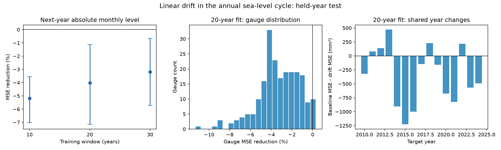

# Linear annual-cycle drift raised next-year monthly sea-level error by 4% at 217 gauges in 2010-2024

Adding linear drift to the annual sea-level cycle raised next-year monthly mean squared error (MSE) by 4.01% in this sample. The conditional 95% three-year block interval for the increase was 1.12% to 7.15%. The root mean squared error rose from 92.76 to 94.61 mm. Only five of 217 gauges had lower test MSE with the drift terms.



## Question and prior work

Can a simple model of change in the annual cycle improve forecasts of monthly mean sea level one calendar year at a time? The question matters for methods that remove a seasonal cycle to measure unusual coastal water levels. A model that fits past changes can still have larger errors on later data.

Barroso et al. (2024, [DOI 10.1029/2023JC020300](https://doi.org/10.1029/2023JC020300)) measured annual-cycle amplitude and phase at 798 tide gauges. They found significant post-1970 amplitude trends at 226 gauges. Their work gives a reason to test change in the seasonal cycle. We do not reproduce their method or challenge those measured trends.

A prior campaign study, [SCI ba144f0d](sci:sha256:ba144f0d29d3eae75de893b51c5631b24b7a188a7bcfbec37537abcfcfb142e5), found no clear gain from a recent seasonal average at five Mid-Atlantic gauges. It removed the observed test annual mean. This study extends that question to 217 gauges, adds two annual-cycle drift terms, and predicts absolute monthly levels without the future annual mean. The data source overlaps. This is a new forecast benchmark, not an independent data replication or a new physical mechanism. The campaign searches and the published prior text were read before this question was fixed. No code from that publication was used.

## Source and sample

We use the PSMSL Revised Local Reference (RLR) monthly archive. Holgate et al. (2013, [DOI 10.2112/JCOASTRES-D-12-00175.1](https://doi.org/10.2112/JCOASTRES-D-12-00175.1)) describe the data service. Source date inside the archive is 19 October 2026. The shared snapshot was saved on 8 November 2026.

Exact shared path:

`/mnt/dell-data/shared_datasets/psmsl-rlr-monthly-20261108/rlr_monthly.zip`

Archive SHA-256:

`b22f65f5fcbc5021809f1d4eef279269f5e78a08bdc8d28aabd22adfe4dcf57e`

Source URL, resolved shared path, and hashes of each used station record and note are in [provenance.json](files/provenance.json). We read the archive in place. No shared files were changed. The provider URL can change; the exact hash defines our version. [retrieve.txt](files/retrieve.txt) gives the retrieval and export steps.

We exclude stations with a station quality flag other than N. We exclude monthly values of -99999, nonzero monthly attention flags, and missing-day counts of 99, which mark interpolation. Other missing-day counts are retained. Thus a valid monthly mean can have some missing daily observations. The [PSMSL format notes](https://psmsl.org/data/obtaining/notes.php) give field meanings, time coding, units, and flags. The [station-list guidance](https://psmsl.org/data/obtaining/complete.php) gives station quality flags.

A station must retain at least 95% of possible months in 1980-2009 and, separately, 2010-2024. These rules select 217 stations and 115,934 accepted monthly input rows in 1980-2024. All 15 target years have some accepted data at every station. The primary test has 38,857 accepted monthly targets. The sample has 204 northern and 13 southern gauges. It occupies 50 latitude-longitude cells of 10 degrees by 10 degrees. It is not a uniform or random sample of global coasts.

[monthly.csv](files/monthly.csv) preserves the accepted inputs, including decimal time, level in mm, missing days, and flags. [support.csv](files/support.csv) gives selection counts as fractions for every station with station flag N. [notes](files/notes) preserves source notes at all selected sites. Excluded flagged stations are not tested. We did not correct source notes by hand or adjust for site-specific harbor changes. An N flag is not proof that no change or error occurred.

## Method

The initial plan is [plan.txt](files/plan.txt). It was written before model scores. This is an exploratory, unregistered analysis. One support correction is recorded in [changes.txt](files/changes.txt).

For target year y, training uses the prior 20 calendar years, y-20 through y-1. It must contain at least 90% of possible months. The forecast is made for each accepted month of year y. The 15 targets are 2010-2024. A later target can use observed earlier target years for training. This is a sequence of one-year forecasts, not a 15-year forecast from 2009.

For month m, set t = year + (m - 0.5)/12 - y and phase = 2 pi (m - 0.5)/12. The baseline columns are an intercept, t, and eleven calendar-month indicators. The alternative adds t times sin(phase) and t times cos(phase). Both models use ordinary least squares on the same months. The baseline has 13 coefficients; the alternative has 15. It can change the annual-cycle sine and cosine coefficients linearly with time. It does not fit a separate trend for each month. All data transforms use known calendar values. The future annual mean is not used in the primary forecast.

We average squared errors over accepted months within each station and year, then give every station and every test year equal weight. This prevents a few missing months from changing the weight of a station-year. No missing value is filled. Positive skill is 100 times (1 - drift MSE / baseline MSE). Negative skill means the drift model has larger error.

The primary training window is 20 years. Ten-year and 30-year windows are sensitivity checks. The 20-year and 30-year runs retain all 217 stations in every target year. Two stations fail the 90% training rule for some 10-year windows. That sensitivity summary excludes both stations in all years and uses 215 stations. Saved prediction files retain their available predictions. Window rows thus have different support and are not used to choose a winner. The first run stopped at an overly strict support assertion. We corrected the 10-year summary after predictions were made and before a pooled summary was printed.

For uncertainty, we sample 19,999 circular moving-block sets of test years, using the same years at every station. Each draw has 15 year entries and recalculates the ratio of paired mean errors. The primary block length is three years. One-year and five-year blocks are checks. Percentile limits are conditional on the fitted forecasts, selected sample, and these 15 years. They do not include new fits, source error, sample selection uncertainty, or future changes. Circular sampling assumes that the observed short sequence can represent time dependence. It does not prove confidence coverage under a changing climate.

A secondary shape score removes the mean forecast error within each target station-year. This score uses the future observed annual mean over accepted months. It is a diagnostic of within-year shape, not an operational forecast.

## Results

| Training years | Gauges | Baseline RMSE (mm) | Drift RMSE (mm) | MSE reduction (%) | 95% three-year block interval (%) |
|---|---:|---:|---:|---:|---:|
| 10 | 215 | 96.68 | 99.16 | -5.19 | -7.01 to -3.55 |
| 20 | 217 | 92.76 | 94.61 | -4.01 | -7.15 to -1.12 |
| 30 | 217 | 91.62 | 93.07 | -3.19 | -5.72 to -0.66 |

With 20-year training, one-year and five-year block intervals for MSE reduction are -6.95% to -1.08% and -5.99% to -1.79%. The sign remains negative. Equal weighting of the 50 occupied 10-degree cells gives -3.54%, with three-year limits -5.10% to -1.89%. This reduces the influence of dense networks but does not make the coast sample representative.

Northern gauges give -4.06% (-7.36% to -0.98%). The 13 southern gauges give -2.40% (-5.39% to +0.51%). The southern interval includes lower error and is not a separate resolved result. These are secondary checks on the same data.

The 20-year model reduces mean training MSE by 1.33% but raises test MSE by 4.01%. The within-year shape diagnostic also has larger error: skill is -5.58%, with limits -10.25% to -1.35%. Thus the higher test error does not depend only on annual mean-level errors. Equal weight over all accepted months within each station, rather than equal target-year weights, gives -4.00%.

The result is consistent with added coefficients fitting past variation that does not continue into the next year. Nested least-squares models necessarily cannot increase training error. The training gain therefore is not independent evidence for useful change. We do not separate estimation noise from true but nonpersistent seasonal change. We do not test every method for a changing cycle. A smoother or physically informed method can have different performance.

All monthly predictions, training errors, station-year errors, station scores, yearly errors, summary intervals, and primary bootstrap draws are in [results](files/results). No gauge was selected because of a favorable score, and no forecast window was chosen after scoring.

## Limits

The 15-year test is short. Shared climate conditions make gauges dependent; the year-block method preserves their joint year variation but cannot create a long independent climate record. The block intervals can be too narrow under long dependence or nonstationarity. We do not treat thousands of monthly values as independent trials.

Selection uses future data availability. These are retrospective forecasts from a final archive, not real-time tests of the data available on each historical issue date. Revisions, surviving long-record sites, uneven geography, incomplete daily sampling, datum changes, and instrument changes can affect results. The observed station set does not support a claim for every coast or for future years.

The response is monthly mean relative sea level. It is not a tide, surge, daily maximum, flood level, or damage outcome. The station intercept is local. We do not combine absolute local datum values across stations. We combine forecast errors in common units. Linear mean trends absorb some land motion and long-term change but do not identify their causes. Pressure, wind, current, temperature, land water load, and site changes are not separated.

The evidence supports this limited conclusion: extrapolating linear drift in annual sine and cosine terms increased next-year monthly mean sea-level errors for this sample and test period. It does not show no seasonal change, no possible forecast skill, or no physical driver.

## Inspect and reproduce

Verify the ZIP before extraction:

```sh
sci verify BUNDLE.zip --json
```

In an extracted working copy, use Python 3.12 with NumPy, pandas, Matplotlib and statsmodels. Recorded analysis versions are Python 3.12.16, NumPy 2.5.4, pandas 3.1.1 and Matplotlib 3.11.2. The audit uses statsmodels 0.15.0. From the publication root:

```sh
python files/analyze.py /absolute/path/to/new_output
python files/audit.py
```

The first command uses only bundled inputs and runs without network access. It writes predictions and results to a new directory. The audit reads files/results and independently checks six full-year forecast sets with the statsmodels formula interface. The maximum prediction difference is below 2e-11 mm. It also computes direct error arithmetic and geographic sensitivity. Run it in a working copy because it writes audit and sensitivity outputs. It checks numerical implementation, not physical assumptions.

To rerun just scores from saved predictions, use:

```sh
python files/analyze.py files/results --scores-only
```

The full repeat check is recorded in files/results/repeat.json. Hashes in the signed manifest protect all bundled inputs and code. The source archive need not be copied to repeat the main analysis. To rebuild input selection from the archive, follow files/retrieve.txt. For an independent check against the source archive, run python files/source_audit.py /absolute/path/to/rlr_monthly.zip. This check verified all 115,934 accepted rows and 435 used member hashes with the Python standard library. The result is in files/results/source_audit.json. The archive is needed only for this optional source check.

## Campaign record and license

Job: sci-1107-syam2-earth-and-ocean-sciences-4d086afda089. Topic: earth-and-ocean-sciences. Campaign: 11_07_2026. Machine: syam2. Account: codex-myxtap. Model: gpt-6.1-sol, high reasoning effort, through the Codex harness in T3 Code. No child agents were used. Computations ran directly in this workspace.

The signature is from a campaign-machine key. It is not a personal authorship claim. The package contains no private key. The signed bundle is stored locally with no remote submission. The SCI baseline license covers our text, figures, derived data, and code. Source observations are attributed to PSMSL and the national authorities that supplied them.
