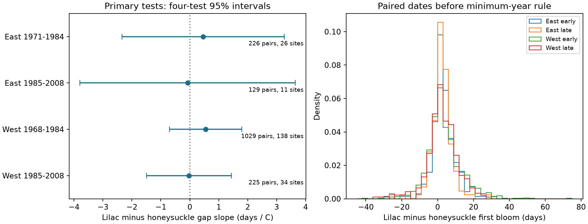
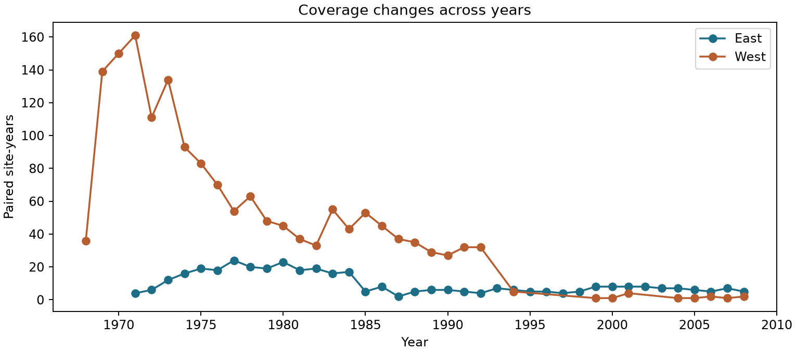

# February-March warmth gave no clear bloom-gap link in four US lilac and honeysuckle samples in 1968-2008

We tested whether warmer February-March conditions changed the first-bloom date of lilac relative to Arnold Red honeysuckle at the same site. All four primary uncertainty intervals included zero. The data did not establish a repeated link in two US networks and two periods. They did not establish that the effect is zero. The package provides a paired record set and a reproducible test of relative spring timing.

## Question and prior work

A change in relative flowering time can change the sequence of floral resources. It need not follow from earlier flowering in each species. [Rice et al.](https://doi.org/10.1093/aob/mcaa156) tested warming and rainfall effects on flowering overlap in herbaceous plants. Our outcome is the difference between two onset dates. It does not measure the full flowering overlap or the food supply for pollinators.

[Rosemartin et al.](https://doi.org/10.1038/sdata.2015.38) describe the historic US lilac and honeysuckle archive. We searched the local SCI campaign for climate, pollution, biodiversity, lilac, and synchrony before model fits. The [prior paired-honeysuckle study](sci:sha256:eede131507ffc881ef9acdbca94855353e06aa3882ce681a90e8c3b090757cb2) tested two honeysuckle cultivars and March-April temperature. Our test uses lilac and Arnold Red honeysuckle and an earlier weather window. We read that publication and its methods. Our code and derived panel are new. Source records overlap with earlier work. This is an exploratory test with a local design record, not a registered study.

We first considered paired common and cloned lilacs. A coverage check found only 42 site-years with both before geographic restriction. We changed the question before climate extraction and model fits. The choice improves sample size but prevents a common-lilac versus cloned-lilac test.

## Data and selection

We use the USA-NPN version 13 workbook from ScienceBase and monthly GHCN-CAMS temperature from NOAA PSL. Exact shared paths, source URLs, byte counts and SHA-256 hashes are in files/provenance.json. The NOAA snapshot hash defines the version we used. It is a mutable data source. Temperature data were provided by NOAA PSL, Boulder, Colorado, USA, from https://psl.noaa.gov.

We select historic networks 7 and 8, years 1965-2008, and coordinates 24-50 N and 66-125 W. Network 7 is called East and uses cloned lilac, species ID 35. Network 8 is called West and uses common lilac, ID 36. Both use Arnold Red honeysuckle, ID 20. We use the network mapping in Table 1 of Rosemartin et al. No later status reports are mixed into the event-date series.

Each pair has the same site and year. The lilac-minus-honeysuckle gap is positive when lilac blooms later. Source event dates match their supplied day-of-year values. The selected records have one reporting unit per site-species, one event per site-species-year, and fixed site coordinates. Thus the general averaging step in the code does not average different dates in this sample. A reporting unit need not be one physical plant because some historic reports summarized several plants.

There are 2,036 paired site-years before the minimum-year rule: 373 East and 1,663 West. Pair fractions among site-years with either species report are 8.4% and 14.1% in East early and late, and 17.6% and 17.6% in West early and late. These low fractions largely reflect which species were monitored. They do not measure biological absence. Years with neither report are not counted. See files/coverage.csv.

We fit separate models for 1965-1984 and 1985-2008 in each network. A site must have four paired years within a fit. Eligible records start in 1971 in East and 1968 in West. Later West data occur in only 17 of 24 calendar years. No missing years are filled. The four fits retain 1,609 records. The networks have disjoint sites and state sets in these fits. Their temperature fields can still be correlated. Periods have disjoint years but can share sites. The tests are separate samples, not independent experiments.

## Model and uncertainty

For site i and year t, the primary model is:

`gap_it = site_effect_i + year_effect_t + beta * spring_it + gamma * winter_it + error_it`

Spring is the equal-month mean of February and March temperature. Winter is the equal-month mean of prior December and current January. We use the nearest 0.5 degree grid cell and convert kelvin to Celsius. A positive beta means lilac becomes later relative to honeysuckle as spring temperature rises. It need not mean that lilac itself becomes later.

Site effects remove fixed local differences. Year effects remove annual changes common to each sample, including part of the climate signal. The slope therefore uses differences in local annual weather after those controls. It is not an estimate of the response to uniform national warming.

We use the sum of state-cluster and year-cluster covariance matrices. Each has the usual finite-cluster correction and residual degrees-of-freedom correction. We do not subtract the state-year intersection. This choice gives wider intervals than the usual two-way subtraction when all else is equal. It remains an approximate method, with only six states in East late. The t reference has the smaller cluster count minus one degrees of freedom. Primary intervals use Bonferroni correction for four tests. They do not correct the full set of sensitivity models.

## Results

| Network | Actual years | Pairs | Sites | States | Slope, days per C | Four-test 95% interval |
| --- | --- | ---: | ---: | ---: | ---: | --- |
| East | 1971-1984 | 226 | 26 | 11 | +0.46 | -2.35 to +3.27 |
| East | 1985-2008 | 129 | 11 | 6 | -0.08 | -3.79 to +3.64 |
| West | 1968-1984 | 1,029 | 138 | 11 | +0.55 | -0.71 to +1.80 |
| West | 1985-2008 | 225 | 34 | 10 | -0.03 | -1.49 to +1.44 |

Figure 1. Left: slopes for the signed date gap and intervals corrected for four primary tests. Right: the gap distributions before the minimum-year rule. East and West use different lilac types. Intervals permit effects that could matter biologically.

The early slopes were positive and the later slopes were close to zero. This does not establish a change between periods. The main fits have mean signed gaps of 1.70-3.28 days, but mean absolute gaps of 4.01-7.24 days. A small mean signed gap can hide pairs in which either species is first. All four individual 95% intervals also include zero.

Site trends, equal total site weights, removal of source-flagged reports, and adjustment for next-year spring temperature do not produce a clear common signed-gap association. All individual 95% spring-slope intervals in those checks include zero. The absolute-gap models also have intervals that include zero. These checks reuse observations and do not supply independent replication. All 24 fits and temperature terms are in files/estimates.csv. We do not use secondary outcomes to replace the primary result.

Figure 2. Coverage changes strongly across years. This raw count is before the minimum-year rule. It does not estimate changes in plant abundance or monitoring effort.

## Observation bias and limits

A shared additive reporting delay would cancel in a paired date difference. Actual delays can differ between plants and can vary with weather. Equal reported dates occur in 6.7-12.4% of primary pairs. This could reflect close biological timing or shared visits. The archive does not supply the visit schedules or observer histories needed to separate them. Site effects cannot remove changing observation practice, plant age, replacement, garden care, or local habitat changes. Selection of complete pairs and long site records can bias the sample.

In 0-16.4% of primary pairs, at least one bloom occurred by March 31. The weather window can include temperatures after an event, so the model is a seasonal association rather than a causal prior-exposure test. Monthly means cannot measure frost, heat extremes, daily heat order, water stress, or microclimate. We do not adjust for rainfall, ozone or other pollution. We do not attribute change to anthropogenic climate change.

The eastern samples are small. Region and lilac type are confounded. The study does not test a shared species pair in both regions. Year effects and state clustering do not remove every spatial or temporal bias. We did not measure wild species distributions, biodiversity loss, pollinator timing, injury, flower duration, or plant fitness. The result does not imply stable ecological interactions. A stronger test needs daily weather, repeated visits with explicit non-detection records, and the same species pairs in new regions.

## Reproduction and worker record

The bundle includes source code, a design note, selected event rows, monthly weather cells, the paired panel, coverage audits, all estimates, figures, and dependency versions. files/reproduce.md gives commands for offline analysis and full raw-data reconstruction. A separate dense dummy-variable regression checks all four primary slopes and standard errors against the absorbed model. The largest absolute discrepancy is below 0.000000001. The full raw repeat and its saved comparison are described in files/raw_repeat_check.json.

Campaign: 11_07_2026. Job: sci-1107-dell-climate-pollution-biodiversity-7fc88db2485a. Topic: climate-pollution-biodiversity. Machine: dell. Account: codex-andrii. Model: gpt-6.1-sol, high reasoning effort, in T3 Code through the Codex harness. Analysis date: 2026-11-08 UTC. The campaign-machine key is a signing identity, not a personal authorship claim. No private key is included. The signed bundle is saved locally without remote archive or index submission.
