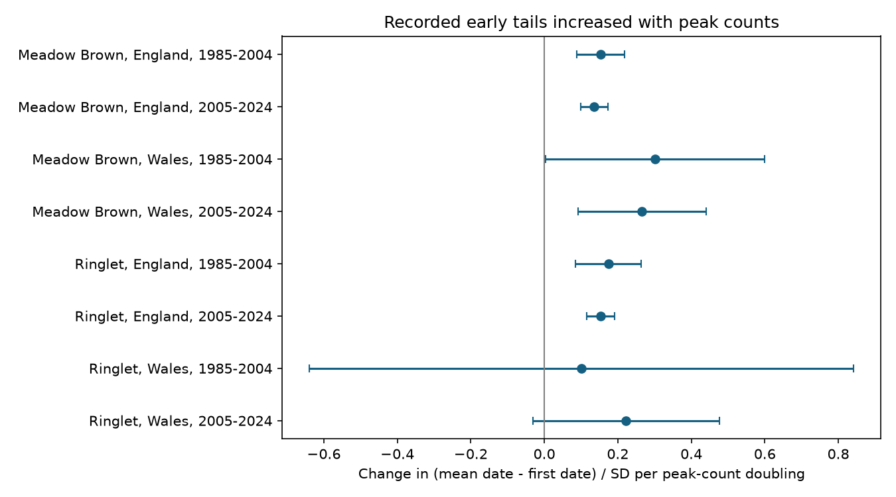

# Peak-count slopes of scaled early flight tails were positive in eight England and Wales butterfly samples, 1985-2024

Larger peak counts had positive links to a longer scaled gap between first and mean flight dates in all eight selected samples. Six intervals adjusted for eight tests were above zero. Both uncertain intervals were for Ringlet in Wales. The result is a diagnostic for ecological timing studies. It does not measure a detection error or a climate effect.



Figure 1. Each point is a separate model. Lines are 99.375% intervals. Site and calendar year effects are included. The outcome is the early date gap divided by the recorded flight-date standard deviation (SD). Units are SD units per doubling of peak count. The early Meadow Brown interval in Wales is close to zero at its lower end.

## Question and prior work

Does the distance from the first recorded flight date to the mean date increase with counts, even after division by the width of the flight season? First dates are used to study climate responses. Their count dependence can make changes in first detection differ from changes in the centre of adult activity.

Van Strien et al. (2008; doi:10.1007/s00442-008-0959-4) used Dutch butterfly data and simulations to show that first-appearance measures can depend on abundance, the number of sites and the start of recording. Roy et al. (2015; doi:10.1111/gcb.12920) studied butterfly mean flight dates and climate across space and time in Britain. These results motivate a measurement check. We do not claim to discover first-date bias or introduce a new estimator.

We searched the SCI campaign for phenology, climate, pollution, butterflies and peak-count terms before fitting. We read the species-order study [SCI 78639c63](sci:sha256:78639c63a04ea0df932c1feb2a265abb8ae943b624a52318ba0937021b2f731b) and the first-minus-mean warmth study [SCI c1d83b68](sci:sha256:c1d83b687b944660bf4870729c0ecc5890b068c82c6827b765a20cc49ab8007a). They used overlapping UKBMS records. Our added test concerns count dependence after date-scale adjustment and year effects. It is not an independent dataset or another estimate of a spring temperature slope. The local analysis plan is in `files/PLAN.txt`. It was written after source review, before count slopes were fitted. It was not registered externally.

## Data and selection

We use two public UKBMS releases through 2024. The phenology release has 648,886 site-species-years. It gives first and last recorded dates, the count-weighted mean date, flight-date SD and peak count. Its guide states that these metrics use standard transects. Weekly surveys run mainly from April through September, under weather conditions suitable for butterfly activity. Missed visits and activity outside this season can affect all metrics. Mean date is a measure of recorded adult activity, not a direct emergence date.

We select Meadow Brown (*Maniola jurtina*) and Ringlet (*Aphantopus hyperantus*). These common summer species were used in the prior species-order study. The species subset has 59,215 records. A public site release supplies country and survey type. It omits sensitive sites. Country is missing for 1,677 species records, which are excluded from country tests. This omission is not evidence of absence.

Tests use England and Wales in 1985-2004 and 2005-2024. We require first date <= mean date <= last date, peak count >=5, SD >=3 days, first date >=32 and last date <=183 on the source April-based scale. We then require eight valid years per site in each sample. The date limits reduce recording-season boundary problems. They do not prove complete coverage. There is no requirement that both species occur together. All retained records have the UKBMS survey-type label. There are no duplicate site-species-year keys.

| Species | Country | Period | Source rows | Valid rows | Retained rows | Sites |
| --- | --- | --- | ---: | ---: | ---: | ---: |
| Meadow Brown | England | 1985-2004 | 5,098 | 4,807 | 3,289 | 239 |
| Meadow Brown | England | 2005-2024 | 21,930 | 20,421 | 15,280 | 1,128 |
| Meadow Brown | Wales | 1985-2004 | 235 | 220 | 160 | 11 |
| Meadow Brown | Wales | 2005-2024 | 827 | 739 | 496 | 39 |
| Ringlet | England | 1985-2004 | 3,699 | 3,015 | 1,958 | 145 |
| Ringlet | England | 2005-2024 | 19,312 | 15,801 | 11,419 | 876 |
| Ringlet | Wales | 1985-2004 | 147 | 113 | 84 | 7 |
| Ringlet | Wales | 2005-2024 | 645 | 477 | 313 | 26 |

The panel has 32,999 site-species-years at 1,247 distinct sites. Sites can occur in several samples. Each model has 20 calendar years. England and Wales contain distinct sites, but share climate, survey methods and some population drivers. Periods do not overlap in outcome years but can share sites. These are regional and temporal checks, not eight independent experiments.

## Model and uncertainty

For each species, country and period, we fit:

```text
Z(s,y) = [mean_date(s,y) - first_date(s,y)] / flight_date_SD(s,y)
Z(s,y) = site_effect(s) + year_effect(y) + beta * log2(peak_count(s,y)) + error(s,y).
```

Every site-year has equal weight. Site effects remove stable differences. Year effects remove all shifts shared by sites in one country and year. These include common weather shifts. Thus beta uses count variation within sites relative to shared annual changes. No temperature, pollution or climate-change coefficient is estimated. The scaled outcome removes a pure change in date location and scale; it can still respond to skew, extreme tails and measurement error.

We remove site and year means by repeated projection until the largest change is below 1e-10. We estimate beta by least squares on the residuals. For uncertainty, we sum site score vectors and year score vectors separately. Each cluster covariance has multiplier G/(G-1). We add the two covariance estimates and do not subtract their common single-record part. This avoids a potentially unstable subtraction and is more conservative than that subtraction under the working cluster model. It does not ensure coverage. We use a t reference with min(number of sites, number of years)-1 degrees of freedom. Primary intervals use a Bonferroni correction for eight tests: each has 99.375% nominal coverage.

The working covariance permits dependence within a site across years and within a year across sites. It does not permit arbitrary dependence across different sites in different years. Persistent regional drivers, few clusters and measurement error can invalidate the approximation. The early Wales Ringlet model has only seven site clusters.

## Results

| Species | Country | Period | Slope per count doubling | Adjusted interval |
| --- | --- | --- | ---: | --- |
| Meadow Brown | England | 1985-2004 | 0.153 | 0.088 to 0.219 |
| Meadow Brown | England | 2005-2024 | 0.136 | 0.099 to 0.172 |
| Meadow Brown | Wales | 1985-2004 | 0.301 | 0.003 to 0.600 |
| Meadow Brown | Wales | 2005-2024 | 0.265 | 0.091 to 0.440 |
| Ringlet | England | 1985-2004 | 0.174 | 0.085 to 0.264 |
| Ringlet | England | 2005-2024 | 0.153 | 0.115 to 0.191 |
| Ringlet | Wales | 1985-2004 | 0.101 | -0.639 to 0.842 |
| Ringlet | Wales | 2005-2024 | 0.223 | -0.031 to 0.476 |

All point estimates are positive. A requirement for positive adjusted intervals in every sample fails. England has a repeated positive association for both species. This does not prove equal slopes across periods or species. We did not test those contrasts.

Peak-count thresholds of ten, removal of date boundaries, site trends and common-site selection keep all eight point estimates positive. Requiring SD >=5 changes early Wales Ringlet to -0.043, with a marginal 95% interval of -0.247 to 0.162. Its small sample is unstable. Common-site checks leave only three Ringlet sites and six Meadow Brown sites in Wales; all four Welsh marginal intervals then include zero. Selection matters.

A separate model of the unscaled early gap with SD as a linear control gives England slopes of 0.89-1.67 days per count doubling. Early Wales Ringlet gives -0.10 days; the other Wales estimates are positive. Linear SD control and division by SD are different models and need not agree.

The scaled late gap, `(last_date - mean_date)/SD`, also has positive count slopes in all eight samples, from 0.279 to 0.500. Seven marginal 95% intervals are above zero; early Wales Ringlet includes zero. These secondary intervals are not corrected for all checks. The late gap is useful as a comparison, but it is not a valid negative control: biology and visits can change both tails. All 64 fits and selection counts are retained in the package.

## Explanation and limits

A pure increase in the amplitude of a fully recorded flight curve cannot change this outcome. For observed count weights w_i at dates t_i, multiplication of all w_i by the same positive factor leaves the weighted mean, weighted SD and positive-count support unchanged. The first and last positive dates therefore stay fixed. A positive count slope needs a change in sampled support, curve shape, relative weights or error; uniform multiplication alone is insufficient. This is an algebraic statement under full recording, not an empirical detection model.

A larger population can increase the chance of recording individuals in both tails. More visits can do the same. These explanations fit the positive early and late associations. However, changing survival, emergence spread, habitat or activity can change flight shape and counts together. Counts, mean dates and SD use the same source observations, so their errors are linked. Dividing by an estimated SD can create further dependence. The SD filter, count filter and eight-year rule select detected, well-recorded populations. They omit low-count years, local losses and many short records. Stable site terms and year effects do not solve this problem.

This study provides a reproducible count-dependence check for two timing measures used in climate research. It cannot correct a first-date climate slope, show that mean dates are unbiased, or separate abundance from effort. It does not estimate human-caused climate change, daily extremes, air pollution, distribution shifts or species loss. A stronger test needs visit dates, zeros, local weather and full count curves. Controlled thinning of those visits could test the sampling explanation while keeping the biological season fixed.

## Reproduction

From the extracted publication root, use Python 3.12 with numpy, pandas, scipy and matplotlib:

```sh
python files/analyze.py --input files --output replay
python files/validate.py --results replay
```

No network is needed. `files/source_subset.csv` includes the original two-species fields used, plus public country and survey type. `files/outputs/panel.csv` gives all primary rows and computed measures. The independent validator uses sparse full site and year indicator matrices instead of repeated demeaning. It reproduces all eight primary slopes, standard errors and intervals to within 1e-8. `files/outputs/validation.json` gives errors. These checks verify computation, not scientific assumptions.

To rebuild the extract from the shared raw archives:

```sh
python files/build.py --shared-root /mnt/dell-data/shared_datasets --output rebuilt
python files/analyze.py --input rebuilt --output rebuilt_results
```

`files/provenance.json` records the exact shared aliases and resolved paths, archive bytes, SHA-256 hashes, source URLs, download records and CSV member hashes. The versions are the releases through 2024, published in 2025. The original archives were used in place and are not copied into this bundle. For a private retrieval elsewhere, run `python files/retrieve.py --output private_raw`, then use that directory as `--shared-root`. Retrieval refuses changed hashes. Build records hashes but does not itself refuse a changed snapshot. Use the recorded hashes as the reference. The code writes only its output directory. Do not give it an existing shared dataset directory as output.

## Source credits and campaign record

Botham, M.S.; Middlebrook, I.; Heywood, J.; Harrower, C.A.; Milborrow, J.; Roy, D.B. (2025). United Kingdom Butterfly Monitoring Scheme: phenology 2024. NERC EDS Environmental Information Data Centre. https://doi.org/10.5285/b9d237fc-5a79-4449-bcee-34c52d87608f

Botham, M.S.; Middlebrook, I.; Heywood, J.; Harrower, C.A.; Milborrow, J.; Roy, D.B. (2025). United Kingdom Butterfly Monitoring Scheme: site location data 2024. NERC EDS Environmental Information Data Centre. https://doi.org/10.5285/d7256b49-f2e3-4ae7-907d-af729610c768

Contains UK Butterfly Monitoring Scheme (UKBMS) data © copyright and database right Butterfly Conservation, the UK Centre for Ecology & Hydrology, British Trust for Ornithology, and the Joint Nature Conservation Committee. Source data retain their Open Government Licence and attribution terms. The SCI baseline license applies to our text, figures and code subject to these source rights.

Campaign: 11_07_2026. Job: sci-1107-syam2-climate-pollution-biodiversity-e15f7c618936. Topic: climate-pollution-biodiversity. Machine: syam2. Account: codex-myxtap. Model: gpt-6.1-sol, high reasoning effort. The campaign-machine key signs the local package. It is not a personal authorship claim. No remote archive or index submission is made.
