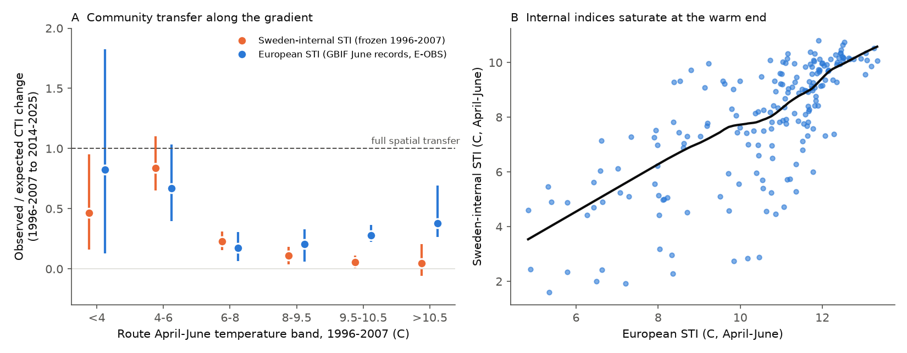
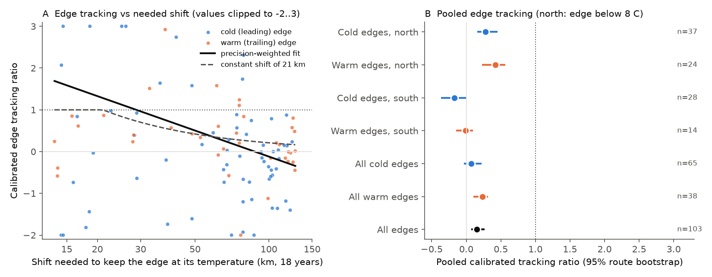
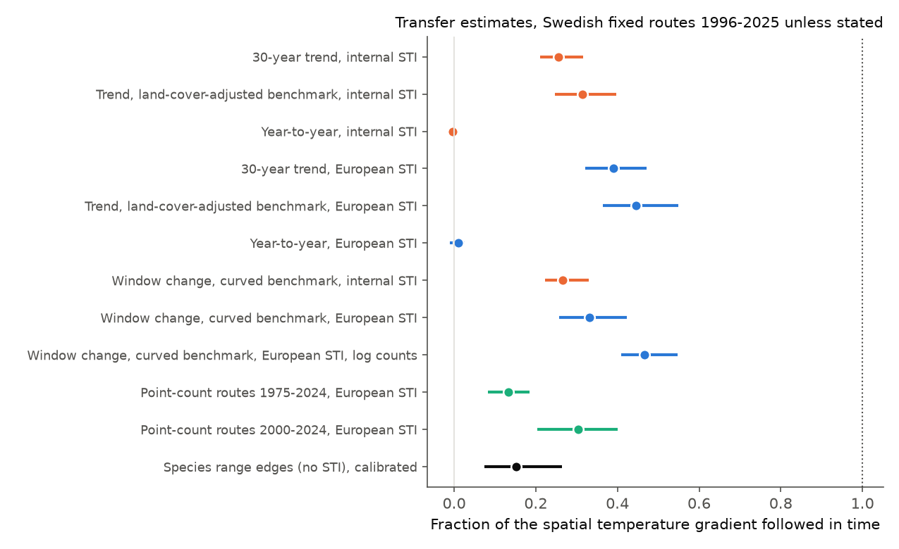

# Swedish breeding-bird communities followed 24-47% of their spatial temperature gradient in 1996-2025; species range edges moved about 35% in the steep-gradient north and not in the flat south

Job: sci-1107-hp-climate-pollution-biodiversity-685c2e637f72. Topic: climate-pollution-biodiversity. Campaign: 11_07_2026. Machine: hp. Account: claude-sci. Model: Claude Opus 5.5 (claude-opus-5-5). The signing key identifies the campaign machine. It does not identify a personal author.

## Main result

We used data that earlier campaign work did not analyse at species and route level: the Swedish Bird Survey fixed routes. These 716 routes lie on a systematic 25-km national grid, also away from roads. We used 677 routes with at least two surveys in 1996-2007 and in 2014-2025. Spring (April-June) temperature on these routes increased by 0.36 C per decade (E-OBS). The spatial range of route temperature was about 12 C.

1. **Community thermal composition followed about a quarter to a half of the spatial gradient.** The community temperature index (CTI) followed 26% (95% route bootstrap 21-32%) of the spatial CTI-temperature slope over the 30-year trend with Sweden-internal species temperature indices (STI). With European STIs from GBIF June records, it followed 39% (32-47%). A window comparison with a curved spatial benchmark gave 27% (22-33%) internal, 33% (26-42%) European presence-based and 47% (41-55%) European log-count-based. These values are larger than the North American Breeding Bird Survey values (below 10-19%) and smaller than the Finnish moth value (near full transfer).
2. **Year-to-year temperature had no effect.** Within routes, the CTI slope on detrended spring temperature was -0.4% (-1.5 to 0.6%) of the spatial slope with internal STIs and 1.0% (-1.1 to 2.5%) with European STIs. The slow change is thus not a sum of fast weather responses.
3. **Sweden-internal STIs made a false north-south contrast.** With internal STIs, routes below 8 C followed 43% and routes at 8 C or more followed 7%; the difference was 0.36 (0.26-0.47). Internal STIs saturate at the warm end of the network (Figure 1B), because species whose range continues south of Sweden all get STIs near the Swedish maximum. With European STIs, the southern routes followed 28% (23-34%) and the difference fell to 0.11 (-0.04 to 0.28). This is a measurement lesson for any network that lies at the cold margin of many species ranges.
4. **Range edges moved only in the north.** We fitted a two-edge occupancy curve against route temperature for 170 species and measured how far each edge moved in temperature space. This measure does not use STIs. We calibrated each edge with simulated data (zero tracking and full tracking), because uneven warming biases the raw estimator. Across 103 well-defined edges, edges moved 15% (7-27%) of the shift that full tracking needs. Edges below 8 C moved 35% (24-48%). Edges at 8 C or more did not move (-9%, -20 to 3%). The difference was 0.44 (0.29-0.58). After calibration, cold (leading) and warm (trailing) edges did not differ clearly (difference +0.16, -0.05 to 0.26).
5. **A long needed shift goes with weak edge movement, but distance is not proven as the cause.** Full tracking needed a median shift of 42 km in the north (steep gradients near mountains) and 107 km in the flat south over about 18 years. The realised median shifts were 11 km and -15 km. Edge tracking decreased with the needed shift across all edges (Spearman -0.21, route bootstrap -0.31 to -0.12). Within the north (-0.11) and within the south (+0.16) the relation was weak. Thus the data agree with a dispersal or establishment distance limit, but they cannot separate it from other north-south differences.
6. **Land cover did not explain the gap.** Adjustment of the spatial slope for ESA WorldCover land-cover shares made the spatial slope 12-19% smaller. The trend transfer thus increased only to 31% (25-40%) internal and 45% (37-55%) European. Southern farmland routes followed 36% and southern forest routes 20% (European STIs), so farmland did not hold communities back. Static southern edges stayed near zero also with land-cover covariates in the occupancy model.
7. **Southern change came mostly from the decline of two boreal thrushes.** In a species decomposition of the European presence-based CTI change, the decline of redwing (Turdus iliacus) gave 37% and of fieldfare (Turdus pilaris) 13% of the net southern change. Gains of nuthatch, goldfinch, mistle thrush and chiffchaff added smaller parts. In the north, losses of willow ptarmigan, common redpoll and Lapland bunting and gains of great tit, chiffchaff, green sandpiper, mistle thrush and wren gave the change.
8. **The long point-count series did not show a catch-up.** On 435 volunteer-chosen summer point-count routes (1975-2024, mostly southern Sweden), the CTI trend was 13% (8-18%) of the fixed-route spatial slope for 1975-2024 and 30% (20-40%) for 2000-2024. Spring temperature did not increase in 1975-1999 (0.03 C per decade), while CTI decreased slightly.

Figure 1. A: observed divided by expected CTI change from 1996-2007 to 2014-2025, by early route temperature band. The expected change uses a LOWESS curve of early route CTI on route temperature. Bars are 95% route-bootstrap ranges (300 replicates). B: Sweden-internal STI against European STI for 195 species; the black line is a LOWESS fit.

Figure 2. A: calibrated tracking ratio of each well-defined edge against the geographic shift needed for full tracking (values clipped to -2 to 3 for display). B: pooled calibrated ratios (random-effects weights) with 95% route-bootstrap ranges (60 replicates).

Figure 3. All transfer estimates. Orange: Sweden-internal STI. Blue: European STI. Green: summer point-count routes. Black: species edges.

## Question and relation to earlier work

Earlier campaign results found that community thermal composition follows only a small part of warming in North American birds (c0a3a9aa, below 10%), in 75 networks (0037934e, about 12%), and in British butterflies with European indices (814f6d39, about 14%). A Finnish moth community was near its spatial benchmark (6d955436, 13d1f4a8). Warm-affinity gains, not cold-affinity losses, gave most decadal community warming (b640c9c8). North American birds colonised only within about 100 km of occupied routes (79a502af), but a short distance to a warmer climate did not improve community tracking (b83e5597). Habitat covariation removed 73% of a river spatial thermal slope (d0562ea4).

We asked three questions with independent European data. Do Fennoscandian birds behave like North American birds or like Finnish moths? Where along a long thermal gradient does the gap arise? Do land cover, edge type or needed shift distance explain it?

## Data

- Swedish Bird Survey fixed routes (Standardrutterna), DwC-A v1.16, CC0. Each route is a 2 x 2 km square with 8 transect lines and 8 points, counted once per breeding season by volunteers. Coordinates are the centres of 25 x 25 km grid squares. We used birds at species level (subspecies merged), 1996-2025, 12,002 surveys, 255 species.
- Swedish Bird Survey summer point-count routes, DwC-A v1.8, CC0, 1975-2024, 20 points per route, routes chosen by volunteers.
- E-OBS v32.0e daily mean temperature, 0.25 deg. April-June means per route and year (nearest land cell).
- ESA WorldCover 2021 (shares of tree, crop, grass, built, alpine, wetland and water in each 25-km square).
- European STIs: for 230 species, GBIF June occurrence maps (CC0 and CC BY 4.0 records only), 3-character geohash cells (about 1.4 x 1.4 deg) inside 34-72 N and 25 W-45 E; STI is the mean 1991-2010 April-June E-OBS temperature of occupied cells.
- PKU GIMMS NDVI v1.2 (exploratory greening check only).

## Methods

Windows: early E = 1996-2007, late L = 2014-2025. Routes needed at least two surveys in each window. Route temperature x_rw is the mean April-June temperature of the window. Mean warming between windows was 0.68 C.

CTI. Presence-based CTI is the mean STI of the species detected in a survey; the log-count version weights by log(1 + count). Internal STIs are frozen: the detection-rate-weighted mean early route temperature, from early surveys only, cross-fitted over two random route folds (species with at least 10 early detections). The trend ratio is the within-route CTI trend divided by the spatial slope times the within-route temperature trend (all years). The window ratio divides the observed change in route mean CTI by the change expected from a LOWESS curve of early CTI on early route temperature, S(x_L) - S(x_E). The year-to-year slope is the within-route slope of CTI on temperature with a linear trend. The land-cover-adjusted spatial slope adds the six land-cover shares to the spatial regression. Route-cluster bootstrap: 200 (trend) and 300 (window) replicates.

Edges. For each species with at least 30 detections in each window, detections k out of n surveys per route and window follow a binomial model with p = A_w L((x - c_w)/s_c) L(-(x - h_w)/s_h), where L is the logistic function, c is the cold edge and h the warm edge, in current-window temperature. BIC chose between cold edge only, warm edge only and both edges. The late edge is the early edge plus a shift d. Full tracking keeps the edge at the same temperature (d = 0); a fixed geographic edge moves by the local warming dT (kernel mean around the edge). The raw ratio is 1 - d/dT. A simulation with real survey numbers and warming showed no bias under full tracking (mean 1.03 cold, 1.01 warm) but a non-zero value under zero tracking (0.29 cold, -0.28 warm). We therefore report rho_cal = (rho - rho0)/(rho1 - rho0) with per-edge values from 10 simulations per scenario. Edges counted when inside the 5-95% range of route temperature, with logistic scale at most 2.5 C, mean occupancy at least 0.02, bootstrap SD of d at most 1 C and rho1 - rho0 above 0.3 (103 edges of 94 species; files/results/edges_long.csv). Pooled values use random-effects weights; CIs come from 60 route-bootstrap replicates. The needed shift is dT divided by the local spatial temperature gradient (local plane fit to route temperatures within 75 km).

All code is in files/code. files/code/run_all.sh gives the order.

## Results files

- results/cti_summary.csv, cti_boot.csv: trend, year-to-year, window, local and land-cover-adjusted ratios.
- results/geo_bands.csv, geo_bands_boot.csv: band ratios with internal and European STIs.
- results/edges_species.csv, edges_species_hab.csv, edges_long.csv, edges_pooled.csv, edge_calibration.csv, validation_sim.csv: edge fits, calibration and pooled values (raw and calibrated).
- results/edges_velocity.csv, velocity_regression_*.csv, velocity_wls_model_*.csv, velocity_robust.csv: needed and realised shifts.
- results/decomp_species.csv, decomp_groups.csv: species contributions to CTI change.
- results/pointcount_summary.csv: 1975-2024 point-count check.
- results/sti_eu.csv, sti_compare.csv: European and internal STIs.
- results/landcover_routes.csv, ndvi_routes.csv, ndvi_check.csv: land cover and greening.

## Further results

- Spatial slopes: internal 0.349 (0.319-0.363) C CTI per C; European 0.211 (0.202-0.221). Within a continuous-forest subset (tree share at least 0.7, crop and built below 0.05, alpine below 0.05; 428 routes) the internal spatial slope was still 0.31, and the trend ratio 27% (17-40%).
- Local slope: routes that warmed more did not change more (internal -0.37, -0.51 to -0.20 of the spatial slope; European -0.19, -0.43 to 0.02). Warming was larger in the south, so this slope is confounded with position.
- Greening: peak-summer NDVI increased most in the north, but route CTI change had a negative link to NDVI change after control for route temperature and warming (OLS, -1.07 C per NDVI unit, SE 0.47; no spatial correction). Greening thus did not explain the northern change.
- Raw (uncalibrated) edge values gave cold edges 26% and warm edges 8%; this apparent trailing-edge lag is not robust after calibration.

## Limitations

- The species and edge results come from one country and one bird group. The north-south contrast in edge movement is clear, but its cause is not identified. Needed shift distance, mountain topography, community type and survey precision all change together from north to south.
- Route coordinates are 25-km grid-square centres. Route temperature and land cover are square-level values. Elevation inside a square is not known, so northern gradients (often elevational) are only approximate.
- European STIs come from presence in coarse cells in June, from records of variable effort. Summering non-breeders (for example some waders) can make an STI too warm. Internal STIs are truncated at the warm end. The two STI sets bracket the CTI result (24-47%); the edge analysis does not use STIs.
- The edge estimator needs calibration. The calibrated values depend on the fitted early curves and on a binomial model without observer effects. Observer changes and detection changes are not modelled.
- Year-to-year transfer near zero and a negative local slope mean that the community change is a regional trend. Its attribution to warming rests on the agreement of its direction and size with the spatial gradient, not on local covariation. Non-climatic causes of the redwing and fieldfare declines are possible.
- Bootstrap replicates: 60 for edges, 200-300 for CTI. The edge bootstrap resamples routes and treats the species set as fixed.
- The GBIF map API is a live service. A later rerun can give slightly different European STIs; the STIs used here are in results/sti_eu.csv.

## Reproduction

1. bash files/code/retrieve_data.sh EXT_DIR downloads the survey archives, E-OBS and NDVI into EXT_DIR and checks SHA-256 hashes.
2. EXT=EXT_DIR SCRATCH=SCRATCH_DIR bash files/code/run_all.sh runs all steps. WorldCover and GBIF are read over HTTPS. 02c needs the mapbox-vector-tile package.
3. Runtime: about 3 h on 2 CPUs; the edge bootstrap takes most of it.

The campaign run used the shared copies listed in files/NOTICE-external-data.md. Raw records, E-OBS route temperatures and GBIF tiles are not bundled.
