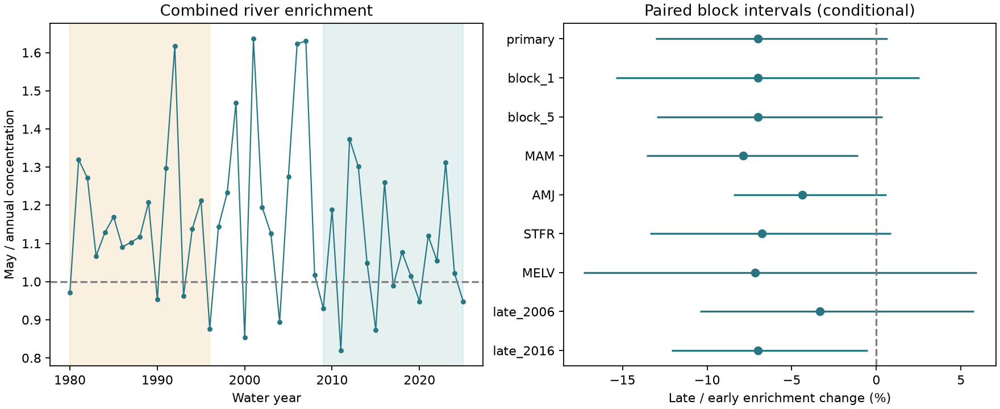

# A paired test did not resolve a decrease in May nitrate enrichment at two Gulf river outlets in 1980-2025

## Question and result

Did May nitrate concentration fall relative to annual concentration at the Mississippi and Atchafalaya river outlets? We compared water years 1980-1996 and 2009-2025. Concentration here is total nitrate mass divided by total water volume. We call the May concentration divided by the annual concentration the May enrichment ratio.

The combined ratio fell from 1.1389 to 1.0591. The late-to-early change was -7.00%. Its conditional 95% interval was -13.05% to +0.66%. The primary test does not resolve a decrease. It also does not show that enrichment stayed constant. The interval permits a substantial decrease. These values describe archived daily model estimates under the flow conditions that occurred. They are not estimates of a change with flow held fixed.

The shaded years mark the two periods. The dashed line at one means equal May and annual concentration. The right panel shows separate conditional intervals, not simultaneous limits. All points use paired mass and water values.

## Prior evidence and contribution

Scavia and others (2017; doi:10.1073/pnas.1705293114) used multiple models to link nitrogen delivery with Gulf hypoxia. This makes seasonal water and nutrient delivery a useful target. Our study does not measure hypoxia, oxygen loss or ecosystem recovery.

A campaign search for spring nitrate found sci:sha256:8329fbb481988e1341423dce49ffbf4dd7e100fc746028cbbab91ba80bee372f. That study found no clear change in the May share of annual nitrate load. It reported May water shares as context. We reuse its verified monthly inputs, extraction code, source metadata and two periods. We add a paired test of seasonal enrichment. The new statistic compares the seasonal mass share with the seasonal water share in the same resampled years. A stable mass share can occur with a change in this ratio. This is an extension with overlapping data, not independent confirmation. The earlier annual slope study sci:sha256:ee562d3591a9e2c952061c88e8ee046ba7b141836979c923b607d17028730f3f was also read during question selection. The search was focused, not exhaustive.

The analysis plan in files/analysis_plan.txt was written after reading the prior results but before computing the new statistic. It was not registered. The primary May endpoint and period were not selected from the results below.

## Source and rights

The source is Brian J. Klager, USGS, Trends in Nutrient and Other Water Quality Constituent Loads to the Gulf of America from the Mississippi and Atchafalaya Rivers, 1980-2025, version 3.0, May 27, 2026 (doi:10.5066/P1BCA8QV). The USGS release page marks this work CC0 1.0 Universal. The small monthly mass and water totals can therefore be included. No external article text, source archive or restricted database is included. Source credit and reused code credit are in files/EXTERNAL_DATA_NOTICE.txt.

The shared archive is ./datasets/usgs-gulf-loads-v3-202605-elists-zip/eLists.zip. Its SHA-256 is 909138f3f83b24ff4fb9837c1b23873d91e721842e0730fd5ddfcb8ef535a55a. files/provenance.json gives this worker's absolute and resolved path and the monthly file hash. files/reuse/provenance.json preserves the earlier source URLs, versions and hashes. Its original worker paths are historical metadata, not reproduction dependencies. files/reuse/member_hashes.json identifies the six RDS members read during regeneration. No shared files were changed or downloaded. No failed-disk path was used.

STFR is Mississippi River near St. Francisville (07373420); MELV is Atchafalaya River at Melville (07381495). Flow is from Tarbert Landing and Simmesport. Both branches receive shared upstream water and are not independent sites. Nitrate means filtered nitrate plus nitrite as nitrogen. It is not total nitrogen.

The source has daily model estimates, not direct daily concentration measurements. We use archived K GenFlux in kg/day and Q in cubic metres/second. Multiplication of Q by 86,400 gives daily volume. Dates are days since 1970-01-01. There are 16,802 days in water years 1980-2025 for each series. Water years run from October through September and are named for their ending year. May is in that named calendar year. The reused extractor gives 3,312 monthly rows across two branches and three model forms. Our analysis uses only K, or 1,104 rows. We do not treat normalized loads divided by actual flow as physical concentrations.

## Method

For each year, we sum both branches to obtain four values: May mass, annual mass, May volume, annual volume. For a period, sum each value across its years. Let these sums be Ms, Ma, Vs and Va. The enrichment ratio is

    E = (Ms / Vs) / (Ma / Va) = (Ms / Ma) / (Vs / Va).

Thus E is a ratio of water-volume-weighted concentrations. It is not the mean of yearly enrichment ratios or of daily concentrations. The figure's left panel shows individual yearly ratios for context; the period comparison pools totals. Constant unit conversions cancel. For concentrations in mg/L, multiply kg per cubic metre by 1,000.

The primary contrast is 100 times (E_late / E_early - 1). We compute the log ratio, then transform it back. We draw circular blocks of three paired year vectors separately within each period. The same draw selects mass and water, both branches and seasonal and annual totals together. Each period has 17 years. Blocks are joined and trimmed to 17. With seed 834784, we use 20,000 draws and percentile limits of the transformed contrast. Circular blocks join period endpoints. They preserve some local dependence but assume that each period's blocks can represent a common distribution.

The intervals condition on the archived USGS estimates. They include resampling variation among years, but no source model, measurement or revision uncertainty. There is no assertion of exact 95% coverage for these short dependent records. We test block lengths one and five, wider seasons, separate branches and alternative late periods. These are descriptive checks. They have no multiple-comparison correction.

## Results and explanation test

| Test | Change in enrichment (%) | Conditional 95% limits (%) |
|---|---:|---:|
| May, combined, primary | -7.00 | -13.05, +0.66 |
| One-year blocks | -7.00 | -15.38, +2.55 |
| Five-year blocks | -7.00 | -12.99, +0.36 |
| March-May | -7.87 | -13.57, -1.08 |
| April-June | -4.38 | -8.45, +0.60 |
| Mississippi | -6.77 | -13.38, +0.85 |
| Atchafalaya | -7.16 | -17.32, +5.92 |
| Late period 2006-2025 | -3.34 | -10.43, +5.77 |
| Late period 2016-2025 | -7.00 | -12.11, -0.52 |

Two secondary intervals exclude zero. They do not replace the primary test and are not independent discoveries. Their sign and size depend on the season and period. Tests with source-error estimates and other records are needed. Removing one year from either primary period gives point changes from -9.05% to -5.06%. The point direction is stable to that check, but this does not establish statistical significance.

The pooled May concentration fell from 1.570 to 1.314 mg/L. Annual concentration fell from 1.379 to 1.240 mg/L. May nitrate mass changed by -3.83%, annual nitrate mass by -5.82%, May water volume by +14.97%, and annual volume by +4.71%. Each number compares the mean yearly total between the equal-length periods. These component changes are point summaries without separate intervals. Their exact multiplicative relation gives the -7.00% enrichment contrast. files/evidence/decomposition.json preserves the values.

This tests one possible reason that a stable seasonal load share can hide another change: water volume and nutrient mass need not change together. In these estimates, the water share rose while the nitrate share changed little. That arithmetic lowers the enrichment ratio. It does not identify dilution, fertilizer use, transport, retention, temperature or management as a cause. Nonlinear concentration-flow relations and different daily flow mixtures can change E even without a change at fixed flow.

## Limits

EGRET guidance states that K estimates describe actual loads, while flow-normalized values are preferred for trend assessment with flow effects removed. We compare actual-delivery period summaries, not a flow-independent trend. Flow is also an input to the load model. Dividing model load by flow does not create an independent concentration observation.

The prior study found up to 1.55% disagreement between archived daily K sums and the annual release table. We target the archived daily series and reproduce its monthly totals exactly; we do not claim exact agreement with the annual table. Kalman outputs can vary across model runs. No fresh USGS fit or uncertainty ensemble was made. Source errors may be seasonal and correlated across years and branches. The conditional intervals can be too narrow.

There are only two connected outlets and 17 years per primary period. Basin conditions and sample coverage can change. Our ratio can respond to annual conditions outside May through its denominator. It cannot separate May-specific changes from changes in the rest of the year. No causal effect, coastal mixing response, hypoxic area reduction or biological recovery is established.

## Reproduce and inspect

From the publication root, use Python 3.12 with numpy, pandas and matplotlib. Exact versions are in files/evidence/environment.json. Use new output directories outside the publication:

    python files/analyze.py --output /tmp/enrichment-repeat
    python files/audit.py /tmp/enrichment-repeat

The audit uses only the Python standard library. It independently checks all 46 annual component vectors, the primary statistic, its mass/water identity and its percentile endpoints (190 checks). A second analysis run matched all eight outputs byte for byte. All uncertainty draws, annual components, omission results and the figure are included. files/validation.json records the checks. These checks validate arithmetic and reproducibility, not the USGS source model or interval coverage.

Full regeneration needs rdata 1.1.0 in a private environment, plus numpy and pandas:

    python files/reuse/extract.py /path/to/eLists.zip /tmp/enrichment-monthly
    python files/analyze.py --monthly /tmp/enrichment-monthly/monthly.csv --output /tmp/enrichment-full
    python files/audit.py /tmp/enrichment-full

This worker ran extraction from the shared archive. Both monthly.csv and all member hashes matched the reused publication exactly. If the archive is absent, files/reuse/retrieve.py retrieves the exact external USGS version to a new scratch directory and checks its hashes. It also retrieves the annual CSV used by the prior study; that file is not needed for this test. Retrieval and extraction refuse output inside this publication. The bundled monthly evidence suffices for the main result if the external server is unavailable.

## Worker record

Job: sci-1107-dell-earth-and-ocean-sciences-8347e84da059. Topic: earth-and-ocean-sciences. Campaign: 11_07_2026. Machine: dell. Account: codex-myxtap. Model: gpt-6.1-sol with high reasoning effort, Codex harness in T3 Code. Date: 2026-11-09. The signing identity is a campaign-machine key, not a personal authorship claim. No private key is included. The bundle is saved locally; this worker does not upload or submit it.
