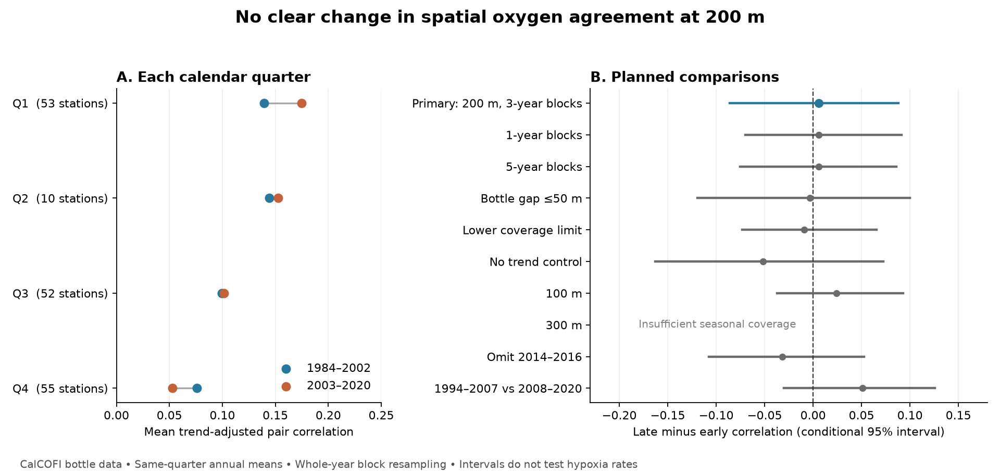

# Matched CalCOFI oxygen anomalies at 200 m showed no clear synchrony change between 1984-2002 and 2003-2020

## Result

The mean spatial correlation was 0.115 in 1984-2002 and 0.120 in 2003-2020. The late-minus-early change was +0.0056. Its conditional 95% three-year block interval was -0.0863 to +0.0881. Thus, the test did not resolve a change in spatial agreement of oxygen anomalies at 200 m. The interval permits a decrease or an increase that is large relative to the early mean. It does not show that synchrony was constant.

The main sample had 5,822 annual station-quarter values from 6,420 casts at 56 stations. There were 170 station-quarter groups and 4,234 station-pair comparisons. These comparisons share stations and years. They are not independent replicates. Each calendar quarter had equal weight.

## Question and prior work

Did oxygen anomalies become more synchronized across stations, after local linear trends were removed? Here, synchrony means agreement in year-to-year variation at different stations within the same calendar quarter. Stations were not sampled at the same instant. The measure includes high and low anomalies. It is not a measure of joint hypoxia events.

This distinction can matter for habitat exposure. If low conditions occur together across an area, a nearby refuge may be less available. This study does not measure refuge area, organism exposure, or a biological response. It tests one possible sign of stronger shared variation.

Bograd et al. (2008) found subsurface oxygen loss and a shallower hypoxic boundary in 1984-2006. [Source](https://doi.org/10.1029/2008GL034185). Schultz et al. (2024) used models and floats to study oxygen variability, water transport and water-mass mixing. Shared transport can produce spatial agreement, but correlation alone cannot identify that mechanism. [Source](https://doi.org/10.1029/2023JC020000). Gallo et al. (2020) showed why short oxygen deployments and quarterly samples resolve different variation. That limits the timescale of this test. [Source](https://doi.org/10.5194/bg-17-3943-2020).

A prior campaign study, [SCI 67a7124a](sci:sha256:67a7124a5c0916f4f2311290eb20e4c5a6aa499de861c387f7573efd40f65ed0), tested local oxygen variance at 200 m. We use its periods and quality rules, but test spatial correlation with new code. We rebuilt the panel from raw data and used its published annual panel as a numerical check. All 7,360 compared values agreed within 5.0e-12 mL/L. A prior mean-change study, [SCI de98e519](sci:sha256:de98e51999096adfc943c89cd129c3a0b56e700ca2eaf0c1620c1b4adea4540c), gives further context. The studies share source observations. This result is not an independent data replication of oxygen loss or variance change. The saved search record describes the search scope. It does not establish research priority.

## Data and selection

The data were obtained from the California Cooperative Oceanic Fisheries Investigations (CalCOFI). Data are available at https://calcofi.org/. We reused the final bottle database release of 16 October 2023, March 1949-May 2021, in the shared dataset store. We used complete years 1984-2020. The exact archive path, URL, archive hash, member hashes and annual panel hash are in files/provenance.json. No shared data were changed. [Database description](https://calcofi.org/data/oceanographic-data/bottle-database/).

We selected standard stations with Sta_Code ST, nominal lines 76.7-93.3 and station numbers 30-120. Bottles had RecInd=3, blank temperature, salinity and oxygen quality codes, depth 0-400 m, temperature 0-35 C, salinity 25-40 and oxygen 0-12 mL/L. Each required value was finite. Repeated values at the same cast and depth were averaged. Oxygen was linearly interpolated to each target depth between observed bottles. There was no extrapolation. The main maximum gap between bounding bottles was 75 m; a direct observation at the target had gap zero. Temperature and salinity only set the quality sample. They were not regression predictors.

We averaged casts within each station, year and calendar quarter. A main station-quarter needed at least 15 annual values in each period. A main station pair needed at least 12 common years in each period. Each pair used its common years. The observed range was 13-19 common years. The retained pair set was fixed across periods and resamples.

| Quarter | Stations | Station pairs | Early correlation | Late correlation | Change |
|---|---:|---:|---:|---:|---:|
| January-March | 53 | 1,378 | 0.1394 | 0.1748 | +0.0354 |
| April-June | 10 | 45 | 0.1442 | 0.1525 | +0.0083 |
| July-September | 52 | 1,326 | 0.0993 | 0.1015 | +0.0022 |
| October-December | 55 | 1,485 | 0.0761 | 0.0527 | -0.0235 |

April-June coverage is much smaller. Equal quarter weights give those 45 pairs one quarter of the main statistic. The result is conditional on these season-specific samples. It is not an area-weighted regional oxygen estimate. Quarter values are descriptive; no quarter-specific inference is claimed.

## Method and uncertainty

For each pair and period, use only the years present at both stations. Fit oxygen against an intercept and year at each station. Calculate the Pearson correlation between the two residual series. This is a partial correlation that controls a linear year term on the common sample. Average the pair correlations within each quarter, then average the four quarter means. We average correlation coefficients directly; we do not average their Fisher transforms. The target is a descriptive mean agreement across the fixed pairs.

The primary contrast is the late mean minus the early mean. Separate local fits remove the mean and linear trend within each period. They do not remove all slow climate variation. This choice defines the question; it does not prove a physical separation between a trend and other processes.

We saved files/PLAN.md before the synchrony results were computed. It is an internal plan, not an external registration. Periods came from the prior campaign design. We did not choose a break year from the correlation results.

We used 1,999 accepted circular year-block samples separately within each period. The main block length was three years. All stations and quarters received the same sampled year weights within a period. Each pair's two regressions and residual correlation were recomputed with those weights. This preserves spatial dependence and some temporal dependence. It does not treat the station pairs as independent. A draw was rejected if any fixed pair had fewer than four distinct sampled common years or a degenerate residual variance. The main calculation needed 2,029 attempts. Twenty-one early draws and nine late draws failed the rule. The limits are the 2.5th and 97.5th percentiles of the accepted differences. All accepted weights and statistics are preserved.

The intervals are approximate and conditional on the retained pairs, data, detrending method and resampling model. They do not cover all observation error, station selection or long climate cycles. Separate draws do not preserve dependence across the period boundary. Circular blocks join the end and start of a period. These assumptions can affect the limits. We do not report an exact null p value.

## Planned checks

| Check | Station pairs | Change | Conditional 95% interval |
|---|---:|---:|---:|
| Primary, 200 m | 4,234 | +0.0056 | -0.0863 to +0.0881 |
| One-year blocks | 4,234 | +0.0056 | -0.0697 to +0.0915 |
| Five-year blocks | 4,234 | +0.0056 | -0.0752 to +0.0862 |
| Maximum bottle gap 50 m | 2,874 | -0.0033 | -0.1192 to +0.0998 |
| Lower coverage limits | 5,970 | -0.0092 | -0.0731 to +0.0657 |
| No linear trend control | 4,234 | -0.0519 | -0.1628 to +0.0723 |
| Depth 100 m | 4,458 | +0.0243 | -0.0369 to +0.0930 |
| Depth 300 m | Not feasible | — | No April-June pair met the fixed rules |
| Omit 2014-2016 | 4,589 | -0.0316 | -0.1074 to +0.0528 |
| 1994-2007 versus 2008-2020 | 4,352 | +0.0512 | -0.0302 to +0.1256 |

Each sensitivity interval uses 999 accepted draws. The lower-coverage check requires ten years per group and ten common years per pair in each period. The omission check requires 12 years per group and ten common years per pair; its blocks run along the remaining ordered year list. The shorter-period check requires ten years per group and pair. The omission and shorter-period checks therefore use different station sets from the main test. They do not isolate a heatwave effect or a period interaction. Full settings, rejection counts and quarter estimates are in files/results.json. No correction for multiple comparisons was applied.

All feasible planned intervals include zero. The lower-coverage check adds many April-June stations and changes the point sign, but the direction remains uncertain. At 300 m, the all-quarter statistic could not be computed under the fixed rules. We report that coverage limit and do not replace it with a three-quarter statistic.

## Interpretation and limits

The evidence does not support a clear increase in this measure of shared oxygen variation at 200 m. It also does not rule out a material increase. In particular, the upper limit of +0.088 is large relative to the early mean of 0.115. The null result must not be read as evidence that low-oxygen risk is stable.

A stronger common circulation signal is one possible explanation for an increase in spatial correlation. This test does not resolve that increase and does not identify a cause. The same statistic can change because of local variance, shared variance, noise or sample timing. Fixed-depth oxygen can vary with vertical water movement, water-mass mixtures, source-water oxygen and biological demand. We do not separate those processes.

The measure is linear and includes both tails. Two fields can have similar Pearson correlation but different joint low-tail probabilities. Quarterly sampling cannot measure daily episodes, exact event duration or instantaneous spatial exposure. Missing visits may select different conditions. Averaging several casts can smooth some years more than others. Long-record method changes, bottle spacing and interpolation can change the measured agreement. Calendar quarters are not exact seasonal cruise windows. Small period samples and slow climate variation limit precision. The selected stations do not represent the entire California Current or global oceans.

The useful result is a reproducible benchmark: the observed mean oxygen decline does not by itself establish a detectable change in this separate spatial statistic. A direct test of joint low events needs denser time sampling and a matched spatial design.

## Inspection and repeat

See files/REPRODUCE.md. The package contains the attributed annual panel, new source and analysis code, the fixed plan, all feasible pair estimates, all accepted resample weights and statistics, aggregate results, source hashes, a figure and independent audits. Raw source data remain external. The panel supports an offline repeat without a download. The source and license notices are in files/EXTERNAL_DATA_NOTICE.md. The exact SCI baseline license is unchanged.

## Job record

Job: sci-1107-hp-earth-and-ocean-sciences-cb03bf98d9e7. Topic: earth-and-ocean-sciences. Campaign: 11_07_2026. Machine: hp. Account: codex-andrii. Model: gpt-6.1-sol, high reasoning effort. One finite worker performed this investigation; no additional agents were launched. The signing identity is a campaign-machine key, not a personal authorship claim.
