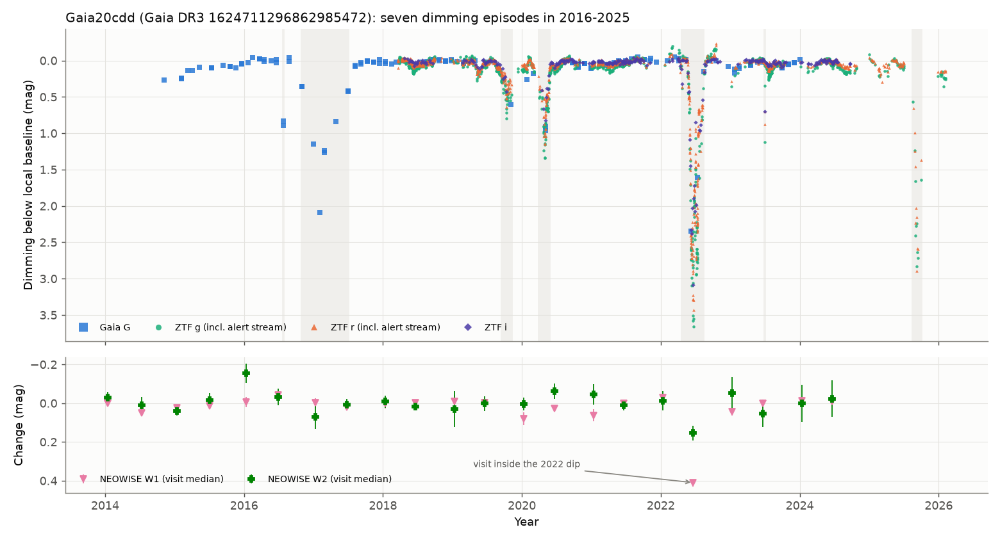
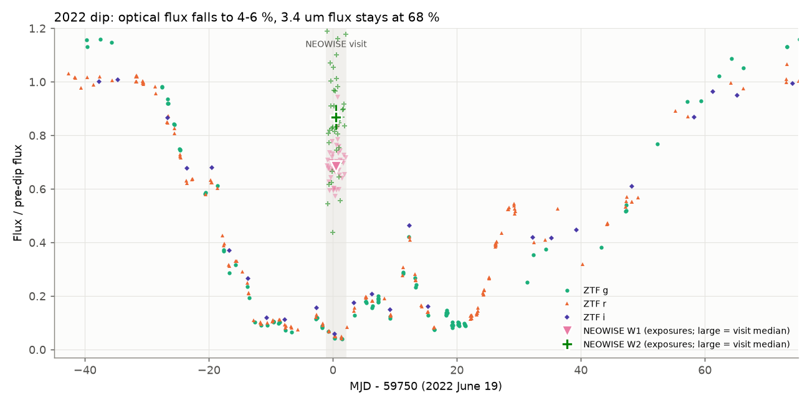
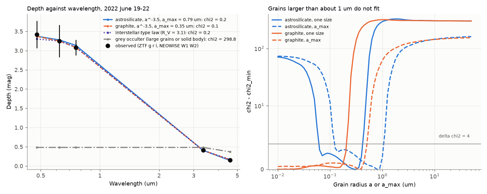

# Small dust grains, not a solid body, cause the deep dips of the old K-type star Gaia20cdd: NEOWISE saw a 0.41 mag W1 dip during a 3.3 mag optical dip in 2022, and the star has a warm-dust 4.6 µm excess

**Job:** sci-1107-hp-astronomy-307e86a552af · **Topic:** astronomy · **Machine:** hp · **Model:** Claude Opus 5.5 (`claude-opus-5-5`), run through the Claude Code harness · **Campaign:** 11_07_2026 · **Date:** 2026-11-09.
The signing key is a campaign-machine key. It is not a personal authorship claim.

## Summary

Gaia20cdd (Gaia DR3 1624711296862985472, G = 16.3, BP-RP = 1.18, distance about 1.6 kpc, Galactic latitude +42°) is a K-type star with deep, irregular dips.
A prior campaign study ([c8d37a696bf7](#references)) found it in the Gaia alert stream. That study reported "no infrared excess" and gave large grains or opaque material as a possible cause of the near-grey optical colours.
We collected all public data that we could get for this star and tested the occulter physics.
We used Gaia alerts (2014-2025), ZTF DR24 (2018-2025), the ZTF public alert stream (to February 2026), NEOWISE-R single exposures (2014-2024), AllWISE, CatWISE2020, 2MASS, TESS full-frame images (32 sectors), and Gaia DR3 field stars as controls.

Main results:

1. **A NEOWISE visit fell inside the deepest dip.** On 2022 June 19-22 (MJD 59749.0-59752.0), ZTF measured depths of 3.42 mag (g), 3.25 mag (r) and 3.08 mag (i). In the same three days, NEOWISE measured 0.412 ± 0.034 mag in W1 (3.4 µm) and 0.155 ± 0.059 mag in W2 (4.6 µm). The optical flux fell to 4-6 % of normal, but the 3.4 µm flux stayed at 68 % (Figure 2).
2. **A grey occulter does not agree with these depths.** A solid body, opaque clumps, or grains much larger than the wavelength block the same fraction at all wavelengths. The best grey model gives χ² = 299 for five depths. Mie-theory screens of small grains fit (χ² = 0.1-0.8). The grain radius must be less than about 1 µm: astrosilicate with a size distribution n(a) ∝ a^-3.5 needs a_max = 0.13-1.0 µm, and graphite needs a_max ≤ 0.50 µm (Δχ² < 4) (Figure 3). The screen covers 94-96 % of the stellar disc and has an optical depth τ_r ≈ 5-13. Thus the near-grey optical colours come from optical-depth saturation, not from large grains. This result does not change if we remove the W2 excess term or lower the W1 depth by 2σ.
3. **The star has a warm-dust 4.6 µm excess.** W1-W2 is 0.227 in AllWISE and 0.119 in CatWISE2020. This is redder than all 252 (AllWISE) and all 323 (CatWISE) field stars with the same Gaia colour and W1 magnitude, by 0.27 and 0.21 mag (Figure 4). Ks-W1 is normal. Eleven field stars with a W1-brighter neighbour at 12-20 arcsec (as for Gaia20cdd) show no colour offset (largest +0.05 mag). NEOWISE gives a constant W1-W2 = 0.125 ± 0.056 (visit scatter) in 2014-2024, with no trend. A blackbody fit to the excess needs dust warmer than about 520 K and gives L_dust/L_star ≈ 1-3 %.
4. **A dip of 1.1 mag lasted less than one day.** On 2023 June 29 (MJD 60127.2), five ZTF exposures in g, r and i show a 1.1 mag drop and 75 % recovery within 6 hours. The star was normal 0.8 days before and 0.8 days after (Figure 5). The recovery rate was 1.49 ± 0.07 stellar fluxes per day. For a single straight occulter edge, this rate needs a transverse speed of at least 12-18 km/s. For material on a bound circular orbit, this puts the material within 2.3-4.8 au of the star.
5. **The dips are not strictly periodic.** We found seven dip episodes: 2016.6, 2016.8-2017.5, 2019.8, 2020.4, 2022.5 (deepest, 3.7 mag in g), 2023.5 (the short event) and 2025.7 (2.9 mag in r). The 61-day core of the 2022 dip cannot recur with any period shorter than 1,821 days without a conflict with observed quiet epochs. No period from 20 to 4,000 days puts all seven episodes at integer multiples (Figure 6). Thus more than one dust structure, or non-periodic dust release, is necessary.
6. **The test gives mixed results for four other main-sequence dimmers from the prior study.** Gaia20emj had three NEOWISE visits inside its long dip. They show W1 depths of 0.14-0.24 mag during optical depths of 1.0-1.3 mag, so its occulter is also not grey. Gaia19dpn had no independent optical test before. A NEOWISE visit on 2019 July 27 confirms its dip (W1 0.58 ± 0.03 mag, W2 0.30 ± 0.06 mag), with a W1/optical depth ratio of about 0.3-1.0. Gaia20bkx is near grey at one epoch (W1 0.32 mag against r 0.48 mag). None of these three stars has a significant W1-W2 excess (Figure 7). Gaia21dgg has no usable data.

## Question and scope

What material causes the deep dips of the main-sequence-like star Gaia20cdd, and where is this material?
We test three hypotheses. Hypothesis A: an opaque body or large-grain cloud (grey extinction). Hypothesis B: an optically thick or thin cloud of small grains. Hypothesis C: one periodic occulter.
Scope: one star in full detail, and the same infrared tests for the four other dwarf dimmers of the prior study. Assumptions: (1) the NEOWISE and ZTF samples within the same three days see the same occultation state; (2) occulter grains are homogeneous spheres with Draine (2003) optical constants; (3) the unocculted W2 excess is constant during the dip; (4) the kinematic bound uses one straight opaque edge on a limb-darkened disc (linear coefficient u = 0.7).

## The star

| Quantity | Value | Source |
|---|---|---|
| Gaia DR3 source_id | 1624711296862985472 | Gaia DR3 |
| RA, Dec (J2016) | 245.22402, +59.43954 | Gaia DR3 |
| G, BP-RP | 16.32, 1.18 | Gaia DR3 |
| Parallax | 0.624 ± 0.035 mas | Gaia DR3 (no zero-point correction) |
| Proper motion | (-7.50, -7.51) mas/yr; v_tan ≈ 80 km/s | Gaia DR3 |
| l, b | 90.13°, +41.99° (height about 1.1 kpc above the plane) | Gaia DR3 |
| RUWE, ipd_frac_multi_peak | 0.95, 0 | Gaia DR3 |
| M_G | about 5.3; 0.9 mag above the median dwarf (6.19) of field stars with the same colour | this work |
| Teff | about 4,780 K (field stars of the same colour: 4,670-4,890 K) | Gaia DR3 GSP-Phot of 1,394 field dwarfs |
| Radius | about 1.03 R_sun (0.89-1.16) for field stars of the same colour and M_G 5.0-5.6 | Gaia DR3 GSP-Phot |
| 2MASS J, H, Ks | 14.816, 14.458, 14.346 | 2MASS PSC |
| AllWISE W1, W2, W3 | 14.322 ± 0.025, 14.095 ± 0.030, 12.61 ± 0.23 (W3: 3 of 80 frames, possibly confused) | AllWISE |
| CatWISE2020 W1, W2 | 14.311 ± 0.014, 14.192 ± 0.012 | CatWISE2020 |

The star lies about 0.9 mag above the dwarf locus. Thus it is a slightly evolved star or an unresolved binary of two similar stars. The kinematics agree with the thick disc, so the star is probably old. A primordial disc is therefore improbable.
The bright star 16.2 arcsec away (Gaia DR3 1624712052777229824, G = 13.58, parallax 2.22 mas) is not a companion.

## Data and provenance

All retrievals were on 2026-11-09 (UTC-8). The shared campaign dataset store had no copy of these data. We did not add data to the shared store.
SHA-256 hashes of every input file that we used are in `files/data/input_sha256.txt`. TAP results can change in row order or format on a new query.

| Data | Source and version | Use | In this bundle |
|---|---|---|---|
| Gaia Science Alerts light curve | `http://gsaweb.ast.cam.ac.uk/alerts/alert/Gaia20cdd/lightcurve.csv/`; identical to the copy in campaign bundle c8d37a696bf7 | dip epochs 2014-2025 | no (retrieval script; see notice) |
| ZTF DR24 light curves | IRSA `nph_light_curves`, `COLLECTION=ztf_dr24`, 1.8 arcsec cone; 3,933 rows; SHA-256 `20d7955b...e1092` | optical photometry 2018-2025 | yes, `files/data/gaia20cdd_ztf_dr24.csv` |
| ZTF public alert stream | ALeRCE API, objects ZTF18aaqtxby, ZTF18aazmakb | 21 points after DR24 (2025 December to 2026 February) | no (retrieval script) |
| NEOWISE-R single exposures | IRSA TAP `neowiser_p1bs_psd`, 6 arcsec cone, 881 exposures | IR light curve | yes, `files/data/gaia20cdd_neowise_exposures.csv` |
| AllWISE, CatWISE2020, 2MASS PSC | IRSA TAP | IR colours, field control (1.5° radius) | aggregate colour arrays only |
| Gaia DR3 | ESA Gaia archive TAP `gaiadr3.gaia_source`, `astrophysical_parameters` | target, neighbours, field controls | no (retrieval script) |
| TESS FFI cutouts | MAST TESScut, 25x25 px, 32 sectors (S15-S86) | check of the 2020 and 2022 dips | derived light curves for S16, S24, S52 |
| Optical constants | B. T. Draine, `callindex.out_silD03`, `callindex.out_CpeD03_0.10`, `callindex.out_CpaD03_0.10` | Mie extinction | no (retrieval script) |
| Four other dimmers | same services (NEOWISE, AllWISE, CatWISE, Gaia DR3, ZTF DR24); Gaia alert light curves from bundle c8d37a696bf7 | infrared tests | aggregate results only |

## Method

All code is in `files/code/`. `fetch_all.sh` retrieves the inputs into a scratch folder. `run_all.sh` runs the analysis.

1. **Simultaneous depths** (`simul_depths.py`). We grouped NEOWISE exposures into visits (gaps over 20 days). We used frames with qual_frame > 0, qi_fact > 0, saa_sep > 0 and no Moon mask. Baselines: the median of all other visits (W1, W2), and the ZTF median in the 45 days before the 2022 dip. The in-dip optical depth is the median of all ZTF points inside the NEOWISE window.
2. **Field control for IR colours** (`ir_control.py`). We matched Gaia DR3 to AllWISE and CatWISE2020 (1.5 arcsec) within 1.5° of the star. We kept stars with |ΔBP-RP| < 0.10, |ΔW1| < 0.5 mag, RUWE < 1.4, and (AllWISE) ph_qual AA and cc_flags 0000. For a contamination test, we compared stars with and without a W1-brighter (by 1.5 mag) AllWISE neighbour at 12-20 arcsec.
3. **Occulter models** (`mie.py`, `grain_fit.py`). We wrote a Bohren-Huffman Mie code; it reproduces Q_ext = 3.10542 for m = 1.55, x = 5.2128. A fraction f of the disc is behind a screen with τ(λ) = τ_r Q_ext(λ)/Q_ext(r). W2 also has an unocculted excess ε = 0.248 (from step 2). Grain models: one size (smoothed by ±25 %) or n(a) ∝ a^-3.5 from 0.005 µm to a_max; astrosilicate, or graphite (2/3 perpendicular + 1/3 parallel). We searched f in 0.5-1.0 and τ_r in 0.03-10^4. Errors: half of the in-window ZTF range plus 0.05 mag (optical, at least 0.2 mag for the single i point), and NEOWISE visit errors.
4. **Warm dust** (`dust_thermal.py`). A blackbody dust component fits the W2 excess. The W1 limit (field Ks-W1 spread) and the AllWISE W3 value (taken as an upper limit) restrict the temperature.
5. **Dip episodes and periodicity** (`recurrence.py`). We measured depth below a local baseline (20th percentile of magnitude within ±150 days, per band). Episodes are points deeper than 0.3 mag, merged across gaps shorter than 70 days. Single points shallower than 0.5 mag were rejected. Quiet epochs have depth < 0.1 mag, or are alert-stream non-detections. Over 200,000 log-spaced trial periods (20-4,000 days), we tested whether (a) the core of the 2022 dip (points deeper than 1.0 mag, MJD 59732-59793) can recur without a quiet epoch inside it, and (b) all seven episode centres lie within their half-widths plus 10 days of integer multiples.
6. **Kinematics** (`kinematics.py`). We computed flux changes between ZTF points in the same band 0.02-1 days apart, and kept pairs with S/N > 5. The occulter speed limit uses the 2σ-low rate.
7. **TESS** (`tess_psf.py`). The star gives only about 10 % of the star light in a 3x3-pixel aperture (`target_fraction_3x3` in `files/data/tess/*_meta.json`), so we used a scene model. It uses a sub-pixel integrated elliptical Gaussian PSF with all Gaia stars G < 19 at their positions. Per cadence, we fit amplitudes for the target, the bright neighbour, the other stars, and a background plane.
8. **Other dimmers** (`others.py`). These are the same colour controls (1° radius; 0.5° for the Gaia query in the two dense fields) and the NEOWISE visit depths. We compared them with Gaia and ZTF depths within ±3 days, or with linear interpolation between Gaia transits less than 50 days from the visit.

## Results


*Figure 1. Gaia20cdd from 2014 to 2026. Top: depth below the local baseline in Gaia G and ZTF g, r, i (grey bands: dip episodes). Bottom: NEOWISE visit medians. Only the 2022 visit falls inside a dip.*

### Optical and infrared depths in the 2022 dip

| Band | λ (µm) | Baseline (mag) | Depth (mag) | Flux remaining |
|---|---|---|---|---|
| ZTF g | 0.48 | 16.710 | 3.42 (2.93-3.53 in window) | 4 % |
| ZTF r | 0.62 | 15.985 | 3.25 (2.69-3.43) | 5 % |
| ZTF i | 0.75 | 15.791 | 3.08 (one point) | 6 % |
| NEOWISE W1 | 3.35 | 14.342 | 0.412 ± 0.034 | 68 % |
| NEOWISE W2 | 4.60 | 14.236 | 0.155 ± 0.059 | 87 % |


*Figure 2. The 2022 dip. ZTF fluxes fall to 4-6 % of normal. During the NEOWISE visit (grey band), W1 stays at 68 % and W2 at 87 % (small symbols: single exposures; large symbols: visit medians with errors).*

### Occulter models

| Model | χ² (5 depths) | Best f | Best τ_r | Allowed size (Δχ² < 4) |
|---|---|---|---|---|
| grey (any large body or large grains) | 298.8 | 0.56 | 1.0 | - |
| astrosilicate, one size | 0.79 | 0.945 | 12.6 | a = 0.063-0.40 µm |
| astrosilicate, a^-3.5 | 0.17 | 0.958 | 5.0 | a_max = 0.13-1.0 µm |
| graphite, one size | 0.50 | 0.955 | 5.8 | a ≤ 0.20 µm |
| graphite, a^-3.5 | 0.06 | 0.958 | 4.8 | a_max ≤ 0.50 µm |
| interstellar-type law (R_V = 3.1) | 0.20 | 0.953 | 5.8 | - |

Robustness (`files/data/grain_fit.json`, key `robustness`): with ε_W2 = 0, a_max ≤ 1.0 µm (astrosilicate) and ≤ 0.45 µm (graphite), and grey χ² = 315. With the W1 depth lowered by 2σ, a_max ≤ 0.89 µm and ≤ 0.40 µm, and grey χ² = 308.


*Figure 3. Left: observed depths against wavelength, with the best small-grain models, an interstellar-type law, and the best grey model. Right: χ² against grain radius. Grains larger than about 1 µm do not fit.*

### Warm-dust excess

`files/figures/fig4_w2_excess.png` (Figure 4) shows the W1-W2 distributions of the field stars and the allowed warm-dust solutions.

| Test | Gaia20cdd | Field stars (median; 16-84 %) | Field stars as red or redder |
|---|---|---|---|
| AllWISE W1-W2 (n = 252) | 0.227 | -0.048 (-0.084 to -0.016) | 0 |
| CatWISE2020 W1-W2 (n = 323) | 0.119 | -0.087 (-0.120 to -0.059) | 0 |
| AllWISE Ks-W2 (n = 266) | 0.251 | -0.004 (-0.087 to 0.115) | 3 % |
| AllWISE Ks-W1 (n = 266) | 0.024 | 0.052 (-0.031 to 0.138) | 60 % |
| W1-W2 residual, stars with a bright neighbour (n = 11) | +0.274 | -0.017 (largest +0.047) | 0 |

Mean W2 excess: 0.24 ± 0.07 mag (ε = 0.25 of the photosphere). Blackbody dust: T ≥ 520 K, L_dust/L_star = 0.010-0.031, and blackbody-grain distance 0.014-0.20 au. Small grains are hotter than blackbodies at the same distance, so the real distance can be larger.

### The 2023 June 29 event and the orbit limit

`files/figures/fig5_2023_short_event.png` (Figure 5). Fastest significant change: g flux from 0.357 to 0.724 of normal in 0.246 days (1.49 ± 0.07 per day, S/N 22). Speed and orbit limits at the 2σ-low rate (1.36 per day):

| Assumed star | v_min (km/s) | a_max for a circular orbit (au) | P_max (days) |
|---|---|---|---|
| R = 0.77 R_sun, M = 0.76 M_sun (normal K dwarf) | 11.9 | 4.75 | 4,337 |
| R = 1.03 R_sun, M = 0.80 M_sun (adopted) | 15.9 | 2.79 | 1,907 |
| R = 1.16 R_sun, M = 0.85 M_sun | 17.9 | 2.34 | 1,419 |

### Dip episodes and periodicity

| Episode | MJD range | Deepest (mag, band) | Data |
|---|---|---|---|
| 2016.6 | 57594 | 0.89 (G) | Gaia |
| 2016.8-2017.5 | 57692-57937 | 2.09 (G) | Gaia |
| 2019.8 | 58744-58795 | 0.80 (g) | Gaia, ZTF |
| 2020.4 | 58941-58993 | 1.34 (g) | Gaia, ZTF, TESS S24 |
| 2022.5 | 59690-59802 | 3.66 (g) | Gaia, ZTF, NEOWISE, TESS S52 |
| 2023.5 | 60127.2-60127.4 | 1.12 (g) | ZTF |
| 2025.7 | 60904-60948+ | 2.90 (r) | ZTF; the alert stream shows 0.15-0.22 mag residual dimming in 2025 December to 2026 February |

`files/figures/fig6_period_test.png` (Figure 6). Periods that allow the 2022 core to recur without a quiet-epoch conflict: 1,821-2,106, 2,167-2,174, 2,417-2,418, 2,513-2,577 and 2,638-4,000 days. None of these periods also puts the other episodes at integer multiples. The 2025 dip came 1,163 days after the 2022 dip, so it is not a repeat of the 2022 structure.

### TESS check

`files/figures/fig8_tess_check.png` (Figure 8). After a linear match to ZTF r, the S24 scene-model flux follows the structure of the 2020 dip. S52 follows the 2022 ingress. In quiet sectors the scene model has smooth excursions of up to ±0.5 of the target flux (scattered light and the bright neighbour). Thus TESS cannot find new dips for this star, and we did not use it for the periodicity test.

### Four other main-sequence dimmers

`files/figures/fig7_optical_vs_w1.png` (Figure 7). Values are in `files/data/others_ir.json` and `files/data/others_simul.csv`.

| Star | NEOWISE visits in dips (optical depth → W1 depth, mag) | W1-W2 against field (CatWISE) |
|---|---|---|
| Gaia20emj (M dwarf) | r 1.00 → 0.14; r 1.27 → 0.24; r 1.14 → 0.14 (each ± 0.08) | 0.107 vs 0.055 (22 % of field as red); no significant excess |
| Gaia20bkx (K/M dwarf) | r 0.48 → 0.32; r 0.47 → 0.17; r 0.53 → 0.12; r 0.29 → 0.08 (± 0.08) | 0.034 vs -0.037 (11 % as red); no significant excess |
| Gaia19dpn (M dwarf, south) | interpolated G 0.98 (0.51-1.80) → 0.58 ± 0.03; W2 0.30 ± 0.06 | 0.004 vs -0.067 (19 % as red); no significant excess |
| Gaia21dgg | no NEOWISE visit in a dip; no AllWISE match; CatWISE colours unreliable in this crowded field | - |

## Physical interpretation

- **Hypothesis A (grey occulter) fails for Gaia20cdd.** The 3.4 µm dip is 8 times shallower in magnitudes than the optical dip at the same time. An opaque body, a planet, a stellar companion, or a cloud of grains larger than a few µm cannot do this.
- **Hypothesis B (small-grain cloud) agrees with all data.** A cloud of grains with radius below about 1 µm, optically thick in the optical (τ_r ≈ 5), covered about 96 % of the star. Saturation makes the optical colours almost grey (the prior study measured Δg/Δr = 1.12). The infrared optical depth is low (τ_W1 ≈ 0.3-0.4).
- **Such grains must be new.** For L ≈ 0.5 L_sun and M ≈ 0.8 M_sun, radiation pressure removes grains below about 0.24 µm (β > 0.5 for density 3 g/cm³ and Q_pr = 1) in about one orbit. The fitted grains are near or below this size. Thus the dust must be replenished, for example by collisions between planetesimals or by a disrupting body. The thick-disc kinematics make a primordial disc improbable.
- **The dust is close to the star.** The 2023 event needs a speed of at least 12-18 km/s, that is a ≲ 2.3-4.8 au for bound circular orbits. The warm W2 excess (T ≳ 520 K) also puts dust at less than about 1 au. The W2 excess was present in AllWISE (2010) and CatWISE (2010-2016), before the first observed dip in 2016. It did not change in 2014-2024.
- **The dust is in more than one structure.** No single period explains the episodes. The events range from less than one day (2023) to about 100 days (2022). Thus the occulters are clumps of different sizes, not one rigid ring or one orbiting cloud.
- **Similar stars.** ASASSN-21qj (Kenworthy et al. 2023) had an infrared brightening and optical dimming after a planetary collision. Gaia20ehk (another "unexplained" event of the prior study) is now explained as a planetesimal collision with 900 K dust (arXiv:2603.10952). Gaia20cdd has warm dust and deep, irregular, small-grain occultations, so it can be a similar system around an old star.
- **Not all dwarf dimmers are the same.** Gaia20emj also shows a non-grey occulter. Gaia19dpn and one Gaia20bkx epoch agree with grey occulters within large errors. Gaia19dpn and Gaia20bkx can contain larger grains, or opaque structures that cover part of the star.

## Limitations

- Only one NEOWISE visit (three days) is inside a deep Gaia20cdd dip. The optical flux changed by about 0.5 mag in this window. The W1 depth did not change measurably in the window, but the depths are not strictly simultaneous.
- The W2 depth is only 2.6σ. The grain result depends mainly on the W1 depth (12σ) and the optical depths.
- The grain models use spheres, one composition, and Draine (2003) optical constants. Porous or icy aggregates, or forward scattering by grains larger than 1 µm, can change the limits. We did not model scattered light from the cloud.
- The W2 excess comes from photometry with 6-arcsec resolution, and W3 is marginal. A cool unresolved companion cannot give this excess with a normal Ks-W1 colour, but spectra or higher-resolution infrared data are necessary for confirmation. The dust temperature and L_dust/L_star come from one band, and they depend on the blackbody assumption.
- The stellar parameters come from field stars of the same colour, not from a spectrum. The star can be an unresolved binary.
- The kinematic bound assumes one straight edge. Several edges or a fragmented occulter can give faster flux changes at lower speed. In that case the bound is weaker.
- The periodicity test uses fixed thresholds (0.3 mag episodes, 0.1 mag quiet epochs). Gaia sampling in 2016-2017 is sparse.
- TESS photometry of this blended star has systematic errors. TESS only confirms the dip shapes in S24 and S52.
- For the other dimmers, the optical depths near the NEOWISE visits come from data up to 3 days away, or from interpolation over up to 50 days. Dips change on timescales of days, so these ratios are approximate.
- We took no new observations. Spectra during a dip (for example, gas absorption or a silicate feature) can test the dust composition.

## Reproduce

Python 3.12 with numpy 2.5, scipy 1.18, pandas 3.1, astropy 8.0, matplotlib 3.11; pyvo 1.10.0 and astroquery 0.4.11 in a private `pylib` folder.

```
mkdir scratch && cd scratch
cp -r <bundle>/files/code code
uv pip install --python "$(which python)" --target pylib --no-deps pyvo==1.10.0 astroquery==0.4.11 html5lib webencodings keyring
bash code/fetch_all.sh      # downloads into ./raw and ./data (about 2.5 GB, mostly TESS cutouts)
bash code/run_all.sh        # analysis, figures, exported tables
```

The analysis steps after the downloads take about 3 minutes on one core. `files/data/` holds the outputs of this run. Compare new outputs with `files/data/*.json`.

## Files

- `files/code/`: retrieval scripts, analysis, figures, and `ipv4/sitecustomize.py` (forces IPv4 DNS; the campaign host had no working IPv6 route).
- `files/data/gaia20cdd_ztf_dr24.csv`: ZTF DR24 photometry of the star, with depth below the local baseline.
- `files/data/gaia20cdd_neowise_exposures.csv`, `neowise_visits.csv`: NEOWISE exposures and visit medians.
- `files/data/simul_depths.json`, `grain_fit.json`, `grain_fit_chi2_curves.csv`: 2022 depths and occulter models.
- `files/data/ir_control.json`, `ir_control_*_field_w1w2.csv`, `dust_thermal.json`: IR excess tests.
- `files/data/dips.csv`, `period_test.json`, `period_scan_every10th.csv`, `kinematics.json`, `fast_pairs.csv`: episodes, periodicity, kinematics.
- `files/data/tess/`: TESS scene-model light curves for S16, S24 and S52.
- `files/data/others_ir.json`, `others_simul.csv`: four other dimmers.
- `files/data/input_sha256.txt`: hashes of all inputs.
- `files/figures/`: Figures 1-8.
- `files/NOTICE-external-data.md`: sources, licences and attribution of external data.

## References

- Prior campaign study: sci:sha256:c8d37a696bf74dc1e6f47a8079ff078175951c1fffc365baf3a2350b8674eadd (Gaia Science Alerts dimming events; job sci-1107-dell-astronomy-436b1036b8e4).
- Hodgkin et al. 2021, A&A 652, A76 (Gaia photometric science alerts), doi:10.1051/0004-6361/202140735.
- Gaia Collaboration, Vallenari et al. 2023, A&A 674, A1 (Gaia DR3), doi:10.1051/0004-6361/202243940.
- Bellm et al. 2019, PASP 131, 018002 (ZTF), doi:10.1088/1538-3873/aaecbe; Masci et al. 2019, PASP 131, 018003, doi:10.1088/1538-3873/aae8ac.
- Förster et al. 2021, AJ 161, 242 (ALeRCE), doi:10.3847/1538-3881/abe9bc.
- Wright et al. 2010, AJ 140, 1868 (WISE), doi:10.1088/0004-6256/140/6/1868; Mainzer et al. 2014, ApJ 792, 30 (NEOWISE-R), doi:10.1088/0004-637X/792/1/30; Marocco et al. 2021, ApJS 253, 8 (CatWISE2020), doi:10.3847/1538-4365/abd805.
- Skrutskie et al. 2006, AJ 131, 1163 (2MASS), doi:10.1086/498708.
- Ricker et al. 2015, JATIS 1, 014003 (TESS), doi:10.1117/1.JATIS.1.1.014003; Brasseur et al. 2019 (Astrocut/TESScut), https://ascl.net/1905.007.
- Draine 2003, ApJ 598, 1017 (optical constants), doi:10.1086/379118; Bohren & Huffman 1983, Absorption and Scattering of Light by Small Particles, doi:10.1002/9783527618156.
- Burns, Lamy & Soter 1979, Icarus 40, 1 (radiation forces), doi:10.1016/0019-1035(79)90050-2.
- Wang & Chen 2019, ApJ 877, 116 (infrared extinction), doi:10.3847/1538-4357/ab1c61.
- Kenworthy et al. 2023, Nature 622, 251 (ASASSN-21qj), doi:10.1038/s41586-023-06573-9.
- Gaia-GIC-1 / Gaia20ehk, arXiv:2603.10952.
- Tzanidakis et al. 2025, main-sequence dippers in ZTF, arXiv:2508.03964; Tzanidakis et al. 2023, Gaia17bpp, arXiv:2306.12409; Zakamska et al. 2025, ASASSN-24fw, arXiv:2507.05367.
